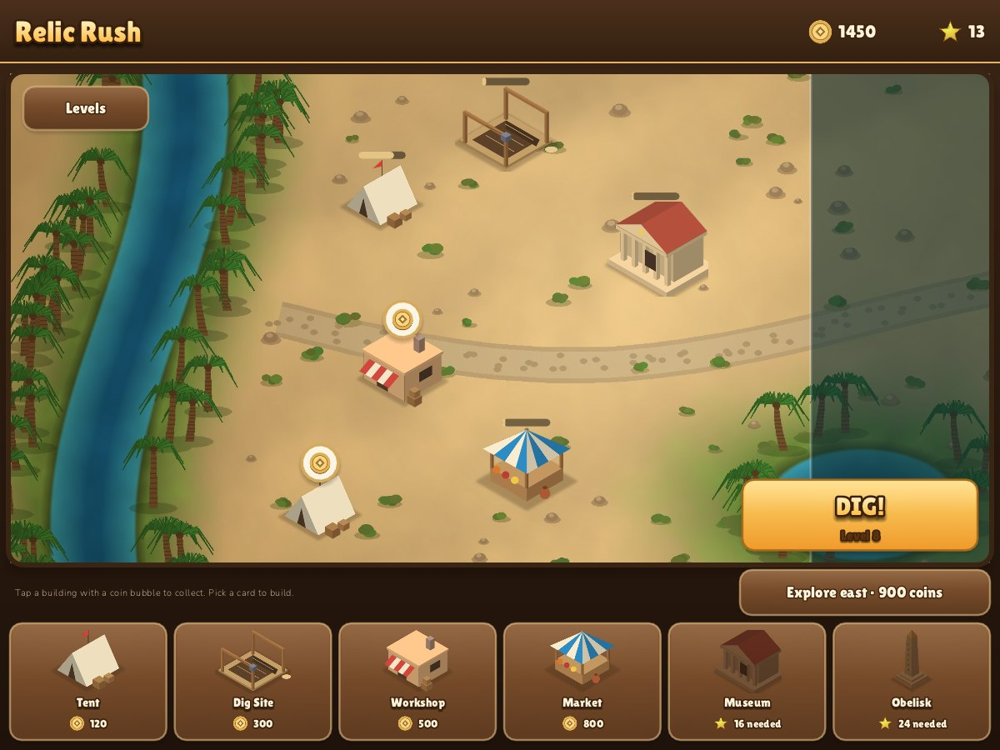
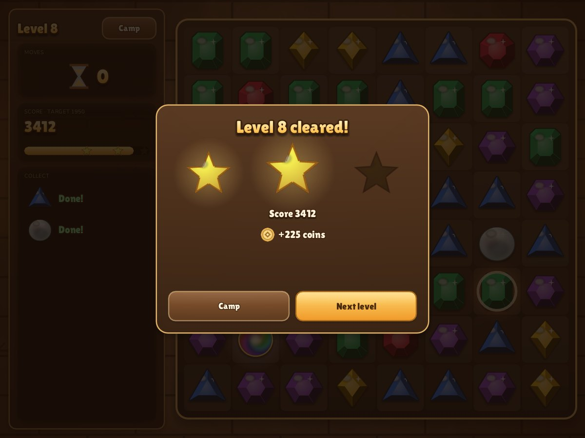
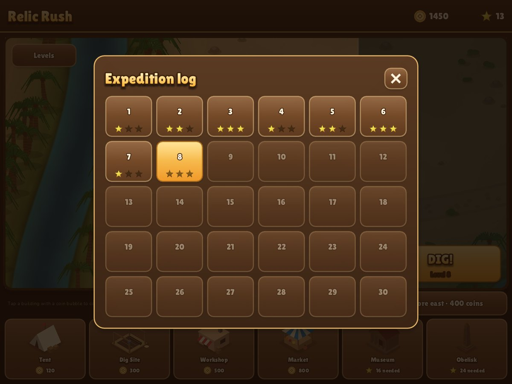
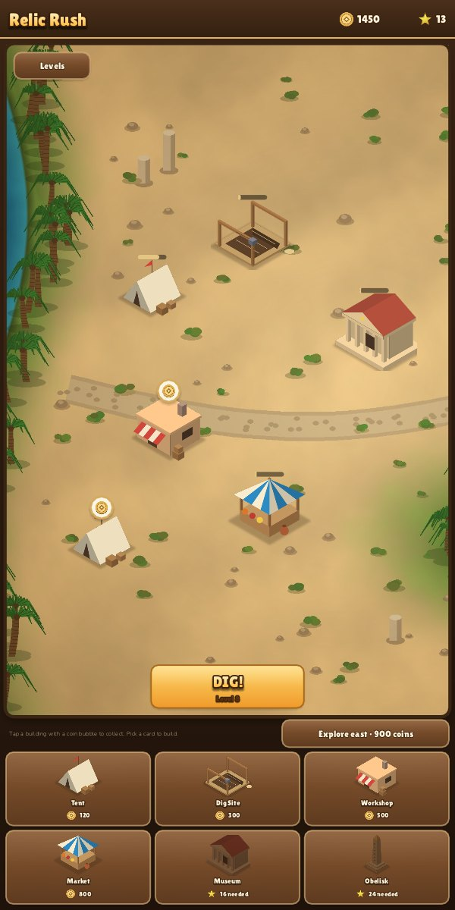
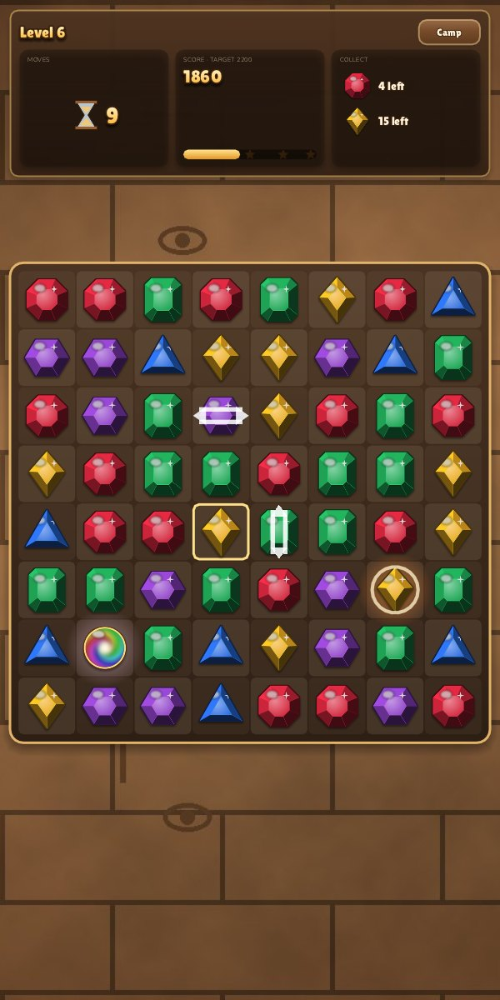
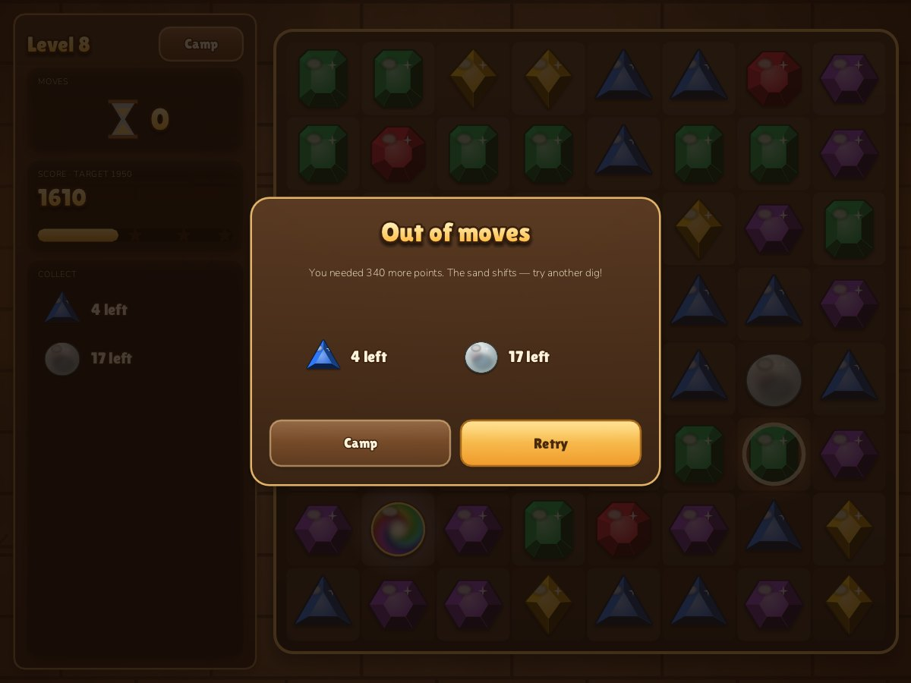

# Relic Rush

A match-3 game with a city-building meta-game. Dig through a lost city's
treasure chambers one level at a time, then spend what you earn building up
the expedition camp by the river.

Built on the shared engine in [`engine/`](../../engine), the same one that runs
[Nile Archive](../nile-archive). Plays in landscape and portrait, on desktop,
tablets, phones and the web.

| Camp | Dig |
| --- | --- |
|  |  |
| **Level cleared** | **Expedition log** |
|  |  |

| Portrait camp | Portrait dig | Out of moves |
| --- | --- | --- |
|  |  |  |

## The loop

**Dig (match-3) → coins and stars → build the camp → buildings earn coins and unlock with stars → harder digs.**

### Digs

- 8×8 board of six gem relics: ruby, emerald, sapphire, topaz, amethyst and
  moonstone. Each has its own silhouette as well as colour, so the board stays
  readable for colour-blind players.
- Swap two neighbours by dragging, or tap one and then the other. Swaps that
  do not match slide back and cost nothing.
- Each level has a move limit, a target score and, from level 2, gems to
  collect. Reach the target and the collection goals to win; every unused
  move is worth 100 bonus points.
- Stars: one for the target, two for 1.5× the target, three for 2×.
- Cascades multiply the score of each wave (×2, ×3, …) and get a cheer.
- No moves left? The board reshuffles. After five idle seconds the game hints
  at a valid swap.

### Specials

| Match | Creates | Effect when cleared |
| --- | --- | --- |
| 4 in a row | Row blaster | Clears its row |
| 4 in a column | Column blaster | Clears its column |
| L or T shape | Bomb | Clears the 3×3 around it |
| 5 in a line | Relic orb | Swap it with a gem to clear every gem of that kind |

Specials set each other off in chains. Swapping two specials fires both;
swapping an orb with a blaster or bomb turns every gem of that kind into one
and fires them all; two orbs clear the whole board.

### Levels

Thirty levels are generated from a formula in `level_get()`: levels 1–6 use
five gem kinds, later ones six (with lower targets, since six kinds cascade
less). Collection goals start at level 2 and a second goal appears on every
other level from level 6. Replaying a level pays half the coins and can raise its stars.
`--autoplay N` runs a simple bot through the real game loop; at the current
tuning it clears most of the first eight levels, often with a retry.

### Camp

The camp is the engine's `city`: drag to look around, pinch or scroll to zoom,
pick a card and tap open sand to build. Buildings with income show a progress
bar, then a coin bubble; tap to collect. Income accrues in real time, also
while the game is closed.

| Building | Cost | Needs | Income |
| --- | ---: | ---: | --- |
| Tent | 120 | — | 30 coins / 1 min |
| Dig Site | 300 | 3 ★ | 70 coins / 2.5 min |
| Workshop | 500 | 6 ★ | 90 coins / 3 min |
| Market | 800 | 10 ★ | 160 coins / 5 min |
| Museum | 1300 | 16 ★ | 300 coins / 10 min |
| Obelisk | 2000 | 24 ★ | decorative |

The map opens eastwards in four zones (the next costs 400, 900 and 1600 coins).
Stars are never spent: they count the best result of every level.

## Run

From the repository root:

```sh
make run-relic
make web && python3 -m http.server 8080 --directory dist   # http://localhost:8080/relic-rush/
```

Options: `--fresh` (ignore saves), `--screen camp|board|win|fail|levels`,
`--autoplay N`, `--size WxH`, `--shot out.png`.

## Code

| File | What |
| --- | --- |
| `relic.h` | Board types and the rules API (shared with `tests/`) |
| `board.c` | Pure match-3 rules: matching, specials, chain reactions, gravity, shuffles, move search |
| `main.c` | Levels, animation state machine, HUD, camp, dialogs, saves |
| `tools/make_art.py` | Draws every sprite, the camp map and the backdrop procedurally (Pillow + NumPy) |
| `data/` | Generated art, fonts (Lilita One, Nunito — OFL) |

The board logic never animates: `board_resolve` reports what was cleared,
created and fired; `board_collapse` reports how far each piece fell. The game
turns those reports into ghosts, beams, particles and falling offsets, so the
rules stay testable (`make test`) and the presentation stays free to change.

## Art

All art is generated by `tools/make_art.py` (shared helpers in
`tools/artkit.py`): faceted gems lit from the top-left with an outline and drop
shadow, isometric buildings from boxes, gables and pyramids, and a desert map
made from fractal noise with a river, an oasis, palms, ruins and a road. The
camp's buildable area in `main.c` (`camp_buildable`) uses the same river and
oasis constants as the map generator.
