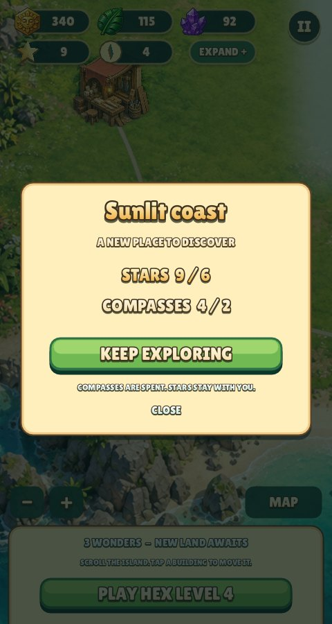
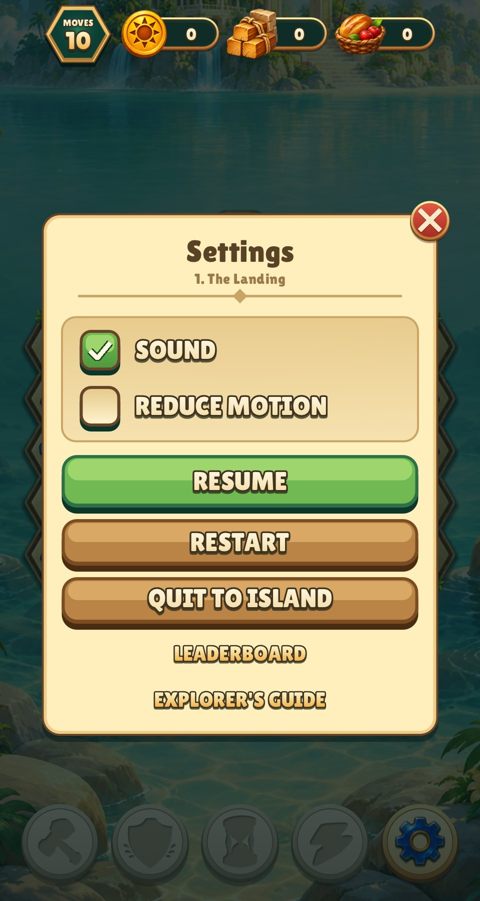
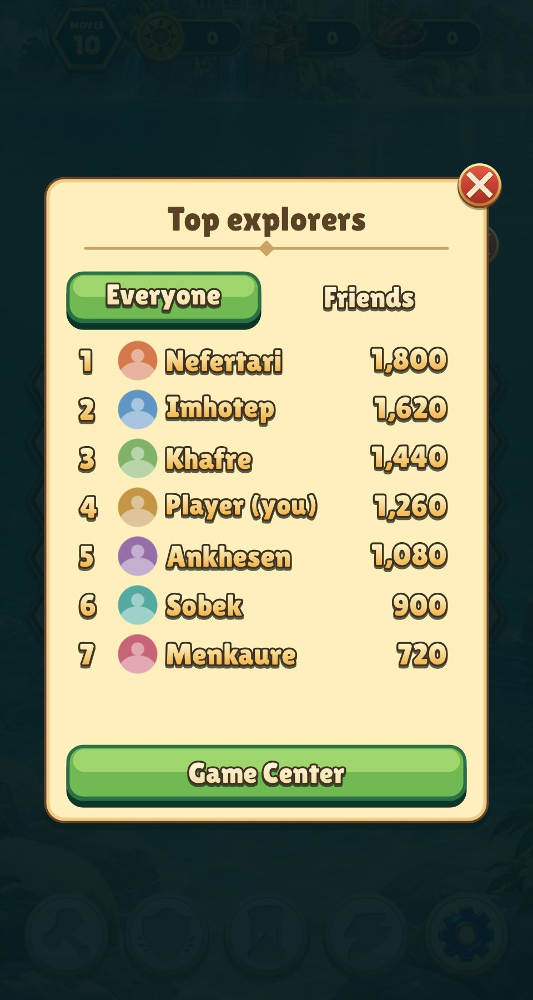
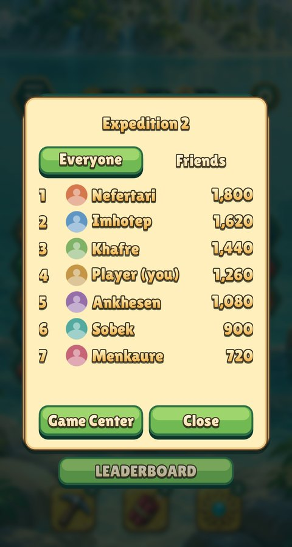
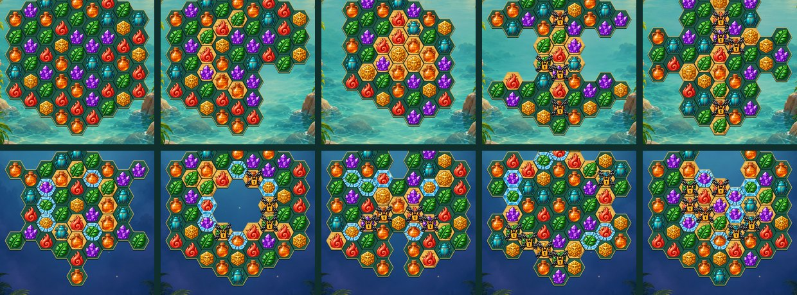
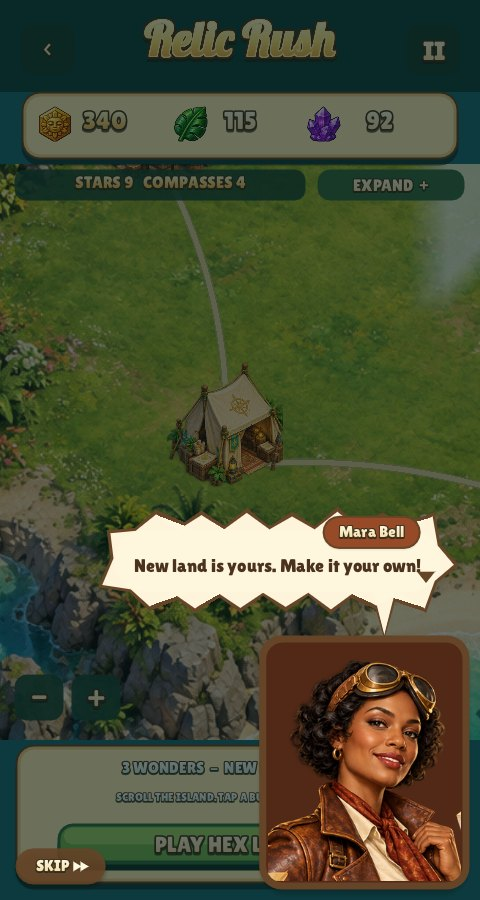
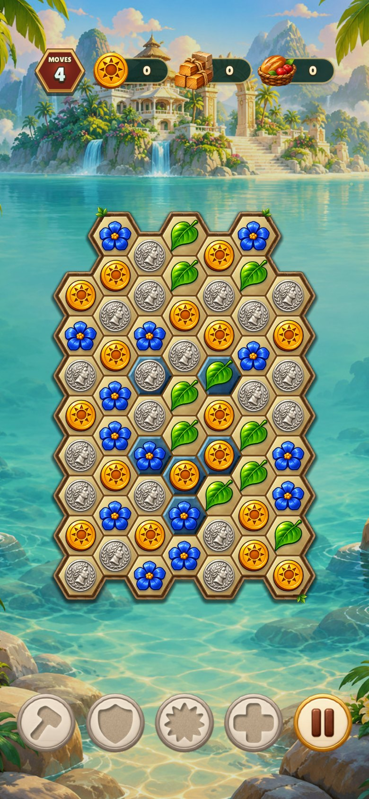

# Relic Rush · The Lost Valley

From the repository root, `make -C games/relic-rush ios` builds, signs, installs
and launches on the connected iPhone. Set `DEVICE="name or UDID"` to select one.
See the [device deployment guide](../../tools/xcode/README.md#deploy-to-a-connected-iphone-or-ipad).

A portrait mobile-first hex match-3 / island-restoration prototype, written in C11 on the repository's shared platform engine ([`engine/`](../../engine)), the same engine that runs [Nile Archive](../nile-archive). The island is the engine's `city`; text, shapes, input, camera, saves and sound come from the engine; this folder holds the rules, the content and the look. The WebAssembly preview runs the same C code; the browser page is only a fullscreen canvas.

Launch straight into level one. Swipe adjacent relics, or tap one and then its neighbor. Clear all blue plaques within the move budget, claim resources, restore the next building on the island, and set out again. Thirty hex stages across three episodes restore the ten existing wonders and end with the valley singing and five lights answering at sea. The island is a scrollable 1920 × 2880 world with six unlockable regions, freely placed buildings and persistent positions.

Building popup images and resource icons follow the panel’s entrance scale,
position and opacity through the shared form skin. See the
[popup and refill comparisons](docs/review/popup-refill/README.md).

Haptics accompany matches, cascades, trickling landings,
results, income collection, building pickup and release/drop. Moving a preview
requires dragging the building; tapping land does not move it. Confirm and Cancel
add no feedback. See the [shared haptics contract](../../docs/HAPTICS.md).

## Island navigation and resources

Buildings is the large workshop/hammer image at bottom left, Play the large right-pointing image at bottom right, and Expeditions the smaller compass beside Buildings. These bottom actions have no text captions. The larger top-right gear opens Settings. Resource icons protrude beyond their counter bars for readability. Expeditions and the building catalogue are continuous measured scrolling lists with bounded inertia; the building catalogue keeps its category selectors. Keyboard focus reveals its item and mouse wheels scroll the same viewport. The two lists share templates with Christmas Market and lay out only the rows in view.

The top wallet shows Coins, Supplies and Food on both screens. Matches
preview in the wallet during an expedition and bank after a successful clear.
The completion dialog shows the expedition score.
The Well costs Coins. The Workshop, Market, Archive and Temple use all three
resources. Discovery stars unlock shop stock and land. The five lives regenerate
one at a time every 30 minutes, including offline.

Tap a placed building for its name and subtitle above it. The label uses the quest panel's dark green and gold palette. Only one stays open. The next press dismisses it. A stationary hold picks up a building through the shared mover, with Confirm/Cancel preserving saved state.

See the [building label comparisons at both phone sizes](docs/screenshots/review/town-labels/README.md).

Scrolling uses the engine animation clock: a scalar `CAAnimation` drives the iOS timeline, as in CorePunch/orca, while other platforms use the platform monotonic clock.

## Shared match engine and atlas

Every expedition ends when all of its blue plaques are clear. Match on a blue
cell to reveal the pale stone below. A chain absorbs the first hit on its piece.
With three or fewer blue plaques left, sparks trace their edges after the same idle delay as the move suggestion.
Swipe or tap a gem toward a chain and it slides toward the chain and back,
with the same haptic as a rejected swap and zero moves spent.
See the [board progression](docs/board-progression.md) for the pattern and move budget of each expedition.
The [resource expedition design](docs/resource-expedition.md) covers how
resource matches and restoration costs fit into the campaign.
See the [shared element rules and design reference](../../docs/MATCH3_ELEMENTS.md)
and [current board review](docs/review/chains-only/README.md).

The [engine match-3 module](../../docs/MATCH3_ENGINE.md) owns all matching,
swaps, blockers, specials, trickling gravity, cascades, hints, tools and board
input/timing. This game provides campaign data, graphics and integer behavior
flags. Every exposed column top (no active cell directly above) spawns gems
vertically. Interior gems fall straight down whenever their cell below is
empty and movable, and slide diagonally only when that cell is occupied,
locked or missing. Locks still route gems around their sides.

`data/match3.png` holds the board's backgrounds, pieces, blockers, materials,
and effects. The HUD uses `data/match3-hud.png`, and the six campaign
bonus pieces and sockets use `data/bonus-gems.png`.
`python3 tools/match3_atlas.py` rebuilds both atlases from their source art.
`--default-match3` previews the engine's neutral skin.


## Screenshots

Captured from the engine build with `make shots` (headless, software renderer). Island images use demonstration progress to show the settlement and placement tools.

| Hexagonal expeditions | Restored island |
| --- | --- |
|  |  |
|  |  |
|  |  |
|  |  |

## Leaderboards

Game Center is in every game through the engine ([docs/GAMECENTER.md](../../docs/GAMECENTER.md)).
Relic Rush turns it on with the `leaderboard` block of `data/game.json`: one **stars** board holds
the lifetime Discovery Stars (they are never spent), and one board per expedition (`level_01`
to `level_30`) holds its best score. Scores are reported when a reward is claimed, so a
replay that beats the old score raises that board, and a weaker one changes nothing. Settings
has a LEADERBOARD link for the stars board. The results card has no leaderboard button; the
expedition boards still receive scores. The link opens the shared dialog with Everyone / Friends tabs, player portraits and the
player's own row marked; without Game Center it shows the player's own best.

| Settings | Stars board | Results card | Expedition board |
| --- | --- | --- | --- |
|  |  |  |  |


To publish them, create 31 leaderboards in App Store Connect (Game Center, high to low) with the
identifiers `com.corepunch.relicrush.stars` and `com.corepunch.relicrush.level_01` ...
`com.corepunch.relicrush.level_30`, ideally grouped in a leaderboard set. `--gamecenter-demo`
shows sample rivals for captures; `--dialog leaderboard` and `--victory --dialog level-leaderboard`
open the dialogs.

Board 1 uses five regular kinds, including the timber log that earns Supplies.
Boards 2–10 and 13 show a story piece in place of one matching colour.
Boards 2, 5, 8, 10 and 13 use four regular kinds plus the story piece. Boards
3, 4, 6, 7 and 9 use five regular kinds plus the story piece.
[Story pieces and board captures](docs/screenshots/review/story-collection/README.md)

A first clear of boards 1 to 10 or board 13 recovers a quest object. It shows big on its own **Item
recovered!** card, styled like the results card, before the story exchange about it and the
results (`--victory clue --dialog award` previews it).

## Shared UI and dialog layers

The island and the board share one wallet and Settings bar. The board shows
Moves at the left of the resource balances. The medallion turns red at five
moves. Blue plaques mark the board objective. Winning banks the resources
earned in the three slots.
Four large circular bonus sockets sit in one row below the centered board from the first
expedition. Settings opens the Explorer's Guide,
and Results shows the score and rewards. Dialogs reuse the engine's forms and
cached blur. See the [top bar review](docs/screenshots/review/top-bar-moves/README.md)
and [shared UI API](../../docs/UI_ENGINE.md).


## Result screens and typography

The result screen reveals Discovery Stars, score, rewards and what's next in sequence, with a short animated return to the island. The next step shows the building to restore, a sealed papyrus for the next clue, or the Build hammer after a replay. See the [results and wallet captures](docs/screenshots/review/discovery-stars/README.md).

Text is aligned by its visible ink bounds (the engine's `text_in`), shared by buttons and counters, and paragraphs wrap into balanced lines (`text_box`).


Dialogs arrive and leave on the engine's motion module ([docs/MOTION.md](../../docs/MOTION.md)): the card eases in and the parts of the result settle on one timeline, which the first tap skips.

See [UI architecture, Playrix/Candy Crush references and regression checks](docs/ui-results-and-type.md).

## Effects and motion

Coloured match fragments, resource trails and cascade chimes follow each clear. During refills, each gem gives a small bounce when it comes to rest in its slot. Reduce Motion suppresses the bounce. The result screen counts the score up. After any dialogue the board presents itself: the HUD lands, the cells ripple out from the centre, relics rain down their columns with squash and bounce, blockers slam on and a sheen runs across as the board goes live. A tap skips it; reduced motion makes it a short fade. See [the board entrance](../../docs/ENGINE.md#board-entrance).


See [effect reference study](docs/effects.md). The reel uses deterministic test boards; actual iPhone/Android performance still needs device testing.

## Current match-3 rules and board shapes

The widest nine-cell board spans 448 of the 480 logical screen units, using a 32-unit cell radius and 16-unit side margins. Gems and cell artwork scale together from their authored sizes: gems retain their transparent padding, and cell faces and state panels retain a small inset so neighbouring cells do not overlap. The entrance returns to a 1× pose when it finishes or is skipped. The board remains centred between the goals and tools on both phone sizes. See the [wide-board and cell-fit correction](docs/review/gem-cell-fit/README.md).

The pale limestone and blue plaques meet at hairline seams on one continuous
board surface. [Before and after at both phone sizes](../../docs/review/match3-board-seams/README.md).

The minimum match is **three identical relics in a straight line** along any of the three hex axes. Bends and diamonds do not count. Ready lines resolve automatically before further input and after each fall. There are thirty different board silhouettes, with real holes and diagonal refill routes. The gold idol now has a six-sided silhouette.

After five idle seconds, a legal swap is highlighted. If there is no legal swap, the board reshuffles for free and displays “No moves. Board reshuffled.” This recovery also runs after cascades; the free shuffle rearranges the movable pieces around chains and keeps the blue plaques in place. See the [dead-board regression and captures](docs/review/dead-board/README.md).

Matched bonus gems fly into their sockets and fill them with gold from the bottom.
With Reduce Motion on, the gold fills immediately.
Empty buttons show their tool carved into sandstone.
See the [bonus artwork and state review](docs/asset-catalogue.md#campaign-bonus-pieces-and-sockets).



See [rules, shape list, implementation notes and reference sources](docs/match4-rules.md).

## New art direction

The match-3 scenes now use two original runtime backgrounds: **Sunlit Lagoon** for levels 1–5 and **Moonlit Sun Temple** for levels 6–10; each later episode reuses those paintings, opening on the lagoon and moving into the temple. The study draws on Tropicats and Candy Crush for playable-screen readability, and June's Journey / Pearl's Peril for garden islands and adult adventure characters.

See the [reference study, original cast and asset gallery](docs/art-direction-v2.md) and [complete generation prompts](docs/art-direction-v2-prompts.json).


Elena Voss leads the archaeological expedition. Mara Bell pilots the Marigold, Tomas Reed keeps the harbor, and Adrian Vale finances the trip. Their busts (cut by `tools/prepare_assets.py` from that lineup) appear in the game's dialogue.

## Story and world

Mara radios from the Marigold when she spots a light under the cliff. The
present-day crew is restoring an ancient harbor whose keepers ran an electric
relay along the original stone channel. The opening chapter, **A Light Below**,
uses boards 1–10 and four island upgrades to lead to the tide room. The player chooses
whether Mara or Tomas answers the signal. Their replies differ, and both advance the expedition.

In **The Keeper’s Return** (levels 11–20), the crew returns the Courtyard,
Lodge and Archive to use. Ines’s note identifies the signaler, and her signed
plan gives the crew a way to repair the quay wall.

The island shows the active chapter, quest, next task and Happiness. Each confirmed
wonder adds four Happiness and each optional building or decoration adds one.
Optional placements also add one Coins to every won expedition, up to ten Coins.
The shop previews the Happiness gain and the results show the Coins bonus.
Required restorations cover quest thresholds. Moving a building preserves its Happiness.

First-clear dialogue leads into Results. Board 30 reveals the signal plate at the cleared site, then shows Ines answering from the safe landing with the three flashes first seen on board 3. The tide-room choice follows Claim, and each
wonder has a separate scene after confirmed placement. Replays bank matched resources.
Existing saves retain clears, currency, land and buildings and receive a recap at their
current level. Chapter 3 carries the quay repair and ownership dispute to the finale.

`lua/story_content.lua` is compiled directly from the script by `python3 games/relic-rush/tools/prepare_story.py`; `--check` catches drift and runs with the other asset checks in `make test-assets` and `make test`. `lua/journey.lua` holds the restoration schedule, recap and changing tap lines as data (the engine keeps the keyed checkpoints); `lua/narrative.lua` holds the cast; the engine (`engine/match3_game.lua`) delivers the scenes. Preview any scene with `--story-beat before-11` or `--story-beat after-30 --story-line 9`. The current presentation uses the live island/scene paintings and character busts; the script's illustrated-panel directions remain optional art direction, not required runtime assets.

| Elena | Mara | Tomas | Adrian | Word bubble |
| --- | --- | --- | --- | --- |
|  |  |  |  |  |

On a 390 × 844 iPhone (safe-area insets 47 top, 34 bottom) the island and the jungle run to the screen edges while the controls stay inside the safe area. The screen grows taller there (480 × 939) rather than showing bars: the top HUD stays at the top, the tools and the island's bottom buttons move down to the bottom edge, and the board and dialogs stay centred:

| Island | Board |
| --- | --- |
|  |  |

## Expedition and restoration loop

1. Start directly in the first match-3 level; there is no title-screen or friend-road detour.
2. Clear all blue plaques within the move budget.
3. Claim the matched resources, up to 40 Coins for saved moves, and three discovery stars on a first clear.
4. Return to the island. At a wonder milestone, check the price and replay an expedition if you need more resources.
5. Confirm construction, pan across the growing settlement and open neighboring land when eligible.
6. Read the discovery, then set out again. Thirty stages support ten restored buildings; level 30 delivers the final hook.

A matched sun coin earns 4 Coins. Red berries and green apples pay 1 Food.
Leaves and flowers add score only.
Timber and dressed stone pay 2 and 3 Supplies. Each confirmed
restoration unlocks a higher-yield chip or a tool on eligible expeditions.
Authored story pieces keep their slots. The result shows what the next
restoration unlocks or what is still needed to afford it. Replays earn
matched resources and up to 40 Coins for unused moves.

The Well adds water buckets on level 5. The Workshop adds cut blocks on level 8,
alongside the relay pliers. An arrival message names the building and the piece's
value. The first hint on level 5 earns 9 Food while clearing plaques. Level 9
offers a similar cut-block match for 15 Supplies toward the Market.

### Tutorials and citizens (`lua/user_events.lua`)

[`lua/user_events.lua`](lua/user_events.lua) ports Cradle of Rome's
`settings/user_events.xml`. It uses the same event ids, `If` conditions,
`Then` effects and `available` chaining.
[`lua/user_events_runtime.lua`](lua/user_events_runtime.lua) lists every
condition and effect it supports. Each event fires once per profile, and the
save keeps which events are done.

- **Tutorials.** The move hint repeats with the board's 1st, 2nd, 3rd and
  5th suggestion until the first line of three. Toasts introduce plaques,
  double plaques, chains, double chains, ice, the low-moves warning, each
  charged bonus and the catalogue.
- **Citizens.** Placing one of eleven buildings opens its citizen's
  challenge. Examples: a line of five after the Workshop, 120 Supplies on
  one expedition after the Archive. Meeting the challenge upgrades the
  building and adds a lasting reward. The reward is either income on every
  claim, itemized as "Citizens" on the results card, or a faster charge for
  a bonus gem.
- **Test flag.** `--user-events-test` fires the `test=true` events at once,
  like Rome's F5 cheat.

The citizen amounts are a first pass. The building upgrade is recorded but
has no art yet.

## Campaign: thirty hex levels

Every stage uses its own connected active-cell mask within a radius-four hex grid. Chain placements shape seams and approaches, and [board progression](docs/board-progression.md) records the decisions and exact starting terrain. Each row gives the starting number of blue plaques, including plaques under chains.

| # | Expedition | Moves | Blue plaques | Chains |
| --- | --- | ---: | ---: | ---: |
| 1 | First Light | 24 | 7 | 0 |
| 2 | The Lamp Lens | 29 | 9 | 0 |
| 3 | The Relay Cable | 32 | 10 | 0 |
| 4 | Under the Pump | 35 | 11 | 4 |
| 5 | The Quay Marker | 35 | 10 | 4 |
| 6 | The Shore Marker | 37 | 11 | 0 |
| 7 | The Tool Roll | 40 | 12 | 3 |
| 8 | The Relay Pliers | 40 | 12 | 4 |
| 9 | The Supply Crate | 43 | 12 | 5 |
| 10 | The Shutter Gear | 46 | 12 | 6 |
| 11 | The Long Terrace | 33 | 12 | 0 |
| 12 | Twelve Crates | 36 | 12 | 5 |
| 13 | Names in the Stone | 37 | 10 | 6 |
| 14 | Static | 38 | 13 | 7 |
| 15 | The Cracked Wall | 39 | 12 | 4 |
| 16 | Supper for Twelve | 40 | 13 | 4 |
| 17 | The Torn Log | 42 | 13 | 5 |
| 18 | Lantern Steps | 40 | 14 | 2 |
| 19 | Under the Vines | 45 | 12 | 4 |
| 20 | The Archivist's Key | 46 | 9 | 5 |
| 21 | Tomas's Trail | 35 | 12 | 0 |
| 22 | The Alternate Landing | 40 | 13 | 2 |
| 23 | The Star Road | 40 | 12 | 3 |
| 24 | Noon Shadow | 41 | 12 | 4 |
| 25 | Smoke on the Water | 38 | 14 | 6 |
| 26 | The Jade Deep | 43 | 10 | 4 |
| 27 | Six Sun Gates | 45 | 12 | 7 |
| 28 | The Last Terrace | 42 | 13 | 2 |
| 29 | The Silent Temple | 47 | 16 | 8 |
| 30 | The Warning Returns | 49 | 16 | 8 |

## Buildings

Buildings unlock in this order at clear milestones 1, 4, 7, 9, 13, 16, 19, 23, 26 and 29. Positions are chosen by the player; the order does not impose fixed plots or a road layout.

| # | Restoration | Price | Board payoff |
| --- | --- | --- | --- |
| 1 | ★ Expedition camp | 20 Supplies + 10 Food | Hammer gems from board 2. |
| 2 | ★ Spring well | 130 Coins | Water buckets worth 3 Food each. |
| 3 | Trapper's cabin | 80 Coins + 75 Supplies + 55 Food | Dynamite upgrades Hammer. |
| 4 | ★ Artisan workshop | 145 Coins + 150 Supplies + 105 Food | Cut blocks worth 5 Supplies each. |
| 5 | Water mill | 75 Coins + 75 Supplies + 50 Food | Opens the Jungle market restoration. |
| 6 | ★ Jungle market | 145 Coins + 150 Supplies + 95 Food | Ration jars worth 4 Food each. |
| 7 | Clock tower | 180 Coins + 200 Supplies + 140 Food | Star gems. |
| 8 | Stone amphitheatre | 60 Coins + 80 Supplies + 80 Food | Shield gems. |
| 9 | ★ Sunstone courtyard | 90 Coins + 160 Supplies + 150 Food | Helmets worth 6 Coins. |
| 10 | ★ Explorer's lodge | 300 Coins + 340 Food | Grain bundles worth 5 Food each. |
| 11 | Trading post | 250 Coins + 360 Supplies + 290 Food | Rings worth 7 Coins. |
| 12 | Valley lighthouse | 100 Coins + 120 Supplies + 110 Food | Lightning upgrades Shield. |
| 13 | ★ Lost-world archive | 195 Coins + 240 Supplies + 230 Food | Carved quartz worth 7 Supplies each. |
| 14 | Beached schooner | 190 Coins + 190 Supplies + 190 Food | Scarabs worth 8 Coins. |
| 15 | Cartographer's house | 285 Coins + 270 Supplies + 250 Food | Plus gems give a quarter charge to other unlocked bonuses. |
| 16 | ★ Star observatory | 205 Coins + 200 Supplies | Star II upgrades Star. |
| 17 | Great aviary | 200 Coins + 180 Supplies + 240 Food | Sandals worth 9 Coins. |
| 18 | ★ Jade fountain | 280 Coins + 300 Supplies | Shrimp worth 6 Food each. |
| 19 | Relic museum | 220 Coins + 220 Supplies + 420 Food | Harps worth 10 Coins. |
| 20 | ★ Temple of the sun | 330 Coins + 330 Supplies + 430 Food | Emeralds worth 11 Coins each. |

The twenty restorations follow this order. ★ marks the ten story restorations,
which hold the next new expedition. The others open after their clear and
must be placed before the next ★ one. Resource and bonus unlocks follow the
table above.

Construction makes the next story beat available. The [economy table](docs/resource-expedition.md#board-rules-and-palette)
lists the first expedition and currency for each payoff.

The island's **SHOP** adds 76 repeatable buildings and decorations to these
twenty restorations: buildings, trees, shrubs, flowers, monuments, water gardens,
furniture, supplies, wildlife and rocks. Browse categories and pages, check the
resource price and cumulative star requirement, then choose a location and
confirm. Cancelling is free. Stars remain in the wallet and the resources
needed for an earned restoration are reserved until placement. Purchases save
and move like wonders, with a 160-object island limit. See the complete
[building catalogue](docs/building-catalogue.md) and
[in-game review](docs/review/building-catalogue/README.md).


## Island regions

The 1920 × 2880 world scrolls beyond the phone screen. Hidden six-neighbor land tiles define connected regions, while placement itself uses continuous world coordinates. The puzzle grid and island territory graph are separate systems.

| Region | Required discovery stars |
| --- | ---: |
| Harbor glade | 0 |
| Sunlit coast | 6 |
| Fern meadow | 9 |
| Sun garden | 15 |
| Ancient heights | 21 |
| Temple ridge | 27 |

A region must touch opened land and meet its discovery-star gate. Expansion does not spend stars or require compasses. Regions do not open on a timer, and players do not need to build roads.

## Play

- Swap adjacent pieces to make a straight line of three or more identical pieces along any hex axis. Longer lines and crossings clear more pieces but make no special pieces: as in Cradle of Rome, power is earned by charging the bonus tools with matched resources.
- Match or land a tool hit on a chained piece to break the chain. A later hit clears a blue plaque on that cell.
- Cascades increase score multipliers. Gathered resources animate toward their wallet slots. The result screen shows the unused-move Coins bonus and any remaining cost of the next restoration.
- Restore buildings to unlock Hammer, Shield, Star and Plus. A later restoration
  upgrades each of the four slots and carries its charge forward. An expedition
  can feature one bonus gem family. Matching six fills one use, and activation
  costs zero moves. [Bonus effects and restorations](docs/board-progression.md#bonus-pieces)
- Idle hints, automatic dead-board recovery, restart on failure, pause with Restart (confirmed), Quit to Island, and Sound and Reduce motion checkboxes.
- Each won attempt banks what the crew brings back. First clears add discovery stars and advance the story.
- Large scrollable island, six connected land regions defined by a hidden hex tile graph. Drag the map to pan, even when the gesture starts on a building; pinch to zoom (or use the mouse wheel on desktop).
- Adjacent clouded regions require cumulative discovery stars, which stay with the expedition. Compasses are retired.
- The settings gear sits beside the three resource balances. Buildings, Play and Expeditions occupy the town's bottom row. Both catalogues scroll continuously. The building shop shows three cards per row.
- Choose any valid grassy position within opened land. Hold a placed building still for half a second to pick it up, then drag and confirm or cancel. The building shows no label; it turns semitransparent red where it can't go. Completed buildings can be moved without spending resources. Preview and cancellation never change the saved layout.
- Footprint collision and shoreline checks prevent overlap and water placement. Automatic connector roads are disabled.
- Progress saves after rewards, construction and region unlocks (a `key=value` file in the per-game preferences folder, or `localStorage["relic-rush/progress"]` in the browser). An unfinished board restarts if the application is closed.

## Selected tile art

The [artwork and state catalogue](docs/asset-catalogue.md) inventories every gem
pack, chain, tool and animation state, with source and runtime paths.
`--art-states` shows the collection and `--art-board` previews the shared
engine’s special pieces for development. Catalogue coverage runs in `make test`.

The campaign uses one [painted atlas](docs/asset-catalogue.md#campaign-piece-atlas)
for resources, upgrades and story pieces. The **Jewels** and **Resources**
art previews remain available through `--tiles jewels` and `--tiles resources`.
See the [tile-set comparison and construction research](docs/tile-sets.md).
The [Cradle of Rome gem sheet](../../docs/cradle-of-rome-reference/gem-correspondence.html)
shows both games’ pieces and payouts side by side.

Use `--rome-reference-art /absolute/path/to/game_graphics` to compare the
extracted Cradle of Rome 2 chips in a local run. Point it at the directory with
`gmbn_5.png`. The shipped resource art remains in the game data.


## Run and build

From the repository root (system platform development files needed for native builds, the Emscripten SDK for the web):

```sh
make run-relic                                  # native desktop
make test                                       # rules, island and engine tests
make web && python3 -m http.server 8080 --directory dist   # http://localhost:8080/relic-rush/
```

The game is laid out for a 480 × 900 portrait screen inside the device's safe area. It is `fixed` with `max_aspect = 2.2`, so on taller phones the screen keeps its width and grows taller (`R.layout()` moves the bottom group down by the extra height, `R.drop`). Its jungle backdrop, the island and the HUD bands run on under the status bar and the home indicator to the screen edges (`app.bleed()` / `gfx.bleed`). Runtime art in `data/` is committed; `python3 games/relic-rush/tools/prepare_assets.py` rebuilds it from the sources in `art/` (needs Pillow).

Debug and capture options (no progress is written): `--level N`, `--city N` (an island after N expeditions; `--open MASK` limits it to those regions, bit per region), `--look X,Y` (centre the island camera on a world point), `--showcase`, `--overview`, `--catalogue [category]`, `--catalogue-page N`, `--catalogue-item ID`, `--catalogue-card ID`, `--building-review N` (four catalogue objects per footprint review page), `--footprints` (every building's footprint and pivot over its sprite), `--placing [blocked|dragging]` (`blocked`: the red ghost over a built wonder; `dragging`: the ghost held up between tiles over the footprint of the tile it will land on), `--zone N`, `--card N`, `--victory`, `--dialog guide|pause|failed|finale|intro|mara|tomas|adrian|bubble|leaderboard|level-leaderboard|award` (`award` with `--victory clue`), `--tiles relics|jewels|resources`, `--art-states`, `--art-board`, `--fx shatter`, `--smoke` (plays level one through injected clicks, claims, builds, checks pan/long-press move/cancel/confirm and enters level two), plus the engine's `--shot file.png --frames N`, `--size WxH`, `--fresh` and `--mute`.

## Controls and saved progress

- **Board:** swipe to one of six neighbors, or tap two adjacent relics. Tap a charged socket and then its target. Plus activates as soon as you tap its socket. The top-right medallion pauses: level details, a Sound and Reduce motion group, Resume, Restart (asks first), Quit to island (keeps the board) and the guide; Escape does the same. Tap outside a closable popup to dismiss it; results require an explicit action.
- **Island:** drag the map to pan, including from buildings; pinch or use the mouse wheel to zoom. Tap a building for its card, or hold it still for half a second to pick it up and move it. Tap clouded land to see what opening it needs.
- **Placement:** choose a grassy spot, check the green/red footprint, then confirm or cancel. Leave a tile of open ground between building bases. Footprints cannot cross the shoreline or occupy closed land. Moving a completed building is free.
- **Save:** level progress, resources, opened regions and building positions persist; an unfinished puzzle restarts. Saves of the standalone prototype (`progress.txt`, `localStorage["relic-rush-v1"]`) are not imported.

## Verification

- `make test` runs the original rule regressions, ported: grid invariants, straight lines and rejection of bent, diamond and ring groups, holes and diagonal trickling, chains, tool targeting, playable opening boards, reward claims and construction. The extended campaign test runs with `make test-extended`. The greedy bot must win every one of the thirty levels at least once in its four seeds, without tools.
- `--smoke` opens and closes the data-backed guide, then drives the real game loop with injected mouse clicks through swaps, cascades, the win dialog, the claim, construction, pan/long-press pickup/cancel/confirm and the start of level two.
- `--smoke --campaign` plays all thirty expeditions through the real result, Claim, region, placement, dialogue and Play controls. Each board's goals are met before one real swap. All 47 story beats must play once, in script order, and be acknowledged, and the run must end on the finale with ten wonders and every region open. A stuck story or restoration gate fails it with the level and the beats played so far. It runs in `make test-full` (CI), or alone with `build/test/relic-rush "smoke campaign"`.
- Every screenshot above is rendered by the same code; they were compared side by side with captures of the standalone prototype.
- iPhone/iPad and Android device builds, touch feel, safe areas and performance still need device QA.

## Art and text pipeline

Nine matching landmarks have independently registered ground shadows below the
current painted sprites. The courtyard and all 86 repeatable catalogue entries
are preserved. See [building registration](docs/BUILDINGS.md) and the
[reviewed captures](docs/review/painted-buildings/README.md).

Original generated environment paintings, the legacy 10-building sprite sheet and the 6 × 3 tile sheet (`art/tile-sets/source.png`: the Relics, Jewels and Resources packs) are kept as editable sources in `art/`. The 96 current building sprites use the Blender-guided ImageGen atlas and `tools/prepare_buildings.py` (see the building catalogue). `tools/prepare_assets.py` cuts the other sprites out of their sheets (largest opaque component, so neighbouring paintings never leak in), scales backgrounds to what the screen needs and writes PNG/JPG files the engine loads directly. `docs/references.md` records reference research and provenance. Generated art is a prototype asset set and needs an art consistency / IP review before a commercial release.

Fonts: **Lilita One** for the game UI, rendered at runtime by the engine (TrueType with outline, gradient and drop shadow, any Unicode — Cyrillic localisation no longer needs a new atlas); **Lobster** made the gold `title.png` logo and stays in `art/fonts`. Both are unmodified SIL OFL 1.1 fonts with their license text.

## Source layout

Relic Rush and Christmas Market are one game with two skins
([docs/PORTRAIT_GAMES.md](../../docs/PORTRAIT_GAMES.md)). The flow around the
board, every dialog, the shop, the level list, the town hooks, story delivery,
effects and the debug entry points are the engine's (`engine/match3_game.lua`,
`engine/match3_vfx.lua`, `engine/match3_debug.lua`); this folder is data and art.

- `data/game.json`: every word of the shared screens (notices, Pause, Restart, failed, region, finale, building card, shop, level list), the piece packs and the dialogue scale.
- `data/town.json`: the town screen's layout and notices.
- `lua/state.lua`: the shared state table (`R`) from the engine.
- `lua/art.lua`: named authored states, control-state selection and the in-game catalogue.
- `lua/rules.lua`: piece identities, the economy slots and rewards over the engine's match-3 rules.
- `lua/campaign.lua`, `lua/story_content.lua`, `lua/buildings.lua`, `lua/building_sprites.lua`: levels, the script and the building catalogue.
- `lua/journey.lua`: the restoration schedule, recap and changing tap lines.
- `lua/narrative.lua`: the cast.
- `lua/island.lua`: shoreline, the hidden hex region map, region adjacency and the ten wonders as engine building definitions.
- `lua/board.lua`: how cells, resource pieces and chains are painted.
- `lua/screens.lua`: the results card, the guide's rows and icons, and the wallet, star and compass icons.
- `lua/skin.lua`: the look as data (`ui.skin`).
- `lua/main.lua`: loads the modules and returns the engine's app descriptor.
- `lua/smoke.lua`: the `--smoke` run through injected input, including the engine's `city.move_test`.
- `art/`, `data/`, `docs/`, `tools/`: sources, runtime assets, documentation and the asset pipeline.

## Design references and original assets

- **Cradle of Rome:** excavating puzzle terrain and spending collected resources on visible restoration.
- **Candy Crush:** an earlier reference for animated reward feedback.
- **June's Journey / Pearl's Peril (Wooga):** a large island, player-selected building locations and land expansion, replacing a linear friend-road progression map.
- **Supercell games:** readable building silhouettes, polished resource feedback and a cheerful settlement presentation.
- **Settlers II / Return to the Roots:** a reference for territory represented by small connected land cells. No road-management system or GPL implementation was copied into the game.
- **Canva-style text effects:** inspiration for layered, image-like lettering with gradient fill, a unified outline and shadow.

See [reference research and source links](docs/references.md) and [art prompts and screenshot provenance](docs/art-prompts.md). The island and buildings are original generated prototype artwork; no ripped commercial game assets are bundled. Font licenses are included alongside the font files. Bundled font licenses apply to the fonts. The repository’s existing top-level `LICENSE` is preserved.

## Roadmap and prototype boundaries

Ideas discussed for later development:

- More decorations, alternative buildings, upgrade choices and a richer restoration economy.
- An expedition journal, characters, narrative events and story scenes built around the Lost Valley premise.
- Visiting friends' settlements; optional asynchronous raids were discussed as an exploratory idea, not an implemented or committed feature.
- Backend accounts, cloud saves and social progression if those features are pursued.
- Human playtesting, campaign balancing, sound design, haptics and more responsive device-specific polish.
- Localization; app icons, safe-area validation, mobile performance checks and signed iOS/Android releases. The standalone prototype's Android/iOS host projects were not carried into this repository; mobile packaging is to be set up once for the shared engine.

Current scope is an offline prototype: thirty hex levels, twenty campaign restorations plus 76 purchasable buildings/decorations, six regions, local saves and a complete puzzle → reward → placement → next-level loop. There are no multiplayer services, advertisements, in-app purchases, production timers, implemented raids or native store releases.

## Fast rule tests

Run `make test-relic-rush` from the repository root for this game's tests in one command. The Lua suites use deterministic state injections and need no window or artwork. See [the testing guide](../../docs/TESTING.md) for coverage, test-only `ENGINE_TEST` hooks, extended samples and renderer smoke checks.

Board artwork fills its registered hex slots. Dialogue portraits slide/fade in and out, and only brighten/dim on speaker changes; no resizing, rotation or idle wobble; the engine owns those transitions. See [motion review](../../docs/review/motion/README.md).

Level entrances provide grouped haptic ticks as gems land and a stronger pulse for
blockers. The touch opening a level cannot skip its entrance; a new tap during
the entrance can. Reduced motion and skipped entrances omit these landing effects.
Building previews show a round × on the lower left and ✓ on the lower right of
the building. Dragging, panning and zooming keep these controls with the preview;
✓ is disabled on blocked land. Cancel preserves the original building and wallet.
Popups (Pause, results, guide, cards) and their backdrops appear and close
immediately, with no entrance or exit motion; only `--reel` captures still play
the results parts.

Ray gems retain their matching artwork with broad engine-rendered cream stripes
masked to the gem's alpha. Stripe direction identifies the cleared board axis.
Bombs are full-size bombs replacing the gem; prisms remain whole crystals.
Frozen pieces retain a centred **1**/**2** counter above the board layers. Selection uses
a soft mint glow; hints use gold light and sparkles. See the updated Explorer’s
guide and [visual review](../../docs/review/striped-specials/README.md).

While moving or placing a building, cream outlines around other buildings show
their occupied ground and clearance for quick alignment. The mover's old spot is
free; guides remain until Confirm/Cancel. See the
[shared placement-guide review](../../docs/review/city-placement-guides/README.md).

## Town screen

The island is the engine's [shared town screen](../../docs/TOWN.md), laid out by
`data/town.json`. Tapping a building shows its name in a word bubble; holding
it for half a second lifts it to move.

The town bottom row has a large central Play button and equal smaller Build
and Levels buttons, with simplified authored icons and five interaction states.

For a local story walkthrough, launch `./build/relic-rush --debug-walkthrough`.
Tap **Skip level** at the top right of the board, read any scene, then claim the usual reward.
On the island, **Complete task** places an earned story building or starts the next board.
The walkthrough has its own save. Add `--fresh` to start at the opening without saving.

### Homescapes board mechanics

The shared hex board uses original Homescapes pieces and blockers. Homescapes power-ups (rockets, bombs, planes and rainbow balls) are not part of the engine: matches only clear, and imported power-up cells and generator tokens become ordinary pieces. See [the complete mechanic and atlas reference](../../docs/HOMESCAPES_HEX.md) for generators, blockers, source previews, verification and known art gaps.

The field uses the expedition's teal hex palette.

Original blocker artwork now covers nuts, statues, cookie stacks and ceramic tiles, with original components for platters, blinds and visible queues. [Source/state inventory](../../docs/HOMESCAPES_ART.md) records all six original jelly layers, both portal rings, the recovered maker dome and the remaining field artwork.

Imported Homescapes fields fit their active-cell bounds to the phone area between HUD and tools. Source-packed inverted objects are corrected during extraction; see the [before/after review](../../docs/review/homescapes-restored-art/README.md). The donut exit uses the original animated arrow, and the maker uses the original base and glass layer offsets. [Portrait captures](../../docs/review/homescapes-arrow-maker/README.md)
