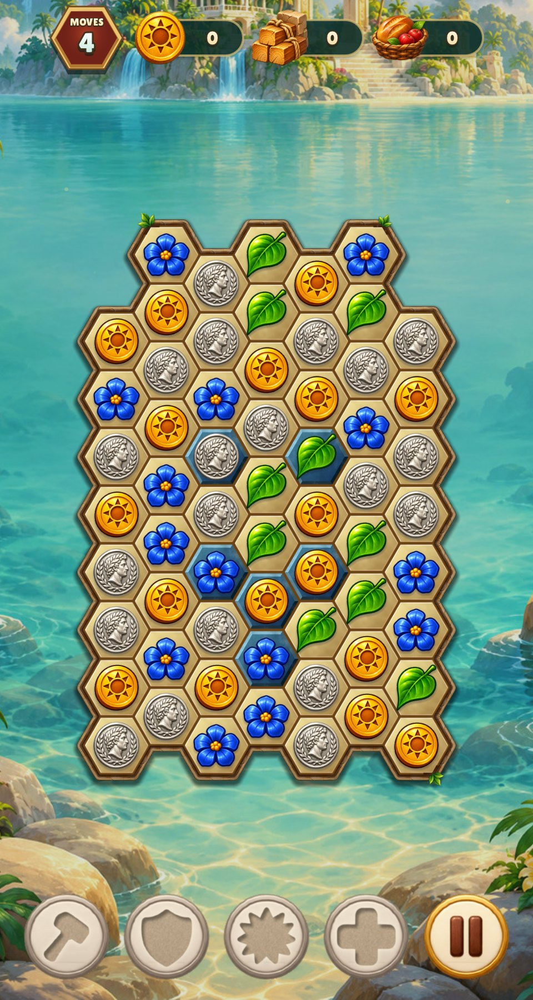
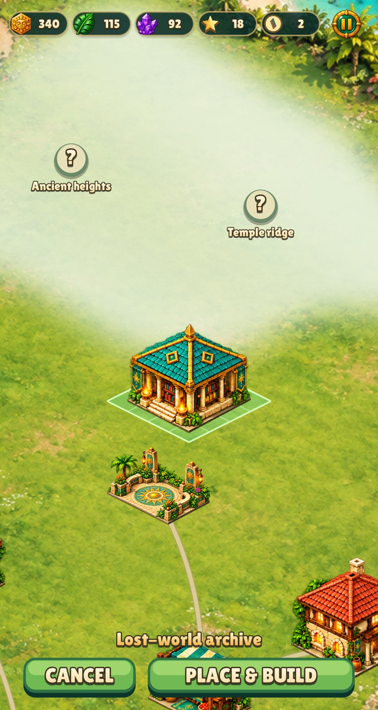
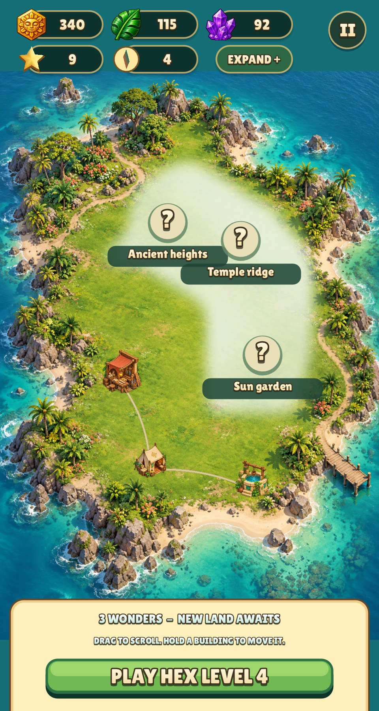
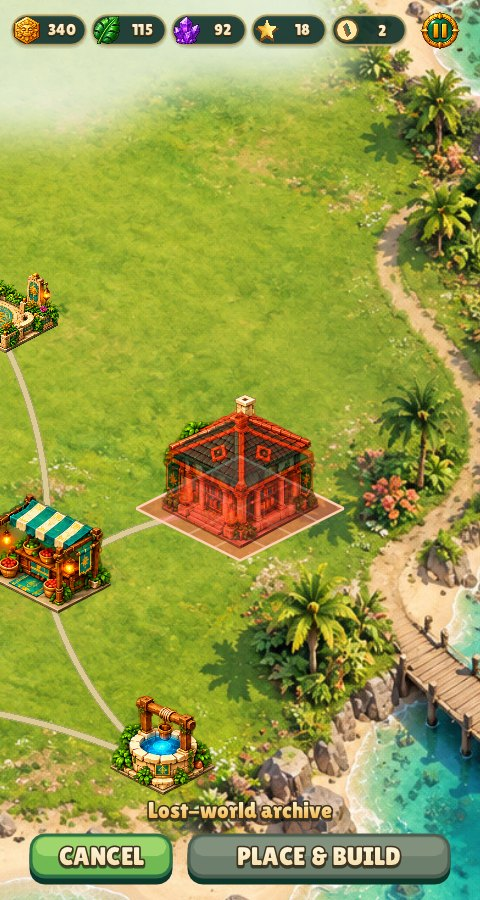
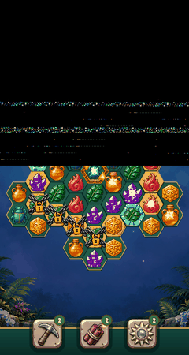
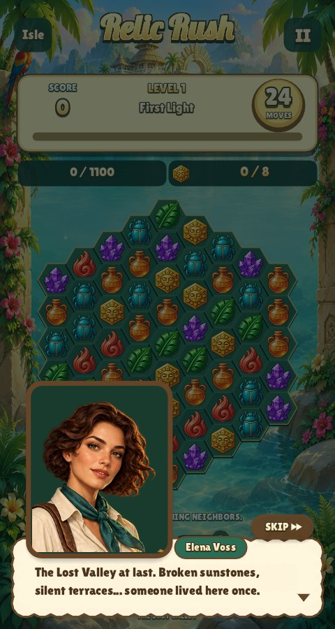

# Relic Rush · The Lost Valley

From the repository root, `make -C games/relic-rush ios` builds, signs, installs
and launches on the connected iPhone. Set `DEVICE="name or UDID"` to select one.
See the [device deployment guide](../../tools/xcode/README.md#deploy-to-a-connected-iphone-or-ipad).

A portrait mobile-first hex match-3 / island-restoration prototype, written in C11 on the repository's shared platform engine ([`engine/`](../../engine)), the same engine that runs [Nile Archive](../nile-archive). The island is the engine's `city`; text, shapes, input, camera, saves and sound come from the engine; this folder holds the rules, the content and the look. The WebAssembly preview runs the same C code; the browser page is only a fullscreen canvas.

Launch straight into level one. Swipe adjacent relics, or tap one and then its neighbor. Complete the level's goals within the move budget, claim resources, restore the next building on the island, and set out again. Thirty hex stages across three episodes restore the ten existing wonders and end with the valley singing and five lights answering at sea. The island is a scrollable 1920 × 2880 world with six unlockable regions, freely placed buildings and persistent positions.

Building popup images and resource icons follow the panel’s entrance scale,
position and opacity through the shared form skin. See the
[popup and refill comparisons](docs/review/popup-refill/README.md).

Haptics accompany matches, special activations, cascades, trickling landings,
results, income collection, building pickup and release/drop. Moving a preview
requires dragging the building; tapping land does not move it. Confirm and Cancel
add no feedback. See the [shared haptics contract](../../docs/HAPTICS.md).

## Island navigation and resources

Buildings is the large workshop/hammer image at bottom left, Play the large right-pointing image at bottom right, and Expeditions the smaller compass beside Buildings. These bottom actions have no text captions. The larger top-right gear opens Settings. Resource icons protrude beyond their counter bars for readability. Expeditions and the building catalogue are continuous measured scrolling lists with bounded inertia; the building catalogue keeps its category selectors. Keyboard focus reveals its item and mouse wheels scroll the same viewport. The two lists share templates with Christmas Market and lay out only the rows in view.

The wallet holds Gold, Provisions, Supplies and discovery stars. Matches earn
resources during the expedition, and a successful clear banks them once.
Most buildings cost two resources. The market, archive and temple use all
three. Discovery stars unlock shop stock and land. The five lives regenerate
one at a time every 30 minutes, including offline.

Tap a placed building for its name and subtitle in the existing speech bubble above it. Only one stays open; the next press dismisses it. A stationary hold still picks up a building through the shared mover, with Confirm/Cancel preserving saved state. Taps do not open building dialogs.

Scrolling uses the engine animation clock: a scalar `CAAnimation` drives the iOS timeline, as in CorePunch/orca, while other platforms use the platform monotonic clock.

## Shared match engine and atlas

The campaign uses carved stone, locks, covers, tablet deliveries and blue
plaques. Match on a plaque to reveal the sandstone underneath. The
[board progression](docs/board-progression.md) lists where each mechanic appears.
The [resource expedition design](docs/resource-expedition.md) covers how
resource matches and restoration costs fit into the campaign.
See the [shared element rules and design reference](../../docs/MATCH3_ELEMENTS.md)
and [in-game art review](docs/screenshots/review/board-theme/README.md).

The [engine match-3 module](../../docs/MATCH3_ENGINE.md) owns all matching,
swaps, blockers, specials, trickling gravity, cascades, hints, tools and board
input/timing. This game provides campaign data, graphics and integer behavior
flags. Every exposed column top (no active cell directly above) spawns gems
vertically. Interior gems fall straight down whenever their cell below is
empty and movable, and slide diagonally only when that cell is occupied,
locked or missing. Locks still route gems around their sides.

`data/match3.png` holds the board's backgrounds, pieces, blockers, materials,
and effects. The HUD and tool controls use `data/match3-hud.png`.
`python3 tools/match3_atlas.py` rebuilds both atlases from their source art.
`--default-match3` previews the engine's neutral skin.
[Power-up paint-over and board captures](docs/screenshots/review/power-up-paint/README.md).

## Screenshots

Captured from the engine build with `make shots` (headless, software renderer). Island images use demonstration progress to show the settlement and placement tools.

| Hexagonal expeditions | Restored island |
| --- | --- |
|  |  |
|  |  |
|  |  |
|  |  |

## Leaderboards

Game Center is in every game through the engine ([docs/GAMECENTER.md](../../docs/GAMECENTER.md)).
Relic Rush turns it on with the `leaderboard` block of `data/game.json`: one **stars** board holds
the lifetime Discovery Stars (they are never spent), and one board per expedition (`level_01`
to `level_30`) holds its best score. Scores are reported when a reward is claimed, so a
replay that beats the old score raises that board, and a weaker one changes nothing. Settings
has a LEADERBOARD link for the stars board. The results card has no leaderboard button; the
expedition boards still receive scores. The link opens the shared dialog with Everyone / Friends tabs, player portraits and the
player's own row marked; without Game Center it shows the player's own best.

| Settings | Stars board | Results card | Expedition board |
| --- | --- | --- | --- |
|  |  |  |  |


To publish them, create 31 leaderboards in App Store Connect (Game Center, high to low) with the
identifiers `com.corepunch.relicrush.stars` and `com.corepunch.relicrush.level_01` ...
`com.corepunch.relicrush.level_30`, ideally grouped in a leaderboard set. `--gamecenter-demo`
shows sample rivals for captures; `--dialog leaderboard` and `--victory --dialog level-leaderboard`
open the dialogs.

Boards 1–10 and 13 collect story pieces that replace a matching colour.
Boards 1, 2, 5, 8, 10 and 13 use four regular kinds plus the story piece. Boards
3, 4, 6, 7 and 9 use five regular kinds plus the story piece.
[Story pieces and board captures](docs/screenshots/review/story-collection/README.md)

A first clear of boards 1 to 10 or board 13 recovers a quest object. It shows big on its own **Item
recovered!** card, styled like the results card, before the story exchange about it and the
results (`--victory clue --dialog award` previews it).

## Shared UI and dialog layers

Pause, building and guide dialogs use engine-owned form resources and one game skin. The look is defined in [`lua/skin.lua`](lua/skin.lua) and compiled by the engine's `ui.skin`. The jade expedition signboard holds the hexagonal Moves medallion, objective counts and Settings. Moves turns red for the last five moves, and a check replaces each completed count. The three tools sit along the bottom edge. Settings contains level details and the Explorer's Guide, and Results contains score and rewards. The measured goal list keeps every win condition visible. Menus and other closable popups dismiss on background taps through the shared engine. Results retain explicit actions. Modal screens and dialogue use the engine's cached GPU Gaussian blur. See the [signboard and board review](../../docs/review/match3-signboards/README.md) and [shared UI API](../../docs/UI_ENGINE.md).

The expedition and city headers share a 64-unit Settings gear with a matching touch area. Goal rows and city currency pills leave room beside it on both phone sizes.

## Result screens and typography

The result screen reveals Discovery Stars, score, rewards and what's next in sequence, with a short animated return to the island. The gold and turquoise Discovery Star badge also identifies the island wallet count. The next step shows the building to restore, a sealed papyrus for the next clue, or the Build hammer after a replay. See the [results and wallet captures](docs/screenshots/review/discovery-stars/README.md).

Text is aligned by its visible ink bounds (the engine's `text_in`), shared by buttons and counters, and paragraphs wrap into balanced lines (`text_box`).


Dialogs arrive and leave on the engine's motion module ([docs/MOTION.md](../../docs/MOTION.md)): the card eases in and the parts of the result settle on one timeline, which the first tap skips.

See [UI architecture, Playrix/Candy Crush references and regression checks](docs/ui-results-and-type.md).

## Effects and motion

Travelling sun rays, expanding bomb shockwaves, prism target links, special-piece birth glows, colored fragments, resource trails, HUD landing pulses, smooth score count-up, landing squash/stretch and escalating cascade chimes use the shared triangle renderer. After any dialogue the board presents itself: the HUD lands, the cells ripple out from the centre, relics rain down their columns with squash and bounce, blockers slam on and a sheen runs across as the board goes live. A tap skips it; reduced motion makes it a short fade. See [the board entrance](../../docs/ENGINE.md#board-entrance). Reduced-motion mode is supported.



See [effect reference study](docs/effects.md). The reel uses deterministic test boards; actual iPhone/Android performance still needs device testing.

## Current match-3 rules and board shapes

The widest nine-cell board spans 448 of the 480 logical screen units, using a 32-unit cell radius and 16-unit side margins. Gems and cell artwork scale together from their authored sizes: gems retain their transparent padding, and cell faces and state panels retain a small inset so neighbouring cells do not overlap. The entrance returns to a 1× pose when it finishes or is skipped. The board remains centred between the goals and tools on both phone sizes. See the [wide-board and cell-fit correction](docs/review/gem-cell-fit/README.md).

The teal wells shade from light at the top to dark at the bottom. A brighter
teal rim frames the hex board.

The minimum match is **three identical relics in a straight line** along any of the three hex axes. Bends and diamonds do not count. Ready lines resolve automatically before further input and after each fall. There are thirty different board silhouettes, with real holes and diagonal refill routes. The gold idol now has a six-sided silhouette.

After five idle seconds, a legal swap is highlighted. If there is no legal swap, the board reshuffles for free and displays “No moves. Board reshuffled.” This recovery also runs after cascades; the same gems are rearranged with all earned special powers intact; moves, tools, objectives, terrain and locked relics are preserved. See the [dead-board regression and captures](docs/review/dead-board/README.md).

The three power-up buttons use square artwork and 76×76 touch targets, with all five interaction states redrawn together. See the [square-button review](docs/review/square-tools/README.md).


See [rules, shape list, implementation notes and reference sources](docs/match4-rules.md).

## New art direction

The match-3 scenes now use two original runtime backgrounds: **Sunlit Lagoon** for levels 1–5 and **Moonlit Sun Temple** for levels 6–10; each later episode reuses those paintings, opening on the lagoon and moving into the temple. The study draws on Tropicats and Candy Crush for playable-screen readability, and June's Journey / Pearl's Peril for garden islands and adult adventure characters.

See the [reference study, original cast and asset gallery](docs/art-direction-v2.md) and [complete generation prompts](docs/art-direction-v2-prompts.json).


Elena Voss leads the archaeological expedition; Mara Bell is its pilot, Tomas Reed its archivist, and Adrian Vale its ambiguous financier. These are original character concepts. Their busts (cut by `tools/prepare_assets.py` from that lineup) appear in the game's dialogue; the garden-island painting is a design asset without a playable version.

## Story and world

Mara spots a light under the cliff before the expedition can land. The crew rebuilds its
camp and follows the signal through the Lost Valley. The opening chapter, **A Light Below**,
uses boards 1–10 and four island upgrades to lead to the tide room. The player chooses
whether Mara or Tomas answers the signal. Their replies differ, and both advance the expedition.

In Chapter 1, complete each board’s match-3 goals to advance the quest. In the
first-clear dialogue, the crew finds timber for the camp, the lamp lens, the tide
chart and other objects that take them towards the quay.

The island shows the active chapter, quest, next task and decoration progress. First clears
award earned resources and Discovery Stars, and unlock scheduled restorations. Each confirmed
wonder adds four decoration points. Other purchases add one. Required upgrades meet the
thresholds for the next quests. Moving a building leaves its points intact.

First-clear dialogue leads into Results. Board 30 seats the signal plate at its exit, then shows Ines answering from the safe landing with the three flashes first seen on board 3. The tide-room choice follows Claim, and each
wonder has a separate scene after confirmed placement. Replays bank matched resources.
Existing saves retain clears, currency, land and buildings and receive a recap at their
current level. Chapters 2 and 3 have provisional dialogue to carry the campaign to its finale.

`lua/story_content.lua` is compiled directly from the script by `python3 games/relic-rush/tools/prepare_story.py`; `--check` catches drift and runs with the other asset checks in `make test-assets` and `make test`. `lua/journey.lua` holds the restoration schedule, recap and changing tap lines as data (the engine keeps the keyed checkpoints); `lua/narrative.lua` holds the cast; the engine (`engine/match3_game.lua`) delivers the scenes. Preview any scene with `--story-beat before-11` or `--story-beat after-30 --story-line 9`. The current presentation uses the live island/scene paintings and character busts; the script's illustrated-panel directions remain optional art direction, not required runtime assets.

| Elena | Mara | Tomas | Adrian | Word bubble |
| --- | --- | --- | --- | --- |
|  |  |  |  |  |

On a 390 × 844 iPhone (safe-area insets 47 top, 34 bottom) the island and the jungle run to the screen edges while the controls stay inside the safe area. The screen grows taller there (480 × 939) rather than showing bars: the top HUD stays at the top, the tools and the island's bottom buttons move down to the bottom edge, and the board and dialogs stay centred:

| Island | Board |
| --- | --- |
|  |  |

## Expedition and restoration loop

1. Start directly in the first match-3 level; there is no title-screen or friend-road detour.
2. Complete its goals within the move budget.
3. Claim the matched resources, up to 40 Gold for saved moves, and three discovery stars on a first clear.
4. Return to the island. At a wonder milestone, choose a location and confirm construction; otherwise the next story clue plays immediately.
5. Confirm construction, pan across the growing settlement and open neighboring land when eligible.
6. Read the discovery, then set out again. Thirty stages support ten restored buildings; level 30 delivers the final hook.

Sun coins pay Gold. Red berries and green plantains pay Provisions. Blue-tied
timber and cut stone pay Supplies. Restore the Spring Well to replace timber
with water buckets on boards 5 and 6. Buckets pay into Provisions. At a
restoration milestone the crew supplies any exact shortfall. First clears
advance the story and unlock discovery stars. Replays earn resources and two
Gold per unused move, with a maximum move bonus of 40 Gold.

## Campaign: thirty hex levels

Every stage uses its own connected active-cell mask within a radius-four hex grid. Their lock placements make seams and interrupted approaches; [board progression](docs/board-progression.md) records the decisions and exact starting terrain. Goals below are taken from the current level configuration; a level is won by its own goals.

| # | Expedition | Moves | Goals | Locks | Cover cells | Focus |
| --- | --- | ---: | --- | ---: | ---: | --- |
| 1 | First Light | 24 | 10 timber pieces | 0 | 0 | Match 3 to collect timber. |
| 2 | The Lamp Lens | 29 | 10 lenses | 0 | 0 | Match 4 for a rocket. Collect lenses. |
| 3 | The Relay Cable | 32 | 12 cable coils | 0 | 0 | Match beside a stone to break it. |
| 4 | Under the Pump | 35 | 15 map pieces | 4 | 0 | Collect map pieces. Match a chained piece to free it. |
| 5 | The Quay Marker | 35 | 10 blue plaques, 14 marker pieces | 4 | 0 | Clear the blue plaques. Collect marker pieces. |
| 6 | The Shore Marker | 37 | 14 marker pieces | 0 | 5 | Match the piece under the salt crust. Collect marker pieces. |
| 7 | The Tool Roll | 40 | 16 tool rolls | 3 | 4 | Collect tool rolls. Break stone to open more space. |
| 8 | The Broken Cable | 40 | 16 snapped cable pieces | 4 | 6 | Collect snapped cable. Match 5 for a rainbow ball. |
| 9 | The Supply Crate | 43 | 18 supply packs | 5 | 6 | Collect supply packs. |
| 10 | The Shutter Gear | 46 | 12 blue plaques, 20 gears | 6 | 6 | Clear blue plaques and collect gears. |
| 11 | The Long Terrace | 33 | 12 blue plaques | 0 | 0 | Clear the blue plaques along the terrace. |
| 12 | Twelve Crates | 36 | 12 blue plaques | 5 | 0 | Match through the vines to reach the blue plaques. |
| 13 | Names in the Stone | 37 | 10 blue plaques, 14 folded notes | 6 | 0 | Clear blue plaques and collect folded notes. |
| 14 | Static | 38 | 13 blue plaques | 7 | 0 | Clear blue plaques on both sides of the seam. |
| 15 | The Frost Line | 39 | 12 blue plaques | 4 | 6 | Clear the blue plaques around the fallen wall. |
| 16 | Supper for Twelve | 40 | 13 blue plaques | 4 | 7 | Hit the salt crust with matches or power-ups. |
| 17 | The Torn Log | 42 | 13 blue plaques | 5 | 7 | Thick salt crust takes two hits. |
| 18 | Lantern Steps | 40 | 14 blue plaques | 2 | 4 | Clear the blue plaques on the terrace. |
| 19 | Under the Vines | 45 | 12 blue plaques | 4 | 6 | Clear the blue plaques under the locks. |
| 20 | The Archivist's Key | 46 | 9 blue plaques | 5 | 7 | Clear the blue plaques beside the records. |
| 21 | Tomas's Trail | 35 | deliver tablet | 0 | 0 | Clear below the tablet to deliver it. |
| 22 | The Frozen Stair | 40 | 13 blue plaques | 2 | 8 | Break the ice to reach the blue plaques. |
| 23 | The Star Road | 40 | 12 blue plaques | 3 | 4 | Choose a colour for the rainbow ball. |
| 24 | Noon Shadow | 41 | 12 blue plaques | 4 | 5 | Clear the blue plaques in the shade. |
| 25 | Smoke on the Water | 38 | 14 blue plaques | 6 | 6 | Clear the blue plaques along the quay. |
| 26 | The Jade Deep | 43 | 10 blue plaques | 4 | 7 | Clear the blue plaques to open the water channel. |
| 27 | Six Sun Gates | 45 | 12 blue plaques | 7 | 8 | Clear the six pairs of blue plaques. |
| 28 | The Last Terrace | 42 | 13 blue plaques | 2 | 4 | Clear the blue plaques on the terrace. |
| 29 | The Silent Temple | 47 | 16 blue plaques | 8 | 10 | Clear the blue plaques at the temple entrance. |
| 30 | The Warning Returns | 49 | deliver signal plate | 8 | 10 | Clear below the signal plate to deliver it. |

The [board materials](docs/asset-catalogue.md#story-materials) come from the
crew's tasks. Salt crust is the usual cover, barnacles mark the tide room and
quay, rubble marks the cracked wall, and only The Frozen Stair uses ice. An
intact cover takes two hits. A cover with a broken upper edge takes one.

## Buildings

Buildings unlock in this order at clear milestones 1, 4, 7, 9, 13, 16, 19, 23, 26 and 29. Positions are chosen by the player; the order does not impose fixed plots or a road layout.

| # | Building | Price | Purpose in the story |
| --- | --- | --- | --- |
| 1 | Expedition camp | 6 Provisions + 8 Supplies | Every great discovery begins with a little canvas. |
| 2 | Spring well | 10 Provisions + 22 Supplies | Fresh water brings the lost valley back to life. |
| 3 | Artisan workshop | 70 Gold + 24 Supplies | A home for the hands that rebuild the valley. |
| 4 | Jungle market | 60 Gold + 18 Provisions + 12 Supplies | Stories, spices and treasures from far away. |
| 5 | Sunstone courtyard | 22 Provisions + 26 Supplies | A sunlit gathering place brings the valley together. |
| 6 | Explorer's lodge | 70 Gold + 25 Provisions | A warm light after a long day of adventure. |
| 7 | Lost-world archive | 100 Gold + 20 Provisions + 25 Supplies | Protect the knowledge buried beneath the vines. |
| 8 | Star observatory | 105 Gold + 30 Supplies | Follow the stars to the next discovery. |
| 9 | Jade fountain | 110 Gold + 33 Supplies | Let the ancient spring flow once more. |
| 10 | Temple of the sun | 120 Gold + 30 Provisions + 36 Supplies | The heart of the valley shines again. |

Construction makes the next story beat available. The Spring Well also
changes the blue match kind on the following two expeditions.

The island's **SHOP** adds 86 repeatable buildings and decorations to these
ten story wonders: buildings, trees, shrubs, flowers, monuments, water gardens,
furniture, supplies, wildlife and rocks. Browse categories and pages, check the
resource price and cumulative star requirement, then choose a location and
confirm. Cancelling is free. Stars remain in the wallet and the resources
needed for an earned restoration are reserved until placement. Purchases save
and move like wonders, with a 160-object island limit. See the complete
[building catalogue](docs/building-catalogue.md) and
[in-game review](docs/review/building-catalogue/README.md).


## Island regions

The 1920 × 2880 world scrolls beyond the phone screen. Hidden six-neighbor land tiles define connected regions, while placement itself uses continuous world coordinates. The puzzle grid and island territory graph are separate systems.

| Region | Required discovery stars |
| --- | ---: |
| Harbor glade | 0 |
| Sunlit coast | 6 |
| Fern meadow | 9 |
| Sun garden | 15 |
| Ancient heights | 21 |
| Temple ridge | 27 |

A region must touch opened land and meet its discovery-star gate. Expansion does not spend stars or require compasses. Regions do not open on a timer, and players do not need to build roads.

## Play

- Thirty distinct hex board masks with 48–58 active cells. Match straight lines of three or more identical relics along any hex axis. Four makes a directional rocket, five or more makes a rainbow ball, crossing lines make a bomb, and a four-cell rhombus makes a paper plane.
- Swap two specials for a combination attack. A rainbow ball combined with another power-up converts matching chips into that power-up before firing them.
- An adjacent match or a direct power-up hit breaks a carved hex stone. Match or land a power-up hit directly on a blue plaque to expose the sandstone. A cover or lock on the same cell takes the hit first. Tablets and the signal plate fall to their exits. Locked and covered relics stay in place until matched or hit. Intact covers need two hits.
- Cascades increase score multipliers. Matched pieces animate toward score/objective readouts; the result screen separately explains the guaranteed grant and spare Gold.
- Pickaxe, dynamite and sunburst tools: select a tool, then a board cell. Two charges per tool per level; no move cost. The guide explains mechanics.
- Idle hints, automatic dead-board recovery, restart on failure, pause with Restart (confirmed), Quit to Island, and Sound and Reduce motion checkboxes.
- Each won attempt banks what the crew brings back. First clears add discovery stars and advance the story.
- Large scrollable island, six connected land regions defined by a hidden hex tile graph. Drag the map to pan, even when the gesture starts on a building; pinch to zoom (or use the mouse wheel on desktop).
- Adjacent clouded regions require cumulative discovery stars, which stay with the expedition. Compasses are retired.
- The island HUD shows lives, the three resource balances and stars beside the settings gear. Large Buildings and Play actions sit at the bottom corners with a smaller Expeditions compass beside Buildings. Both catalogues scroll continuously. The building shop shows three cards per row.
- Choose any valid grassy position within opened land. Hold a placed building still for half a second to pick it up, then drag and confirm or cancel. The building shows no label; it turns semitransparent red where it can't go. Completed buildings can be moved without spending resources. Preview and cancellation never change the saved layout.
- Footprint collision and shoreline checks prevent overlap and water placement. Automatic connector roads are disabled.
- Progress saves after rewards, construction and region unlocks (a `key=value` file in the per-game preferences folder, or `localStorage["relic-rush/progress"]` in the browser). An unfinished board restarts if the application is closed.

## Selected tile art

The [artwork and state catalogue](docs/asset-catalogue.md) inventories every gem
pack, special, blocker, tool and animation state, with source/runtime paths and
reproduction commands. Specials, blockers and all five tool interaction states
use one authored atlas; `--art-states` shows the complete set and `--art-board`
freezes a board with all specials. Catalogue coverage runs in `make test`.

The campaign uses the [expedition resource sprites](docs/asset-catalogue.md#resource-pieces).
Story pieces and water take their authored slots. The **Jewels** and **Resources**
art previews remain available through `--tiles jewels` and `--tiles resources`.
See the [tile-set comparison and construction research](docs/tile-sets.md).


## Run and build

From the repository root (system platform development files needed for native builds, the Emscripten SDK for the web):

```sh
make run-relic                                  # native desktop
make test                                       # rules, island and engine tests
make web && python3 -m http.server 8080 --directory dist   # http://localhost:8080/relic-rush/
```

The game is laid out for a 480 × 900 portrait screen inside the device's safe area. It is `fixed` with `max_aspect = 2.2`, so on taller phones the screen keeps its width and grows taller (`R.layout()` moves the bottom group down by the extra height, `R.drop`). Its jungle backdrop, the island and the HUD bands run on under the status bar and the home indicator to the screen edges (`app.bleed()` / `gfx.bleed`). Runtime art in `data/` is committed; `python3 games/relic-rush/tools/prepare_assets.py` rebuilds it from the sources in `art/` (needs Pillow).

Debug and capture options (no progress is written): `--level N`, `--city N` (an island after N expeditions; `--open MASK` limits it to those regions, bit per region), `--look X,Y` (centre the island camera on a world point), `--showcase`, `--overview`, `--catalogue [category]`, `--catalogue-page N`, `--catalogue-item ID`, `--catalogue-card ID`, `--building-review N` (four catalogue objects per footprint review page), `--footprints` (every building's footprint and pivot over its sprite), `--placing [blocked|dragging]` (`blocked`: the red ghost over a built wonder; `dragging`: the ghost held up between tiles over the footprint of the tile it will land on), `--zone N`, `--card N`, `--victory`, `--dialog guide|pause|failed|finale|intro|mara|tomas|adrian|bubble|leaderboard|level-leaderboard|award` (`award` with `--victory clue`), `--tiles relics|jewels|resources`, `--art-states`, `--art-board`, `--fx ray|bomb|prism`, `--smoke` (plays level one through injected clicks, claims, builds, checks pan/long-press move/cancel/confirm and enters level two), plus the engine's `--shot file.png --frames N`, `--size WxH`, `--fresh` and `--mute`.

## Controls and saved progress

- **Board:** swipe to one of six neighbors, or tap two adjacent relics. Select a tool and then its target. The top-right medallion pauses: level details, a Sound and Reduce motion group, Resume, Restart (asks first), Quit to island (keeps the board) and the guide; Escape does the same. Tap outside a closable popup to dismiss it; results require an explicit action.
- **Island:** drag the map to pan, including from buildings; pinch or use the mouse wheel to zoom. Tap a building for its card, or hold it still for half a second to pick it up and move it. Tap clouded land to see what opening it needs.
- **Placement:** choose a grassy spot, check the green/red footprint, then confirm or cancel. Leave a tile of open ground between building bases. Footprints cannot cross the shoreline or occupy closed land. Moving a completed building is free.
- **Save:** level progress, resources, opened regions and building positions persist; an unfinished puzzle restarts. Saves of the standalone prototype (`progress.txt`, `localStorage["relic-rush-v1"]`) are not imported.

## Verification

- `make test` runs the original rule regressions, ported: grid invariants, straight triples, rejection of bent/diamond/ring groups, four/five special creation, holes and diagonal trickling, chain and ice locks, tools, prism colour clears, connected board masks and seeded opening boards without ready matches and with a legal move, exactly-once rewards and construction, shoreline/collision/zone rules on the engine city, and 120 greedy campaign trials (extended: `make test-extended`). The greedy bot must win every one of the thirty levels at least once in its four seeds, without tools.
- `--smoke` opens and closes the data-backed guide, then drives the real game loop with injected mouse clicks through swaps, cascades, the win dialog, the claim, construction, pan/long-press pickup/cancel/confirm and the start of level two.
- `--smoke --campaign` plays all thirty expeditions through the real result, Claim, region, placement, dialogue and Play controls. Each board's goals are met before one real swap, so it checks the flow rather than the boards. Every one of the 46 story beats must play once, in script order, and be acknowledged, and the run must end on the finale with ten wonders and every region open. A stuck story or restoration gate fails it with the level and the beats played so far. It runs in `make test-full` (CI), or alone with `build/test/relic-rush "smoke campaign"`.
- Every screenshot above is rendered by the same code; they were compared side by side with captures of the standalone prototype.
- iPhone/iPad and Android device builds, touch feel, safe areas and performance still need device QA.

## Art and text pipeline

Nine matching landmarks have independently registered ground shadows below the
current painted sprites. The courtyard and all 86 repeatable catalogue entries
are preserved. See [building registration](docs/BUILDINGS.md) and the
[reviewed captures](docs/review/painted-buildings/README.md).

Original generated environment paintings, the legacy 10-building sprite sheet and the 6 × 3 tile sheet (`art/tile-sets/source.png`: the Relics, Jewels and Resources packs) are kept as editable sources in `art/`. The 96 current building sprites use the Blender-guided ImageGen atlas and `tools/prepare_buildings.py` (see the building catalogue). `tools/prepare_assets.py` cuts the other sprites out of their sheets (largest opaque component, so neighbouring paintings never leak in), scales backgrounds to what the screen needs and writes PNG/JPG files the engine loads directly. `docs/references.md` records reference research and provenance. Generated art is a prototype asset set and needs an art consistency / IP review before a commercial release.

Fonts: **Lilita One** for the game UI, rendered at runtime by the engine (TrueType with outline, gradient and drop shadow, any Unicode — Cyrillic localisation no longer needs a new atlas); **Lobster** made the gold `title.png` logo and stays in `art/fonts`. Both are unmodified SIL OFL 1.1 fonts with their license text.

## Source layout

Relic Rush and Christmas Market are one game with two skins
([docs/PORTRAIT_GAMES.md](../../docs/PORTRAIT_GAMES.md)). The flow around the
board, every dialog, the shop, the level list, the town hooks, story delivery,
effects and the debug entry points are the engine's (`engine/match3_game.lua`,
`engine/match3_vfx.lua`, `engine/match3_debug.lua`); this folder is data and art.

- `data/game.json`: every word of the shared screens (notices, Pause, Restart, failed, region, finale, building card, shop, level list), the piece packs and the dialogue scale.
- `data/town.json`: the town screen's layout and notices.
- `lua/state.lua`: the shared state table (`R`) from the engine.
- `lua/art.lua`: named authored states, control-state selection and the in-game catalogue.
- `lua/rules.lua`: piece identities, the economy slots and rewards over the engine's match-3 rules.
- `lua/campaign.lua`, `lua/story_content.lua`, `lua/buildings.lua`, `lua/building_sprites.lua`: levels, the script and the building catalogue.
- `lua/journey.lua`: the restoration schedule, recap and changing tap lines.
- `lua/narrative.lua`: the cast.
- `lua/island.lua`: shoreline, the hidden hex region map, region adjacency and the ten wonders as engine building definitions.
- `lua/board.lua`: how cells, relics, ice and blockers are painted.
- `lua/screens.lua`: the results card, the guide's rows and icons, and the wallet, star and compass icons.
- `lua/skin.lua`: the look as data (`ui.skin`).
- `lua/main.lua`: loads the modules and returns the engine's app descriptor.
- `lua/smoke.lua`: the `--smoke` run through injected input, including the engine's `city.move_test`.
- `art/`, `data/`, `docs/`, `tools/`: sources, runtime assets, documentation and the asset pipeline.

## Design references and original assets

- **Cradle of Rome:** excavating puzzle terrain and spending collected resources on visible restoration.
- **Candy Crush:** understandable special-piece creation, combination attacks, boosters and animated reward feedback.
- **June's Journey / Pearl's Peril (Wooga):** a large island, player-selected building locations and land expansion, replacing a linear friend-road progression map.
- **Supercell games:** readable building silhouettes, polished resource feedback and a cheerful settlement presentation.
- **Settlers II / Return to the Roots:** a reference for territory represented by small connected land cells. No road-management system or GPL implementation was copied into the game.
- **Canva-style text effects:** inspiration for layered, image-like lettering with gradient fill, a unified outline and shadow.

See [reference research and source links](docs/references.md) and [art prompts and screenshot provenance](docs/art-prompts.md). The island and buildings are original generated prototype artwork; no ripped commercial game assets are bundled. Font licenses are included alongside the font files. Bundled font licenses apply to the fonts. The repository’s existing top-level `LICENSE` is preserved.

## Roadmap and prototype boundaries

Ideas discussed for later development:

- More decorations, alternative buildings, upgrade choices and a richer restoration economy.
- An expedition journal, characters, narrative events and story scenes built around the Lost Valley premise.
- Visiting friends' settlements; optional asynchronous raids were discussed as an exploratory idea, not an implemented or committed feature.
- Backend accounts, cloud saves and social progression if those features are pursued.
- Human playtesting, campaign balancing, sound design, haptics and more responsive device-specific polish.
- Localization; app icons, safe-area validation, mobile performance checks and signed iOS/Android releases. The standalone prototype's Android/iOS host projects were not carried into this repository; mobile packaging is to be set up once for the shared engine.

Current scope is an offline prototype: thirty hex levels, ten story wonders plus 86 purchasable buildings/decorations, six regions, local saves and a complete puzzle → reward → placement → next-level loop. There are no multiplayer services, advertisements, in-app purchases, production timers, implemented raids or native store releases.

## Fast rule tests

Run `make test-relic-rush` from the repository root for this game's tests in one command. The Lua suites use deterministic state injections and need no window or artwork. See [the testing guide](../../docs/TESTING.md) for coverage, test-only `ENGINE_TEST` hooks, extended samples and renderer smoke checks.

Board artwork fills its registered hex slots. Dialogue portraits slide/fade in and out, and only brighten/dim on speaker changes; no resizing, rotation or idle wobble; the engine owns those transitions. See [motion review](../../docs/review/motion/README.md).

Level entrances provide grouped haptic ticks as gems land and a stronger pulse for
blockers. The touch opening a level cannot skip its entrance; a new tap during
the entrance can. Reduced motion and skipped entrances omit these landing effects.
Building previews show a round × on the lower left and ✓ on the lower right of
the building. Dragging, panning and zooming keep these controls with the preview;
✓ is disabled on blocked land. Cancel preserves the original building and wallet.
Popups (Pause, results, guide, cards) and their backdrops appear and close
immediately, with no entrance or exit motion; only `--reel` captures still play
the results parts.

Ray gems retain their matching artwork with broad engine-rendered cream stripes
masked to the gem's alpha. Stripe direction identifies the cleared board axis.
Bombs are full-size bombs replacing the gem; prisms remain whole crystals.
Frozen pieces retain a centred **1**/**2** counter above the board layers. Selection uses
a soft mint glow; hints use gold light and sparkles. See the updated Explorer’s
guide and [visual review](../../docs/review/striped-specials/README.md).

While moving or placing a building, cream outlines around other buildings show
their occupied ground and clearance for quick alignment. The mover's old spot is
free; guides remain until Confirm/Cancel. See the
[shared placement-guide review](../../docs/review/city-placement-guides/README.md).

## Town screen

The island is the engine's [shared town screen](../../docs/TOWN.md), laid out by
`data/town.json`. Tapping a building shows its name in a word bubble; holding
it for half a second lifts it to move.

The town bottom row has a large central Play button and equal smaller Build
and Levels buttons, with simplified authored icons and five interaction states.

For a local story walkthrough, launch `./build/relic-rush --debug-walkthrough`.
Tap **Skip level** at the top right of the board, read any scene, then claim the usual reward.
On the island, **Complete task** places an earned story building or starts the next board.
The walkthrough has its own save. Add `--fresh` to start at the opening without saving.

### Homescapes board mechanics

The shared hex board uses original Homescapes pieces and standalone rockets, bombs, planes and rainbow balls, with the existing animations and effects. See [the complete mechanic and atlas reference](../../docs/HOMESCAPES_HEX.md) for generators, blockers, source previews, verification and known art gaps.

The field uses the expedition's teal hex palette.

Original blocker artwork now covers nuts, statues, cookie stacks and ceramic tiles, with original components for platters, blinds and visible queues. [Source/state inventory](../../docs/HOMESCAPES_ART.md) records all six original jelly layers, both portal rings, the recovered maker dome and the remaining field artwork.

Imported Homescapes fields fit their active-cell bounds to the phone area between HUD and tools. Source-packed inverted objects are corrected during extraction; see the [before/after review](../../docs/review/homescapes-restored-art/README.md). The donut exit uses the original animated arrow, and the maker uses the original base and glass layer offsets. [Portrait captures](../../docs/review/homescapes-arrow-maker/README.md)
