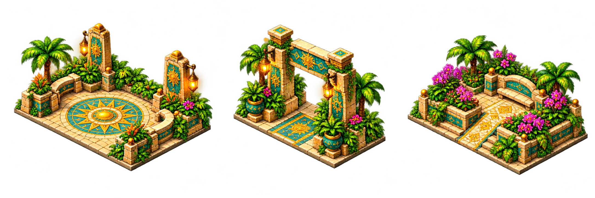

# Dry-land landmark alternatives

Generated as one complete transparent three-sprite atlas with the built-in
ImageGen tool on 30 October 2026. The exact generation prompt is [prompt.txt](prompt.txt).
Reference images were `../paintover-wonders.png` for the existing world style
and `../detail-reference.png` (the supplied `buildings-paintover`) for detail.
The source is preserved unmodified as [source.png](source.png), RGBA 2172 x 724.
No new dependency, model download or cloud-only intermediate is required.

| Atlas position | Meaning | State | Runtime use |
| --- | --- | --- | --- |
| Left | Sunstone courtyard: dry sun mosaic, seating, separate carved stelae and planters | Finished/restored | Replaces story ID 4, legacy key `gateway` |
| Middle | Ceremonial gate: upright ground-level entrance and dry mosaic path | Finished concept | Review-only alternative |
| Right | Orchid terrace: planted low tiers, bench and dry walkway | Finished concept | Review-only alternative |



The courtyard avoids suggesting a river crossing and adds an open gathering
place between the settlement's roofed buildings. It has one authored sprite;
the existing city preview and hold-to-move contract applies. There are no new
construction, upgrade or interaction-art states. The other two concepts are
not loaded by the game and carry no gameplay cost or footprint contract.

The prompt requested a 4 x 2 foundation, but the actual painted front-edge ratio
measures 421:295 (1.427). The runtime footprint follows the measured art, rounded
to **3 x 2** whole tiles. Selection `[47,80,780,630]`, followed by the importer's
component isolation and transparent crop `[1,1,733,549]`, produces the 732 x 548
runtime sprite. Its ground measurements are bottom `(425,542)`, left `4`, right
`720`, pivot `(362,363)`, base width `716`. Retained pixels preserve source RGB
and alpha; no detail or state is manufactured in processing.

Reproduce the exact runtime asset from the saved source:

```sh
python3 games/relic-rush/tools/prepare_buildings.py
python3 tools/footprint.py games/relic-rush/data/buildings/4.png --bottom 425,542 --left 4 --right 720 --overlay /tmp/courtyard.png
```

Re-generation with ImageGen uses the saved prompt and the two references; its
output may vary. The retained source and importer reproduce the shipped pixels.
See the [reviewed game captures](../../../docs/review/sunstone-courtyard/README.md).
