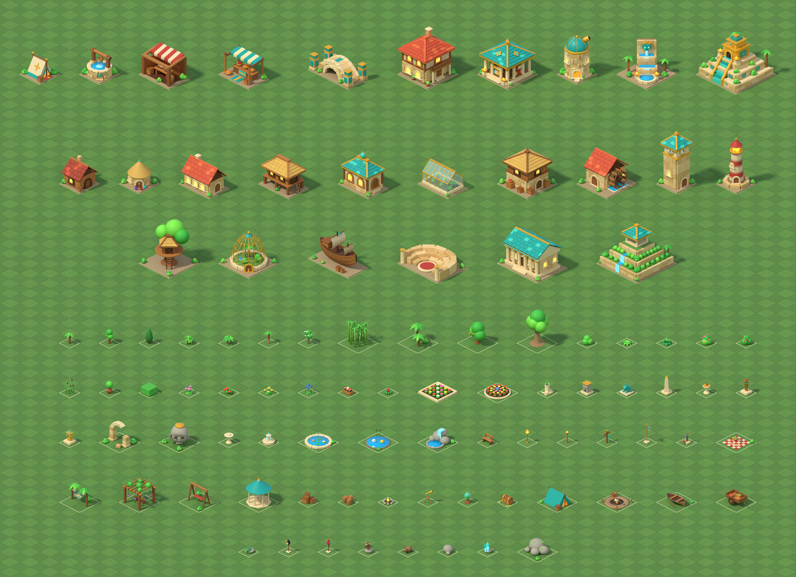
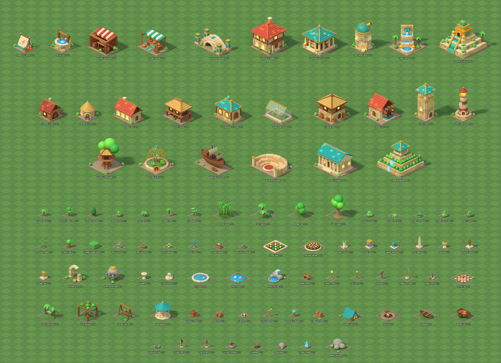

# Blender building projection study

Editable geometry and review renders for the 96 assets proposed in
[`docs/island-catalogue.md`](../../docs/island-catalogue.md): ten wonders, 16 income
buildings and 70 decorations, listed in `catalogue.json`. This is an art study, not
a replacement for `data/buildings/` or the runtime definitions.
The persistent source master is `relic_rush_buildings.blend`; the procedural
source is `build_scene.py`. Both are committed alongside the previews.

## Projection and registration

The camera is orthographic, at 30° elevation and 45° azimuth. One ground tile
projects to 120×60 pixels; its axes have slopes ±0.5. Buildings use footprint
centres at ground height as pivots, with one Blender unit per tile side.
`scene_layout.json` records the layout, footprints, projection origin, scale and
geometry checks. The saved report has slope 0.5 and maximum sampled projection
error 0.00019 pixels. `annotate.py` independently overlays the analytic ground
footprints and centre pivots on the saved render.

Every asset has one restored presentation. Selected, pressed, hover, disabled
and blocked-placement states are not new authored states in this study. The
gateway, lodge, archive, fountain and temple have study footprints that differ
from the current game definitions; see the catalogue. Decorations stand on the grass
without a slab.
Runtime adoption, matching footprints, sprite export, state review and in-game
validation remain tracked by [issue #15](https://github.com/corepunch/nile-archive/issues/15).

## Reproduce

Open the committed `.blend` master in an existing Blender installation and render
the `RelicRushIso` scene. The source configures Cycles GPU rendering. No new
dependencies or models are needed for the committed source assets.

To rebuild the geometry, run this in Blender's Python console from the repo root:

```python
import runpy, bpy
ns = runpy.run_path('games/relic-rush/art/isometric-blender/build_scene.py')
bpy.ops.wm.save_as_mainfile(filepath=ns['HERE'] + '/relic_rush_buildings.blend')
ns['SCN'].render.filepath = ns['HERE'] + '/preview/scene.png'
bpy.ops.render.render(write_still=True, scene=ns['SCN'].name)
```

Then, with existing Pillow:

```sh
python3 games/relic-rush/art/isometric-blender/annotate.py
```

The two saved previews were visually inspected before committing. They are
Blender renders, not in-game captures. The separate
[ImageGen trial](../isometric-trial/README.md) includes historical game captures.




