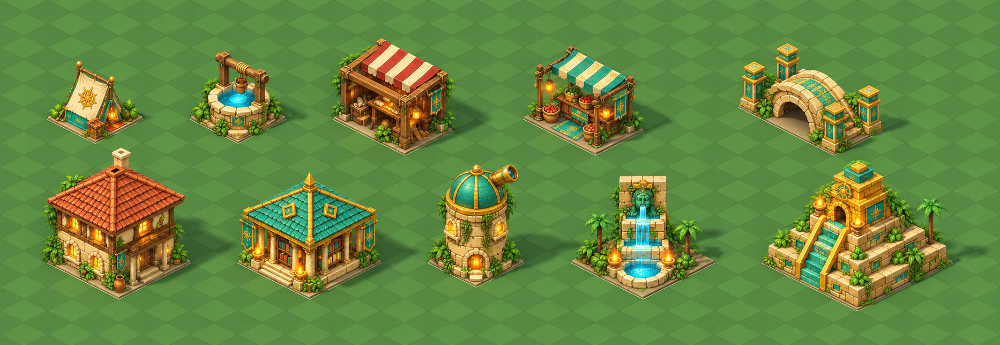

# ImageGen paint-over of the Blender grid study

Generated with the built-in ImageGen tool on 2026-10-30, in one edit call for all
ten buildings together. This is the requested paint-over, not a Blender model
or material edit. The original Blender source and original game art are intact.

- **Edit target / geometry reference:**
  `../isometric-blender/preview/scene.png` (2520×870).
- **Style reference:** `../buildings.png`, the original Relic Rush building set.
- **Exact generation prompt:** `prompt.txt`.
- **Generated master:** `buildings-paintover.png` (2134×737 RGB, green grid retained).
- **Meaning/state:** the same ten restored buildings and source-study footprints,
  in the same order and arrangement; no authored interaction-state set added.
- **Runtime integration:** the current 96-entry building catalogue supersedes
  this ten-sprite extraction. Its higher-detail sprites and dry courtyard remain
  unchanged. Only the nine matching independent Blender shadow passes are used
  by `tools/building_assets.py`; the historical bridge pass (4) is excluded.

The opaque paint-over and transparent extraction masters are retained unchanged,
with their exact prompts. They document the original whole-atlas ImageGen edits.
The current sprite source is `../building-catalogue/manifest.json`.

`render_shadows.py` uses the preserved Blender master and camera to render each
building in isolation onto a transparent Cycles shadow catcher. Persistent
source passes are `shadows/0..9.png`. Registration resizes each matching pass to
the current catalogue sprite's pixel density, crops with an 8px feather margin,
and records the independent pivot in `registration.json`. Alpha is preserved.
The runtime table `lua/building_art.lua` supplies only shadows; no sprite or
footprint is replaced. The engine draws all shadows below all buildings and
keeps them grounded while the sprite lifts.

Reproduce the historical paint-over with built-in ImageGen, using the geometry
reference and style reference above with `prompt.txt`; use `extraction-prompt.txt`
for the full-atlas transparency edit. Retain these masters because generation is
nondeterministic. No new generation or dependencies are needed for integration.

```sh
python3 games/relic-rush/tools/building_assets.py
python3 games/relic-rush/tools/building_assets.py --check
```

Re-render shadow sources with an existing Blender installation:
`Blender --background --python games/relic-rush/art/isometric-paintover/render_shadows.py`.

See [runtime registration and reviewed captures](../../docs/BUILDINGS.md).
Projection acceptance remains tracked by [issue #15](https://github.com/corepunch/nile-archive/issues/15).

| Geometry reference | Historical ImageGen paint-over |
| --- | --- |
|  |  |
