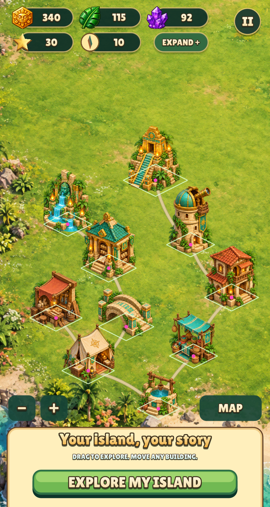
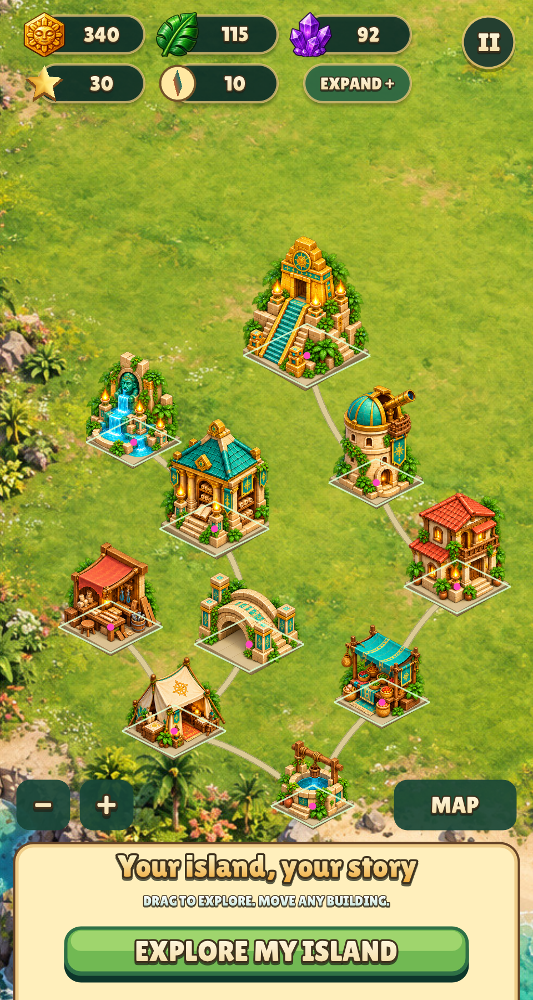
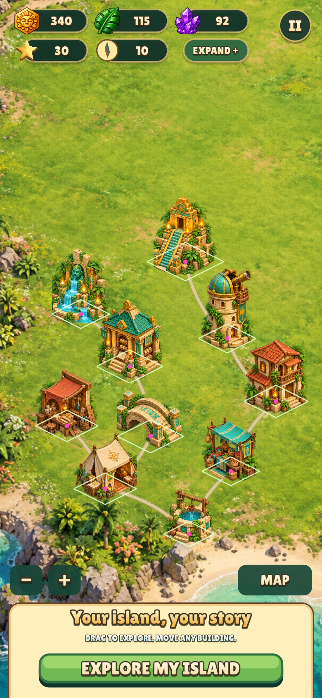

# 2:1 building projection trial — 2026-10-30

Review-only experiment, **not accepted runtime artwork**. Tracked gap:
[2:1 building projection and ground registration, #15](https://github.com/corepunch/nile-archive/issues/15).
The original `art/buildings.png`, runtime sprites and Lua definitions remain unchanged.

## Sources and generation

- `make_guide.py` creates exact 2:1 diamond slabs and wall blockouts. Ground
  slopes are ±0.5; the slab top is 280×140 pixels, centred at
  `(200 + 400*column, 490 + 600*row)` on a 2000×1200 canvas.
- `buildings-2to1-v1.png`: built-in ImageGen, one call for all ten buildings,
  using `prompt.txt`, `geometry-guide.png`, and the original `../buildings.png`.
- `buildings-2to1-v2.png`: built-in ImageGen, one call for all ten buildings,
  using `prompt-v2.txt`, `structure-guide.png`, and v1. This is the candidate
  shown in the in-game trial. Both generated outputs are 1619×971 RGBA;
  generation did not preserve the requested guide registration or dimensions.
- Subjects, in row order: camp, well, workshop, market, gateway, lodge,
  archive, observatory, fountain, temple. One restored state each; no new
  interaction-state artwork was requested or promoted to the runtime.

## Result

The model repeatedly drew steeper foundation edges than the guide. The sampled
lower-left slab slopes in v2 range from approximately 0.518 to 0.582, versus
the required 0.500. This checks one visible edge per building, not all
architectural lines. Neither candidate qualifies as geometrically exact 2:1.
Use controlled orthographic geometry/rendering to guarantee the projection.

`capture_trial.py` uses temporary copies of data and scripts and the existing
game binary. White diamonds are exact 2:1 reference outlines; magenta dots are
placement anchors. The trial temporarily uses `sink = width*0.29`, footprints
`(width*0.5, width*0.25)`, and no height cap. **That sink is an approximate review
registration, not an authored per-building pivot.** Original widths are retained.
The reference outlines have the same width in both captures and are larger than
the original collision footprints. They are review overlays, not shipped UI.

The existing `prepare_assets.isolate_sprite` extracts each candidate from explicit
crop bounds, excluding disconnected neighbouring fragments. No perspective warp,
recolouring or manufactured interaction state is applied. PNG alpha is retained
for the extracted artwork. Runtime inventory and state contracts are unchanged.

## Reproduce

The guide and measurement helpers run from the current repository root using
existing Pillow:

```sh
python3 games/relic-rush/art/isometric-trial/make_guide.py
python3 games/relic-rush/art/isometric-trial/measure_foundations.py
```

The capture helper uses the historical city API from revision `5ea3e97`, before
the later whole-tile size and pixel-pivot implementation. Set `RR_ISO_GAME` to
`games/relic-rush` in a separate checkout of that revision with its matching
`build/relic-rush`, then run
`python3 games/relic-rush/art/isometric-trial/capture_trial.py` from this repo.
It exits with an explanation on the newer API, rather than silently rendering
incorrect footprints. Existing captures preserve the original experiment.

Generation itself uses the saved prompts and references in the built-in ImageGen
tool. Keep the selected PNGs as masters because regeneration is nondeterministic.
macOS needs access to its window server even for a hidden capture. On Linux, run
the capture script under Xvfb. Retina captures are twice the requested logical
resolution. No dependencies were downloaded; retained local trial storage is below 30 MB.

## Reviewed real-game captures

All four captures were visually inspected, including every building, footprint
and anchor. The candidate is an experiment and remains subject to issue #15's
acceptance criteria: consistent axes, authored ground pivots and scale, placement
state coverage and a full runtime asset audit before adoption.

| Logical size | Existing art with reference overlay | Trial with reference overlay |
| --- | --- | --- |
| 480×900 |  |  |
| 390×844 |  |  |
