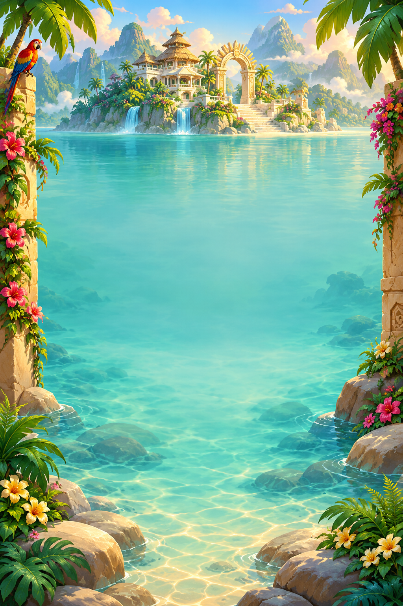
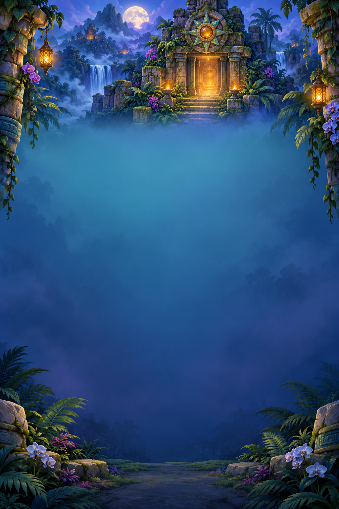
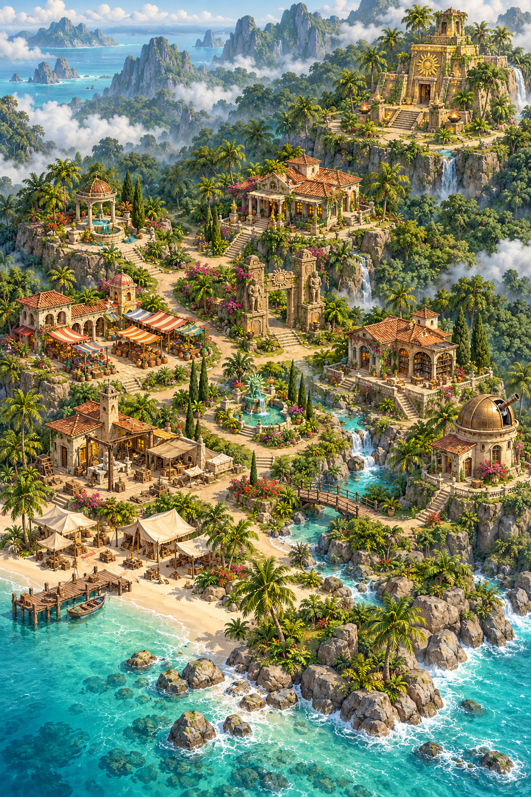
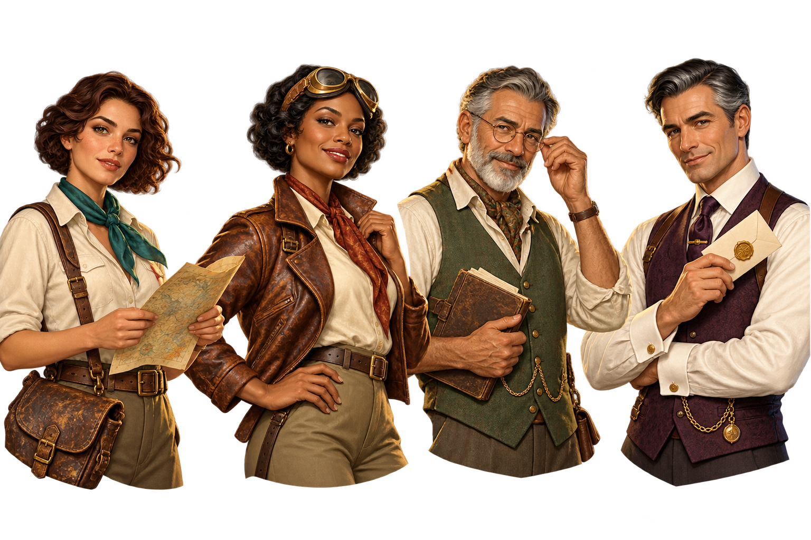

# Art direction: gardens, expeditions and characters

## Reference study

Reference images are research material, not bundled game assets.

| Reference | Studied material | Applied principle |
| --- | --- | --- |
| June's Journey | [Official game](https://www.wooga.com/junes-journey), [island and lighthouse screenshot](https://wooga.helpshift.com/hc/pt/27-june-s-journey/faq/2248-what-is-the-boat-for-and-how-do-i-visit-friends/) | Layered coastal gardens, organic settlement clusters, paths, atmosphere and adult adventure presentation |
| Pearl's Peril | [Official art and game](https://www.wooga.com/games/pearls-peril), [placement screenshot and instructions](https://wooga.theymes.com/hc/en/pearls-peril/articles/how-do-i-place-decorations-251) | Detailed building silhouettes, planting around structures, elegant character costumes, green/red placement feedback |
| Tropicats | [Official game and art](https://www.wooga.com/games/tropicats), [board screenshot](https://images.sftcdn.net/images/t_app-cover-l%2Cf_auto/p/01fdb834-d5b4-11e7-9759-ad9bee2d2fcb/2977677014/tropicats-build-decorate-play-match-3-paradise-screenshot.png) | Welcoming tropical framing, saturated foreground pieces against a quieter background, compact objectives and boosters |
| Candy Crush Saga | [Publisher game page](https://www.king.com/game), [official mobile listing and screenshots](https://apps.apple.com/gb/app/candy-crush-saga/id553834731) | Clear value separation, rounded tactile pieces, readable special pieces and strong reward feedback |

The visual observations above are our art-direction interpretation of the references. Characters, paintings and architecture created for Relic Rush are original; no reference game's artwork is imported into the runtime.

## New assets and implementation status

| Asset | File | Status |
| --- | --- | --- |
| Sunlit Lagoon | `assets/scene-lagoon.png` | Runtime background for levels 1–5; quiet center for the dynamic hex board |
| Moonlit Sun Temple | `assets/scene-temple.png` | Runtime background for levels 6–10; indigo/teal field with amber lights at the edges |
| Garden island | `assets/art-direction/island-gardens-concept.jpg` | Environment concept only; not a replacement terrain or placement map |
| Expedition cast | `assets/art-direction/expedition-cast.png` | Transparent character concept lineup; busts cut from it are the dialogue portraits |

The island concept uses terraces to communicate discovery and depth. Its painted buildings are not a playable free-placement surface: a future island upgrade needs separate terrain and building sprites with compatible perspective, footprints and depth sorting. The existing scrollable island retains its free-placement behavior.

## Original cast

Left to right in the lineup:

| Character | Role | Visual identity | Narrative direction |
| --- | --- | --- | --- |
| Elena Voss | Archaeologist, expedition lead | Auburn bob, ivory field shirt, teal scarf, map and satchel | Wants the valley's history preserved rather than stripped for treasure |
| Mara Bell | Pilot and expedition partner | Vintage curls, brass goggles, russet flight jacket | Resourceful friend who brings the expedition to the island and keeps it connected to the outside world |
| Tomas Reed | Island archivist | Grey beard, spectacles, sage waistcoat and old journal | Connects restored landmarks to the island's forgotten history |
| Adrian Vale | Expedition financier | Plum waistcoat, gold watch chain, sealed envelope | Charming sponsor whose interest in the Heart of the Sun may conflict with Elena's |

These names, relationships and story hooks are design material. Dialogue, character animations and story events have not been implemented. The setting is fictional golden-age archaeological adventure, not a licensed character universe or a historically precise reconstruction.

## Production rules

- Portrait backgrounds reserve the center for the existing 61-cell hex board; painted tile grids and baked-in UI are avoided.
- Original source paintings remain full resolution. The reproducible Pillow pipeline exports 768 × 1152 RGBA runtime layers; SDL draws the real board and interface above them.
- Keep foliage, bright ornaments and warm lights near the outside edges. The title, counters and moving resources remain renderer-controlled.
- Use the existing whole-string gradient/outline text compositor; lettering is not baked into these backgrounds.
- Built-in imagegen was used for all four new paintings. Full prompts are recorded in `art-direction-v2-prompts.json`.
