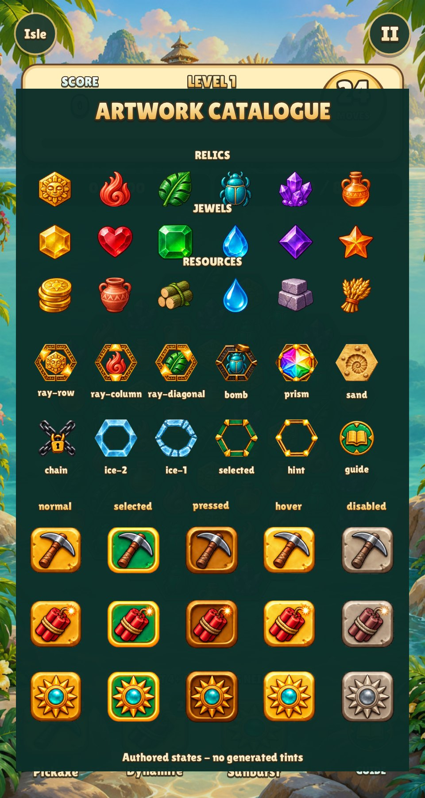
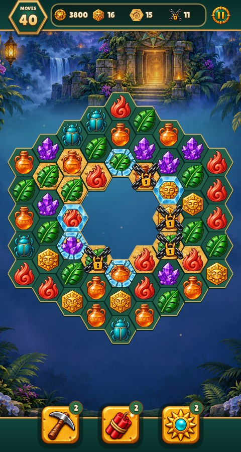

# Relic Rush artwork and state catalogue

This is the review inventory for the current game, audited 31 October 2026.
The original gap and acceptance criteria are tracked in [issue #11](https://github.com/corepunch/nile-archive/issues/11).
There are **18 base pieces, 5 special modifiers, 27 authored board/control sprites,
7 expedition-header icons and one investigating Elena cutout**.
The complete filename inventory, crop rectangles, rule names and state matrix live in
[`manifest.json`](../art/board-states/manifest.json). Paths below are relative to this game.



## Buildings and decorations

The [building catalogue](building-catalogue.md) covers **96** registered sprites,
including ten story wonders and 86 repeatable shop items. It records the full
source/prompt history, runtime paths, whole-tile measurements, supported states,
import commands and reviewed in-game captures. The board manifest links the
building manifest and inventories every new runtime file.

The fifth restoration is now the **Sunstone courtyard**, a dry mosaic gathering
plaza replacing the bridge-shaped gateway. Its 3 x 2 footprint is measured from
the new artwork. The complete three-option ImageGen atlas, selection, source,
prompt and reviewed game captures are recorded in the
[replacement review](review/sunstone-courtyard/README.md).

## Reward and replay presentation

The [economy review](review/economy/README.md) records first-clear/replay rewards,
the measured expedition list, available/locked/resume rows and the shop's spendable /
reserved Gold. Sources are `lua/expeditions.lua`, `lua/screens.lua`,
`lua/catalogue.lua` and `lua/rules.lua`. The shared form skin supplies existing
normal/hover/pressed/disabled/focus controls. No new bitmap or icon set is added;
the existing normal Idol/Leaf/Crystal artwork identifies Gold/Wood/Stone. Board
matches contribute to score/objectives; wallet payouts use the separate fixed
grant contract. Discovery Stars/Compasses are one-time progress rewards, and
replays pay Gold only. All piece packs and authored board/tool states retain
their existing artwork and state mapping. Reproduce with `--victory`,
`--replay-victory`, `--expeditions --expedition-page N` and `--catalogue`.

## Piece kinds and optional packs

All packs use the same kind IDs and rules. Colours and silhouettes are authored;
the game does not recolour one gem into other kinds.

| ID / rule name | Relics (default) | Jewels | Resources | Rule meaning |
| --- | --- | --- | --- | --- |
| 0 / IDOL | Gold sun idol | Yellow hex gem | Coins | Idol objective and score; reused Gold purse icon |
| 1 / FLAME | Coral flame | Red heart | Terracotta amphora | A matched, unlocked flame thaws adjacent ice |
| 2 / LEAF | Jade leaf | Green square gem | Timber | Ordinary matching kind; reused Wood purse icon |
| 3 / SCARAB | Turquoise scarab | Blue teardrop | Water | Ordinary matching kind |
| 4 / CRYSTAL | Purple crystal cluster | Purple diamond | Stone | Ordinary matching kind; reused Stone purse icon |
| 5 / AMPHORA | Amber amphora | Orange star | Wheat | Ordinary matching kind |

Source: `art/tile-sets/source.png`, six columns × three packs. Runtime:
`data/tile-sets/{relics,jewels,resources}/{0..5}.png`. Import:
`python3 games/relic-rush/tools/prepare_assets.py` from the repository root.
Largest-component isolation removes neighbouring sprite fragments before centring
and resizing; it does not create new colours or states.

## Specials and powerups

Source for every new sprite below: `art/board-states/source.png`, generated together
in one built-in ImageGen call. The exact prompt is
[`board-states.prompt.txt`](../art/board-states.prompt.txt). The manifest records the
actual generated dimensions and explicit crop boxes; the importer does not assume
the generator produced a mathematically uniform grid.

Runtime pattern: `data/board-states/<name>.png`, RGBA 128 × 128.
All hex layers use the slot's **flat-top** orientation (left/right vertices),
51.4 logical pixels wide and 44.51 high, centred on the same cell. Their shared
registration is recorded in `hex_slot`. The actual renderer exports
`art/board-states/cell-mask.png`; `tools/board_assets.py` fits the artwork with a
small overscan, then clips its alpha with that mask. The same mask fills normal
cells at runtime, so the state and slot use identical coverage. State panels
replace the old green face/rim. The square texture has transparent top/bottom
margins. The original ornate selected/hint frames retain all six
accents: at the user's request, Pillow rotates their authored art 30° clockwise
before fitting, instead of generating replacement designs. This spatial rotation
does not derive a new interaction state. The importer also crops ray arrow tips
to their slot registration, so they do not overlap neighbouring cells.
`lua/art.lua` names these textures; `lua/board.lua` uses the same artwork for
live pieces, collection flights, clearing animations and the guide.

| Rule state | Authored name | Creation / behaviour |
| --- | --- | --- |
| NORMAL (0) | Base kind image | Four connected equal kinds clear normally |
| ROW (1) | `ray-row` | Group of five; two gold arrowheads along the 30° board axis |
| COLUMN (2) | `ray-column` | Group of five; two arrowheads along the vertical 90° axis |
| DIAGONAL (3) | `ray-diagonal` | Group of five; two arrowheads along the 150° axis |
| BOMB (4) | `bomb` | Six or more in a non-line group; radius-one hex blast (cell plus six neighbours) |
| PRISM (5) | `prism` | Six in a straight line; clears the swapped kind |

Rays and bombs use painted frames with transparent centres around a smaller base
piece, preserving its match kind in all three packs. Prism uses its full rainbow
crystal artwork and retains its kind internally. No stripes, circle glyphs or
procedural special badges remain. The axes are separately authored, not rotated
copies. See [match rules](match4-rules.md) for special-combination resolution.

## Terrain, blockers and board interaction

| Authored name | State and meaning |
| --- | --- |
| `sand` | One excavation layer under a piece; cleared by a match above it |
| `chain` | Crossed linked chains and padlock; one hit unlocks the piece |
| `ice-2` | Thick intact icy shell; two hits remain |
| `ice-1` | Broken icy shell; one hit remains, including after damage to ice-2 |
| `selected` | Gold/jade frame under the tapped piece |
| `hint` | Distinct fine gold frame under both idle-hint pieces |
| `guide` | Jade book medallion for the explorer guide; not drawn on the board since the [match-3 HUD](review/match3-hud/README.md) (the guide opens from Pause), kept for the art catalogue screen |

Ice and chain are independent layers; if both exist, both are shown. A blocker hit
removes a layer before collecting its piece. Selected/hint frames are under pieces,
blockers over them; sand is beneath both. Board cells and outer edge lines remain
simple intentional layout geometry. Empty/inactive cells have no piece artwork.
Hint opacity pulses; reduced motion uses a steady frame. There are no hover/pressed
states for individual pieces: a touch selects a piece or initiates a swap.
If idle hint search finds no legal swap, the existing reshuffle now also recovers
idle boards and shows the text-only notice “No moves. Board reshuffled.” No new
sprites or derived artwork are used. The existing hint artwork still marks only
legal swaps; [review captures and reproduction](review/dead-board/README.md)
cover a zero-charge ring at both phone sizes.

## Tools: complete interaction matrix

Each tool starts with two charges per level, costs no move, and is used by selecting
it then tapping an active cell. Pickaxe hits one cell; dynamite hits its cell and
six neighbours; sunburst attacks all three axes through its target.

All fifteen buttons are separately painted in the same atlas, including their
backgrounds. The renderer never desaturates, tints or synthesizes a disabled state.
Their updated source is `art/tool-buttons/source.png`, generated together in one
built-in ImageGen call; the exact prompt is [`tool-buttons/prompt.txt`](../art/tool-buttons/prompt.txt).
The original 27-sprite atlas remains the source for hex layers and the guide.
Tool crop boxes and the separate atlas's dimensions are recorded in the manifest.
The importer spatially registers each measured button body (plus eight source
pixels of padding) into a 120×120 area on the existing 128×128 runtime canvas,
preserving authored alpha and all five painted states. This corrects the source's
roughly 4% width excess; no visual state is generated by processing.
Runtime paths remain `data/board-states/{pickaxe,dynamite,sunburst}-{state}.png`.
`lua/art.lua` specifies 76×76 touch targets, and `lua/board.lua` draws each texture
into a square with equal padding. The row begins at y=784 plus tall-phone offset;
labels sit below the buttons and counters stay at their upper-right corners.
Reproduce with `python3 games/relic-rush/tools/board_assets.py`; validate with
`--check`. [Actual-game captures and native-input checks](review/square-tools/README.md)
cover every tool/state plus normal and exhausted rows at both phone sizes.

| Tool | Normal | Selected | Pressed | Mouse hover | Disabled |
| --- | --- | --- | --- | --- | --- |
| Pickaxe | `pickaxe-normal` | `pickaxe-selected` | `pickaxe-pressed` | `pickaxe-hover` | `pickaxe-disabled` |
| Dynamite | `dynamite-normal` | `dynamite-selected` | `dynamite-pressed` | `dynamite-hover` | `dynamite-disabled` |
| Sunburst | `sunburst-normal` | `sunburst-selected` | `sunburst-pressed` | `sunburst-hover` | `sunburst-disabled` |

Priority: depleted or board busy → disabled; held pointer that began inside →
pressed; selected tool → selected; real mouse inside → hover; otherwise normal.
Touch never receives hover art. Charge counts are dynamic text on a counter.
The tools stand up out of a low jade tray along the bottom edge, three evenly
spaced sockets without captions; choosing one names it and its effect in the toast.

## Expedition header

The header follows the portrait match-3 convention (Royal Match, Toon Blast,
Homescapes): one jade band with a gold trim hangs from the top edge, under the
status bar. It holds a hexagonal Moves medallion that overhangs the band, a
recessed goal plate and the authored pause medallion. Goals are icons with their
remaining count beside them; both bars stay slim to leave the painting visible. Score remains a win condition, represented by the star
seal; idols, sand and lock counts use their existing artwork. A met goal dims its
icon and replaces the count with the completed seal. Collections landing on a
goal make its icon bounce. Over the last five moves the medallion face turns
red and glows. The band, trim, plate and medallion are drawn with engine shapes
(gradients, polygons); they are frames, not interaction states of an authored
control, and the medallion has no pressed/hover states because it is read-only. No score total, level title,
progress bar or island shortcut is displayed during an expedition. Level details
are in Pause; results retain score/reward details. An unfinished round cannot
return to the island. Win/failure screens provide the exit actions.

`art/expedition-hud/controls.png` contains **all seven new icons together in one
built-in ImageGen call**. The exact prompt is
[`controls-prompt.txt`](../art/expedition-hud/controls-prompt.txt). `pause-normal`,
`pause-selected`, `pause-pressed`, `pause-hover`, `pause-disabled` are individually
painted jade/gold medallions. `score` denotes the remaining score objective;
`complete` denotes any fulfilled objective. The runtime button uses normal,
pressed and real-mouse hover states; selected/disabled artwork is supplied for
the complete control contract. No tint or procedural bars create states.
Runtime: `data/expedition-hud/<name>.png`, 128×128 RGBA.

`art/expedition-hud/elena-investigating.png` is a separate ImageGen identity edit
of the existing Elena portrait: she examines a sun fragment through a magnifying
glass. [Exact portrait prompt](../art/expedition-hud/elena-prompt.txt). It was
shown between the old goal and moves cards; the match-3 HUD retires it, so it has
no runtime export and the manifest lists it as `retired_portrait`. Dialogue
continues using the original Elena portrait.

Measured crops, source dimensions, prompts and runtime paths are recorded in
[`expedition-hud/manifest.json`](../art/expedition-hud/manifest.json), referenced
by the primary runtime manifest. Import is aspect-preserving spatial registration
with authored alpha retained, never derived state artwork:
`python3 games/relic-rush/tools/prepare_hud.py` (`--check` verifies exact exports).
`lua/art.lua` loads the contract; the measured horizontal engine list in
`lua/board.lua` owns the goal cells. Collection flights land on the new goal positions.
[Reviewed game captures and native input checks](review/expedition-header/README.md)
cover both backgrounds, both phone sizes, completed goals, every pause state,
and dismissible/required popup behavior.

[Match-3 HUD before/after captures](review/match3-hud/README.md) cover both
paintings, both phone sizes, completed goals, the last moves, a tapped tool,
pause, guide and the island.



## Animation and effect states

| State | Presentation / assets |
| --- | --- |
| Idle | Base or special frame, optional sand/selection/hint/blocker layers |
| SWAP | Existing piece artwork moves to neighbour |
| REJECT | Same artwork returns; no move spent |
| CLEAR | Existing artwork expands briefly, then shrinks and fades; a blocked hit keeps the piece |
| FALL | Existing artwork follows gravity, eased position and landing squash/stretch |
| Special birth | Existing authored special plus transient halo/sparks |
| Attack | Procedural travelling rays, bomb rings, prism links and combo effects |
| Collection | Existing base-kind image flies to resource HUD with a trail |
| Reduced motion | Suppresses trails, shake, squash and effect spawns; rule resolution stays active |

Transient light, beams, rings, particles, score text and sunlight motes
are intentional animation primitives, not missing static artwork. Result-card
torch sconces and their flame renderer have been removed; reviewed standard
and safe-area phone captures are in `docs/review/result-without-torches/`.
`lua/vfx.lua` creates an additive light texture in memory; see
[effects and capture modes](effects.md). There are no additional hidden gem skins
for burning, charging, cracked gems or tool upgrades.

## Remaining runtime asset families

The current [96-entry catalogue](building-catalogue.md), including the dry
Sunstone courtyard, remains the sprite source. The earlier full-atlas
[ImageGen paint-over](../art/isometric-paintover/README.md) is preserved as
source history. Its nine matching Blender shadow passes are spatially resized
and registered to the current measured base widths by `tools/building_assets.py`.
The retired bridge's shadow is excluded. See [registration](BUILDINGS.md) and
[review captures](review/painted-buildings/README.md).
The wider projection audit remains tracked in
[issue #15](https://github.com/corepunch/nile-archive/issues/15).

The [2:1 building-art trial](../art/isometric-trial/README.md) contains two
review-only full-atlas generations, exact geometry references, saved prompts,
edge measurements and inspected before/trial game captures. It is not runtime
artwork: projection and authored pivot registration still fail acceptance and
are tracked in [issue #15](https://github.com/corepunch/nile-archive/issues/15).
No runtime inventory or interaction-state mapping changed in this experiment.

The [Blender projection study](../art/isometric-blender/README.md) preserves
editable geometry, its procedural source, a measured 2:1 camera report and two
reviewed render previews for all ten buildings. The runtime adopts its `w`/`h`
footprints. Its `game` column records earlier sizes for provenance.

These families plus the board assets above cover every file in `data/`;
`runtime_inventory` is checked against disk by `make test`.

| Runtime files | Source / ownership | Supported states |
| --- | --- | --- |
| `data/buildings/0..9.png` | Current `art/building-catalogue/manifest.json`; `tools/prepare_buildings.py` | Authored restored sprite; valid placement reuses it, blocked placement uses the existing engine red ghost, held placement lifts it; cards/rewards use it alone |
| `data/building-shadows/{0,1,2,3,5,6,7,8,9}.png` | Original Blender master; `art/isometric-paintover/render_shadows.py` and persistent `shadows/0..9.png`; same importer | Separate grounded shadow for restored/valid/blocked/held states; own crop/pivot and shared pixel scale; all shadows below all buildings; omitted in cards/rewards |
| `data/characters/{elena,mara,tomas,adrian}.png` | `art/art-direction/expedition-cast.png`; prepare_assets.py | One authored bust each; engine supplies speech/thought/shout bubbles |
| `data/{island,jungle,scene-lagoon,scene-temple}.jpg` | Corresponding paintings in `art/` | Island, fallback jungle, levels 1–5 lagoon, levels 6–10 temple |
| `data/board-states/cell-mask.png` | Actual `gfx.ngon` capture in `art/board-states/cell-mask.png` | Shared flat-top slot silhouette; clip mask, not an icon/state |
| `data/title.png` | `art/title.png` | Retained title asset; the current minimal HUD does not draw it |
| `data/fonts/LilitaOne-Regular.ttf`, `lilitaone-OFL.txt` | Bundled licensed font | Dynamic labels, counters, outlined/gradient typography |

The reusable engine UI now owns form layout, input, focus, data exchange and modal
Gaussian blur; the game supplies its skin and templates for pause, building and
guide dialogs. The guide uses one stable-key data source, a measured list and
left-aligned icon/copy rows. Speech, thought-cloud and shout-burst badges centre
on the visible outline; their puffs/spikes contribute to text padding. Framed
phone dialogue centres the portrait, visible bubble and any listener as one
measured unit within the safe screen; Skip travels with that unit. Reviewed
480×900 and safe-area 390×844 comparisons are in `docs/review/centered-dialogue/`.
The badge/padding audit is tracked in [issue #16](https://github.com/corepunch/nile-archive/issues/16).
Reviewed comparisons live in `docs/review/dialogue-stack/` (all three shapes,
one/two-line speech, 480×900 and safe-area 390×844, plus the guide). See [the UI engine](../../../docs/UI_ENGINE.md).

Board presentation uses a 32-unit cell radius (previously 26.5), fitting the
maximum nine-column grid into 448/480 logical screen units. Base pieces, the
cell mask, specials, blockers and selection/hints share the same 32/26.5
registration scale; the authored alpha and orientation are preserved. Cell
positions, input and refill clips use the enlarged geometry, while guide icons
retain their original size. Sources: `lua/state.lua`, `lua/board.lua`; no runtime
asset or manifest mapping changes. Reviewed phone captures of both paintings,
all three packs and ray/bomb/prism effects, plus reproduction, are in
[the board-scale review](review/larger-board/README.md).

Superseded twice (by the Goal/Moves cards and then the match-3 HUD above):
the board HUD used three small, separate jade cards with gold rims: score,
level/name and moves. Each label stays grouped with its value; objective pills
share the same near-opaque backing. The painting remains visible in the gaps.
The read-only `hud_form` in `lua/board.lua` uses engine row/column layout,
computed values and a paint-only skin. Text keeps its outlined/shadowed palettes;
score pulses and progress remain animated. No authored sprite or interaction
state is added. The earlier unbacked HUD lost contrast and is superseded by
[the grouped-card review](review/readable-hud/README.md), including both paintings,
phone safe areas, modal underlays and effects. Historical captures are in
`docs/review/floating-hud/`.

The island's redundant minus/plus/MAP button cluster has been removed from
`lua/island_view.lua`. Navigation uses the shared city camera: pinch or mouse
wheel to zoom and drag to pan. Placement, confirmation and long-press pickup
are unchanged. No bitmap or state mapping changed. Normal, overview and
placement captures at both phone sizes are in
[the map-control review](review/gesture-only-map/README.md).

Building pickup now uses the engine's stationary 0.5-second hold; ordinary drags
pan the map. The existing ghost/footprint, held/released, valid/blocked and
confirm/cancel states are retained. [Issue #21](https://github.com/corepunch/nile-archive/issues/21)
tracks gesture arbitration and the two-game input audit. Sources are
`engine/city.c`, `engine/core.c` and `lua/island_view.lua`; reviewed native-input
captures and reproduction commands are in
[the shared gesture review](../../../docs/review/city-long-press/README.md).
No bitmap or atlas mapping is added.

The island HUD has no sheet or panel over the map: one row of slim resource
pills, the shared pause medallion, and a bottom row of a large Play/Build button
between round Expeditions and Shop buttons. The round buttons are engine geometry
(gold rim, jade face) around existing artwork: the procedural compass icon and the
Jungle market sprite (`data/buildings/3.png`). Their pressed state shifts the face
2 units, as menu buttons do; there is no hover, selected or disabled state because
they are always available. The EXPAND pill is gone: a region that can open now
shows "+" and a glow on its fog marker, and its name is outlined text without a
plate. [Island HUD captures](review/island-hud/README.md).

Resource capsules, island HUD buttons, progress bars, menu buttons, result stars, placement outlines, land
fog and dialogue chrome are intentional engine geometry/text; they are not gem
or tool artwork states. Existing island, dialogue and result captures are linked
from the [README](../README.md). App icons live in `Assets.xcassets/`, outside the
runtime data inventory; their source and selection records are in `art/app-icon/`.

## Reproduce and keep current

From the repository root:

```sh
python3 games/relic-rush/tools/capture_cell_mask.py  # when cell geometry changes
python3 games/relic-rush/tools/board_assets.py
python3 games/relic-rush/tools/board_assets.py --check
python3 games/relic-rush/tools/check_art_catalogue.py
make test
./build/relic-rush --headless --mute --fresh --art-states --shot catalogue.png
./build/relic-rush --headless --mute --fresh --art-board --shot specials.png
./build/relic-rush --headless --mute --fresh --tiles jewels --art-board --shot jewels.png
```

Use Xvfb on Linux. `tools/screenshots.sh` regenerates the catalogue and special
board as well as ordinary levels, guide, effect and phone captures. Review at
480 × 900 and 390 × 844 with phone safe areas. `--art-board` freezes a deterministic
level-nine board with all five specials, selection/hints and selected/depleted
tools; `--art-states` displays every base piece and all 27 authored sprites through
the real renderer. These capture modes do not save progress.

For every addition, update this document, the manifest inventory and state mapping,
and the runtime contract together; add capture coverage. A new file without an
inventory entry, an absent authored state, or a stale atlas crop fails CI. When
changing existing definitions, audit their actual rule meaning as well as names.
If any visual gap remains, open/link a GitHub issue here before handoff. No known
placeholder board/control states remain from issue #11.

## Island connector removal

`lua/island.lua` disables the engine's procedural roads between buildings
with a transparent `city.path`. Building sprites, shadows and terrain assets
keep their existing registrations. Reviewed 480×900 and 390×844 captures are
in [the road removal comparison](review/no-auto-roads/README.md).
