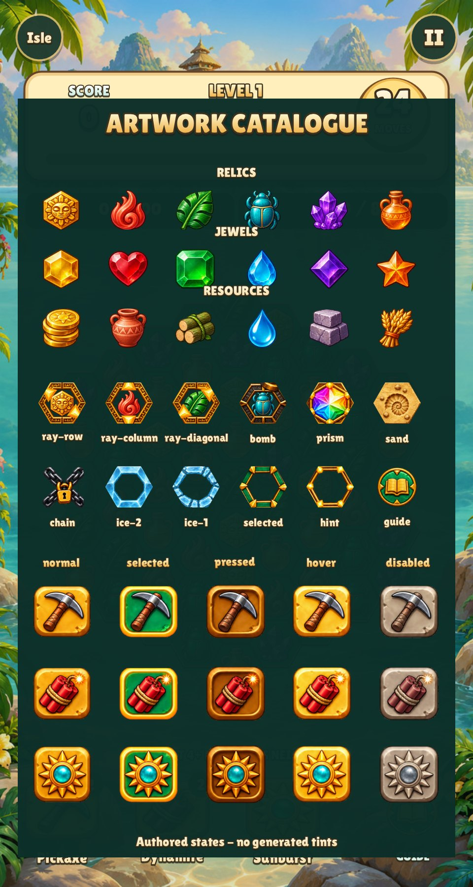
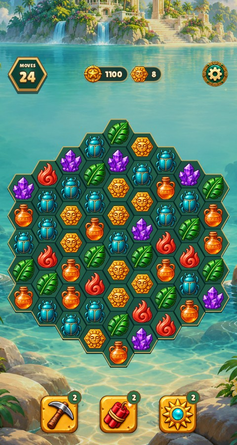
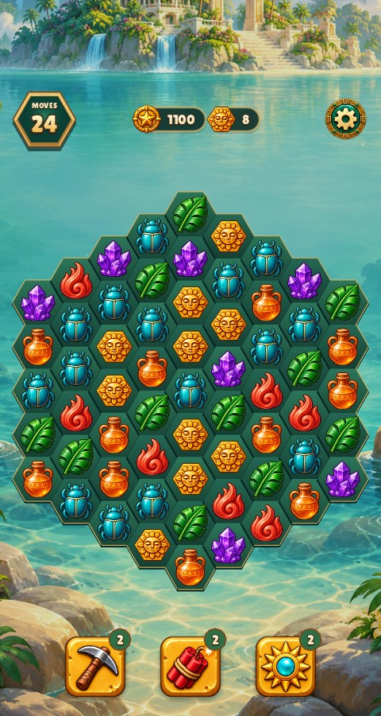
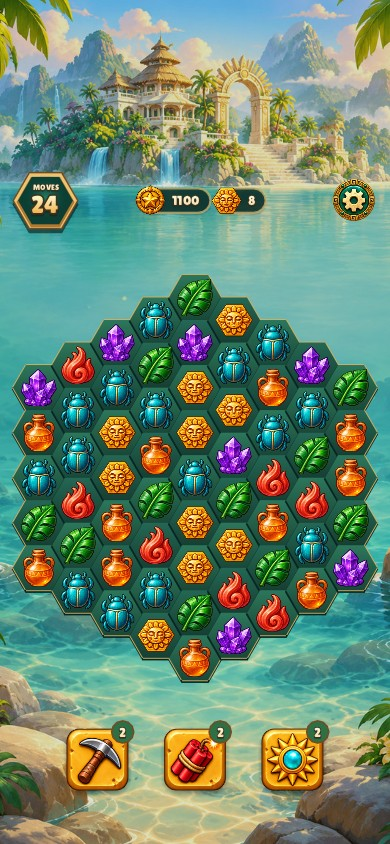

# Relic Rush artwork and state catalogue

## Themed board art

The live expedition uses the [campaign piece atlas](#campaign-piece-atlas) on pale limestone. Dark blue plaques mark the cells required to win. The older Relics, Jewels and Resources sheets serve the previews and imported-board diagnostics.

| Runtime frames | Rule and artwork |
| --- | --- |
| `relics-0` through `relics-5` | Round gold sun coin, red flame, jade leaf, blue scarab, violet crystal and orange amphora. Source and preview boards use these older frames. |
| `ray-row`, `ray-column`, `ray-diagonal` | One capped rocket modelled in Scener and rendered on the +30°, 90° and −30° axes. Terracotta-red collars and waist, with old-gold long cone tips and diagonal bands. |
| `bomb`, `prism`, `plane` | Petrol-teal bomb with an ochre-gold belt and inset socket disc, a rope fuse and a lit tip. Parchment paper plane: Christmas Market's painted plane with its blues remapped by luminance to parchment shades. The rainbow ball has chamfered enamel tiles in three rows of six on a dark violet sphere. The bomb and rainbow gem are painted over Scener renders. |
| `carpet-swatch`, `goal-carpet` | Dusty blue tesserae and a limestone chevron mark restored floor. Matching on the mosaic restores the cells it clears. The goal shows a fragment of the restored pattern. |
| `oil-material`, `goal-oil` | Matte rose-brown sediment gathers in shallow banks. Matching on it clears it. If the turn clears none, silt spreads to a neighbouring cell. A silt bank icon identifies the goal. |
| `stone-1` | One front-facing carved hex stone. An adjacent match or direct power-up hit clears it. The HUD and guide reuse the board sprite. |
| `delivery` | Carved tablet from the earlier delivery boards. Imported boards use their own tokens. |
| `chain`, `chain-1-mirror`, `chain-2` | A silver strand bolts to two opposite hex edges. The mirrored one-hit strand uses the opposite diagonal and gold plating. Two crossed silver strands bolt to all four sloped edges for two hits. |

Built-in ImageGen authored the [base sheet](../art/board-theme/source.png) and the [accent revision](../art/board-theme/accent-revision.png). The [base prompt](../art/board-theme/prompt.txt), [revision prompt](../art/board-theme/accent-prompt.txt) and [registration manifest](../art/match3-atlas.json) identify each source and transform. Rebuild `data/match3.png` with `python3 tools/match3_atlas.py`. See the [art guide](../../../docs/MATCH3_ART_GENERATION.md) and [in-game review](screenshots/review/board-palette/README.md).

The round sun coin at `relics-0` is the Relics preview idol (kind 0). The wallet uses the `resource-coin` sprite. Built-in ImageGen authored the preview idol's [transparent source](../art/board-theme/sun-coin/source.png) from the [chosen round-coin concept](../art/board-theme/sun-coin/concept.png) and [production prompt](../art/board-theme/sun-coin/prompt.txt). The atlas recipe trims the transparent margin, then scales and centres the coin inside the canonical flat-top hex while preserving its authored alpha. [In-game review at both phone sizes](screenshots/review/sun-coin/README.md).

Built-in ImageGen painted the three rocket axes, bomb and rainbow gem together for both games. The [painted sheet](../../../art/match3-power-up-paint/source.png) and its [prompt](../../../art/match3-power-up-paint/prompt.txt) are saved with the [Scener edit target](../../../art/match3-power-up-paint/scener-strip.png). The [atlas manifest](../art/match3-atlas.json) records the crop, fitted size and position of each frame inside the canonical inset hex. Rebuild with `python3 tools/match3_atlas.py`. [Before and after at both phone sizes](screenshots/review/power-up-paint/README.md).

`python3 tools/match3_specials.py relic-rush` reproduces the five geometry renders used to make the edit target. [Scener models and original board review](screenshots/review/scener-power-ups/README.md).

One ImageGen atlas contains all six [edge-mounted chain sprites](../../../art/match3-chain-paint/README.md). The board uses the hex well face to place the bolts, and the guide uses a miniature of that face. [In-game comparisons](screenshots/review/chain-anchors/README.md).

The [terrain atlas](../../../art/match3-terrain/source.png) was painted in one built-in ImageGen call for both games using the [approved concepts](../../../art/match3-terrain/relic-rush-concepts.png). The [prompt](../../../art/match3-terrain/prompt.txt) and [registration manifest](../art/match3-atlas.json) record the opaque swatch crops and alpha-preserving goal icon placement. Rebuild with `python3 tools/match3_atlas.py`. [Before and after at both phone sizes](screenshots/review/themed-terrain/README.md).

The [front-facing carved hex stones](../../../art/match3-blockers/source.png) use their own ImageGen sheet. [Stone review](screenshots/review/board-floors/README.md).

## Campaign piece atlas

One built-in ImageGen edit painted the original 23 campaign objects together. It used the
[previous pieces assembled in slot order](../art/campaign-pieces/edit-target.png)
as the edit target and the original Cradle of Rome's
`reference/cradle-of-rome/visuals/board-pieces.png` as the style reference.
The objects share an upper-left light, dark contours and compact silhouettes.
The [transparent source](../art/campaign-pieces/source.png), [exact prompt](../art/campaign-pieces/prompt.txt)
and [manifest](../art/board-states/manifest.json) record the inputs and registration.
A [fruit and score revision](../art/campaign-pieces/fruit-and-score.png) redraws the
emerald as a green apple and adds a leaf and flower. The
[revision prompt](../art/campaign-pieces/fruit-and-score.prompt.txt) and named
crop boxes in the manifest register all three into the same runtime atlas.
The [relay pliers revision](../art/campaign-pieces/relay-pliers.png) uses the
[full atlas edit prompt](../art/campaign-pieces/relay-pliers.prompt.txt).
Register its row 4, column 5 object from the named crop in the manifest.
The [Rome treasures revision](../art/campaign-pieces/rome-treasures.png) paints
nine motifs together in built-in ImageGen. The [prompt](../art/campaign-pieces/rome-treasures.prompt.txt)
uses the extracted Cradle of Rome 2 pieces for motif reference and the
existing campaign artwork for style. The three-log bundle replaces the old
single log in both matches and the first-clear award.
[Side-by-side sheet](../../../docs/cradle-of-rome-reference/gem-correspondence.html) ·
[In-game review](screenshots/review/rome-treasures/README.md)

| Atlas row | Left to right |
| --- | --- |
| 1 | Sun coin, berries, green apple, timber, quarry stones |
| 2 | Amphora, water bucket, cut blocks, ration jar, helmet |
| 3 | Grain, quartz, shrimp, emerald, lamp lens |
| 4 | Relay cable, tide chart, trail arrow, tool roll, relay pliers |
| 5 | Supply satchel, shutter gear, folded note, leaf, flower |
| 6 | Silver coin, ring, scarab, harp, sandal |

Run `python3 games/relic-rush/tools/prepare_resource_pieces.py` to crop the
measured row bands, columns and revision boxes, trim the transparent exterior and
uniformly fit each object into a centered 128 px cell with a 112 px maximum
extent (108 px for the winged sandal). The runtime atlas is
`data/campaign-pieces.png`. The same sprite appears
in matches, refills, resource flights and the guide. The existing selection,
hint and chain overlays supply their respective states. The game's shop and
wallet use their own currency artwork. The level 8 first-clear card also uses the
pliers from this atlas.
The sprites are free-standing objects. At the board's actual draw size the
30 pieces fit the canonical face in strict object mode.
[Fruit and score review](screenshots/review/fruit-and-score/README.md).
[Relay pliers review](screenshots/review/relay-pliers/README.md).

## Resource pieces

Built-in ImageGen painted the [3 × 3 source atlas](../art/board-refresh/source.png)
with seven expedition pieces and both cell faces. The [prompt](../art/board-refresh/prompt.txt)
and [hex layout](../art/board-refresh/hex-template.png) record the generation inputs
for the earlier resource set used by the wallet and art previews.
The [manifest](../art/board-states/manifest.json) records the slot order, crop and
registration. Resources are trimmed with a four-pixel margin and centred on a
transparent square. The Rome treasures atlas also supplies the standalone
Emerald, fitted inside 114 px on a 128 px canvas, and the timber for the
reward card, fitted inside 285 px on a 320 px canvas. Standalone sprites live in
`data/resource-pieces/`. Selected, hinted and falling pieces reuse the same
authored sprite with existing motion and separate indicators. Specials use
their own authored art. The original scenario sheet is still the source of
the other story pieces below, alongside the trail arrow from the outlined atlas.

| Runtime name | Match meaning | Wallet context |
| --- | --- | --- |
| `coin` | Round gold coin engraved with an eight-ray sun, 4 Coins | Coins icon |
| `berries` | Red berries, 1 Food | Board only |
| `emerald` | Bright green faceted emerald, 11 Coins | Board and guide from 30 after the Temple |
| `timber` | Three bark-covered logs with visible end grain, 2 Supplies | Board and Camp Timber award |
| `stone` | Pale violet-grey quarry stone, 3 Supplies | Board only |
| `water` | Teal water bucket, 3 Food. Replaces timber from board 5 after the Well is restored. | Board and guide |
| `rations` | Orange ration jar, 4 Food in the Market slot from board 10 | Board and guide |
| `cut-blocks` | Workshop unlock from board 8, 5 Supplies | Board and guide |
| `silver-coin` | Silver profile coin with a laurel border, 3 Coins | Board on 3 and guide |
| `helmet` | Gold helmet with red crest, 6 Coins | Board from 14 after the Courtyard, and guide |
| `ring` | Gold ring with a dark green inset, 7 Coins | Board from 18 after the Trading post, and guide |
| `scarab` | Bronze beetle with a jade inset, 8 Coins | Board from 21 after the Beached schooner, and guide |
| `sandal` | Roman leather sandal with a silver wing, 9 Coins | Board from 25 after the Great aviary, and guide |
| `harp` | Gold lyre with a turquoise inset, 10 Coins | Board from 28 after the Relic museum, and guide |
| `grain` | Existing Resources wheat bundle (`data/tile-sets/resources/5.png`), 5 Food | Board and guide from 17 |
| `quartz` | Existing Relics purple crystal (`data/tile-sets/relics/4.png`), 7 Supplies | Board and guide from 20 |
| `shrimp` | Curled red-orange shrimp, 6 Food | Replaces the water bucket from 27 after the Fountain |

Run `python3 games/relic-rush/tools/prepare_resource_pieces.py` to reproduce.
Leaves and flowers use the same board match and scoring behavior as other
pieces. Their authored slots carry no wallet yield. The amphora asset serves
legacy art previews.
Cut blocks use `data/tile-sets/resources/4.png` (Resources atlas, row 3,
column 5), registered with `python3 games/relic-rush/tools/prepare_assets.py`.
The alternate packs still supply separate grain and quartz sprites at their
authored orientation and alpha. Selected, hinted and falling pieces use the normal chip
with the existing board feedback. The Camp and Observatory enable existing
Dynamite and Sunburst controls with their authored normal, selected, pressed,
hover and disabled artwork. The locked and depleted tools share the disabled
art and show different tap notices. Review `shot hex-first`, `shot hex-late`,
`shot landing-briefing`, and `shot phone-story-level-30` in the Relic Rush suite.
See the [current board and wallet review](review/blue-plaque-campaign/README.md).
The [harbor campaign review](screenshots/review/harbor-campaign/README.md)
shows the original openings and the cut blocks on level 8. The relay pliers
review above shows the current level 8 board.

`--rome-reference-art` uses the aliases in the manifest to load local
Cradle of Rome 2 crops for resource pieces and the matching coin and guide icons.
Selected, hinted and falling pieces use the same authored crop with the existing
Relic Rush overlays and motion. The source is the Windows atlas `gmf_balls_2.png`.
The [Cradle of Rome 2 extraction](../../../docs/cradle-of-rome-reference/README.md#cradle-of-rome-2-artwork)
reproduces the transparent crops. `--level 5 --size 390x844` shows the water
bucket in its live slot alongside the original story marker.


## The signal finale

| Asset | Rule meaning and states | Source and runtime |
| --- | --- | --- |
| `signal-plate` | On board 30’s first clear, the recovered signal plate appears at the cleared site before the scene cuts to the landing. | ImageGen [source](../art/finale/signal-plate.png) and [prompt](../art/finale/signal-plate.prompt.txt). Cropped and uniformly fitted into a 128 px sprite with its painted alpha. Runtime `data/signal-plate.png`. |
| `safe-landing` | After the plate arrives, the first win cuts to Ines holding a lantern on the safe landing. She answers with the three flashes first seen on board 3. Reduced motion shows a steady light. | ImageGen [source](../art/finale/safe-landing.png) and [prompt](../art/finale/safe-landing.prompt.txt). Uncropped 864×1152 JPEG at `data/safe-landing.jpg`. The manifest records the lantern coordinates for the glow. |

Run `python3 games/relic-rush/tools/prepare_finale_art.py` to register both assets.
The amber pulses reuse the board’s additive glow, with a shared delay and rhythm.
See the [finale and sand review](screenshots/review/signal-finale/README.md).
The old [board 8 painting](../art/story-pictures/broken-relay.png) is archived with its
[historical review](review/story-mosaic/README.md).

## Chapter 1 quest objects

The [single ImageGen atlas](../art/quest-objects/source.png) and its [prompt](../art/quest-objects/prompt.txt)
contain eight recognizable objects. A first clear shows its object (the board-size file) at 210 px, centred on an
**Item recovered!** card (the results card's panel, jade header and glow; the name and a
CONTINUE button below), before the story exchange in which the characters find it and before
the results. Reviewed capture: `build/relic-rush --victory clue --dialog award`.
They are independent of the selected match piece pack.

| Atlas slot | Quest object | Board and use |
| --- | --- | --- |
| `timber` | Camp timber | 1, put up the Expedition camp |
| `lens` | Lamp lens | 2, answer the light below the cliff |
| `cable` | Relay cable | 3, trace the route |
| `chart` | Tide chart | 4, read the route after restoring the Spring well |
| `marker` | Green painted brass trail arrow | 5 and 6, locate the steps below the quay |
| `tools` | Tool roll | 7, equip the Artisan workshop |
| `pliers` | Relay pliers | 8, recover Tomas’s tool at the severed cable and use it on the market hoist |
| `supplies` | Supply crate | 9, stock the Jungle market supply point |
| `gear` | Shutter gear | 10, operate the near shutter and read the tide-room warning |

The [shutter gear sheet](../art/quest-objects/shutter-gear-states.png) supplies
the weathered bronze reward. The new board gear uses the same open square bore. The
[prompt](../art/quest-objects/shutter-gear-states.prompt.txt) and manifest
record the source and crops.

Run `python3 tools/relic_quest_art.py` after the resource registration to build
the scenario index in `data/quest-objects.png` and the item card props in
`data/finds/`. Camp Timber uses `data/resource-pieces/timber.png` directly.
Separate card props fit within 256 px on a 320×320 canvas. Board 8 uses its
`pliers` atlas region on the card and in alternate board previews. The intact
relay cable for board 3 is coiled with two plugs.

### Collectible story pieces

The board uses the story sprite for the replaced colour slot. Selection, hints
and refill use the existing animation and overlays. Power-ups use their own
sprites. The first clear recovers the story item.

| Slot | Boards | Collectible sprite |
| --- | --- | --- |
| Gold | 4, 13 | Tide map, folded note |
| Red | 7 | Rolled leather tool wrap |
| Green | 5, 6 | Painted brass trail arrow |
| Blue | 2, 9 | Lamp lens, supply pack |
| Purple | 3 | Coiled relay cable |
| Orange | 8, 10 | Relay pliers, bronze shutter gear |

Board 1 uses the ordinary timber chip. The campaign atlas includes all nine
story sprites. In alternate art previews most story sprites come
from the [expedition atlas](../art/resource-pieces/scenario-atlas.png). The
trail arrow chip and marker recovery card use the
[outlined source sheet](../art/resource-pieces/outlined-atlas.png).
The manifest records each crop, the boards it appears on and its colour slot.
Run `python3 tools/relic_quest_art.py` to register the individual
`data/story-pieces/*.png` files. Each crop fits inside 108 px on a centred
128 × 128 canvas. The [new board review](screenshots/review/expedition-economy/README.md)
covers both cable silhouettes. The [earlier review](screenshots/review/story-collection/README.md)
records the preceding sprites and the item cards.


### Board 13 warning note

The collectible sprite shows the outside of the folded note. On the first-clear
card the open paper reads “WALL UNSAFE” and “I. R.” before the courtyard scene.
The card uses the exposed crop of the [original sheet](../art/quest-objects/ines-note-states.png)
and [prompt](../art/quest-objects/ines-note-states.prompt.txt). The manifest
registers it as `data/finds/note.png` within 228 px on a 320×320 canvas.

The earlier excavation art is documented in
[the silhouette review](screenshots/review/compact-silhouettes/README.md) and
[the footprint review](screenshots/review/laid-finds/README.md).

## Additional board elements

These sprites support the reference-board previews. The campaign uses chains
and blue plaques.

The 48-cell [surface master](../../../engine/art/match3-elements/source.png) and
[exact prompt](../../../engine/art/match3-elements/prompt.txt) contain both games'
24-state families in one ImageGen call. The full-bleed tile faces are cropped,
resized and registered with the [canonical engine hex mask](../../../engine/art/hex-tile/README.md).
The two free-standing delivery pieces retain their authored alpha from the earlier
[master](../../../engine/art/match3-elements/source-v1.png) and
[prompt](../../../engine/art/match3-elements/prompt-v1.txt). The
[registration manifest](../../../engine/art/match3-elements/manifest.json) records
all sources, crops and runtime paths. From the repository root, reproduce the
states with `python3 tools/match3_elements_art.py`, then pack the runtime atlas
with `python3 tools/match3_atlas.py`. No colour or damage state is generated by
tinting; each was authored. The registration check verifies all 46 full-cell
states against the canonical mask.

| Role | Runtime atlas keys | Rule and visual states |
| --- | --- | --- |
| Carved stone | `stone-1` | Solid; one adjacent match or direct power-up hit breaks it. |
| Delivery | `delivery`, `delivery-exit` | A nonmatching movable piece and its fixed destination. |

The master's crate, tunnel, hidden-object and growth cells belong to mechanics
the engine no longer has (they are not in Homescapes' story levels). They stay
in the master image but are not registered, and their frames left the atlas.

Board rendering, guide icons and goal icons use the same named atlas artwork;
the neutral skin preview falls back to this game's authored element sprites.
Review the carved stone and the delivery on the actual board with
`--element-states --headless --fresh --mute --size 480x900`, and at 390×844.
The reviewed captures are [full size](../../../docs/review/match3-elements/relic-rush-states.png)
and [narrow](../../../docs/review/match3-elements/relic-rush-state-narrow.png).


This is the review inventory for the current game, audited 31 October 2026.
The original gap and acceptance criteria are tracked in [issue #11](https://github.com/corepunch/nile-archive/issues/11).
There are **18 base pieces, 5 special modifiers, 27 authored board/control sprites,
7 expedition-header icons and one investigating Elena cutout**.
The complete filename inventory, crop rectangles, rule names and state matrix live in
[`manifest.json`](../art/board-states/manifest.json). Paths below are relative to this game.



## Earlier cell and goal alignment

The teal wells use the engine's flat-top hex geometry and a light-to-dark
vertical gradient. The atlas cell mask remains the registration reference for
authored art. Goal icons and counts share the jade signboard. Collection
flights land at the icon centres. The chain objective uses a 12% larger icon
shifted 2 logical units right. The carved-stone objective uses a 10% smaller
icon. [Current board review](../../../docs/review/match3-signboards/README.md).

Reproduce with `build/test/relic-rush "shot hex-first" "shot phone-board" "shot art-specials"`.

| Size | Before | After |
| --- | --- | --- |
| 480×900 |  |  |
| 390×844 |  |  |

[Board with blockers and specials](screenshots/review/cell-and-goals/specials.jpg)

## Buildings and decorations

The [building catalogue](building-catalogue.md) covers **96** registered sprites,
including twenty campaign restorations (ten story wonders and ten ladder
buildings, all placed once) and 76 repeatable shop items. It records the full
source/prompt history, runtime paths, whole-tile measurements, supported states,
import commands and reviewed in-game captures. The board manifest links the
building manifest and inventories every new runtime file.

The fifth restoration is now the **Sunstone courtyard**, a dry mosaic gathering
plaza replacing the bridge-shaped gateway. Its 3 x 2 footprint is measured from
the new artwork. The complete three-option ImageGen atlas, selection, source,
prompt and reviewed game captures are recorded in the
[replacement review](review/sunstone-courtyard/README.md).

## Reward and replay presentation

The [economy review](review/economy/README.md) records the first-clear and replay
flows, expedition list and build shop. Board matches contribute to score and
objectives. The results card and wallet use the three resource icons. First clears award
three Discovery Stars. Replays bank matched resources and the move bonus.

| Sprite | Presentation |
| --- | --- |
| `discovery-star` | Faceted gold star in a turquoise setting. The celebration scales and fades the same artwork, and the Discovery Stars reward row and island wallet use it at smaller sizes. |
| `next-clue` | Sealed papyrus when the investigation continues after a first clear. Restoration milestones show the building sprite, and replay results show the normal Build hammer. |

Both static icons were authored together with built-in ImageGen in a
[transparent atlas](../art/result-icons/source.png), using the Christmas Market
results stars as the visual reference. The [generation prompt](../art/result-icons/prompt.txt)
and [crop bounds and slot order](../art/board-states/manifest.json) record the
source. Run `python3 games/relic-rush/tools/prepare_result_icons.py` to crop
both sprites, fit them to 120 px preserving aspect ratio and alpha, and center
them in two 128 px cells in `data/result-icons.png`. Add `--check` to verify
the exported pixels. The wallet capsule retains its skin-painted feedback.
See the [results and wallet captures](screenshots/review/discovery-stars/README.md)
for both phone sizes and reproduction commands.

## Pause menu actions

`lua/screens.lua` lays Pause out in groups, with the look in `lua/skin.lua`: a
settings well holding the Sound and Reduce motion checkboxes, then Resume, then
Restart and Quit to Island as secondary wooden buttons, and the guide as a link.
Restart asks for confirmation and resets the current puzzle; Quit to Island
suspends it without paying rewards. Island Pause hides Restart and Quit. (The
motion toggle was removed once and returned as the Reduce motion checkbox.)
Both menus measure their content before centring, including the taller
safe-area phone layout. States are listed below with the checkbox and button
variants; no artwork, source prompt, runtime file or sprite transform is added.
The menu contract is recorded in `art/board-states/manifest.json` under `pause_menu`.

Pause also carries a LEADERBOARD link above the guide link, drawn by the game skin (the link
role); the results card has no leaderboard button. They open the engine's shared leaderboard dialog ([docs/GAMECENTER.md](../../../docs/GAMECENTER.md)):
a panel with Everyone / Friends tabs (the chosen one a jade button, the other a flat caption), a
scrolling list of rank, portrait, name and score rows (a round placeholder bust with the initial
while a portrait loads, "(you)" on the player's row), loading / empty / signed-out notes, and
Game Center and Close buttons. No artwork is added: every state is skin paint, and the portraits
come from Game Center at runtime. Reviewed captures: `pause`, `phone-pause`, `victory`,
`leaderboard`, `phone-leaderboard` and `level-leaderboard` in `docs/screenshots` (from
`build/test/relic-rush "shot leaderboard"` ..., with `--gamecenter-demo`).

Reproduce and inspect both contexts at both phone sizes with
`python3 tests/fixtures/pause-actions/capture.py`; reviewed captures and exact
commands are in the [pause menu review](review/pause-actions/README.md).
The game's `--smoke` run exercises Restart, Quit to Island, hidden island actions,
resuming through the expedition browser, and unchanged banked rewards.

## Piece kinds and optional packs

All packs use the same kind IDs and rules. Colours and silhouettes are authored;
the game does not recolour one gem into other kinds.

| ID / rule name | Relics (default) | Jewels | Resources | Rule meaning |
| --- | --- | --- | --- | --- |
| 0 / IDOL | Round gold sun coin | Yellow hex gem | Coins | Idol objective and score; reused Amulet icon |
| 1 / FLAME | Coral flame | Red heart | Terracotta amphora | Ordinary matching kind |
| 2 / LEAF | Jade leaf | Green square gem | Timber | Ordinary matching kind; reused Wood purse icon |
| 3 / SCARAB | Turquoise scarab | Blue teardrop | Water | Ordinary matching kind |
| 4 / CRYSTAL | Purple crystal cluster | Purple diamond | Stone | Ordinary matching kind; reused Stone purse icon |
| 5 / AMPHORA | Amber amphora | Orange star | Wheat | Ordinary matching kind |

Source: `art/tile-sets/source.png`, six columns × three packs. Runtime:
`data/tile-sets/{relics,jewels,resources}/{0..5}.png`. Import:
`python3 games/relic-rush/tools/prepare_assets.py` from the repository root.
Largest-component isolation removes neighbouring sprite fragments before centring
and resizing; it does not create new colours or states.

## Special pieces

Live expeditions make rockets (four in a line), bombs (crossing lines) and
rainbow balls (five or more in a line). Expeditions accept straight lines only,
so the plane, made from a four-cell rhombus, appears only on reference boards
and in art previews.

Source for every new sprite below: `art/board-states/source.png`, generated together
in one built-in ImageGen call. The exact prompt is
[`board-states.prompt.txt`](../art/board-states.prompt.txt). The manifest records the
actual generated dimensions and explicit crop boxes; the importer does not assume
the generator produced a mathematically uniform grid.

Runtime pattern: `data/board-states/<name>.png`, RGBA 128 × 128.
Terrain and ice use the slot's **flat-top** mask. Special gems are
free-standing artwork.
The replacement set is authored together in
`art/board-states/clear-indicators.png` (ImageGen, 2026-11-01), with its prompt
in `clear-indicators-prompt.txt`. The manifest records measured crop boxes,
spatial axis registration and runtime paths. The importer preserves authored
RGBA and clips filled ice to the actual tile; it does not synthesize states.
Selection and hints use soft filled glows, with no hard border.
`lua/art.lua` names these textures; `lua/board.lua` uses the same artwork for
live pieces, collection flights, clearing animations and the guide.

| Rule state | Authored name | Creation / behaviour |
| --- | --- | --- |
| NORMAL (0) | Base kind image | Three equal kinds in a straight line clear normally |
| ROW (1) | `ray-row` | Line of four; full-gem stripes along the 30° board axis |
| COLUMN (2) | `ray-column` | Line of four; full-gem vertical stripes |
| DIAGONAL (3) | `ray-diagonal` | Line of four; full-gem stripes along the 150° axis |
| BOMB (4) | `bomb` | Existing/review bomb or special combination; radius-one hex blast (cell plus six neighbours) |
| PRISM (5) | `prism` | Five or more in a straight line; clears the swapped kind |

Rays use `gfx.image_striped` on the matching gem at full size. Broad cream bands
follow the 30°, 90° or 150° clear axis, masked to the gem's authored alpha and
modulated by its surface shading. Bomb and prism sprites replace the gem at full
piece size. The old `ray-row`, `ray-column`, `ray-diagonal` images remain canonical
skin compatibility regions and no longer appear as tiny board/guide badges.

The user explicitly requested engine-drawn masked stripes on 2026-11-01; this
supersedes the usual authored-state requirement for this pattern. No generated
stripe atlas is used, and existing textures/alpha remain unchanged. Relics,
Jewels, Resources and the guide share the same renderer. The
[striped-special review](../../../docs/review/striped-specials/README.md) covers
all six kinds, all axes, the full bomb, both phone sizes and blockers.
See [match rules](match4-rules.md) for special-combination resolution.

## Terrain, blockers and board interaction

| Authored name | State and meaning |
| --- | --- |
| `chain` | A silver chain holds the chip between two bolted hex edges. One hit unlocks the piece. |
| `ice-2` | Diagnostic ice pane with two hits remaining. |
| `ice-1` | Diagnostic ice pane with one hit remaining. |
| `carpet-swatch`, `goal-carpet` | Shared mosaic art for the neutral atlas and source-level reviews. |
| `oil-material`, `goal-oil` | Shared spreading-silt art for the neutral atlas and source-level reviews. The campaign overrides this slot with blue plaques and sets the fixed-cell rule. |
| `selected` | Soft filled mint glow under the tapped piece; no outline |
| `hint` | Soft filled gold glow and sparkles under both idle-hint pieces; no outline |
| `guide` | Jade book medallion for the explorer guide; not drawn on the board since the [match-3 HUD](review/match3-hud/README.md) (the guide opens from Pause), kept for the art catalogue screen |

The campaign uses the same silver chain art on each board. One hit breaks
the chain and keeps the piece in place. A later hit clears the piece and its
blue plaque. Ice and carpet textures are recorded here for shared engine
and source-board diagnostics.

### Story materials

| Frame | Meaning and use |
| --- | --- |
| `tile-cell-normal` | Slot 1, parchment lit from the upper left: ordinary and cleared cells. |
| `tile-tablet-single` | Slot 2, deep blue: plaques required for a win. The Explorer’s Guide uses the same face. |
| `tile-tablet-double` | Slot 3, green: a plaque listed in a level's `oil_double`, before its first hit. The level tuner turns plaques green as a difficulty step ([level-tuning.md](level-tuning.md)). [Level 15 before/after](screenshots/review/level-tuning/after15.jpg). |
| `tile-light-wave` | Slot 4, a diagonal streak of pale gold: the light that sweeps across the board as it arrives. |
| `tile-hover` | Slot 5, white: the cell under a mouse pointer (not on touch). |
| `tile-selected` | Slot 6, orange corner brackets on a clear tile: the selected cell. |
| `tile-ice` | Slot 7, frosted teal with a white burst and hairline cracks: the floor under an iced piece, which keeps its `ice-1`/`ice-2` overlay. |
| `tile-bonus-area` | Slot 8, blue-gray with a soft glow: every cell an armed tool will hit, at the hovered or pressed cell. |

The eight tiles follow the slots of Cradle of Rome's board sheet and are
shared by Relic Rush and Christmas Market. `tools/board_tiles.py` bakes them
from [`engine/art/board-tiles/tiles.json`](../../../engine/art/board-tiles/tiles.json)
into each game's `data/board-tiles/`. Colours and lighting are sampled from the
first Cradle of Rome's tile sheet: faces lit from the upper left, a thin edge
light on the parchment, wide cut bevels on the blue and green tablets (lit on
the upper-left edges, dark on the lower-right) so they read as thick stones,
and a bevel on the ice. The spec's options
add a warm mottle (`grain`, `grain_tint`), a glow, hairline cracks, a diagonal
light `streak`, and `brackets` for the open selected frame. The canonical
128 px flat-top mask cuts the alpha, and every filled tile passes
`tools/hex_tile_art.py --mode fill --strict`.
Regenerate with `python3 tools/board_tiles.py`; `tools/check_art_catalogue.py`
fails if a tile is stale. The `--art-states dressing` screen shows all eight, and
`--level 6 --cell-states` shows them in use on a board.

`frame-stone` (`data/board-frame/stone.png`) trims the active board silhouette
with six straight runs, six outward joins and six inward joins. Its
`frame-entrance` region follows the incoming cells. The starter bakes the
previous frame's bands, seeded grain and cracks with
`python3 tools/board_frame.py --output build/board-frame`.
The stone atlas also contains outer joins with three-leaf jungle sprigs and
an inner join with a bright front-facing leaf cluster. The broad leaves fan
diagonally out from a hub seated on top of the stone. The generator bakes the
[painted leaves](../../../engine/art/board-frame/rim-rosette-source.png)
and contact shadows into their joins and
exports `lua/board_frame_atlas.lua` with the registration.
Run `python3 tools/board_frame.py --game relic-rush --output build/board-frame/relic-rush`.
[Board close-ups, prompt and level 6 at both phone sizes](../../../docs/review/board-frame-decorations/front.md).

The painted [limestone and cobalt atlas](../art/board-refresh/flat-ground.png)
these replaced remains as a style reference. [In-game review](../../../docs/review/board-tiles/README.md).

The earlier [cover and terrain sources](../art/board-dressing/) and
[historical review](screenshots/review/board-dressing/README.md) document the
archived salt, rubble, vine, rope, cable and excavation artwork.

Hint opacity pulses; reduced motion uses a steady frame. There are no hover/pressed
states for individual pieces: a touch selects a piece or initiates a swap.
If idle hint search finds no legal swap, the existing reshuffle now also recovers
idle boards and shows the text-only notice “No moves. Board reshuffled.” No new
sprites or derived artwork are used. The existing hint artwork still marks only
legal swaps; [review captures and reproduction](review/dead-board/README.md)
cover a zero-charge ring at both phone sizes.

## Campaign bonus pieces and sockets

The eight standalone pieces are the Hammer, Dynamite, Shutter Gear, Shield,
Lightning, Star, Amphora and Tide Chart. The board shows one unlocked family per expedition. Their
rules, building unlocks and first-board story link are in [board progression](board-progression.md#bonus-pieces).
The toolbar shows all eight sockets in two rows of four, in restoration order,
below the centred board. The five authored faces are gold normal, jade selected, dark amber
pressed, bright gold hover, and shallow sandstone engraving for locked and empty
sockets. Partial charge reveals the gold normal face from the bottom. Gems fly
from ordinary matches to the center of their own socket. The animated gem is
the existing board sprite, with the engine's collection trail and landing ring.
Reduce Motion fills the meter immediately.

The [ImageGen source atlas](../art/bonus-gems/shallow-sockets.png) and
[edit prompts](../art/bonus-gems/shallow-sockets.prompt.txt) record the new
faces and the larger Amphora drawn to match the visual weight of the other
icons. The Amphora also uses its new standalone painting on the board. The
first six board pieces come from the [original atlas](../art/bonus-gems/source.png).
The Tide Chart still borrows the campaign atlas chip for the board
([#103](https://github.com/corepunch/nile-archive/issues/103)).

Run `python3 games/relic-rush/tools/prepare_bonus_gems.py` to pack
`data/bonus-gems.png`. The [manifest](../art/board-states/manifest.json)
records the inputs and registration. The packer crops and scales the five
painted state rows, preserving their alpha, and fits board pieces in 112 × 112
px. Every board pack uses the same eight pieces.

[Rendered states](screenshots/bonus-states.jpg) ·
[480 × 900 toolbar](screenshots/bonus-toolbar.jpg) ·
[390 × 844 toolbar](screenshots/bonus-toolbar-phone.jpg) ·
[Locked sockets on expedition 1](screenshots/bonus-locked-phone.jpg) ·
[Spent Hammer](screenshots/bonus-spent.jpg) ·
[Workshop card](screenshots/bonus-workshop-card.jpg) ·
[Market unlock on the results screen](screenshots/bonus-building-result.jpg) ·
[Shutter Gear board](screenshots/bonus-gear.jpg) ·
[Recovered gear](screenshots/bonus-gear-award.jpg).
Reproduce the views and the real tap-to-spend check with
`build/test/relic-rush 'shot bonus-' 'reel bonus-gem-flight' 'shot workshop-card-phone'`.

## Earlier tool art and reference boards

Reference boards use the Pickaxe, Dynamite and Sunburst controls.
Pickaxe hits one cell, Dynamite hits its cell and six neighbours, and Sunburst
hits every piece of the tapped kind.

All fifteen buttons are separately painted in the same atlas, including their
backgrounds. The renderer never desaturates, tints or synthesizes a disabled state.
Their updated source is `art/tool-buttons/source.png`, generated together in one
built-in ImageGen call; the exact prompt is [`tool-buttons/prompt.txt`](../art/tool-buttons/prompt.txt).
The original 27-sprite atlas remains the source for hex layers and the guide.
Tool crop boxes and the separate atlas's dimensions are recorded in the manifest.
The importer spatially registers each measured button body (plus eight source
pixels of padding) into a 120×120 area on the existing 128×128 runtime canvas,
preserving authored alpha and all five painted states. This corrects the source's
roughly 4% width excess; no visual state is generated by processing.
Runtime paths remain `data/board-states/{pickaxe,dynamite,sunburst}-{state}.png`.
`lua/art.lua` specifies 76×76 touch targets, and `lua/board.lua` draws each texture
into a square with equal padding. The row begins at y=784 plus tall-phone offset;
labels sit below the buttons and counters stay at their upper-right corners.
Reproduce with `python3 games/relic-rush/tools/board_assets.py`; validate with
`--check`. [Actual-game captures and native-input checks](review/square-tools/README.md)
cover every tool/state plus normal and exhausted rows at both phone sizes.

| Tool | Normal | Selected | Pressed | Mouse hover | Disabled |
| --- | --- | --- | --- | --- | --- |
| Pickaxe | `pickaxe-normal` | `pickaxe-selected` | `pickaxe-pressed` | `pickaxe-hover` | `pickaxe-disabled` |
| Dynamite | `dynamite-normal` | `dynamite-selected` | `dynamite-pressed` | `dynamite-hover` | `dynamite-disabled` |
| Sunburst | `sunburst-normal` | `sunburst-selected` | `sunburst-pressed` | `sunburst-hover` | `sunburst-disabled` |

Priority: depleted or board busy → disabled; held pointer that began inside →
pressed; selected tool → selected; real mouse inside → hover; otherwise normal.
Touch never receives hover art. Charge counts are dynamic text on a counter.
The tools stand along the bottom edge on the painting, three evenly spaced
buttons without captions; choosing one names it and its effect in the toast.

## Expedition header

The campaign draws the same town wallet, lives, stars and Settings in both
views. The board adds a separate Moves medallion, with its existing low-move
state. The three resource icons show pending earnings in that same layout;
flights land on the matching wallet icon. See the [current review](review/blue-plaque-campaign/README.md).

The earlier jade `signboard` is a static backplate packed in `data/match3-hud.png`.
Moves, goal counts and Settings share its face. A green check replaces a
completed count. Collected idol icons bounce on landing, and the Moves
medallion turns red over the last five moves. Settings retains the existing
authored states. The [ImageGen source](../../../art/match3-signboards/source.png),
[prompt](../../../art/match3-signboards/prompt.txt) and
[atlas registration](../art/match3-atlas.json) document the crop and preserved
alpha. Rebuild with `python3 tools/match3_atlas.py`.
[In-game captures](../../../docs/review/match3-signboards/README.md).

`art/expedition-hud/controls.png` contains **all seven new icons together in one
built-in ImageGen call**. The exact prompt is
[`controls-prompt.txt`](../art/expedition-hud/controls-prompt.txt). `pause-normal`,
`pause-selected`, `pause-pressed`, `pause-hover`, `pause-disabled` are individually
painted jade/gold medallions. `score` denotes the remaining score objective;
`complete` denotes any fulfilled objective. The runtime button uses normal,
pressed and real-mouse hover states; selected/disabled artwork is supplied for
the complete control contract. No tint or procedural bars create states.

The shared board/city Pause medallion uses a 64×64 logical-unit canvas and touch
area, enlarged from 44×44. The existing authored states scale directly. Board
goals reserve 64 units beside the button; city currency pills use 76-unit spacing
and 72-unit widths to stay clear of it. The smoke run opens board Pause at the
new left edge and city Pause at the new lower edge, outside the old touch area.
[Reviewed headers at both phone sizes](review/larger-pause/README.md).
Runtime: `data/expedition-hud/<name>.png`, 128×128 RGBA.

`art/expedition-hud/elena-investigating.png` is a separate ImageGen identity edit
of the existing Elena portrait: she examines a sun fragment through a magnifying
glass. [Exact portrait prompt](../art/expedition-hud/elena-prompt.txt). It was
shown between the old goal and moves cards; the match-3 HUD retires it, so it has
no runtime export and the manifest lists it as `retired_portrait`. Dialogue
continues using the original Elena portrait.

Measured crops, source dimensions, prompts and runtime paths are recorded in
[`expedition-hud/manifest.json`](../art/expedition-hud/manifest.json), referenced
by the primary runtime manifest. Import is aspect-preserving spatial registration
with authored alpha retained, never derived state artwork:
`python3 games/relic-rush/tools/prepare_hud.py` (`--check` verifies exact exports).
`lua/art.lua` loads the contract; the measured engine list remains available for diagnostic boards.
[Reviewed game captures and native input checks](review/expedition-header/README.md)
cover both backgrounds, both phone sizes, completed goals, every pause state,
and dismissible/required popup behavior.

[Match-3 HUD before/after captures](review/match3-hud/README.md) cover both
paintings, both phone sizes, completed goals, the last moves, a tapped tool,
pause, guide and the island.


## Animation and effect states

| State | Presentation / assets |
| --- | --- |
| PRESENT | The board's entrance after any dialogue: existing HUD, tool, cell, piece and blocker artwork move on the shared timeline in `engine/board_intro.lua`, with transient glows, sparks and a sheen. No new art. Tap skips it. Capture: `build/test/relic-rush board-intro` (`--level 5 --present --reel`), frames in `build/shots/frames/` |
| DIVE | Town <-> board transition (`wipe` in `engine/match3_dive.lua`): a diagonal edge sweeps left to right over 1.4 seconds, the town on one side and the board on the other; procedural (a masked draw of both screens), no art. Input waits for it; reduced motion skips it. Capture: `build/test/relic-rush relic-rush-town-dive` (`--city 3 --dive --reel`), frames in `build/shots/frames/` |
| Idle | Base or special frame, optional selection/hint/blocker layers |
| SWAP | Existing piece artwork moves to neighbour |
| REJECT | Existing artwork moves and returns with zero moves spent. Against a chain only the incoming gem moves (`engine/match3.lua`). Capture with `build/test/all --suite=relic-rush 'reel chain-reject'`. |
| CLEAR | Existing artwork expands briefly, then shrinks and fades; a blocked hit keeps the piece |
| FALL | Existing gem artwork follows engine gravity, then squashes and rebounds briefly on contact with its resting slot (`engine/match3.lua`). Reduced motion omits the bounce. Capture with `build/test/all --suite=relic-rush 'reel relic-rush-top-edge-refill'`. |
| Last tablets | Cradle of Rome 2's original `Star_02_16.png` and `Star_16.png` are packed unchanged as `fx-tablet-glow` and `fx-tablet-spark` in `data/match3.png`. `engine/match3_vfx.lua` sweeps them clockwise along the bevel over a soft blue wash. One to three tablets receive the first pulse with the move suggestion. The cue repeats every nine seconds until board input. Reduce Motion hides it. Reproduce the phone captures with `build/test/all --suite=relic-rush 'reel relic-rush-tablet-hints'`. [Source and extraction](../../../docs/cradle-of-rome-reference/README.md#last-puzzle-tile-glow). |
| Layer break | A hit that removes ice, a double tablet's green face or a blue tablet breaks that layer's own art (`tile-ice`, `tile-tablet-double`, `tile-tablet-single`, or the `oil-material` hex sample on undressed levels) into about eight Voronoi shards (`engine/match3_shatter.lua`). Cracks glow, then shards burst, tumble with a darker side face and fall over about 0.55 s, above billowing smoke: four Kenney puff sprites per cell (`fx-smoke-0..3`, below), turning slowly, tinted pale earth and fading over about 1.25 s, after the shards. The shards are procedural cut-outs of existing art with no new states; Reduce Motion hides it. Capture with `build/test/all --suite=relic-rush 'reel fx-shatter'` (`--fx shatter`). [Reviewed frames](screenshots/review/shatter/fx-shatter-480x900.jpg); smoke [before](screenshots/review/shatter/smoke-before.jpg) and [after](screenshots/review/shatter/smoke-after.jpg) (24 reel frames, 2 apart). |
| Special birth | Existing authored special plus transient halo/sparks |
| Attack | Procedural travelling rays, bomb rings, prism links and combo effects |
| Collection | Removed resources fly to their matching wallet capsule with a trail; story pieces do not earn resources |
| Reduced motion | Suppresses trails, shake, squash and effect spawns; the board's entrance becomes a short fade; rule resolution stays active |

Transient light, beams, rings, particles, score text and sunlight motes
are intentional animation primitives, not missing static artwork. Result-card
torch sconces and their flame renderer have been removed; reviewed standard
and safe-area phone captures are in `docs/review/result-without-torches/`.
`engine/match3_vfx.lua` draws the radial glow from the board atlas. See
[effects and capture modes](effects.md).

### Particle sprites

Seven sprites from Kenney's CC0 [Particle Pack](https://opengameart.org/content/particle-pack-80-sprites)
texture the impact, spark and bomb effects. The original black-background PNGs
and `License.txt` are retained in `art/particles/kenney/`;
`python3 tools/match3_atlas.py` packs the seven `fx-*` frames into
`data/match3.png`. Registration resizes the sources and uses their brightness as
alpha on white. `engine/match3_vfx.lua` draws them additively, tinted with each piece's effect colour.
They are transient effect sprites with no interaction states. Ray beams,
prism links, special births and the bomb's leading ring stay procedural.

| Sprite | Kenney source | Use |
| --- | --- | --- |
| `shock` | `circle_03` | Soft outer band of the bomb shockwave |
| `flash` | `light_01` | Bomb bloom |
| `burst` | `star_09` | Bomb centre flare, under the glint |
| `ring` | `circle_02` | Per-cell impact ring |
| `glint` | `star_07` | Four-point twinkle on impacts, the bomb centre, ray tips and births |
| `twinkle` | `star_06` | Spark particles and shard heads |
| `streak` | `trace_06` | Shard particles, aligned to their velocity |
| `smoke-0`, `smoke-1`, `smoke-2`, `smoke-3` | `whitePuff00`, `04`, `08`, `12` | Smoke of a breaking layer (`engine/match3_shatter.lua`), alpha-blended |

The smoke puffs come from Kenney's CC0 [Smoke particle assets](https://opengameart.org/content/smoke-particle-assets)
(`engine/art/match3/kenney-smoke/`, with its license). Unlike the sprites above they keep
their own colour and alpha, since the grey fringe is the billow's shading, are centred on a
square and reduced to 128 px.

Review: [kenney-particles](review/kenney-particles/README.md) (bomb and ray frames before and after,
`--fx bomb|ray --frames N`).

## Remaining runtime asset families

`cloud-fog` covers locked land with rolling cloud banks (`city.fog_clouds`, `engine/city.c`).
Two world-space density fields of three spatial frequencies each drift on the smooth frame
clock. Density modulates soft cloud edges, blue-grey hollows and pale sunlit lobes. The cached
closed-land mask stays fixed, and unlocking clears it immediately. Open land stays clear. This
is a continuous procedural effect, with no icon or interaction-state atlas. See the
[review](review/cloud-fog/README.md).

`building-shadows` is a separate Blender-rendered RGBA layer for all 96 objects, drawn below the
fog and every sprite; see [registration](BUILDINGS.md).

The current [96-entry catalogue](building-catalogue.md), including the dry Sunstone
courtyard, is rendered directly from its Blender master with the shared
[city camera](../../../docs/BUILDINGS.md#the-camera). The earlier
[ImageGen paint-over](../art/isometric-paintover/README.md), the
[2:1 building-art trial](../art/isometric-trial/README.md) and the
[Blender projection study](../art/isometric-blender/README.md) are preserved as source
history; all of them use the old 2:1 view, and none is runtime artwork. Painted detail is
the known gap recorded in the [building catalogue](building-catalogue.md#known-gap-no-paint-over) and [tracked here](https://github.com/corepunch/nile-archive/issues/41).

These families plus the board assets above cover every file in `data/`;
`runtime_inventory` is checked against disk by `make test`.

| Runtime files | Source / ownership | Supported states |
| --- | --- | --- |
| `data/buildings/<key>.png` | Blender master; `make buildings GAME=relic-rush` | Authored restored sprite; valid placement reuses it, blocked placement uses the existing engine red ghost, held placement lifts it; cards/rewards use it alone |
| `data/building-shadows/<key>.png` | Blender master; `make buildings GAME=relic-rush` | Separate grounded shadow for restored/valid/blocked/held states; own crop/pivot and shared pixel scale; all shadows below all buildings; omitted in cards/rewards |
| `data/characters/{elena,mara,tomas,adrian}.png` | `art/art-direction/expedition-cast.png`; prepare_assets.py | One authored bust each; engine supplies speech/thought/shout bubbles |
| `data/{island,jungle,scene-lagoon,scene-temple}.jpg` | Corresponding paintings in `art/` | Island, fallback jungle, and the board scenes. As in Cradle of Rome, a board shows the scene of the latest restoration in force on it (the same restored-and-reached gate as its pieces, `backdrop` in `economy.unlocks`): camp, well, workshop, market, lodge and fountain bring the lagoon; courtyard, archive, observatory and temple bring the temple. Before any, a board uses its authored `background`. Only two scenes exist, so restorations share them; per-building scenes are not yet painted |
| `data/board-states/cell-mask.png` | Actual `gfx.ngon` capture in `art/board-states/cell-mask.png` | Shared flat-top slot silhouette; clip mask, not an icon/state |
| `data/title.png` | `art/title.png` | Retained title asset; the current minimal HUD does not draw it |
| `data/fonts/LilitaOne-Regular.ttf`, `lilitaone-OFL.txt` | Bundled licensed font | Dynamic labels, counters, outlined/gradient typography |

The reusable engine UI now owns form layout, input, focus, data exchange and modal
Gaussian blur; the game supplies its skin and templates for pause, building and
guide dialogs. The guide uses one stable-key data source, a measured list and
left-aligned icon/copy rows. Speech, thought-cloud and shout-burst badges centre
on the visible outline; their puffs/spikes contribute to text padding. Framed
phone dialogue centres the portrait, visible bubble and any listener as one
measured unit within the safe screen; Skip travels with that unit. Reviewed
480×900 and safe-area 390×844 comparisons are in `docs/review/centered-dialogue/`.
The badge/padding audit is tracked in [issue #16](https://github.com/corepunch/nile-archive/issues/16).
Reviewed comparisons live in `docs/review/dialogue-stack/` (all three shapes,
one/two-line speech, 480×900 and safe-area 390×844, plus the guide). See [the UI engine](../../../docs/UI_ENGINE.md).

Board presentation restores the original 26.5-unit cell radius, fitting the
maximum nine-column grid into 371/480 logical screen units. The previous fixed
32-unit radius made the settled board about 21% too large. Base pieces, the
cell mask, specials, blockers and selection/hints share the restored geometry;
authored alpha and orientation are preserved. Cell positions, input and refill
clips use the same radius. Guide icons retain their original size. Sources:
`lua/state.lua`, `lua/board.lua`; no bitmap or interaction state is added.
The entrance settles to a 1× pose after natural completion, skipping or reduced
motion. Representative before/after captures at both phone sizes, plus
reproduction, are in
[the size correction review](review/board-size-fix/README.md).

Superseded twice (by the Goal/Moves cards and then the match-3 HUD above):
the board HUD used three small, separate jade cards with gold rims: score,
level/name and moves. Each label stays grouped with its value; objective pills
share the same near-opaque backing. The painting remains visible in the gaps.
The read-only `hud_form` in `lua/board.lua` uses engine row/column layout,
computed values and a paint-only skin. Text keeps its outlined/shadowed palettes;
score pulses and progress remain animated. No authored sprite or interaction
state is added. The earlier unbacked HUD lost contrast and is superseded by
[the grouped-card review](review/readable-hud/README.md), including both paintings,
phone safe areas, modal underlays and effects. Historical captures are in
`docs/review/floating-hud/`.

The island's redundant minus/plus/MAP button cluster has been removed from
`engine/match3_game.lua` (the town hooks). Navigation uses the shared city camera: pinch or mouse
wheel to zoom and drag to pan. Placement, confirmation and long-press pickup
are unchanged. No bitmap or state mapping changed. Normal, overview and
placement captures at both phone sizes are in
[the map-control review](review/gesture-only-map/README.md).

Building pickup now uses the engine's stationary 0.5-second hold; ordinary drags
pan the map. The existing ghost/footprint, held/released, valid/blocked and
confirm/cancel states are retained. [Issue #21](https://github.com/corepunch/nile-archive/issues/21)
tracks gesture arbitration and the two-game input audit. Sources are
`engine/city.c`, `engine/core.c` and `engine/match3_game.lua` (the town hooks); reviewed native-input
captures and reproduction commands are in
[the shared gesture review](../../../docs/review/city-long-press/README.md).
No bitmap or atlas mapping is added.

The island HUD has no sheet or panel over the map: one row of slim resource
pills, the shared pause medallion, and a bottom row of a large Play/Build button
between icon-only round Expeditions and Shop buttons. The side-button centres
share the Play/Build button’s centre line; captions beneath them are removed.
The round buttons are engine geometry
(gold rim, jade face) around existing artwork: the procedural compass icon and the
Jungle market sprite (`data/buildings/3.png`). Their pressed state shifts the face
2 units, as menu buttons do; there is no hover, selected or disabled state because
they are always available. The EXPAND pill is gone: a region that can open now
shows "+" and a glow on its fog marker, and its name is outlined text without a
plate. [Island HUD captures](review/island-hud/README.md).

The Pause menu's Sound and Reduce motion settings are engine `checkbox`
controls drawn by `lua/skin.lua` (`controls.checkbox`): a 40-unit well in the
panel's wooden rim on a jade shadow, filled with a jade face, gloss and a cream
tick with a dark rim when checked. States: unchecked, checked, pressed (box and
tick sink 2 units) and disabled (rim and fill turn grey; not used by the game).
Hover looks like normal, as for every Relic Rush control, because touch has no
hover. All of it is engine geometry, like the menu buttons, with no bitmap.
Checked = sound on / motion reduced; the binding writes the setting at once.
[Reviewed captures of every state](../../../docs/review/ui-skin-files/README.md#relic-rush-pause-checkboxes).
`--smoke` clicks Sound off and on again through real input.

Pause groups its controls, as pause menus in other match-3 games do. The two
checkboxes sit in a recessed well (`controls.panel.variants.group`: a sand
gradient with a darker rim). Below it come the jade RESUME and two secondary
actions in carved wood (`controls.button.variants.secondary`, same layers and
states as the jade button: pressed sinks 2 units, disabled drains it). EXPLORER'S
GUIDE is a gold text link (`variants.link`: no layers; pressed moves the text).
From the island Pause shows only Resume. RESTART opens a confirmation
(`OV_CONFIRM`): RESTART in jade and KEEP PLAYING as a link, which returns to
Pause. QUIT TO ISLAND keeps the unfinished board. All are engine geometry
with no bitmap. Captures at both sizes, in the board and on the island, are in
[the skin review](../../../docs/review/ui-skin-files/README.md#relic-rush-pause-grouped-with-restart-and-quit).

Resource capsules, island HUD buttons, progress bars, menu buttons, result stars, placement outlines, land
fog and dialogue chrome are intentional engine geometry/text; they are not gem
or tool artwork states. Existing island, dialogue and result captures are linked
from the [README](../README.md). App icons live in `Assets.xcassets/`, outside the
runtime data inventory; their source and selection records are in `art/app-icon/`.

## Reproduce and keep current

From the repository root:

```sh
python3 games/relic-rush/tools/capture_cell_mask.py  # when cell geometry changes
python3 games/relic-rush/tools/board_assets.py
python3 games/relic-rush/tools/board_assets.py --check
python3 games/relic-rush/tools/check_art_catalogue.py
make test
./build/relic-rush --headless --mute --fresh --art-states --shot catalogue.png
./build/relic-rush --headless --mute --fresh --art-board --shot specials.png
./build/relic-rush --headless --mute --fresh --tiles jewels --art-board --shot jewels.png
```

Use Xvfb on Linux. `tools/screenshots.py` regenerates the catalogue and special
board as well as ordinary levels, guide, effect and phone captures. Review at
480 × 900 and 390 × 844 with phone safe areas. `--art-board` freezes a deterministic
level-nine board with all five specials, selection/hints and selected/depleted
tools; `--art-states` displays every base piece and all 27 authored sprites through
the real renderer. These capture modes do not save progress.

For every addition, update this document, the manifest inventory and state mapping,
and the runtime contract together; add capture coverage. A new file without an
inventory entry, an absent authored state, or a stale atlas crop fails CI. When
changing existing definitions, audit their actual rule meaning as well as names.
If any visual gap remains, open/link a GitHub issue here before handoff. No known
placeholder board/control states remain from issue #11.

## Island connector removal

`lua/island.lua` disables the engine's procedural roads between buildings
with a transparent `city.path`. Building sprites, shadows and terrain assets
keep their existing registrations. Reviewed 480×900 and 390×844 captures are
in [the road removal comparison](review/no-auto-roads/README.md).

## Engine match-3 atlas and trickling

`data/match3.png` holds the backgrounds, piece packs, power-ups, blockers,
materials, selection/hint frames and additive effects. `lua/match3_skin.lua`
gives each frame's pixel rectangle. The HUD uses `data/match3-hud.png` and
`lua/match3_hud.lua` for all five states of each tool and Pause, goal and
wallet counters, and the shop icons. `art/match3-atlas.json` records both atlases
and their source images. Board pieces and objectives also supply their own
icons to the goal display.

The shop's built and locked tiles use `data/expedition-hud/shop-built.png`
(checkmark) and `shop-locked.png` (padlock), packed into the HUD atlas as
`shop-built` and `shop-locked`. Relic Rush and Christmas Market ship the same
two files. Their source, prompt and per-game styling are not yet recorded:
[#90](https://github.com/corepunch/nile-archive/issues/90).

The engine's default resource skin is independent and embedded; both games
normally override it. `python3 tools/match3_atlas.py` reproduces the atlases and
registrations. FALL uses engine-owned
simultaneous one-edge movement steps, straight-down priority with blocked-down diagonal fallback, vertical spawning at every exposed column top and
a short landing squash; static states continue to use the existing artwork.
Input and animation timing are shared.

See [checked in-game captures and commands](review/trickling/README.md) and the
[engine contract](../../../docs/MATCH3_ENGINE.md). The default atlas's source,
prompt, all supported states and crop/rotation registration are catalogued in
`engine/art/match3/manifest.json` at repository root.

### Earlier flat-top piece artwork

The earlier flat-top sun idol and the Jewels pack's yellow hex gem come from
`art/tile-sets/source-flat-hex.png` and `flat-hex.prompt.txt`.
`piece_replacements` in the state manifest records both historical crops and
their fit to the cell. The current atlas uses the round sun coin in the Relics
pack and the six-sided yellow gem in the Jewels pack.

The clay brick belongs to the independent engine default atlas and is not used
by this game's overrides. Reproduce with `python3 tools/match3_atlas.py` and
`make gen`. Review [actual boards and guide](../../../docs/review/resource-icons/README.md).


### Cell registration and dialogue motion

The board retains its enlarged 32-unit radius and 16-unit side margins. Pieces
and state panels scale together by `32 / 26.5` from the authored registration:
the 43.7-unit piece canvas becomes about 52.77 units, while the inset 51.4-unit
cell/state canvas becomes about 62.07 units. This preserves piece padding and
keeps neighbouring cell faces, selection/hint frames and special panels apart.
Filling the entire cell diameter had removed that inset; reducing the board
radius then lost the deliberate wide layout without repairing the proportions.
The guide and HUD retain their own sizes. Artwork and alpha are unchanged. See
the [wide-board and cell-fit review](review/gem-cell-fit/README.md) for both phone
sizes, the selected/special cell view and existing capture commands.

Portraits retain finite entrance/exit slides and fades. An independent colour
tween brightens/dims active/listener states without replaying the slide. Size is
constant for speaker/listener, with no scale/rotation animation or idle wobble. See [motion, captures and timing review](../../../docs/review/motion/README.md).

### Placement confirmation controls

`engine/match3_game.lua` (the town hooks) uses an engine form with `placement_cancel` and
`placement_confirm` variants from `lua/skin.lua`. These are procedural UI skin
controls like the existing checkbox: red round × (cancel) and jade round ✓
(commit build/move), normal/hover/pressed states with a keyboard-only focus ring; confirmation fades when
invalid. No texture substitution or gem-art tint is used. Their screen positions
follow the preview sprite with safe-screen clamping, at 480×900 and 390×844.
Reproduce with `--city 6 --placing` or `--placing blocked`; reviewed captures are
in `docs/review/relic-polish/` at the repository root. Existing native-input smoke
covers both cancel and confirm, including uncommitted moves and wallet changes.

## Current-camera building paint pass

All registered buildings and decorations use the painted-v1 sources, normal sprite
and unchanged engine placement/lift/validity states documented in the
[building catalogue](building-catalogue.md) and
[review gallery](review/painted-buildings/current-camera/README.md).

## Centred board indicators and placement input

The former centred lightning/bomb overlay was replaced by the engine-masked
stripes and full-size bomb described above. Ice **1**/**2** counters are centred on
their cell and drawn last, above every board layer. The guide shares the current piece rendering. Authored PNGs and alpha are unchanged;
the former corner offsets remain removed. No new bitmap assets.

Touch/mouse use removes the placement button's keyboard focus outline; Tab
restores keyboard focus. Preview movement requires dragging the building.
Pickup and release/drop emit feedback; Confirm and Cancel add none. See the
[review and reproduction commands](../../../docs/review/relic-input-feedback/README.md)
for both phone sizes and the dense special/blocker state board.

## Placement alignment guides

`placement-guides` uses the shared `engine/city.c` renderer. While moving or
placing a building, other buildings show neutral cream outlines with dark
contrast edges around their occupied ground, including placement clearance.
The building in hand retains its green/red footprint; its original location
is omitted. Guides stay visible after release until Confirm/Cancel, then hide.
The guides use the existing camera and tile measurements; artwork, alpha,
footprints and collision rules are unchanged. No bitmap or ImageGen source is
added. Reproduce with the existing native-input hold/placement captures in the
[review](../../../docs/review/city-placement-guides/README.md).

## Settings gear and three-resource wallet

The `pause-normal`, `pause-hover`, `pause-pressed`, `pause-selected` and `pause-disabled` keys draw the authored settings gear from `art/expedition-hud/settings-lives.png`. The same atlas includes the archived `life` heart. The top wallet shows the sun coin, `wallet-supplies` and `wallet-food` in that order.

Built-in ImageGen painted the timber-and-stone bundle and bread-and-fruit
basket in one [transparent atlas](../art/resource-pieces/wallet-supplies-food.png).
The [prompt](../art/resource-pieces/wallet-supplies-food.prompt.txt) and [asset manifest](../art/board-states/manifest.json)
record the source and registration. Run `python3 games/relic-rush/tools/prepare_resource_pieces.py`
to crop the left and right cells, fit each to 120 px and center it on a 128 px
canvas with the authored alpha. The static icons appear in the top wallet,
shop prices and expedition rewards. The shared capsule handles press feedback.
[In-game comparison](screenshots/review/three-resource-wallet/README.md).

All five gear states were generated together by ImageGen; `settings-lives-prompt.txt` records the prompt and alpha cutout edit. `python3 games/relic-rush/tools/prepare_hud.py` performs only grid crops and thumbnail registration to 128px RGBA canvases, preserving authored alpha and paint. `tools/match3_atlas.py` then packs the five gear states. No tint-generated interaction state is used. Captures: `docs/screenshots/hud-states.jpg`, `hex-first.jpg`, `phone-board.jpg`, `island-village.jpg` and `phone-island.jpg`. Normal, selected, pressed, hover and disabled use the same authored outer medallion, with distinct painted state feedback.

The larger Buildings and Play actions reuse the existing jade button skin in all its states. Expeditions remains the smaller compass action. Building name/subtitle bubbles use the existing story bubble renderer and persist until the next press.

## Island image actions and prominent resources

The **bottom of the town screen** now has Build (left), a large Play (center),
and Levels (right). Build and Levels have equal 88×88 slots; Play has a 144×144
slot. The shared `town` form centers the controls and routes Levels to the
existing expedition / winter-wishes level-selection action. Game boards and
other menus keep their existing controls.

The replacement artwork is deliberately simple: one hammer, one Play triangle,
and one level-list icon, each filling a plain face with a thin rim. No stalls,
roofs, foliage, ribbons, star crests or decorative surrounds. Christmas retains
only a light snow edge; Relic Rush uses jade and amber faces.

Source: `art/navigation/controls.png`, an authored transparent **5×3** atlas;
exact ImageGen prompt: `art/navigation/prompt.txt`; deterministic bounds and
runtime paths: `art/navigation/manifest.json`. Columns are normal, hover,
pressed, selected and disabled; rows are Build, Play and Levels. Pressed faces
are recessed, selected faces have a simple double rim, and disabled icons are
engraved into dull material. All states are authored separately; no runtime
recolouring or procedural icon overlays. Each manifest box is a 324×324
square centred on its atlas column's and row's visible art (the earlier
equal-fifths grid cut the art off-centre and clipped some rims); the row-wide
vertical centre keeps the pressed drop. The crop is scaled evenly into a
160×160 RGBA image under `data/navigation/`, so the visible buttons are
centred in their slots and `town.json`'s `bottom` puts Play's lower edge as
far from the screen edge as Build and Levels are from the sides.

| Role | Runtime state names (all `.png`) |
|---|---|
| `navigation_build` | `build-normal`, `build-hover`, `build-pressed`, `build-selected`, `build-disabled` |
| `navigation_play` | `play-normal`, `play-hover`, `play-pressed`, `play-selected`, `play-disabled` |
| `navigation_levels` | `levels-normal`, `levels-hover`, `levels-pressed`, `levels-selected`, `levels-disabled` |

Reproduce: `python3 games/relic-rush/tools/prepare_hud.py --navigation-only`;
append `--check` to verify exact exported pixels. Runtime inventory and asset
catalogue checks cover the added files. `lua/art.lua` documents all three roles;
`--hud-states` uses the live skin to draw all fifteen states.

**Pending validation:** genuine before/after town captures at 480×900 and
390×844 (safe area 0,47,0,34), plus the existing HUD state shot. Native builds
remain blocked here by missing OpenGL/X11/EGL headers and Xvfb, and Lua lint by
missing `luacheck`. Assets and Lua syntax can be checked independently; no
fabricated game screenshots are supplied. Follow-up tracked by
[#84](https://github.com/corepunch/nile-archive/issues/84). Unpublished review
only; PR publication and merging require user approval.


The shared form still owns hit testing, focus and activation. The smaller Expeditions compass remains between the primary actions. Resource icons are drawn at 60 units beside 36-unit counter bars; they deliberately protrude beyond the pills, including their interactive bounds. The island settings gear uses an 88-unit art/touch box; expedition-board geometry stays unchanged. Toasts sit above the taller image actions. New art and every authored state are reviewed in `docs/screenshots/image-buttons-after/hud-states.jpg`; actual home UI at 480x900 and 390x844 is in the same review folder.

Straight-line match-3 rules: ordinary triples, four-in-line rays on all three axes, and five-plus prisms reuse the existing authored states. The guide now shows a prism alone for the five-plus recipe. Bomb artwork remains for existing pieces, tools/effect reviews and special combinations; no nonlinear group creates one. See [rules](match4-rules.md).

## Three-episode story presentation

All 46 scenes / 120 lines reuse the authored cast sheet `art/art-direction/expedition-cast.png` and its four RGBA crops `data/characters/{elena,mara,tomas,adrian}.png`. Original prompts and crop reproduction are in [art direction](art-direction-v2.md) and `python3 games/relic-rush/tools/prepare_assets.py`. No character is missing: Elena investigates, Mara pilots the Marigold, Tomas is the archivist, and Adrian funds the expedition. Cornelius is an off-screen missing person, not a speaking fifth portrait. Kessler, the Meridian Society's man, speaks but is deliberately never seen: his radio and loudhailer lines are engine captions with a name tag and no bust, which is the intended final state, not a missing asset.

The runtime cast all face right. The portrait import mirrors Adrian’s crop from the original lineup to match the other three. It also isolates Mara’s bust from a stray fragment of the neighboring portrait while keeping her canvas and anchors. Run `python3 games/relic-rush/tools/prepare_assets.py --portraits-only` to reproduce the exports. The story renderer mirrors the portrait on the right side and keeps partners facing one another across turns. [Phone captures](review/portrait-facing/README.md) show the staging. Body text is 31.5 points, names/building bubbles 22.5 points, retaining the cream/ink palette. All thirty boards use the existing packs and the Lagoon/Temple paintings; the island and all ten wonder sprites/registration remain unchanged. Narrative-specific building bubbles reveal only clues the player has reached. The implementation intentionally stages scenes over existing paintings rather than adding cinematic panel assets.

Runtime contract: `lua/art.lua:A.story`; mapping: `art/board-states/manifest.json:story`. Script compilation: `python3 games/relic-rush/tools/prepare_story.py`. Reproduction and inspected game captures are in [story review](review/story/README.md); use `--story-beat before-11`, `--story-beat after-28`, or `--story-beat after-30 --story-line 9`.

## Original Homescapes board atlas

Before the themed board art above, the Homescapes import replaced the earlier striped-gem and themed-piece mappings. `ray-row`, `ray-column`, `ray-diagonal`, `bomb`, `prism` and `plane` were standalone original power-ups and all piece packs aliased `kind-0` through `kind-5`. Original cookies, donut, cherry, box strengths, ice and chain variants share `data/match3.png` with retained board controls. No new art was generated and no states were recolored.

See [the shared feature/asset catalogue](../../../docs/HOMESCAPES_HEX.md) and `art/match3-atlas.json` for source PNGs, original regions, exact registration transforms, hashes, reproduction command and reviewed captures. Diagnostic blocker/generator states are tracked in [issue #98](https://github.com/corepunch/nile-archive/issues/98); these are not finished 1:1 artwork. Existing selected/hint/pressed/hover/disabled control artwork remains in the atlas.

Live field correction: removed all legacy gold/snow/sand edges, selection/hint frames and ice badges. Only original Homescapes sprites plus the temporarily retained quest resource appear on the flat hex field. Surrounding interface artwork is retained by explicit user choice. The donut collection exit remains diagnostic under issue #98.

## Recovered original blocker and generator artwork

The shared [source/state inventory](../../../docs/HOMESCAPES_ART.md) records every added state, the 9.2.601/3.5.9 source versions, exact crops/rotations/hashes, original goal icons, manually registered group composites, reproduction commands and unresolved requirements under issue #98. [Actual game review](../../../docs/review/homescapes-restored-art/README.md) includes both portrait sizes. No state recoloring or generated artwork was used. All six jelly layers, the glass dome and the colored-box goal icon use original parts. Exact maker charge poses and colored-box field artwork remain open. [Jelly, portal and maker captures](../../../docs/review/homescapes-jelly-portals/README.md).

Original atlas orientation: statues, nuts, cookie stacks, platter, maker base, blind header and queue shell use recorded 180° extraction rotations. Active source fields now fit the available phone area; both sizes and pointer registration are covered in the [review](../../../docs/review/homescapes-restored-art/README.md).

The donut exit uses the original `CarryExitForAnim` sprite. The maker base and
both glass layers use the original shared-frame offsets. See the [source
registration and portrait review](../../../docs/review/homescapes-arrow-maker/README.md).

The Windows 9.2.601 x64 atlas supplies the
classic donut maker charge layers. See the [source registration and portrait
review](../../../docs/review/homescapes-windows-art/README.md).

The maker plays queued, approximate source-video stage transitions on the field;
[durations, uncertainty and review command](../../../docs/HOMESCAPES_ART.md)
are recorded in the shared inventory. Original particle curves remain open in
[issue #98](https://github.com/corepunch/nile-archive/issues/98).

## Island streets

| Asset | Source | Runtime | States and use |
|---|---|---|---|
| Old stone paths | `python3 tools/roads.py relic-rush` (Scener model; palette in `art/roads.json`) | `data/roads.png` | Fifteen paved road pieces, one per combination of joined neighbours, with rounded turns and junction corners, plus eight looks of each straight direction so a long street does not repeat (8 × 4 atlas): worn, uneven flagstones of weathered limestone in keeping with the valley's ruins: no kerb and no bed, wide joints and the odd missing stone, so the grass shows between them (`rough`, `gap`, `missing` in the palette). The engine lays them from every building's front and joins them ([Roads](../../../docs/BUILDINGS.md#roads)); they replace the curved connectors removed in [the earlier review](review/no-auto-roads/README.md). No interaction states. Captures: `screenshots/island-village.jpg` (`--showcase`), `screenshots/phone-island.jpg` (`--city 3`) |
