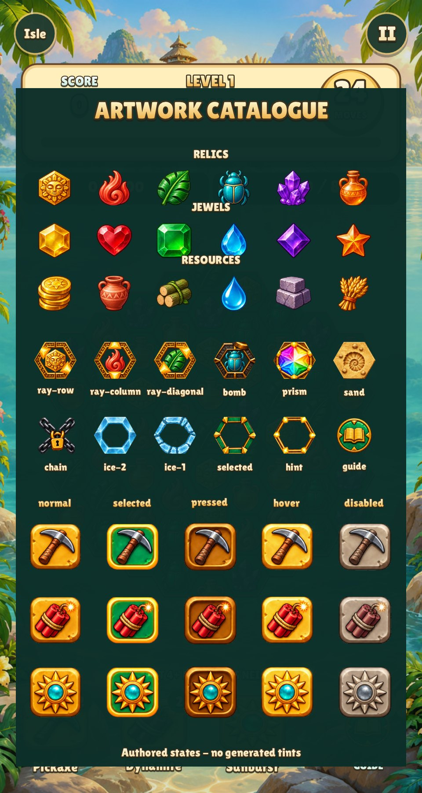
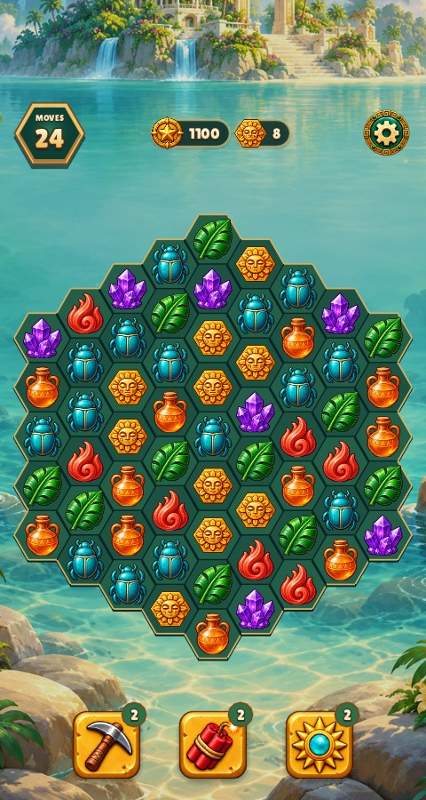
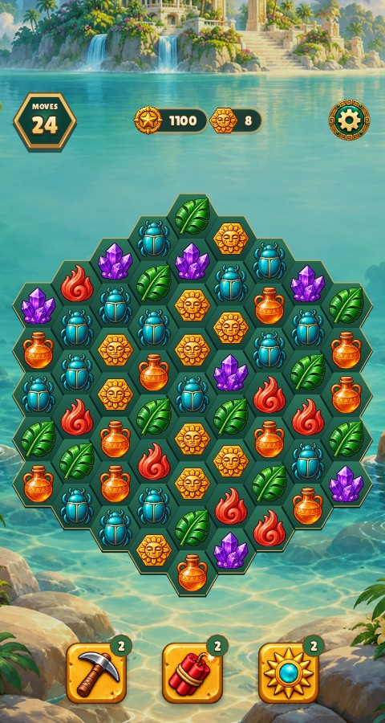
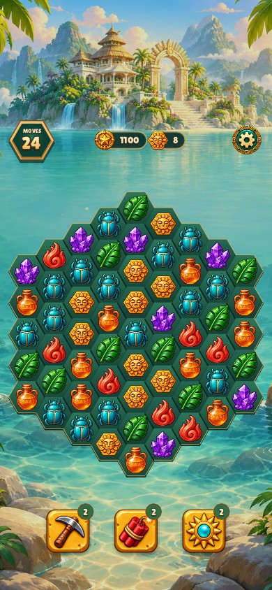
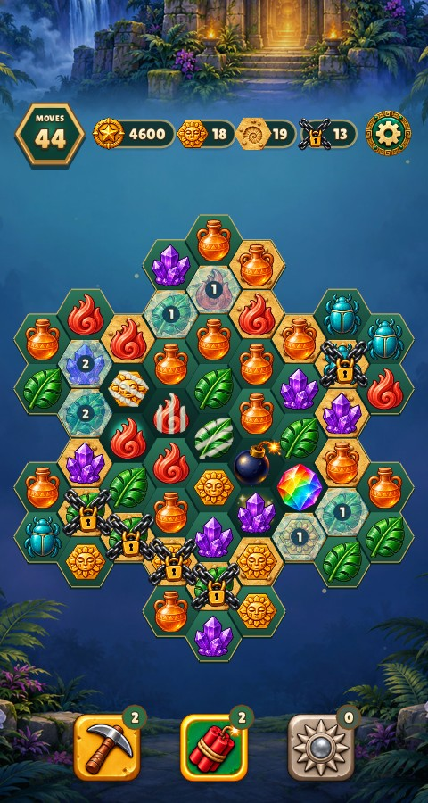
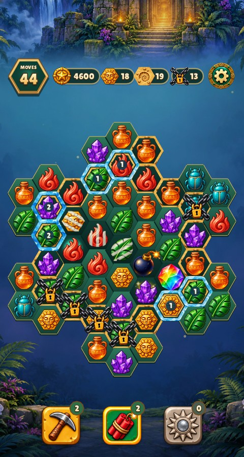
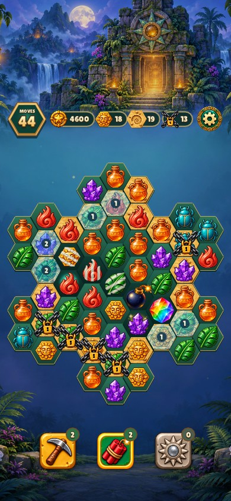
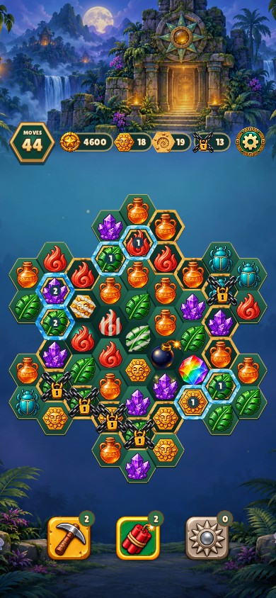
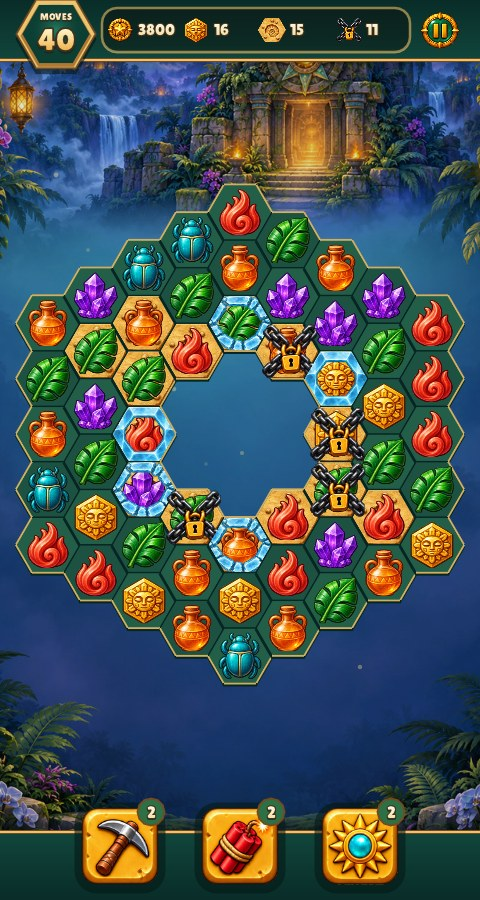

# Relic Rush artwork and state catalogue

## Chapter 1 quest objects

The [single ImageGen atlas](../art/quest-objects/source.png) and its [prompt](../art/quest-objects/prompt.txt)
contain eight recognizable objects. Their icons appear alongside the first-clear
story exchanges; the objects are found by the characters after the match-3 level.
They are independent of the selected match piece pack.

| Atlas slot | Quest object | Board and use |
| --- | --- | --- |
| `timber` | Camp timber | 1, put up the Expedition camp |
| `lens` | Lamp lens | 2, answer the light below the cliff |
| `cable` | Relay cable and broken end | 3 and 8, trace the route and establish that the cable is broken |
| `chart` | Tide chart | 4, read the route after restoring the Spring well |
| `marker` | Quay and shore markers | 5 and 6, locate the steps below the quay |
| `tools` | Tool roll | 7, equip the Artisan workshop |
| `supplies` | Supply crate | 9, stock the Jungle market supply point |
| `crank` | Shutter crank | 10, test the tide-room signal |

Run `python3 tools/relic_quest_art.py` from the repository root to register the source
into `data/quest-objects.png`. The tool only crops, resizes and centers the original RGBA art.
Each 128×128 slot passes the canonical hex check in strict object mode. The
[historical review captures](review/quest-campaign/README.md) show the retired board presentation and its story handoff.

## Additional board elements

The 48-cell [surface master](../../../engine/art/match3-elements/source.png) and
[exact prompt](../../../engine/art/match3-elements/prompt.txt) contain both games'
24-state families in one ImageGen call. The full-bleed tile faces are cropped,
resized and registered with the [canonical engine hex mask](../../../engine/art/hex-tile/README.md).
The two free-standing delivery pieces retain their authored alpha from the earlier
[master](../../../engine/art/match3-elements/source-v1.png) and
[prompt](../../../engine/art/match3-elements/prompt-v1.txt). The
[registration manifest](../../../engine/art/match3-elements/manifest.json) records
all sources, crops and runtime paths. From the repository root, reproduce the
states with `python3 tools/match3_elements_art.py`, then pack the runtime atlas
with `python3 tools/match3_atlas.py`. No colour or damage state is generated by
tinting; each was authored. The registration check verifies all 46 full-cell
states against the canonical mask.

| Role | Runtime atlas keys | Rule and visual states |
| --- | --- | --- |
| Sand goal | `sand` | Existing full-cell artwork marks each remaining sand goal beneath its piece. Matching over it clears the cell. |
| Stone | `stone-1`, `stone-2`, `stone-3` | Solid; adjacent matches or direct special effects reduce its remaining hits. |
| Coloured crate | `crate-0-1` through `crate-5-2` | Six matching kinds, each with one- and two-hit authored states; an adjacent matching colour or a direct effect damages it. |
| Tunnel | `tunnel-in`, `tunnel-out` | Fixed entry and exit; pieces transfer between them during a fall. |
| Growth | `growth` | One-hit overlay on a piece; it spreads after a turn in which no growth was damaged. |
| Delivery | `delivery`, `delivery-exit` | A nonmatching movable piece and its fixed destination. |

Board rendering, guide icons and goal icons use the same named atlas artwork;
the neutral skin preview falls back to this game's authored element sprites.
Review all strengths and colours on the actual board with
`--element-states --headless --fresh --mute --size 480x900`, and at 390×844.
The reviewed captures are [full size](../../../docs/review/match3-elements/relic-rush-states.png)
and [narrow](../../../docs/review/match3-elements/relic-rush-state-narrow.png).


This is the review inventory for the current game, audited 31 October 2026.
The original gap and acceptance criteria are tracked in [issue #11](https://github.com/corepunch/nile-archive/issues/11).
There are **18 base pieces, 5 special modifiers, 27 authored board/control sprites,
7 expedition-header icons and one investigating Elena cutout**.
The complete filename inventory, crop rectangles, rule names and state matrix live in
[`manifest.json`](../art/board-states/manifest.json). Paths below are relative to this game.



## Cell and goal alignment

Live green wells use the engine's flat-top hex geometry and a light-to-dark
vertical gradient. The atlas cell mask remains the registration reference for
authored art. Goal icons sit 3.6 logical units farther left over their
capsules, with collection flights landing at the same position.

Reproduce with `build/test/relic-rush "shot hex-first" "shot phone-board" "shot art-specials"`.

| Size | Before | After |
| --- | --- | --- |
| 480×900 |  |  |
| 390×844 |  |  |

[Board with blockers and specials](screenshots/review/cell-and-goals/specials.jpg)

## Buildings and decorations

The [building catalogue](building-catalogue.md) covers **96** registered sprites,
including ten story wonders and 86 repeatable shop items. It records the full
source/prompt history, runtime paths, whole-tile measurements, supported states,
import commands and reviewed in-game captures. The board manifest links the
building manifest and inventories every new runtime file.

The fifth restoration is now the **Sunstone courtyard**, a dry mosaic gathering
plaza replacing the bridge-shaped gateway. Its 3 x 2 footprint is measured from
the new artwork. The complete three-option ImageGen atlas, selection, source,
prompt and reviewed game captures are recorded in the
[replacement review](review/sunstone-courtyard/README.md).

## Reward and replay presentation

The [economy review](review/economy/README.md) records first-clear/replay rewards,
the measured expedition list, available/locked/resume rows and the shop's spendable /
reserved Gold. Sources are `engine/match3_game.lua` (the level list and shop) with
`data/game.json` (their words), `lua/screens.lua` and `lua/rules.lua`. The shared form skin supplies existing
normal/hover/pressed/disabled/focus controls. No new bitmap or icon set is added;
the existing normal Idol/Leaf/Crystal artwork identifies Gold/Wood/Stone. Board
matches contribute to score/objectives; wallet payouts use the separate fixed
grant contract. Discovery Stars/Compasses are one-time progress rewards, and
replays pay Gold only. All piece packs and authored board/tool states retain
their existing artwork and state mapping. Reproduce with `--victory`,
`--replay-victory`, `--expeditions --expedition-page N` and `--catalogue`.

## Pause menu actions

`lua/screens.lua` lays Pause out in groups, with the look in `lua/skin.lua`: a
settings well holding the Sound and Reduce motion checkboxes, then Resume, then
Restart and Quit to Island as secondary wooden buttons, and the guide as a link.
Restart asks for confirmation and resets the current puzzle; Quit to Island
suspends it without paying rewards. Island Pause hides Restart and Quit. (The
motion toggle was removed once and returned as the Reduce motion checkbox.)
Both menus measure their content before centring, including the taller
safe-area phone layout. States are listed below with the checkbox and button
variants; no artwork, source prompt, runtime file or sprite transform is added.
The menu contract is recorded in `art/board-states/manifest.json` under `pause_menu`.

Pause also carries a LEADERBOARD link above the guide link, and the results card a
LEADERBOARD button under the card, both drawn by the game skin (the jade button and the link
role). They open the engine's shared leaderboard dialog ([docs/GAMECENTER.md](../../../docs/GAMECENTER.md)):
a panel with Everyone / Friends tabs (the chosen one a jade button, the other a flat caption), a
scrolling list of rank, portrait, name and score rows (a round placeholder bust with the initial
while a portrait loads, "(you)" on the player's row), loading / empty / signed-out notes, and
Game Center and Close buttons. No artwork is added: every state is skin paint, and the portraits
come from Game Center at runtime. Reviewed captures: `pause`, `phone-pause`, `victory`,
`leaderboard`, `phone-leaderboard` and `level-leaderboard` in `docs/screenshots` (from
`build/test/relic-rush "shot leaderboard"` ..., with `--gamecenter-demo`).

Reproduce and inspect both contexts at both phone sizes with
`python3 tests/fixtures/pause-actions/capture.py`; reviewed captures and exact
commands are in the [pause menu review](review/pause-actions/README.md).
The game's `--smoke` run exercises Restart, Quit to Island, hidden island actions,
resuming through the expedition browser, and unchanged banked rewards.

## Piece kinds and optional packs

All packs use the same kind IDs and rules. Colours and silhouettes are authored;
the game does not recolour one gem into other kinds.

| ID / rule name | Relics (default) | Jewels | Resources | Rule meaning |
| --- | --- | --- | --- | --- |
| 0 / IDOL | Gold sun idol | Yellow hex gem | Coins | Idol objective and score; reused Gold purse icon |
| 1 / FLAME | Coral flame | Red heart | Terracotta amphora | A matched, unlocked flame thaws adjacent ice |
| 2 / LEAF | Jade leaf | Green square gem | Timber | Ordinary matching kind; reused Wood purse icon |
| 3 / SCARAB | Turquoise scarab | Blue teardrop | Water | Ordinary matching kind |
| 4 / CRYSTAL | Purple crystal cluster | Purple diamond | Stone | Ordinary matching kind; reused Stone purse icon |
| 5 / AMPHORA | Amber amphora | Orange star | Wheat | Ordinary matching kind |

Source: `art/tile-sets/source.png`, six columns × three packs. Runtime:
`data/tile-sets/{relics,jewels,resources}/{0..5}.png`. Import:
`python3 games/relic-rush/tools/prepare_assets.py` from the repository root.
Largest-component isolation removes neighbouring sprite fragments before centring
and resizing; it does not create new colours or states.

## Specials and powerups

Source for every new sprite below: `art/board-states/source.png`, generated together
in one built-in ImageGen call. The exact prompt is
[`board-states.prompt.txt`](../art/board-states.prompt.txt). The manifest records the
actual generated dimensions and explicit crop boxes; the importer does not assume
the generator produced a mathematically uniform grid.

Runtime pattern: `data/board-states/<name>.png`, RGBA 128 × 128.
Terrain and ice rims use the slot's **flat-top** silhouette. Special gems use
no hexagonal outline frames.
The replacement set is authored together in
`art/board-states/clear-indicators.png` (ImageGen, 2026-11-01), with its prompt
in `clear-indicators-prompt.txt`. The manifest records measured crop boxes,
spatial axis registration and runtime paths. The importer preserves authored
RGBA and clips filled ice to the actual tile; it does not synthesize states.
Selection and hints use soft filled glows, with no hard border.
`lua/art.lua` names these textures; `lua/board.lua` uses the same artwork for
live pieces, collection flights, clearing animations and the guide.

| Rule state | Authored name | Creation / behaviour |
| --- | --- | --- |
| NORMAL (0) | Base kind image | Three equal kinds in a straight line clear normally |
| ROW (1) | `ray-row` | Line of four; full-gem stripes along the 30° board axis |
| COLUMN (2) | `ray-column` | Line of four; full-gem vertical stripes |
| DIAGONAL (3) | `ray-diagonal` | Line of four; full-gem stripes along the 150° axis |
| BOMB (4) | `bomb` | Existing/review bomb or special combination; radius-one hex blast (cell plus six neighbours) |
| PRISM (5) | `prism` | Five or more in a straight line; clears the swapped kind |

Rays use `gfx.image_striped` on the matching gem at full size. Broad cream bands
follow the 30°, 90° or 150° clear axis, masked to the gem's authored alpha and
modulated by its surface shading. Bomb and prism sprites replace the gem at full
piece size. The old `ray-row`, `ray-column`, `ray-diagonal` images remain canonical
skin compatibility regions and no longer appear as tiny board/guide badges.

The user explicitly requested engine-drawn masked stripes on 2026-11-01; this
supersedes the usual authored-state requirement for this pattern. No generated
stripe atlas is used, and existing textures/alpha remain unchanged. Relics,
Jewels, Resources and the guide share the same renderer. The
[striped-special review](../../../docs/review/striped-specials/README.md) covers
all six kinds, all axes, the full bomb, both phone sizes and blockers.
See [match rules](match4-rules.md) for special-combination resolution.

## Terrain, blockers and board interaction

| Authored name | State and meaning |
| --- | --- |
| `sand` | One excavation layer under a piece; cleared by a match above it |
| `chain` | Crossed linked chains and padlock; one hit unlocks the piece |
| `ice-2` | Filled faceted frost sheet across the whole gem; counter **2** means two hits remain |
| `ice-1` | Filled cracked frost sheet across the whole gem; counter **1** means one hit remains |
| `carpet-swatch` | Moss (Homescapes' carpet), levels 18, 24 and 28: tiled under one rounded patch over every covered cell (`texture.hex_field` + `gfx.sdf_mask`); a match touching it spreads it. Original swatch, resized full-bleed by `tools/homescapes_atlas.py`. [Review](../../christmas-market/docs/screenshots/review/carpet/levels.jpg) |
| `goal-carpet` | Moss goal and guide icon: rounded hex, smooth rim, pebbles set in, soft shadow; `python3 tools/carpet_goal_icon.py` |
| `selected` | Soft filled mint glow under the tapped piece; no outline |
| `hint` | Soft filled gold glow and sparkles under both idle-hint pieces; no outline |
| `guide` | Jade book medallion for the explorer guide; not drawn on the board since the [match-3 HUD](review/match3-hud/README.md) (the guide opens from Pause), kept for the art catalogue screen |

The live board and guide use `sand-edge`, `ice-1-edge` and `ice-2-edge`.
Each takes an edge band from its corresponding authored crop. Sand sits
slightly inward when ice shares its cell. The two ice states keep the dynamic
1/2 remaining-hit count. Ice and chain are independent layers and a blocker hit
removes a layer before collecting its piece. Selected/hint frames are under
pieces, blockers over them, and sand beneath both. Board cells and outer edge lines remain
simple intentional layout geometry. Empty/inactive cells have no piece artwork.

Regenerate the spatial crops and atlases with `python3 tools/fit_match3_edges.py`.

| Size | Before | After |
| --- | --- | --- |
| 480×900 |  |  |
| 390×844 |  |  |

[Explorer’s Guide](screenshots/review/frost-edges/guide.jpg) · [Narrower phone guide](screenshots/review/frost-edges/phone-guide.jpg)

Hint opacity pulses; reduced motion uses a steady frame. There are no hover/pressed
states for individual pieces: a touch selects a piece or initiates a swap.
If idle hint search finds no legal swap, the existing reshuffle now also recovers
idle boards and shows the text-only notice “No moves. Board reshuffled.” No new
sprites or derived artwork are used. The existing hint artwork still marks only
legal swaps; [review captures and reproduction](review/dead-board/README.md)
cover a zero-charge ring at both phone sizes.

## Tools: complete interaction matrix

Each tool starts with two charges per level, costs no move, and is used by selecting
it then tapping an active cell. Pickaxe hits one cell; dynamite hits its cell and
six neighbours; sunburst attacks all three axes through its target.

All fifteen buttons are separately painted in the same atlas, including their
backgrounds. The renderer never desaturates, tints or synthesizes a disabled state.
Their updated source is `art/tool-buttons/source.png`, generated together in one
built-in ImageGen call; the exact prompt is [`tool-buttons/prompt.txt`](../art/tool-buttons/prompt.txt).
The original 27-sprite atlas remains the source for hex layers and the guide.
Tool crop boxes and the separate atlas's dimensions are recorded in the manifest.
The importer spatially registers each measured button body (plus eight source
pixels of padding) into a 120×120 area on the existing 128×128 runtime canvas,
preserving authored alpha and all five painted states. This corrects the source's
roughly 4% width excess; no visual state is generated by processing.
Runtime paths remain `data/board-states/{pickaxe,dynamite,sunburst}-{state}.png`.
`lua/art.lua` specifies 76×76 touch targets, and `lua/board.lua` draws each texture
into a square with equal padding. The row begins at y=784 plus tall-phone offset;
labels sit below the buttons and counters stay at their upper-right corners.
Reproduce with `python3 games/relic-rush/tools/board_assets.py`; validate with
`--check`. [Actual-game captures and native-input checks](review/square-tools/README.md)
cover every tool/state plus normal and exhausted rows at both phone sizes.

| Tool | Normal | Selected | Pressed | Mouse hover | Disabled |
| --- | --- | --- | --- | --- | --- |
| Pickaxe | `pickaxe-normal` | `pickaxe-selected` | `pickaxe-pressed` | `pickaxe-hover` | `pickaxe-disabled` |
| Dynamite | `dynamite-normal` | `dynamite-selected` | `dynamite-pressed` | `dynamite-hover` | `dynamite-disabled` |
| Sunburst | `sunburst-normal` | `sunburst-selected` | `sunburst-pressed` | `sunburst-hover` | `sunburst-disabled` |

Priority: depleted or board busy → disabled; held pointer that began inside →
pressed; selected tool → selected; real mouse inside → hover; otherwise normal.
Touch never receives hover art. Charge counts are dynamic text on a counter.
The tools stand along the bottom edge on the painting, three evenly spaced
buttons without captions; choosing one names it and its effect in the toast.

## Expedition header

The header floats on the painting with no band or plate behind it. It holds a
hexagonal Moves medallion, one resource panel per goal (the engine's
`skin:draw_resource`, the same element as the island wallet) and the authored
pause medallion. Score remains a win condition, represented by the star seal;
idols, sand and lock counts use their existing artwork. A met goal dims its icon
and replaces the count with the completed seal. Collections landing on a goal
make its icon bounce. Over the last five moves the medallion face turns red and
glows. The panels and medallion are drawn with engine shapes; the goal panels
and medallion are read-only and have no pressed/hover states
([reviewed captures](../../../docs/review/resource-panels/README.md)). No score total, level title,
progress bar or island shortcut is displayed during an expedition. Level details
are in Pause; results retain score/reward details. Pause's Restart (confirmed)
and Quit to island (keeps the board) are the in-round exits; win/failure screens
provide theirs.

`art/expedition-hud/controls.png` contains **all seven new icons together in one
built-in ImageGen call**. The exact prompt is
[`controls-prompt.txt`](../art/expedition-hud/controls-prompt.txt). `pause-normal`,
`pause-selected`, `pause-pressed`, `pause-hover`, `pause-disabled` are individually
painted jade/gold medallions. `score` denotes the remaining score objective;
`complete` denotes any fulfilled objective. The runtime button uses normal,
pressed and real-mouse hover states; selected/disabled artwork is supplied for
the complete control contract. No tint or procedural bars create states.

The shared board/city Pause medallion uses a 64×64 logical-unit canvas and touch
area, enlarged from 44×44. The existing authored states scale directly. Board
goals reserve 64 units beside the button; city currency pills use 76-unit spacing
and 72-unit widths to stay clear of it. The smoke run opens board Pause at the
new left edge and city Pause at the new lower edge, outside the old touch area.
[Reviewed headers at both phone sizes](review/larger-pause/README.md).
Runtime: `data/expedition-hud/<name>.png`, 128×128 RGBA.

`art/expedition-hud/elena-investigating.png` is a separate ImageGen identity edit
of the existing Elena portrait: she examines a sun fragment through a magnifying
glass. [Exact portrait prompt](../art/expedition-hud/elena-prompt.txt). It was
shown between the old goal and moves cards; the match-3 HUD retires it, so it has
no runtime export and the manifest lists it as `retired_portrait`. Dialogue
continues using the original Elena portrait.

Measured crops, source dimensions, prompts and runtime paths are recorded in
[`expedition-hud/manifest.json`](../art/expedition-hud/manifest.json), referenced
by the primary runtime manifest. Import is aspect-preserving spatial registration
with authored alpha retained, never derived state artwork:
`python3 games/relic-rush/tools/prepare_hud.py` (`--check` verifies exact exports).
`lua/art.lua` loads the contract; the measured horizontal engine list in
`lua/board.lua` owns the goal cells. Collection flights land on the new goal positions.
[Reviewed game captures and native input checks](review/expedition-header/README.md)
cover both backgrounds, both phone sizes, completed goals, every pause state,
and dismissible/required popup behavior.

[Match-3 HUD before/after captures](review/match3-hud/README.md) cover both
paintings, both phone sizes, completed goals, the last moves, a tapped tool,
pause, guide and the island.



## Animation and effect states

| State | Presentation / assets |
| --- | --- |
| PRESENT | The board's entrance after any dialogue: existing HUD, tool, cell, piece and blocker artwork move on the shared timeline in `engine/board_intro.lua`, with transient glows, sparks and a sheen. No new art. Tap skips it. Capture: `build/test/relic-rush board-intro` (`--level 5 --present --reel`), frames in `build/shots/frames/` |
| DIVE | Town <-> board transition: the screen being left blurs into a warm flash (the town's camera zooms into its newest building), the other settles out of it; procedural (`gfx.backdrop`, camera zoom) in `engine/match3_game.lua`, no art. Input waits for it; reduced motion skips it. Capture: `build/test/relic-rush relic-rush-town-dive` (`--city 3 --dive --reel`), frames in `build/shots/frames/` |
| Idle | Base or special frame, optional sand/selection/hint/blocker layers |
| SWAP | Existing piece artwork moves to neighbour |
| REJECT | Same artwork returns; no move spent |
| CLEAR | Existing artwork expands briefly, then shrinks and fades; a blocked hit keeps the piece |
| FALL | Engine one-edge gravity steps prefer straight down; diagonals require a blocked or missing cell below the donor, then land with a short squash; all exposed column tops spawn vertically; interior cells spawn only with blocked donors |
| Special birth | Existing authored special plus transient halo/sparks |
| Attack | Procedural travelling rays, bomb rings, prism links and combo effects |
| Collection | Existing base-kind image flies to resource HUD with a trail |
| Reduced motion | Suppresses trails, shake, squash and effect spawns; the board's entrance becomes a short fade; rule resolution stays active |

Transient light, beams, rings, particles, score text and sunlight motes
are intentional animation primitives, not missing static artwork. Result-card
torch sconces and their flame renderer have been removed; reviewed standard
and safe-area phone captures are in `docs/review/result-without-torches/`.
`engine/match3_vfx.lua` creates an additive light texture in memory; see
[effects and capture modes](effects.md). There are no additional hidden gem skins
for burning, charging, cracked gems or tool upgrades.

### Particle sprites (`data/particles.png`)

Seven sprites from Kenney's CC0 [Particle Pack](https://opengameart.org/content/particle-pack-80-sprites)
texture the impact, spark and bomb effects. The original black-background PNGs
and `License.txt` are retained in `art/particles/kenney/`;
`python3 tools/pack_particles.py relic-rush` (from the repository root) resizes them, turns brightness into alpha on
white and writes `data/particles.png` with its contract `lua/particle_skin.lua`.
`engine/match3_vfx.lua` draws them additively, tinted with each piece's effect colour.
They are transient effect sprites with no interaction states. Ray beams,
prism links, special births and the bomb's leading ring stay procedural.

| Sprite | Kenney source | Use |
| --- | --- | --- |
| `shock` | `circle_03` | Soft outer band of the bomb shockwave |
| `flash` | `light_01` | Bomb bloom |
| `burst` | `star_09` | Bomb centre flare, under the glint |
| `ring` | `circle_02` | Per-cell impact ring |
| `glint` | `star_07` | Four-point twinkle on impacts, the bomb centre, ray tips and births |
| `twinkle` | `star_06` | Spark particles and shard heads |
| `streak` | `trace_06` | Shard particles, aligned to their velocity |

Review: [kenney-particles](review/kenney-particles/README.md) (bomb and ray frames before and after,
`--fx bomb|ray --frames N`).

## Remaining runtime asset families

`cloud-fog` covers locked land with rolling cloud banks (`city.fog_clouds`, `engine/city.c`).
Two world-space density fields of three spatial frequencies each drift on the smooth frame
clock. Density modulates soft cloud edges, blue-grey hollows and pale sunlit lobes. The cached
closed-land mask stays fixed, and unlocking clears it immediately. Open land stays clear. This
is a continuous procedural effect, with no icon or interaction-state atlas. See the
[review](review/cloud-fog/README.md).

`building-shadows` is a separate Blender-rendered RGBA layer for all 96 objects, drawn below the
fog and every sprite; see [registration](BUILDINGS.md).

The current [96-entry catalogue](building-catalogue.md), including the dry Sunstone
courtyard, is rendered directly from its Blender master with the shared
[city camera](../../../docs/BUILDINGS.md#the-camera). The earlier
[ImageGen paint-over](../art/isometric-paintover/README.md), the
[2:1 building-art trial](../art/isometric-trial/README.md) and the
[Blender projection study](../art/isometric-blender/README.md) are preserved as source
history; all of them use the old 2:1 view, and none is runtime artwork. Painted detail is
the known gap recorded in the [building catalogue](building-catalogue.md#known-gap-no-paint-over) and [tracked here](https://github.com/corepunch/nile-archive/issues/41).

These families plus the board assets above cover every file in `data/`;
`runtime_inventory` is checked against disk by `make test`.

| Runtime files | Source / ownership | Supported states |
| --- | --- | --- |
| `data/buildings/<key>.png` | Blender master; `make buildings GAME=relic-rush` | Authored restored sprite; valid placement reuses it, blocked placement uses the existing engine red ghost, held placement lifts it; cards/rewards use it alone |
| `data/building-shadows/<key>.png` | Blender master; `make buildings GAME=relic-rush` | Separate grounded shadow for restored/valid/blocked/held states; own crop/pivot and shared pixel scale; all shadows below all buildings; omitted in cards/rewards |
| `data/characters/{elena,mara,tomas,adrian}.png` | `art/art-direction/expedition-cast.png`; prepare_assets.py | One authored bust each; engine supplies speech/thought/shout bubbles |
| `data/{island,jungle,scene-lagoon,scene-temple}.jpg` | Corresponding paintings in `art/` | Island, fallback jungle, levels 1–5 lagoon, levels 6–10 temple |
| `data/board-states/cell-mask.png` | Actual `gfx.ngon` capture in `art/board-states/cell-mask.png` | Shared flat-top slot silhouette; clip mask, not an icon/state |
| `data/title.png` | `art/title.png` | Retained title asset; the current minimal HUD does not draw it |
| `data/fonts/LilitaOne-Regular.ttf`, `lilitaone-OFL.txt` | Bundled licensed font | Dynamic labels, counters, outlined/gradient typography |

The reusable engine UI now owns form layout, input, focus, data exchange and modal
Gaussian blur; the game supplies its skin and templates for pause, building and
guide dialogs. The guide uses one stable-key data source, a measured list and
left-aligned icon/copy rows. Speech, thought-cloud and shout-burst badges centre
on the visible outline; their puffs/spikes contribute to text padding. Framed
phone dialogue centres the portrait, visible bubble and any listener as one
measured unit within the safe screen; Skip travels with that unit. Reviewed
480×900 and safe-area 390×844 comparisons are in `docs/review/centered-dialogue/`.
The badge/padding audit is tracked in [issue #16](https://github.com/corepunch/nile-archive/issues/16).
Reviewed comparisons live in `docs/review/dialogue-stack/` (all three shapes,
one/two-line speech, 480×900 and safe-area 390×844, plus the guide). See [the UI engine](../../../docs/UI_ENGINE.md).

Board presentation restores the original 26.5-unit cell radius, fitting the
maximum nine-column grid into 371/480 logical screen units. The previous fixed
32-unit radius made the settled board about 21% too large. Base pieces, the
cell mask, specials, blockers and selection/hints share the restored geometry;
authored alpha and orientation are preserved. Cell positions, input and refill
clips use the same radius. Guide icons retain their original size. Sources:
`lua/state.lua`, `lua/board.lua`; no bitmap or interaction state is added.
The entrance settles to a 1× pose after natural completion, skipping or reduced
motion. Representative before/after captures at both phone sizes, plus
reproduction, are in
[the size correction review](review/board-size-fix/README.md).

Superseded twice (by the Goal/Moves cards and then the match-3 HUD above):
the board HUD used three small, separate jade cards with gold rims: score,
level/name and moves. Each label stays grouped with its value; objective pills
share the same near-opaque backing. The painting remains visible in the gaps.
The read-only `hud_form` in `lua/board.lua` uses engine row/column layout,
computed values and a paint-only skin. Text keeps its outlined/shadowed palettes;
score pulses and progress remain animated. No authored sprite or interaction
state is added. The earlier unbacked HUD lost contrast and is superseded by
[the grouped-card review](review/readable-hud/README.md), including both paintings,
phone safe areas, modal underlays and effects. Historical captures are in
`docs/review/floating-hud/`.

The island's redundant minus/plus/MAP button cluster has been removed from
`engine/match3_game.lua` (the town hooks). Navigation uses the shared city camera: pinch or mouse
wheel to zoom and drag to pan. Placement, confirmation and long-press pickup
are unchanged. No bitmap or state mapping changed. Normal, overview and
placement captures at both phone sizes are in
[the map-control review](review/gesture-only-map/README.md).

Building pickup now uses the engine's stationary 0.5-second hold; ordinary drags
pan the map. The existing ghost/footprint, held/released, valid/blocked and
confirm/cancel states are retained. [Issue #21](https://github.com/corepunch/nile-archive/issues/21)
tracks gesture arbitration and the two-game input audit. Sources are
`engine/city.c`, `engine/core.c` and `engine/match3_game.lua` (the town hooks); reviewed native-input
captures and reproduction commands are in
[the shared gesture review](../../../docs/review/city-long-press/README.md).
No bitmap or atlas mapping is added.

The island HUD has no sheet or panel over the map: one row of slim resource
pills, the shared pause medallion, and a bottom row of a large Play/Build button
between icon-only round Expeditions and Shop buttons. The side-button centres
share the Play/Build button’s centre line; captions beneath them are removed.
The round buttons are engine geometry
(gold rim, jade face) around existing artwork: the procedural compass icon and the
Jungle market sprite (`data/buildings/3.png`). Their pressed state shifts the face
2 units, as menu buttons do; there is no hover, selected or disabled state because
they are always available. The EXPAND pill is gone: a region that can open now
shows "+" and a glow on its fog marker, and its name is outlined text without a
plate. [Island HUD captures](review/island-hud/README.md).

The Pause menu's Sound and Reduce motion settings are engine `checkbox`
controls drawn by `lua/skin.lua` (`controls.checkbox`): a 40-unit well in the
panel's wooden rim on a jade shadow, filled with a jade face, gloss and a cream
tick with a dark rim when checked. States: unchecked, checked, pressed (box and
tick sink 2 units) and disabled (rim and fill turn grey; not used by the game).
Hover looks like normal, as for every Relic Rush control, because touch has no
hover. All of it is engine geometry, like the menu buttons, with no bitmap.
Checked = sound on / motion reduced; the binding writes the setting at once.
[Reviewed captures of every state](../../../docs/review/ui-skin-files/README.md#relic-rush-pause-checkboxes).
`--smoke` clicks Sound off and on again through real input.

Pause groups its controls, as pause menus in other match-3 games do. The two
checkboxes sit in a recessed well (`controls.panel.variants.group`: a sand
gradient with a darker rim). Below it come the jade RESUME and two secondary
actions in carved wood (`controls.button.variants.secondary`, same layers and
states as the jade button: pressed sinks 2 units, disabled drains it). EXPLORER'S
GUIDE is a gold text link (`variants.link`: no layers; pressed moves the text).
From the island Pause shows only Resume. RESTART opens a confirmation
(`OV_CONFIRM`): RESTART in jade and KEEP PLAYING as a link, which returns to
Pause. QUIT TO ISLAND keeps the unfinished board. All are engine geometry
with no bitmap. Captures at both sizes, in the board and on the island, are in
[the skin review](../../../docs/review/ui-skin-files/README.md#relic-rush-pause-grouped-with-restart-and-quit).

Resource capsules, island HUD buttons, progress bars, menu buttons, result stars, placement outlines, land
fog and dialogue chrome are intentional engine geometry/text; they are not gem
or tool artwork states. Existing island, dialogue and result captures are linked
from the [README](../README.md). App icons live in `Assets.xcassets/`, outside the
runtime data inventory; their source and selection records are in `art/app-icon/`.

## Reproduce and keep current

From the repository root:

```sh
python3 games/relic-rush/tools/capture_cell_mask.py  # when cell geometry changes
python3 games/relic-rush/tools/board_assets.py
python3 games/relic-rush/tools/board_assets.py --check
python3 games/relic-rush/tools/check_art_catalogue.py
make test
./build/relic-rush --headless --mute --fresh --art-states --shot catalogue.png
./build/relic-rush --headless --mute --fresh --art-board --shot specials.png
./build/relic-rush --headless --mute --fresh --tiles jewels --art-board --shot jewels.png
```

Use Xvfb on Linux. `tools/screenshots.py` regenerates the catalogue and special
board as well as ordinary levels, guide, effect and phone captures. Review at
480 × 900 and 390 × 844 with phone safe areas. `--art-board` freezes a deterministic
level-nine board with all five specials, selection/hints and selected/depleted
tools; `--art-states` displays every base piece and all 27 authored sprites through
the real renderer. These capture modes do not save progress.

For every addition, update this document, the manifest inventory and state mapping,
and the runtime contract together; add capture coverage. A new file without an
inventory entry, an absent authored state, or a stale atlas crop fails CI. When
changing existing definitions, audit their actual rule meaning as well as names.
If any visual gap remains, open/link a GitHub issue here before handoff. No known
placeholder board/control states remain from issue #11.

## Island connector removal

`lua/island.lua` disables the engine's procedural roads between buildings
with a transparent `city.path`. Building sprites, shadows and terrain assets
keep their existing registrations. Reviewed 480×900 and 390×844 captures are
in [the road removal comparison](review/no-auto-roads/README.md).

## Engine match-3 atlas and trickling

`data/match3.png`, registered by `lua/match3_skin.lua` and
`art/match3-atlas.json`, contains all match-board backgrounds, pieces, special
axes, blockers, selection/hint/guide frames, HUD icons and all five authored
states of each tool and Pause. Relic Rush includes all three piece packs and
both scenes. Existing source artwork and alpha are copied without modifying
states. The 64px cubic radial light is the existing procedural transient
effect, packed in the same atlas and drawn with a per-view additive flag.

The shop's built and locked tiles use `data/expedition-hud/shop-built.png`
(checkmark) and `shop-locked.png` (padlock), packed into the same atlas as
`shop-built` and `shop-locked`. Relic Rush and Christmas Market ship the same
two files. Their source, prompt and per-game styling are not yet recorded:
[#90](https://github.com/corepunch/nile-archive/issues/90).

The engine's default resource skin is independent and embedded; both games
normally override it. `python3 tools/match3_atlas.py` reproduces the atlases and
registrations, and `make gen` embeds the default. FALL uses engine-owned
simultaneous one-edge movement steps, straight-down priority with blocked-down diagonal fallback, vertical spawning at every exposed column top and
a short landing squash; static states continue to use the existing artwork.
Input and animation timing are shared.

See [checked in-game captures and commands](review/trickling/README.md) and the
[engine contract](../../../docs/MATCH3_ENGINE.md). The default atlas's source,
prompt, all supported states and crop/rotation registration are catalogued in
`engine/art/match3/manifest.json` at repository root.

### Flat-top hex pieces; original gem set retained

Relic Rush retains its original flame and the other original piece identities.
Only the sun idol and yellow hex gem contours were reauthored to match the
board's six-sided flat-top orientation; the sun face remains upright.
`art/tile-sets/source-flat-hex.png` and `flat-hex.prompt.txt` preserve the whole
set edit. `piece_replacements` in the state manifest records both crops and
their spatial fit to the renderer-authored cell aspect. The other sixteen
pieces, including the flame, match the original runtime pixels exactly.

The clay brick belongs to the independent engine default atlas and is not used
by this game's overrides. Reproduce with `python3 tools/match3_atlas.py` and
`make gen`. Review [actual boards and guide](../../../docs/review/resource-icons/README.md).


### Cell registration and dialogue motion

The board retains its enlarged 32-unit radius and 16-unit side margins. Pieces
and state panels scale together by `32 / 26.5` from the authored registration:
the 43.7-unit piece canvas becomes about 52.77 units, while the inset 51.4-unit
cell/state canvas becomes about 62.07 units. This preserves piece padding and
keeps neighbouring cell faces, selection/hint frames and special panels apart.
Filling the entire cell diameter had removed that inset; reducing the board
radius then lost the deliberate wide layout without repairing the proportions.
The guide and HUD retain their own sizes. Artwork and alpha are unchanged. See
the [wide-board and cell-fit review](review/gem-cell-fit/README.md) for both phone
sizes, the selected/special cell view and existing capture commands.

Portraits retain finite entrance/exit slides and fades. An independent colour
tween brightens/dims active/listener states without replaying the slide. Size is
constant for speaker/listener, with no scale/rotation animation or idle wobble. See [motion, captures and timing review](../../../docs/review/motion/README.md).

### Placement confirmation controls

`engine/match3_game.lua` (the town hooks) uses an engine form with `placement_cancel` and
`placement_confirm` variants from `lua/skin.lua`. These are procedural UI skin
controls like the existing checkbox: red round × (cancel) and jade round ✓
(commit build/move), normal/hover/pressed states with a keyboard-only focus ring; confirmation fades when
invalid. No texture substitution or gem-art tint is used. Their screen positions
follow the preview sprite with safe-screen clamping, at 480×900 and 390×844.
Reproduce with `--city 6 --placing` or `--placing blocked`; reviewed captures are
in `docs/review/relic-polish/` at the repository root. Existing native-input smoke
covers both cancel and confirm, including uncommitted moves and wallet changes.

## Current-camera building paint pass

All registered buildings and decorations use the painted-v1 sources, normal sprite
and unchanged engine placement/lift/validity states documented in the
[building catalogue](building-catalogue.md) and
[review gallery](review/painted-buildings/current-camera/README.md).

## Centred board indicators and placement input

The former centred lightning/bomb overlay was replaced by the engine-masked
stripes and full-size bomb described above. Ice **1**/**2** counters are centred on
their cell and drawn last, above every board layer. The guide shares the current piece rendering. Authored PNGs and alpha are unchanged;
the former corner offsets remain removed. No new bitmap assets.

Touch/mouse use removes the placement button's keyboard focus outline; Tab
restores keyboard focus. Preview movement requires dragging the building.
Pickup and release/drop emit feedback; Confirm and Cancel add none. See the
[review and reproduction commands](../../../docs/review/relic-input-feedback/README.md)
for both phone sizes and the dense special/blocker state board.

## Placement alignment guides

`placement-guides` uses the shared `engine/city.c` renderer. While moving or
placing a building, other buildings show neutral cream outlines with dark
contrast edges around their occupied ground, including placement clearance.
The building in hand retains its green/red footprint; its original location
is omitted. Guides stay visible after release until Confirm/Cancel, then hide.
The guides use the existing camera and tile measurements; artwork, alpha,
footprints and collision rules are unchanged. No bitmap or ImageGen source is
added. Reproduce with the existing native-input hold/placement captures in the
[review](../../../docs/review/city-placement-guides/README.md).

## Settings gear and three-resource wallet

The legacy `pause-normal`, `pause-hover`, `pause-pressed`, `pause-selected` and `pause-disabled` keys now draw the authored settings gear from `art/expedition-hud/settings-lives.png`. `life` is the red heart from the same atlas; it is a wallet readout, not an interactive control. The hex amulet uses the existing archaeological sun idol, and discovery stars retain their documented procedural glyph. Wood, stone and compasses are retired from wallet UI, costs and rewards; their old slots remain reserved for save compatibility.

All five gear states were generated together by ImageGen; `settings-lives-prompt.txt` records the prompt and alpha cutout edit. `python3 games/relic-rush/tools/prepare_hud.py` performs only grid crops and thumbnail registration to 128px RGBA canvases, preserving authored alpha and paint. `tools/match3_atlas.py` then packs the five gear states. No tint-generated interaction state is used. Captures: `docs/screenshots/hud-states.jpg`, `hex-first.jpg`, `phone-board.jpg`, `island-village.jpg` and `phone-island.jpg`. Normal, selected, pressed, hover and disabled use the same authored outer medallion, with distinct painted state feedback.

The larger Buildings and Play actions reuse the existing jade button skin in all its states. Expeditions remains the smaller compass action. Building name/subtitle bubbles use the existing story bubble renderer and persist until the next press.

## Island image actions and prominent resources

The **bottom of the town screen** now has Build (left), a large Play (center),
and Levels (right). Build and Levels have equal 88×88 slots; Play has a 144×144
slot. The shared `town` form centers the controls and routes Levels to the
existing expedition / winter-wishes level-selection action. Game boards and
other menus keep their existing controls.

The replacement artwork is deliberately simple: one hammer, one Play triangle,
and one level-list icon, each filling a plain face with a thin rim. No stalls,
roofs, foliage, ribbons, star crests or decorative surrounds. Christmas retains
only a light snow edge; Relic Rush uses jade and amber faces.

Source: `art/navigation/controls.png`, an authored transparent **5×3** atlas;
exact ImageGen prompt: `art/navigation/prompt.txt`; deterministic bounds and
runtime paths: `art/navigation/manifest.json`. Columns are normal, hover,
pressed, selected and disabled; rows are Build, Play and Levels. Pressed faces
are recessed, selected faces have a simple double rim, and disabled icons are
engraved into dull material. All states are authored separately; no runtime
recolouring or procedural icon overlays. Each manifest box is a 324×324
square centred on its atlas column's and row's visible art (the earlier
equal-fifths grid cut the art off-centre and clipped some rims); the row-wide
vertical centre keeps the pressed drop. The crop is scaled evenly into a
160×160 RGBA image under `data/navigation/`, so the visible buttons are
centred in their slots and `town.json`'s `bottom` puts Play's lower edge as
far from the screen edge as Build and Levels are from the sides.

| Role | Runtime state names (all `.png`) |
|---|---|
| `navigation_build` | `build-normal`, `build-hover`, `build-pressed`, `build-selected`, `build-disabled` |
| `navigation_play` | `play-normal`, `play-hover`, `play-pressed`, `play-selected`, `play-disabled` |
| `navigation_levels` | `levels-normal`, `levels-hover`, `levels-pressed`, `levels-selected`, `levels-disabled` |

Reproduce: `python3 games/relic-rush/tools/prepare_hud.py --navigation-only`;
append `--check` to verify exact exported pixels. Runtime inventory and asset
catalogue checks cover the added files. `lua/art.lua` documents all three roles;
`--hud-states` uses the live skin to draw all fifteen states.

**Pending validation:** genuine before/after town captures at 480×900 and
390×844 (safe area 0,47,0,34), plus the existing HUD state shot. Native builds
remain blocked here by missing OpenGL/X11/EGL headers and Xvfb, and Lua lint by
missing `luacheck`. Assets and Lua syntax can be checked independently; no
fabricated game screenshots are supplied. Follow-up tracked by
[#84](https://github.com/corepunch/nile-archive/issues/84). Unpublished review
only; PR publication and merging require user approval.


The shared form still owns hit testing, focus and activation. The smaller Expeditions compass remains between the primary actions. Resource icons are drawn at 60 units beside 36-unit counter bars; they deliberately protrude beyond the pills, including their interactive bounds. The island settings gear uses an 88-unit art/touch box; expedition-board geometry stays unchanged. Toasts sit above the taller image actions. New art and every authored state are reviewed in `docs/screenshots/image-buttons-after/hud-states.jpg`; actual home UI at 480x900 and 390x844 is in the same review folder.

Straight-line match-3 rules: ordinary triples, four-in-line rays on all three axes, and five-plus prisms reuse the existing authored states. The guide now shows a prism alone for the five-plus recipe. Bomb artwork remains for existing pieces, tools/effect reviews and special combinations; no nonlinear group creates one. See [rules](match4-rules.md).

## Three-episode story presentation

All 46 scenes / 120 lines reuse the authored cast sheet `art/art-direction/expedition-cast.png` and its four RGBA crops `data/characters/{elena,mara,tomas,adrian}.png`. Original prompts and crop reproduction are in [art direction](art-direction-v2.md) and `python3 games/relic-rush/tools/prepare_assets.py`. No character is missing: Elena investigates, Mara pilots the Marigold, Tomas is the archivist, and Adrian funds the expedition. Cornelius is an off-screen missing person, not a speaking fifth portrait. Kessler, the Meridian Society's man, speaks but is deliberately never seen: his radio and loudhailer lines are engine captions with a name tag and no bust, which is the intended final state, not a missing asset.

The runtime cast all face right. The portrait import mirrors Adrian’s crop from the original lineup to match the other three. It also isolates Mara’s bust from a stray fragment of the neighboring portrait while keeping her canvas and anchors. Run `python3 games/relic-rush/tools/prepare_assets.py --portraits-only` to reproduce the exports. The story renderer mirrors the portrait on the right side and keeps partners facing one another across turns. [Phone captures](review/portrait-facing/README.md) show the staging. Body text is 31.5 points, names/building bubbles 22.5 points, retaining the cream/ink palette. All thirty boards use the existing packs and the Lagoon/Temple paintings; the island and all ten wonder sprites/registration remain unchanged. Narrative-specific building bubbles reveal only clues the player has reached. The implementation intentionally stages scenes over existing paintings rather than adding cinematic panel assets.

Runtime contract: `lua/art.lua:A.story`; mapping: `art/board-states/manifest.json:story`. Script compilation: `python3 games/relic-rush/tools/prepare_story.py`. Reproduction and inspected game captures are in [story review](review/story/README.md); use `--story-beat before-11`, `--story-beat after-28`, or `--story-beat after-30 --story-line 9`.

## Original Homescapes board atlas

Current board art supersedes the earlier striped-gem and themed-piece mappings below/above. `ray-row`, `ray-column`, `ray-diagonal`, `bomb`, `prism` and `plane` are standalone original power-ups; all piece packs alias `kind-0` through `kind-5`. Original cookies, donut, cherry, box strengths, ice and chain variants share `data/match3.png` with retained board controls. No new art was generated and no states were recolored.

See [the shared feature/asset catalogue](../../../docs/HOMESCAPES_HEX.md) and `art/match3-atlas.json` for source PNGs, original regions, exact registration transforms, hashes, reproduction command and reviewed captures. Diagnostic blocker/generator states are tracked in [issue #98](https://github.com/corepunch/nile-archive/issues/98); these are not finished 1:1 artwork. Existing selected/hint/pressed/hover/disabled control artwork remains in the atlas.

Live field correction: removed all legacy gold/snow/sand edges, selection/hint frames and ice badges. Only original Homescapes sprites plus the temporarily retained quest resource appear on the flat hex field. Surrounding interface artwork is retained by explicit user choice. Portals use the original yellow entrance and blue output rings. The donut collection exit remains diagnostic under issue #98.

## Recovered original blocker and generator artwork

The shared [source/state inventory](../../../docs/HOMESCAPES_ART.md) records every added state, the 9.2.601/3.5.9 source versions, exact crops/rotations/hashes, original goal icons, manually registered group composites, reproduction commands and unresolved requirements under issue #98. [Actual game review](../../../docs/review/homescapes-restored-art/README.md) includes both portrait sizes. No state recoloring or generated artwork was used. All six jelly layers, the glass dome and the colored-box goal icon use original parts. Exact maker charge poses and colored-box field artwork remain open. [Jelly, portal and maker captures](../../../docs/review/homescapes-jelly-portals/README.md).

Original atlas orientation: statues, nuts, cookie stacks, platter, maker base, blind header and queue shell use recorded 180° extraction rotations. Active source fields now fit the available phone area; both sizes and pointer registration are covered in the [review](../../../docs/review/homescapes-restored-art/README.md).

The donut exit uses the original `CarryExitForAnim` sprite. The maker base and
both glass layers use the original shared-frame offsets. See the [source
registration and portrait review](../../../docs/review/homescapes-arrow-maker/README.md).

The Windows 9.2.601 x64 atlas supplies all 36 colored-box states and the
classic donut maker charge layers. See the [source registration and portrait
review](../../../docs/review/homescapes-windows-art/README.md).

The maker plays queued, approximate source-video stage transitions on the field;
[durations, uncertainty and review command](../../../docs/HOMESCAPES_ART.md)
are recorded in the shared inventory. Original particle curves remain open in
[issue #98](https://github.com/corepunch/nile-archive/issues/98).

## Island streets

| Asset | Source | Runtime | States and use |
|---|---|---|---|
| Old stone paths | `python3 tools/roads.py relic-rush` (Scener model; palette in `art/roads.json`) | `data/roads.png` | Fifteen paved road pieces, one per combination of joined neighbours, with rounded turns and junction corners, plus eight looks of each straight direction so a long street does not repeat (8 × 4 atlas): worn, uneven flagstones of weathered limestone in keeping with the valley's ruins: no kerb and no bed, wide joints and the odd missing stone, so the grass shows between them (`rough`, `gap`, `missing` in the palette). The engine lays them from every building's front and joins them ([Roads](../../../docs/BUILDINGS.md#roads)); they replace the curved connectors removed in [the earlier review](review/no-auto-roads/README.md). No interaction states. Captures: `screenshots/island-village.jpg` (`--showcase`), `screenshots/phone-island.jpg` (`--city 3`) |
