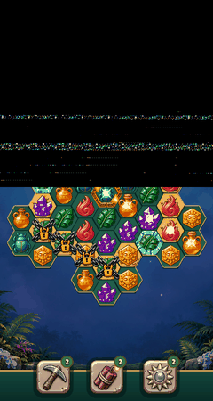

# Effects and motion

This reel was captured from the actual renderer before special pieces were removed from the engine, so it still shows retired special-piece effects (rays, bombs, prisms). Matches no longer create special pieces. `tools/make_reels.py` now builds it from the `fx-shatter` reel (`make test-full`).

## Implemented feedback

| Event | Presentation |
| --- | --- |
| Normal match | Brief piece expansion, shrink and fade, local light bloom, colored shards and four-point sparkles |
| Landing | Shared engine one-edge trickling steps and a short squash/stretch after the final step |
| Resource collection | Staggered curved flights, light trails and a small HUD landing pulse; locked pieces do not send unearned resource icons |
| Score | Smooth count-up, progress-bar interpolation, a small number pulse and one floating score per cascade wave |
| Cascade | Escalating chimes and animated BRILLIANT / MAGNIFICENT / SUNSTORM feedback |

Reduced-motion mode suppresses effect spawns, trails, shakes and squash/stretch while retaining normal rule resolution and immediate score readability.

## Reference study

- [King: creating and combining special candies](https://candycrush.zendesk.com/hc/en-us/articles/211939685-Creating-and-combining-Special-Candies): distinct line, area and color attacks rather than one generic explosion. A study reference only; Relic Rush has no special pieces, and its tool hits take the same care.
- [King's Crush & Tell: Super Color Bomb](https://community.king.com/en/candy-crush-saga/discussion/512579/crush-tell-go-behind-the-scenes-of-the-candy-kingdom): the official developer-series reference for satisfying booster feedback and its place in gameplay.
- [GDC: Juice It or Lose It, Martin Jonasson and Petri Purho](https://www.gdcvault.com/play/1016789/Juice-It-or-Lose): a game-feel reference for layered sensory feedback.

Our interpretation is anticipation → attack → tile response → collection → HUD response. All art, effects and timing are implemented for Relic Rush; no Candy Crush effects or proprietary assets are copied.

## Implementation and verification

`engine/lua/match3/vfx.lua` (shared with Christmas Market) isolates presentation from `rules.lua`. Effects use a separate random stream, a 256-event pool and the existing 650-particle pool. The cubic radial glow is an atlas frame. Impact rings, sparkles, shards and shockwaves use tinted CC0 Kenney particle sprites (`fx-*` frames in `data/board/fx.png`, see the [asset catalogue](asset-catalogue.md#particle-sprites)); other strokes use SDL geometry. Presentation never consumes gameplay random numbers or changes rewards/objectives.

Static blockers and tool controls use authored atlas artwork; their
states and the intentional procedural animation primitives are listed in the
[asset catalogue](asset-catalogue.md). Ice and chain strength are not supplied by
procedural glyphs.

Effects only read the board; the ported rule tests (`make test`) and the `--smoke` run cover gameplay with effects active.

Capture single moments with `--fx shatter --frames N --shot file.png` (N frames after a blast across tablets); `tools/screenshots.py` renders the reel frames and assembles `screenshots/effects-reel.gif`. These modes do not write player progress.
