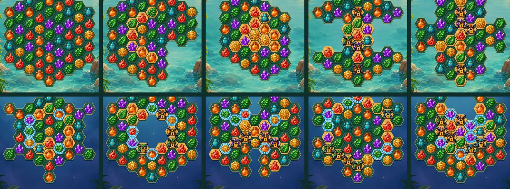

# Hex straight-line match-3 rules and varied boards

This supersedes the prototype's connected-group match-4 rules.

## Matching

- Exchange two side-adjacent movable relics, by swiping or tapping both.
- A contiguous **straight line of three or more identical relics** matches along any of the three hex axes. Bends, triangles, diamonds and rings do not count on their own. Side branches are not part of a line.
- A swap without a line through either swapped cell returns without spending a move. Special combinations retain their existing swap behavior.
- Three clears normally; four leaves a directional ray along the matched axis; five or more leaves a sun prism. Swap the prism with a relic to clear that color.
- Crossing lines clear their union once. Their combined size does not create a bomb; there are no T/L or ring recipes. Bombs already present and dynamite tools retain their blast effects.
- Existing specials, combos, fire thawing, ice layers, chains, excavation and tools retain their respective effects.
- A ready group is checked on the idle board before hints/input and after every completed fall. All cascade waves finish before victory/failure is checked. Automatic waves do not spend additional moves.
- The expedition HUD floats on the painting along the top edge: a hexagonal Moves medallion, the remaining score/idol/sand/lock objectives as small resource panels, and Pause. Absent objectives are omitted; completed objectives dim and show a check seal. The tools stand along the bottom edge; the Explorer's Guide opens from Pause. See [match-3 HUD review](review/match3-hud/README.md). Pause resumes the round, restarts it after a confirmation, or quits to the island keeping the board for LEVEL / Expeditions to continue; required results need their explicit actions. See [header and popup review](review/expedition-header/README.md).
- Hints highlight a legal swap after five idle seconds. If the hint search finds no swap, idle boards use the same free reshuffle as boards settling after a fall, with a “No moves. Board reshuffled.” notice. Recovery resets selection/tool targeting and stale hints, preserving move/tool budgets, objective progress, holes, sand, ice, chains and their locked relics. Victory and exhausted moves take precedence over reshuffling.

The shared engine's `LINE_MATCHES` flag selects this detector for both Relic Rush and Christmas Market. Generation, hints, reshuffling and cascades use the same rule in both games.

## Ten board masks

| Level | Shape | Active cells |
| --- | --- | ---: |
| 1 | Hexagon | 61 |
| 2 | Crescent | 54 |
| 3 | Diamond | 43 |
| 4 | Butterfly | 45 |
| 5 | Hourglass | 49 |
| 6 | Lotus | 43 |
| 7 | Ring | 54 |
| 8 | Twin courts | 55 |
| 9 | Crossroads | 55 |
| 10 | Sun crown | 53 |

Each mask is a distinct connected graph within the common axial-coordinate envelope. Missing cells are excluded from rendering, matching, tile selection, swapping, booster targeting, obstacle placement and refill. Matching never crosses a gap. Gravity moves gems straight down whenever the cell beneath them is empty. Diagonal movement is allowed only when that cell is occupied, locked or missing. Every active cell with no active cell directly above spawns vertically before considering side donors, so the whole stepped top edge refills together. Interior cells spawn only when all upstream donors are blocked. Gems flow around holes and immovable blockers through real neighboring cells; they never jump a gap or consume a locked gem. The shared engine animates each edge and waits for the complete fall before checking a cascade. Directional special attacks may travel across gaps but only affect actual cells. The silhouette follows the active cells rather than a permanently painted large hexagonal frame.

## Idol

The gold idol is six-sided, like the board. Since the tile-set update the match pieces come from `art/tile-sets/source.png` (see [tile-sets.md](tile-sets.md)); the selected Relics pack keeps the hexagonal sun idol.

See [shared engine and atlas contract](../../../docs/MATCH3_ENGINE.md) and [before/after trickling captures](review/trickling/README.md).

## Validation

- Seeded startup boards across all ten masks: no pre-existing straight match and at least one legal opening move.
- Three/four/five/six runs on all axes, rejected triangles/diamonds/rings, excluded branches, crossing triples, swap rollback, and hole-separated runs.
- Independent coordinate-based line oracle and exhaustive runs in both directions for every color and length.
- Existing blockers, gravity, tools, special combinations, update-loop cascades, hints and reshuffles.

## Reference research

- [King's GDC Europe 2016 presentation: Level Design Saga, Jeremy Kang](https://media.gdcvault.com/gdceurope2016/presentations/KANG_Jeremy_LevelDesignSaga.pdf): level concept, layout, balancing and testing as separate design steps; board layouts support different gameplay situations.
- [Red Blob Games: Hexagonal Grids](https://www.redblobgames.com/grids/hexagons/): axial/cube coordinates, six edge neighbors, connected traversal and shaped grid regions. Used as a geometry/reference explanation, not copied game implementation.
- [Match 4 – Hex, developer page](https://dimcairion.itch.io/match-4-hex): an independent hex swap/match-4 prototype demonstrating the genre. No code or assets were imported.
- [Candy Crush official modes guide](https://candycrush.zendesk.com/hc/en-us/articles/360000754897-Which-game-modes-will-I-find): varying objectives and mixed modes complement level-layout variety.

The hexagonal grid does not mandate a four-piece minimum. Relic Rush uses three in a straight line, with four/five rewards inspired by Candy Crush.
