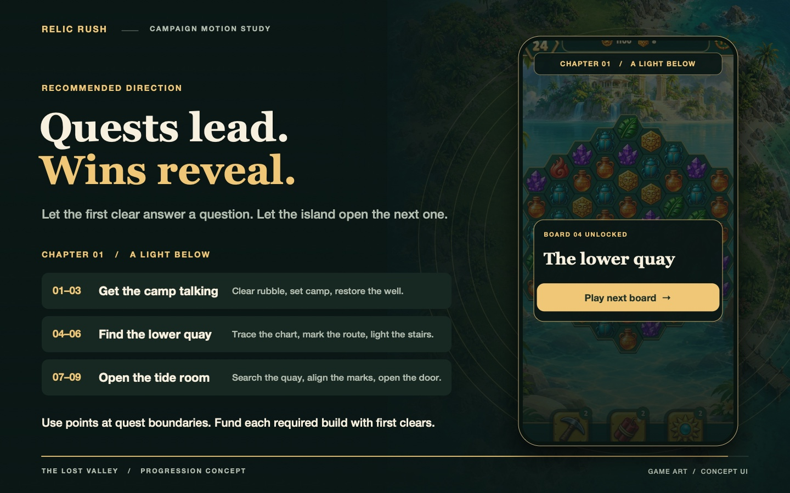

# Relic Rush: what happens after the win?

Five motion concepts for a fresh campaign. The reel uses the existing Relic Rush art and a sample mystery, **A Light Below**, to compare five ways to move from a first clear to the next playable board. These are proposed flows and sample lines; they do not change the live campaign.

| Reel | Direction | What brings the player back | Tradeoff |
| --- | --- | --- | --- |
| 0:07 | **Quest first** | Mara's request gives three boards a purpose. She reacts to the signal immediately after the win. The restored well reveals a chart and opens the next quest. | Strong link between the island and the plot. Each quest needs a concrete request and a visible result. |
| 0:21 | **Scene by scene** | Each board is a location. Its clue identifies the next site, and the decoration threshold makes it playable. | The trail is easy to follow. Checking a score at every site can interrupt it. |
| 0:35 | **The living island** | Choose a restoration. At the threshold, a signal becomes a tappable location on the island and reveals the next board. | The island feels like a place to investigate. Story-critical landmarks need fixed locations even if decorations can move. |
| 0:49 | **The evidence table** | Turn a tag over, get a character's reaction, then compare it against a record when the archive opens. | A small action lets the player make the connection. Repeating the ritual after every board would slow it down. |
| 1:03 | **People first** | Choose who sees the clue. That person changes what they do and who accompanies the player into the next scene. | The cast can surprise the player through action. Branching needs extra writing and staging. |
| 1:17 | **Recommendation** | Use quests for structure, immediate character reactions for momentum, and decoration points for access to the next part of the island. | Bring in evidence and companion choices where they can change the scene. |



## Start with one chapter

**Play fantasy:** Rebuild an abandoned expedition base and follow the light that answers from under the island. The first chapter asks, “Who is signalling back?”

| Quest | Board-linked tasks | What changes |
| --- | --- | --- |
| **Get the camp talking** (01–03) | **01:** Clear landing rubble and find an empty lamp bracket. **02:** Set camp and see a flash answer Mara's lamp. **03:** Dig along the well seam; confirm the spring well restoration. | The first-clear exchange happens immediately. The well repair reaches the first threshold and uncovers a chart inside the old pump cover. |
| **Find the lower quay** (04–06) | **04:** Cut through the vines along the charted route. **05:** Mark the shore path. **06:** Light the stairs and confirm the path beacon. | The signal lines up with the old tide room. Tomas insists it's empty, then goes ahead to check. |
| **Open the tide room** (07–09) | **07:** Search the quay. **08:** Align the reflected marks. **09:** Open the tide door and reconnect the lamp. | The lamp is sending an old mooring signal. It explains how the light answered, but someone just changed the signal. The next chapter asks who has come back. |

This is a chapter sketch for comparing the flows. A campaign script would settle the truth behind the signal, outline how each character acts on what they know, and map the later chapters before writing the full dialogue.

**Progression rule to prototype:** Every first clear earns money and an immediate story beat. Confirmed builds earn decoration points; they are a separate, cumulative measure of rebuilding, not the current discovery stars. In the reel, a 100-coin payout covers an 80-coin restoration that adds 4 points, taking the island from 8 to 12. These are illustrative values. Place thresholds between quests and show them up front. The required boards should always fund a build that can reach the next threshold. Moving or re-placing an owned item should not award more points, and a scene that opened should stay open. Replays should earn money without repeating a reveal. Keep the next board one tap away whenever its quest is open.

The [Tropicats handoff](../../../../../docs/tropicats-reference/STORY.md#start-here-when-writing-a-new-campaign) shows the useful pattern: someone asks, boards feed repair or interaction tasks, the world changes, and a scene reacts. That source describes the bundled authored data. In [Wooga's June's Journey support](https://wooga.theymes.com/hc/en/junes-journey/articles/what-are-june-s-journey-levels-396), Flowers from island improvements unlock new locations in combination with clues. Here the word *scene* means the next story location and its associated board; the post-clear exchange is a *beat*.

## Render the reel

From the repository root on macOS:

```sh
swiftc -O games/relic-rush/docs/mockups/story-progression/story_options.swift -o /tmp/story-options
/tmp/story-options /tmp/relic-rush-story
```

The Swift renderer writes an 85-second, silent, captioned H.264 MP4 (1440×900, 24 fps) and a JPEG poster. It uses Apple frameworks and the system video encoder. The phone uses the game's [hex board](../../screenshots/hex-first.jpg), [island capture](../../screenshots/phone-island.jpg), island painting, and current character and building sprites. The wallets, point gates, layouts and animated interactions are design mockups. No new runtime art is introduced.
