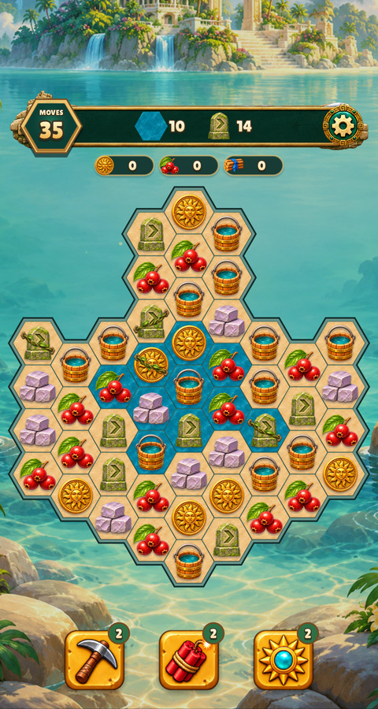
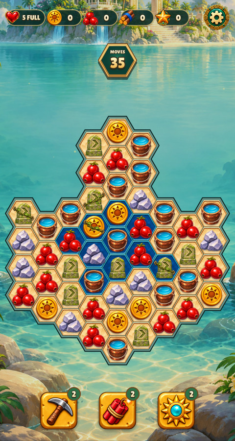
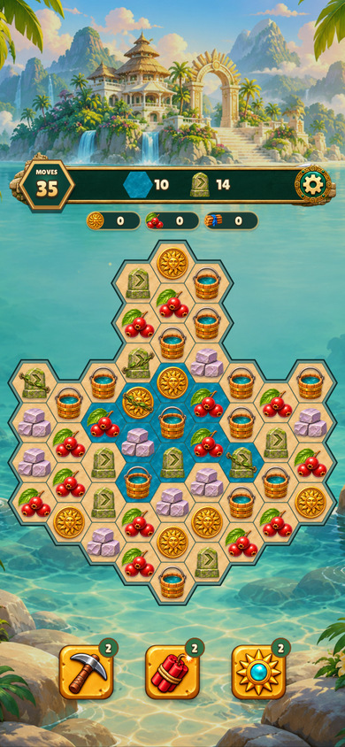
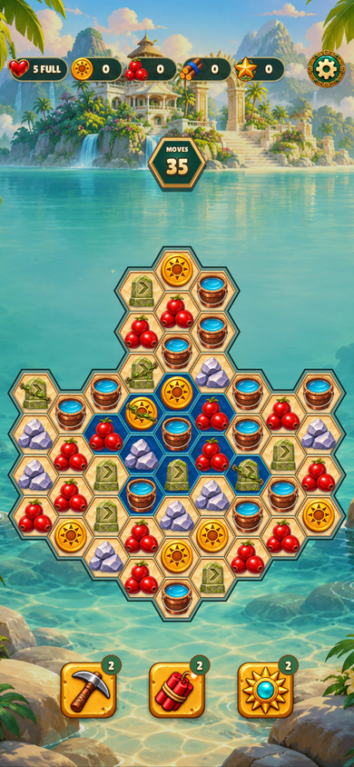
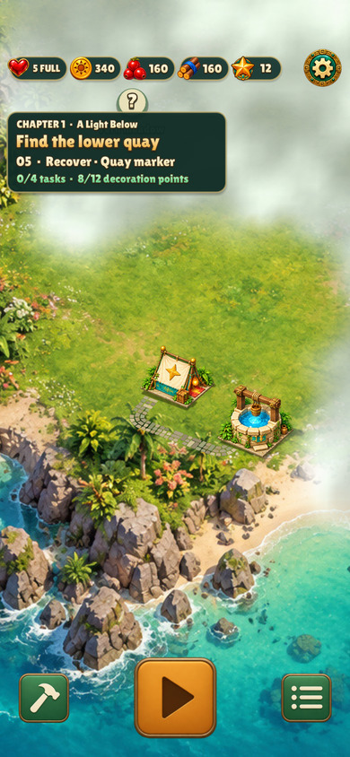

# Blue plaques and the shared wallet

The Quay Marker, board 5, shows the new resource pieces, pale stone and blue
plaques, including a plaque protected by a creeper. The top of the puzzle now
uses the same five wallet capsules and Settings button as town. The move count
sits on its own below the wallet.

| Capture | Before, at `075f4dea` | After |
| --- | --- | --- |
| Board, 480 × 900 |  |  |
| Board, 390 × 844 |  |  |
| Town, 390 × 844 |  |  |

[First Light](first-light.jpg) introduces the target cells with a compact
blue patch and no written mission banner. [Board materials](materials.jpg)
shows both tile faces and the lock and cover layers. The [art catalogue](atlas-states.jpg)
shows every resource piece, the optional packs, specials and tool states.
[The Frozen Stair](frozen-stair.jpg) shows the objective faces alongside
double ice, chains and a separate solid stone.
[Explorer’s Guide](guide.jpg) uses the same plaque art. The
[signal plate](signal-site.jpg) appears on the cleared site before the finale.

Capture using the actual game’s test runner:

```sh
build/test/all --suite=relic-rush "shot hex-first" "shot dressing-quay" "shot plaques-phone" \
  "shot economy-wallet" "shot art-catalogue" "shot dressing-states" "shot phone-campaign-thaw" \
  "shot guide" "shot signal-in-exit"
```

The [art catalogue](../../asset-catalogue.md#resource-pieces) records the
source atlas and the registration steps for resources and field art.
