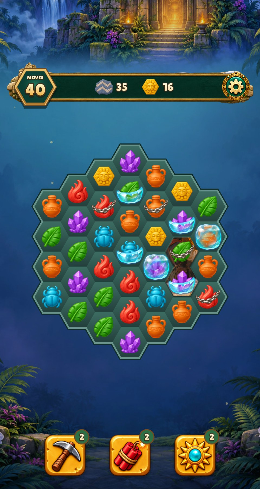
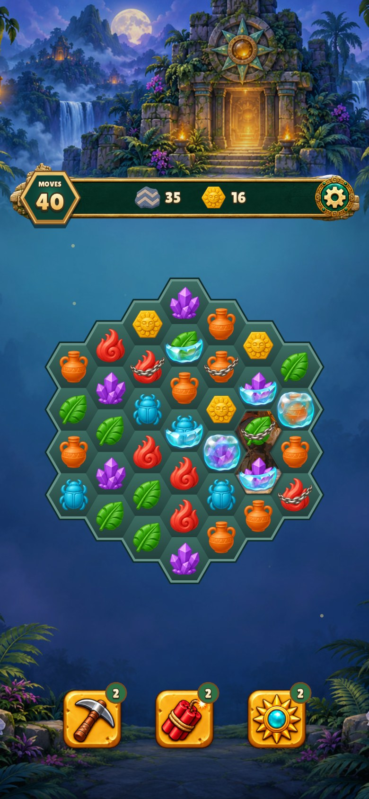
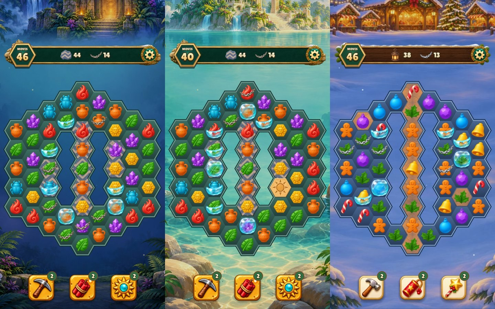

# Centred boards and reseeded lane levels

A level's cells are now centred across the screen. The compact court (Relic
Rush board 8) is laid off-centre in the grid and used to sit to the left; see
the earlier capture in [story-mosaic/before.jpg](../story-mosaic/before.jpg).

| 480×900 | 390×844 |
| --- | --- |
|  |  |

Relic Rush 10 and 22 and Christmas Market 9 start with the narrow middle column
restored (and, in Relic Rush, a seed in both lanes), so the floor can be
finished within the moves:

