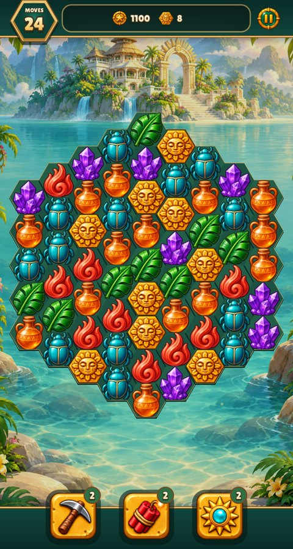
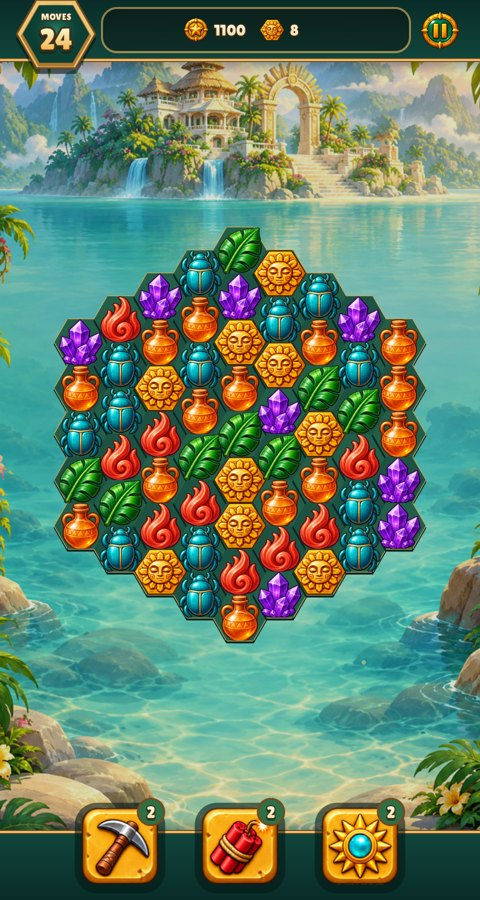
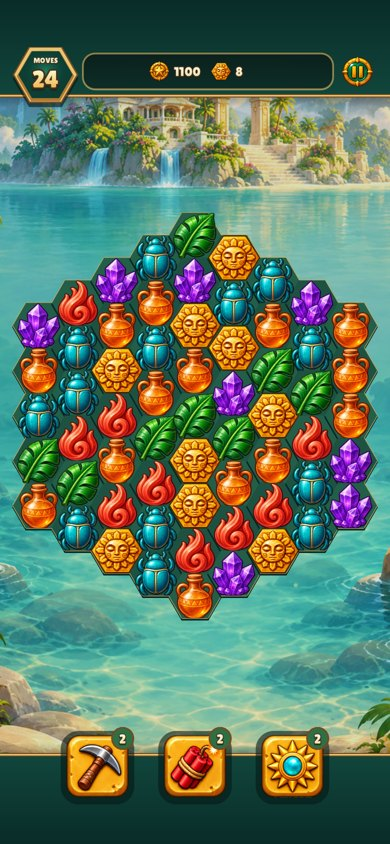
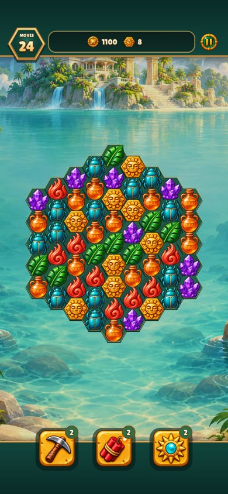

# Restore the resting board size

The fixed cell radius had increased from 26.5 to 32, enlarging the board by
about 21%. Restoring 26.5 returns the maximum board width from 448 to 371
logical units. Cells, gems, state layers, clipping and input share that geometry.
The entrance already returns its animation scale to 1. No artwork changes.

Before: `aff8af8`. Both pairs use the same opening board, seed and frame;
the 390×844 capture includes phone safe areas. These two sizes represent the
uniform geometry change without repeating every level and asset pack.

Focused verification for this correction:

```sh
make CFLAGS="-O2 -g -Werror" relic-rush build/test/relic-rush
build/test/relic-rush "rules relic_board" "shot hex-first" "shot phone-board"
make lint
```

The board regression covers natural completion, skipping, reduced motion and
final piece poses/input. Full build, full `make test` and lint also passed during
the initial verification; that broad run is unnecessary for this game-local
constant. All four retained images were visually reviewed. Review JPEGs are
reduced to the named viewport sizes from real game captures.

| Size | Before | After |
| --- | --- | --- |
| 480×900 |  |  |
| 390×844 |  |  |
