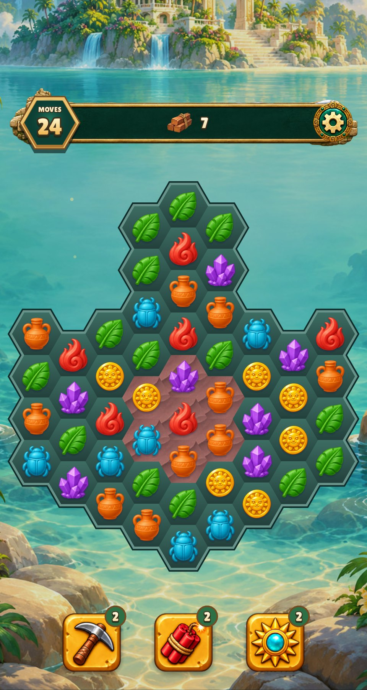
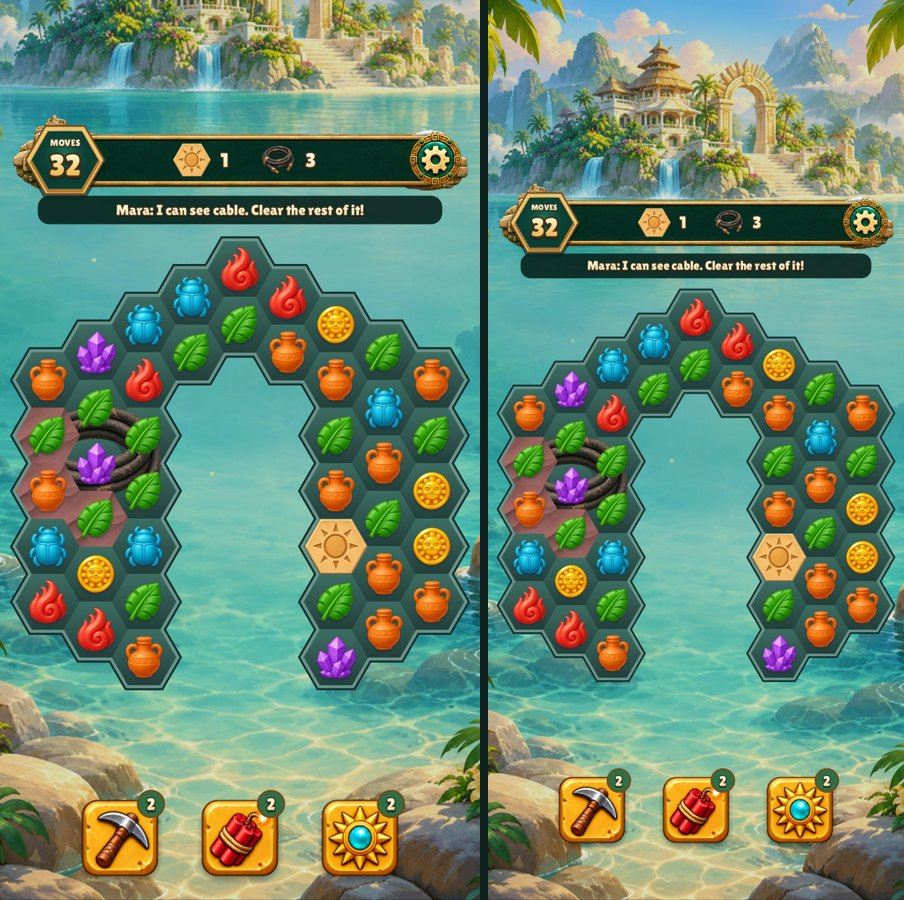
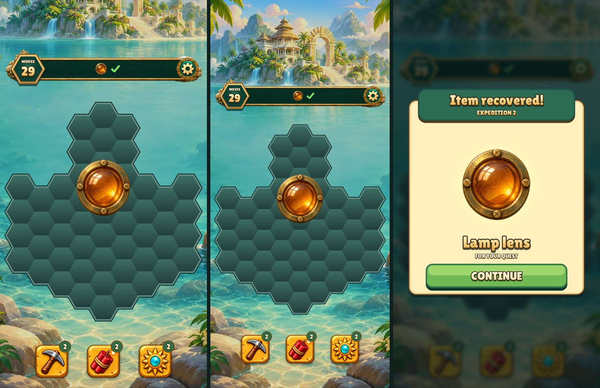

# Buried finds

Boards 1-7, 9 and 10 bury their quest object under seven cells of still silt. Uncovering every
cell is a board goal, so the object the story asks for is recovered by play.

| Board 1, covered |
| --- |
|  |

Half uncovered on board 3 at 480×900 and 390×844, with the crew's line:



First clear of board 2 at both sizes, then the card:



```sh
build/test/relic-rush "shot find-"
```
