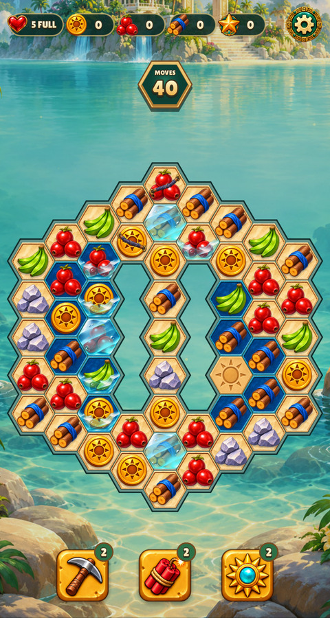
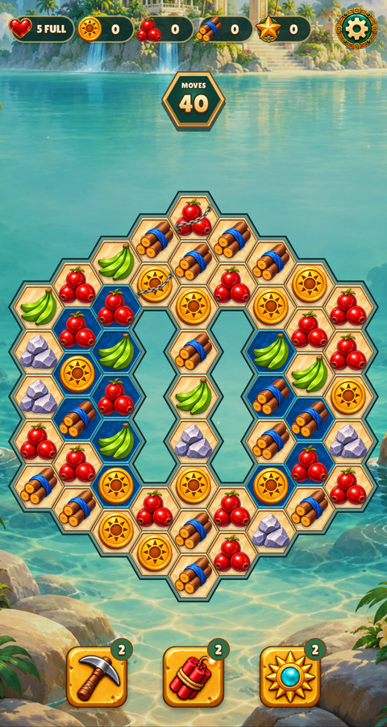
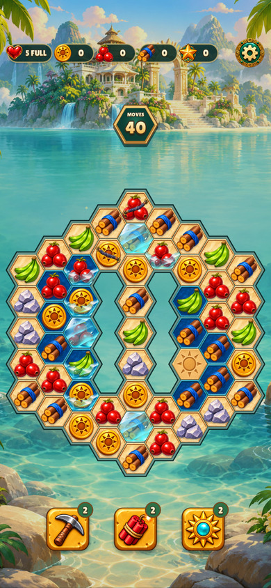
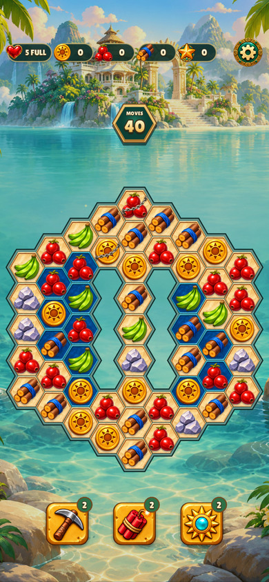
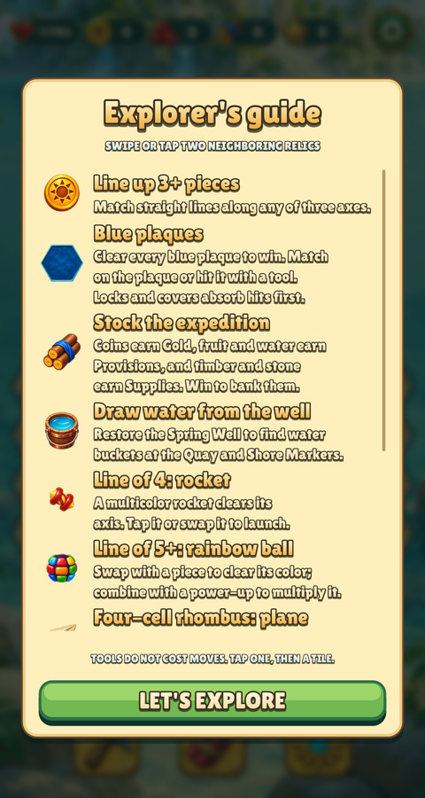
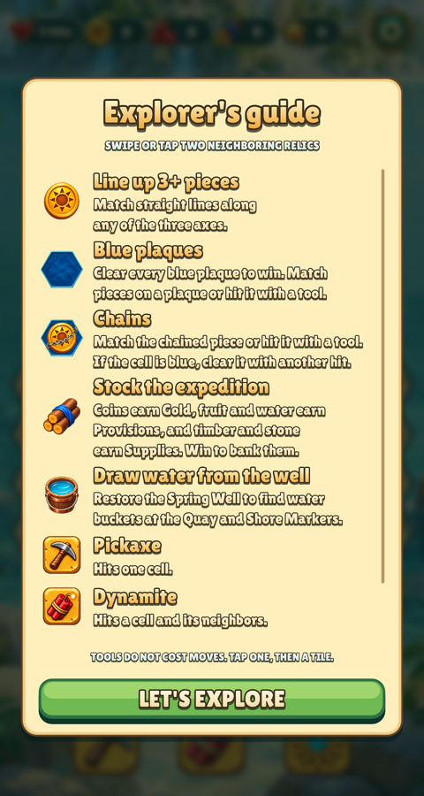
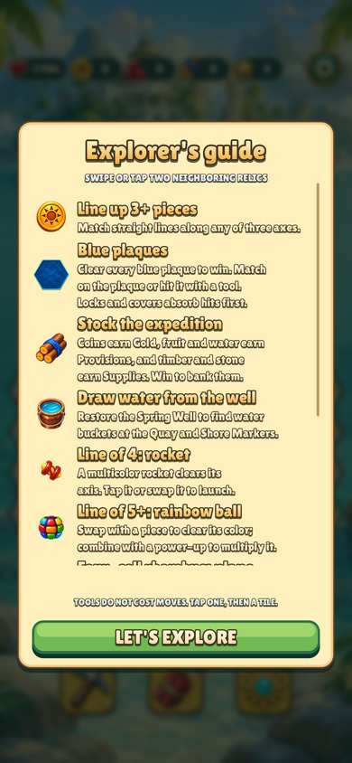
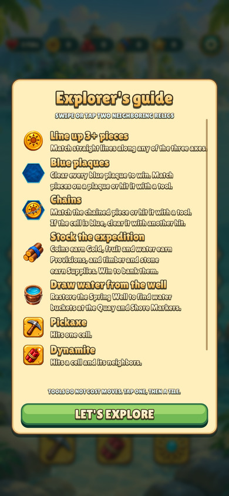

# Chains and blue plaques

The former Frozen Stair is now The Alternate Landing. Iron chains are the
campaign’s only blocker. A chain on a blue plaque takes a hit before the
player can clear the plaque itself. Straight matches clear the whole line.
Sunburst hits every piece of the chosen kind, like Cradle of Rome’s Star.

| Capture | Before at `81ef6049` | After |
| --- | --- | --- |
| Expedition 22, 480 × 900 |  |  |
| Expedition 22, 390 × 844 |  |  |
| Guide, 480 × 900 |  |  |
| Guide, 390 × 844 |  |  |

The [Quay Marker](chained-plaque.jpg) and [board materials](board-materials.jpg)
show a chain over a blue plaque. The [art catalogue](art-catalogue.jpg) shows
all five button states for the three tools. The [landing briefing](landing-briefing.jpg)
and [tide-room briefing](tide-room-briefing.jpg) show the revised story lines.

```sh
build/test/all --suite=relic-rush "shot alternate-landing" "shot phone-alternate-landing" \
  "shot guide" "shot phone-guide" "shot plaques-phone" "shot dressing-states" \
  "shot art-catalogue" "shot landing-briefing" "shot dressing-tide-beat"
```
