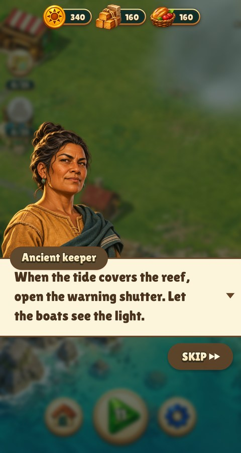
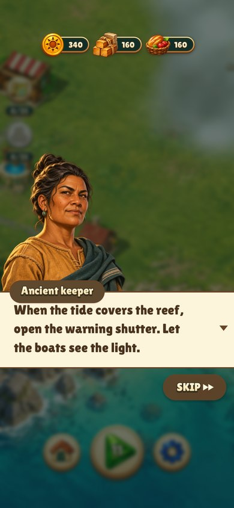
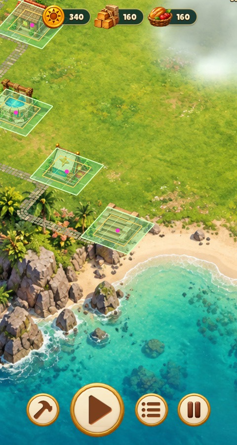
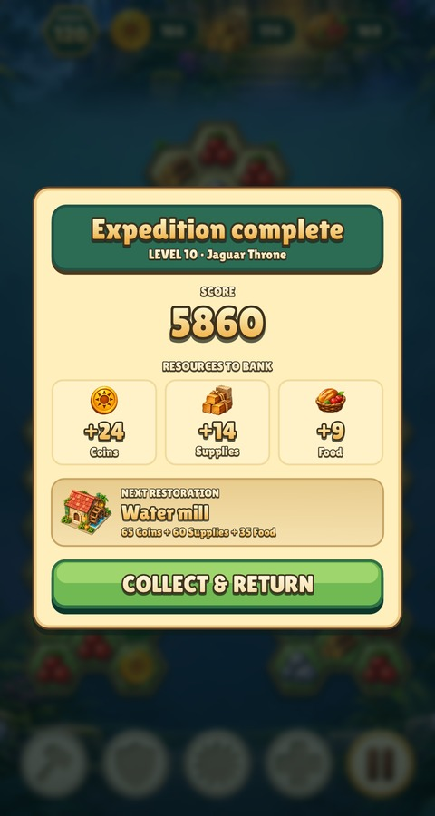
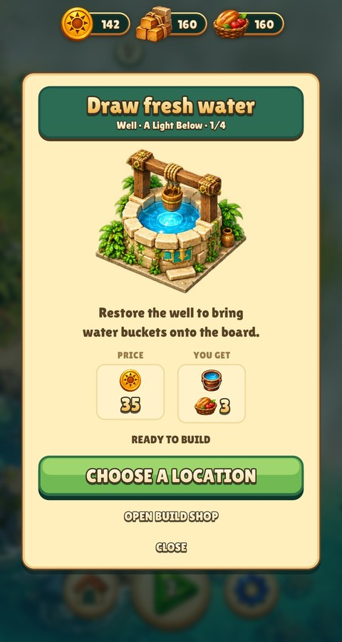
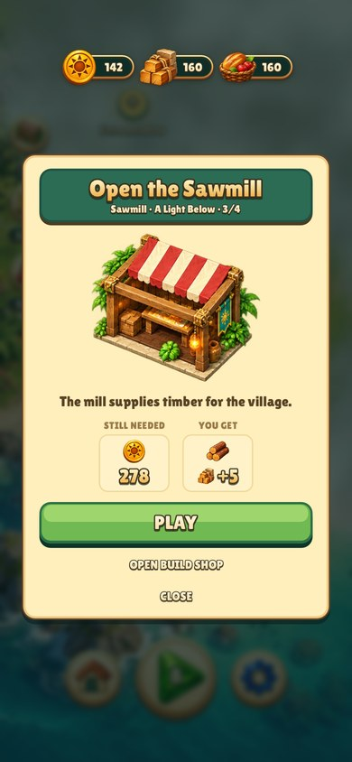

# Chapter 1 native review

When the player confirms the quay repair, the story enters a short flashback
with the ancient keeper. The steps sit at a fixed site on the coast.

| Keeper at 480 × 900 | Keeper at 390 × 844 with safe areas |
| --- | --- |
|  |  |

Collect & Return follows the expedition earnings. On the island the building marker opens the purchase card, where the player can check the remaining cost or start placement.

| Size | Previous result | Current result |
| --- | --- | --- |
| 480 × 900 |  |  |
| 390 × 844 |  |  |

The ready faces lift, grow slightly, and settle back. Each counter and touch target stays in place. Reduced motion keeps the selected face and steady glow.
The building card shows each new board piece above the amount it banks.

| Building | Previous reward | Current reward |
| --- | --- | --- |
| Well · 480 × 900 |  |  |
| Sawmill · 390 × 844 |  |  |

Capture the results, town card and motion together with `build/test/relic-rush "shot economy-result" "shot build-ready-in-town" "reel quest-rail-hand-in"`.
