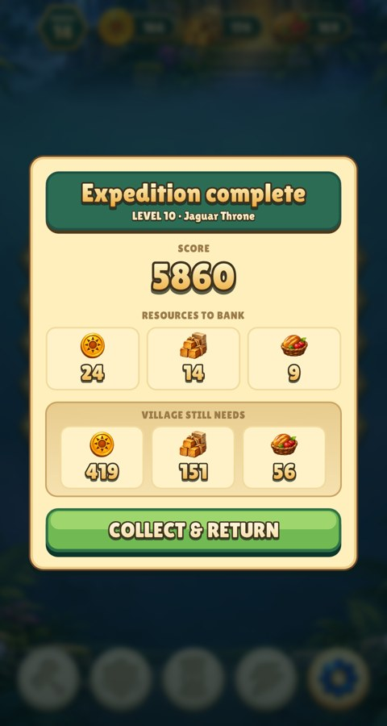
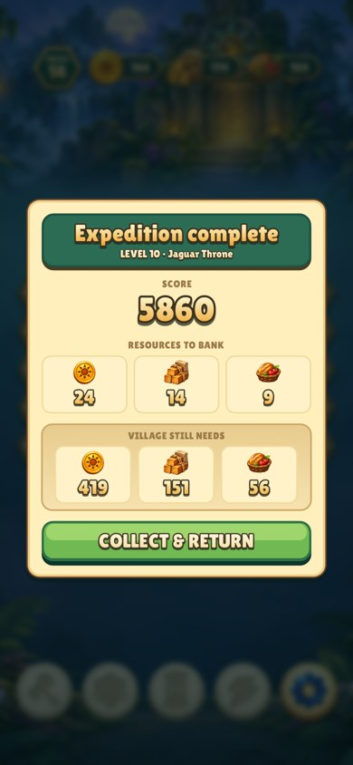

# Chapter 1 native review

When the player confirms the quay repair, the story enters a short flashback
with the ancient keeper. The steps sit at a fixed site on the coast.

| Keeper at 480 × 900 | Keeper at 390 × 844 with safe areas |
| --- | --- |
|  |  |

Collect & Return follows the expedition earnings. On the island the building marker opens the purchase card, where the player can check the remaining cost or start placement.

| Size | Previous result | Current result |
| --- | --- | --- |
| 480 × 900 |  |  |
| 390 × 844 |  |  |

The ready faces lift, grow slightly, and settle back. Each counter and touch target stays in place. Reduced motion keeps the selected face and steady glow.
[Ready building on its town card](ready-to-build.jpg)

Capture the results, town card and motion together with `build/test/relic-rush "shot economy-result" "shot build-ready-in-town" "reel quest-rail-hand-in"`.
