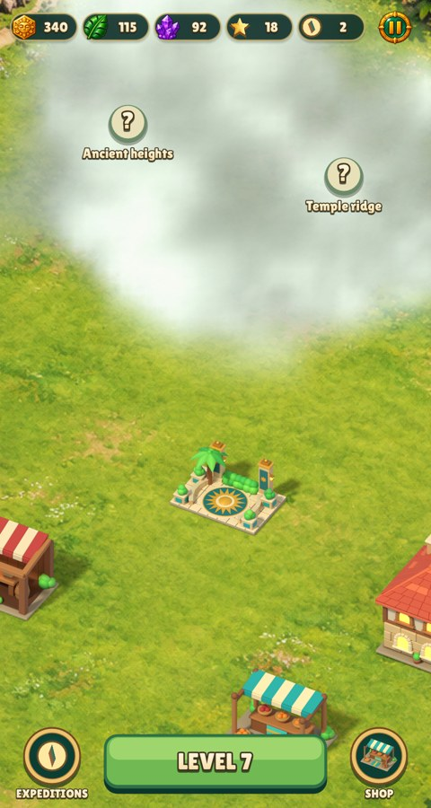

# Cloud fog

Locked land has rolling, textured cloud banks (`city.fog_clouds`). Density and lighting drift in world space on frame time, independently of the wall clock used for income. Region masks, terrain and placement stay unchanged, and ground shadows draw below the fog.

| Still, 480×900 | Motion |
| --- | --- |
|  |  |
