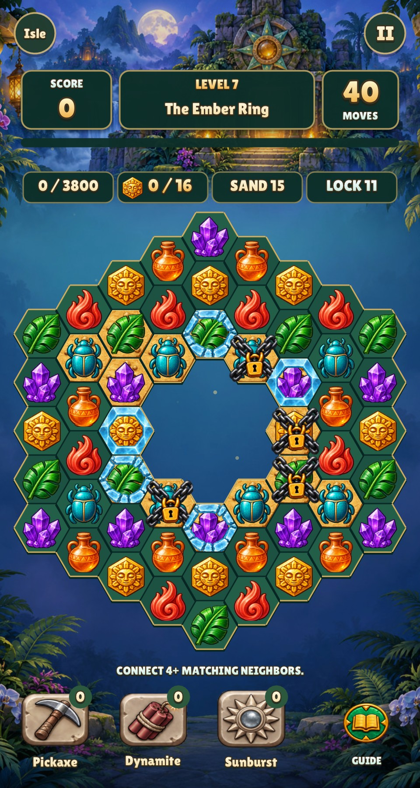
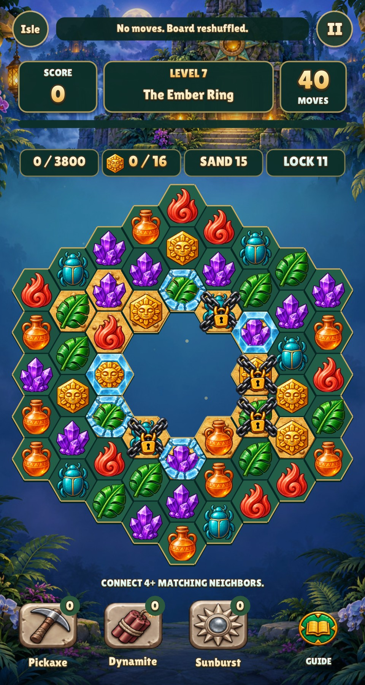
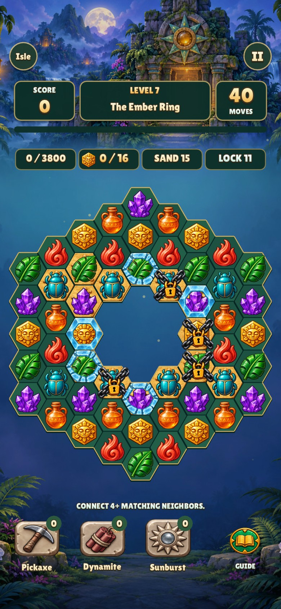
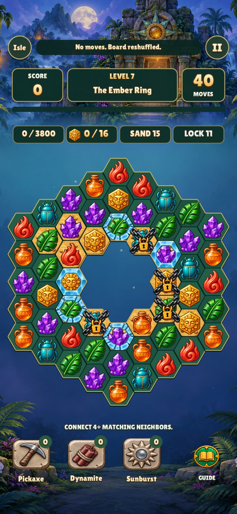

# Idle dead-board recovery

A deterministic ring with no ready match, no legal swap and no tool charges stayed
idle forever: the hint search returned false without invoking recovery. The
existing post-fall reshuffle was never reached. Idle hint failure now uses that
same settlement path, which checks results before reshuffling, clears stale
selection/tool targeting/hints, and shows “No moves. Board reshuffled.”

Moves, tools, objective progress, terrain and locked relics survive the existing
reshuffle. Playable boards continue to show legal hints without changing pieces.
The user's reported board itself has a legal five-amphora swap on its right side;
that move and its two chained targets have a separate regression.

These images render the actual game, after the same first update with its idle
timer already over five seconds. The before code leaves the dead board unchanged;
the after code recovers it and displays the notice.

| Size | Before | After |
| --- | --- | --- |
| 480 × 900 |  |  |
| 390 × 844, safe area 47 top / 34 bottom |  |  |

Reproduce from the repository root (the before code is commit `0a3a9bd`):

```sh
make CFLAGS="-O2 -g -Werror"
python3 tests/fixtures/relic-dead-board/capture.py --before-ref 0a3a9bd
make test
./build/relic-rush --headless --mute --fresh --smoke
```

Use `xvfb-run -a` for rendering and smoke commands on Linux. macOS uses the native
headless renderer. Capture dependencies are the existing Python/Pillow install;
temporary Lua links are removed automatically, with no copied assets.

`tests/lua/relic_board.lua` exercises the real board update function across all
ten masks, including pause/island suspension, playable hints, ready-group
precedence, win/loss precedence and recovery after a completed fall.

Validation: strict `-Werror` build, full `make test` (including 905 board checks
with zero failures), and the complete native Relic Rush smoke run passed.
All four review captures were inspected.
