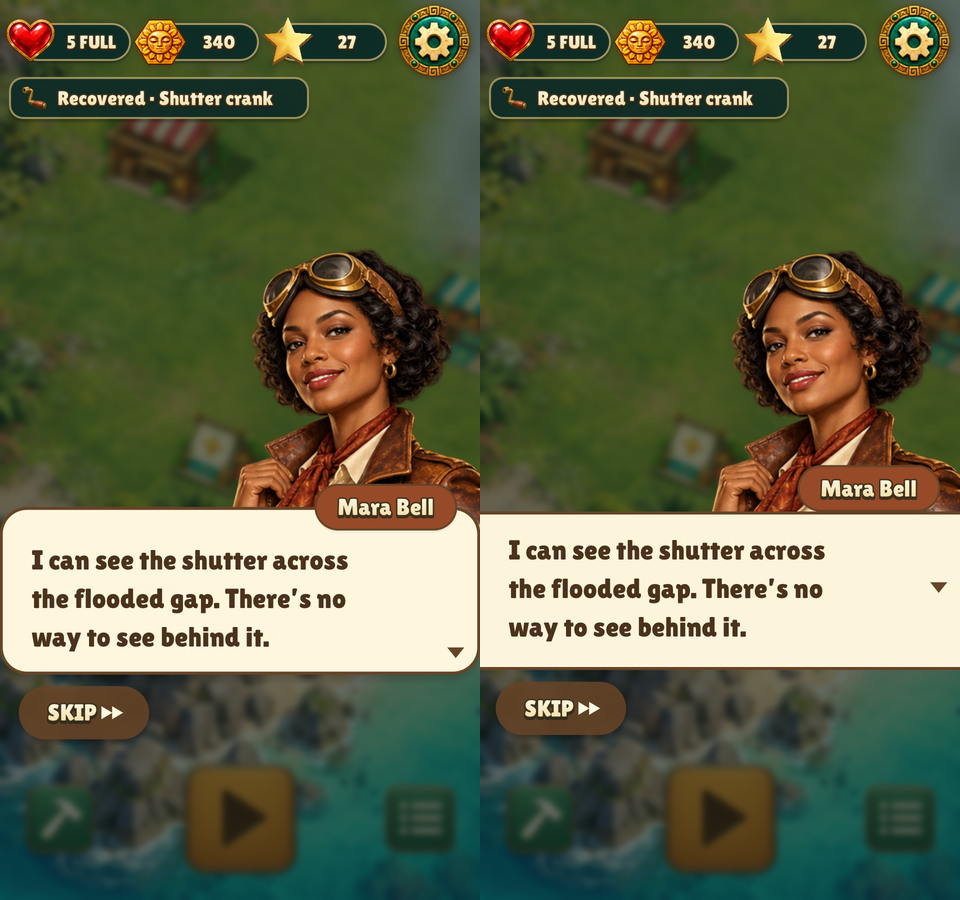
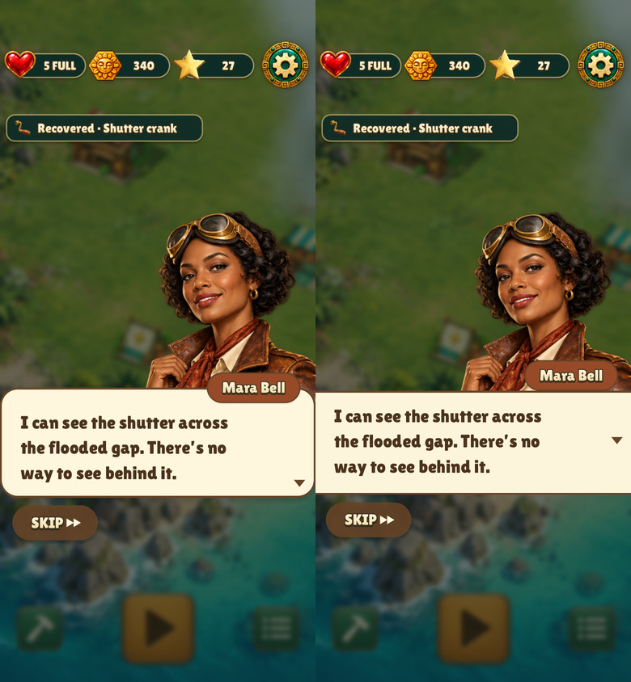

# Relic Rush dialogue bar

The speech panel spans the usable width with square ends. The speaker's
name sits above the panel, leaving the same padding above and below the
text. The renderer centers the full block of visible letter shapes, even
when the line wraps.

The previous layout is on the left in each comparison.

| Size | Before and after |
| --- | --- |
| 480×900 |  |
| 390×844 with safe areas |  |

Capture short and wrapped lines with
`build/test/relic-rush 'frame portrait-listener-' 'shot quest-handoff'`.
