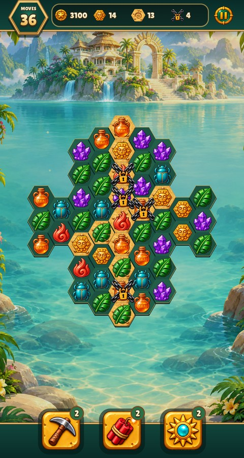
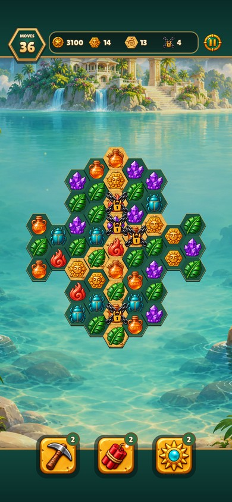
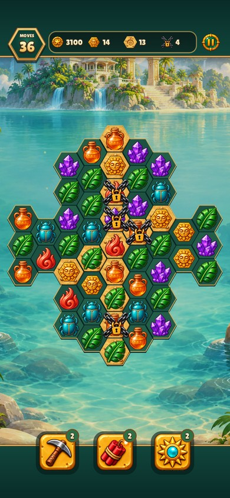
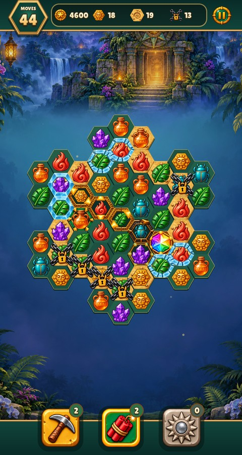
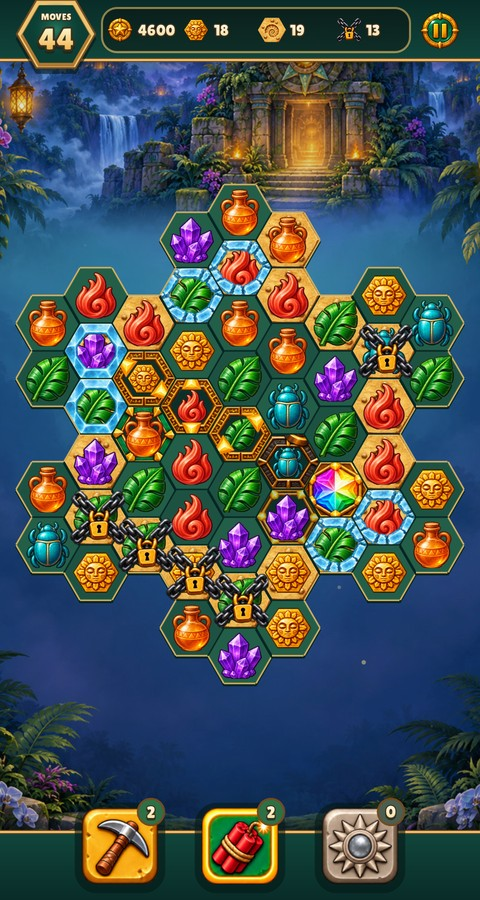

# Restore the wide board and inset cell artwork

The deliberate wider layout in `b4182d4` used a 32-unit cell radius: the widest
board spans 448 of 480 logical units, leaving 16-unit side margins. The later
radius reduction to 26.5 lost that layout. Separately, `27f63ed` enlarged piece
canvases and expanded cell/state artwork to the full cell diameter, removing its
original inset. A finished animation at 1× could therefore still look wrong.

Restore the 32-unit grid and scale the original piece and cell registrations
together by `32 / 26.5`. Normal piece canvases are about 52.77 logical units,
including transparent padding; cell faces and state panels are about 62.07 units
across, inset from the 64-unit grid diameter. Special pieces use the same inset
as the cell, selection/hint and blocker panels. Guide and HUD sizes, artwork,
alpha and animation timing are unchanged.

The regression checks the widest board's side margins, the actual draw
rectangles of all six normal kinds and an inset special panel after entrance
completion, in normal and reduced-motion modes. It exercises the renderer's
board scaling directly. Existing lifecycle checks cover skipping and input.
The side-margin check failed against the previous PR revision.

Before: PR revision `e427210`. The main pairs show level 5 at frame 180, after
the complete entrance, at both phone sizes; the alternate phone has safe areas.
The extra state view covers selection/hint frames, all special axes, blockers
and tool states affected by the restored board scale and panel inset. All six
images were visually reviewed. JPEGs are reduced to logical viewport size.

```sh
make CFLAGS="-O2 -g -Werror" relic-rush build/test/relic-rush
build/test/relic-rush "rules relic_board" "frame entrance-settled-relic-rush" "shot art-specials"
make lint
```

Existing jobs write `build/shots/frames/entrance-settled-relic-rush-<size>.png`
and `build/shots/relic-rush/art-specials.png`; no new capture jobs or artwork
pipeline runs are required for this geometry correction.

| Size/view | Before | After |
| --- | --- | --- |
| 480×900 settled |  |  |
| 390×844 settled, safe areas |  |  |
| 480×900 selected/special cells |  |  |
