# Gesture-only map navigation

The minus, plus and MAP buttons are removed from the island. Their painting,
hit targets and button helper are gone; the shared city camera still handles
pinch-to-zoom, mouse-wheel zoom and drag-to-pan. Building pickup/placement and
the bottom action sheet remain unchanged. No new asset or state is introduced.

Before: `d32ffe3d51e1a320a13574d474ed127a6d85cc36`. After: this change.
Captures are the actual game at frame 4, at 480×900 and at 390×844 with safe
areas. Overview is a capture fixture, not a remaining player-facing button.

Reproduce after `make CFLAGS="-O2 -g -Werror"`:

```sh
./build/relic-rush --headless --mute --fresh --size 480x900 --city 3 --frames 4 --shot island.png
./build/relic-rush --headless --mute --fresh --size 480x900 --city 3 --overview --frames 4 --shot overview.png
./build/relic-rush --headless --mute --fresh --size 480x900 --city 6 --placing --frames 4 --shot placement.png
```

For phone captures use `--size 390x844 --safe-area 0,47,0,34`. Review JPEGs are
resized to at most 480×1000. `make shots` regenerates canonical captures.

Validation: Werror build, `make test` (including catalogue/asset checks), and
native-input Relic Rush smoke at both phone sizes. The smoke covers map pans
starting on a building, deliberate pickup, drag, Cancel and Confirm.
No dependencies downloaded.

| Screen | Before | After |
| --- | --- | --- |
| island | 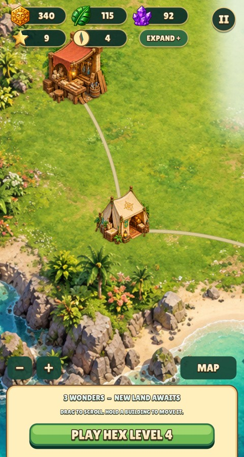 | 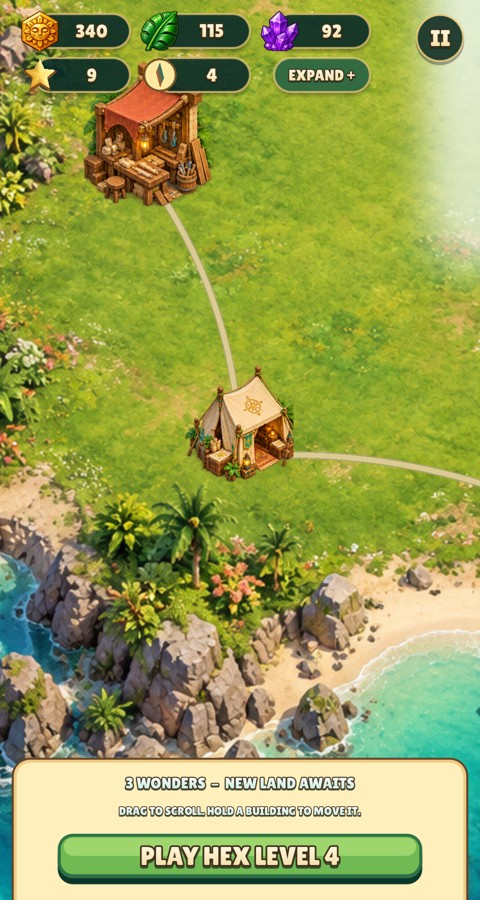 |
| overview | 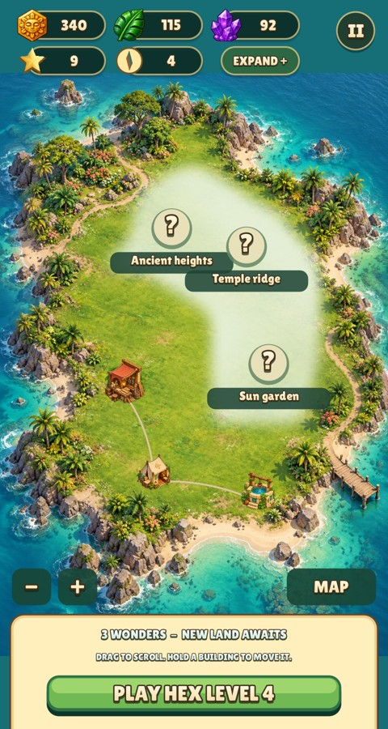 | 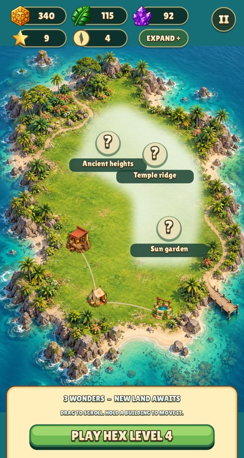 |
| placement | 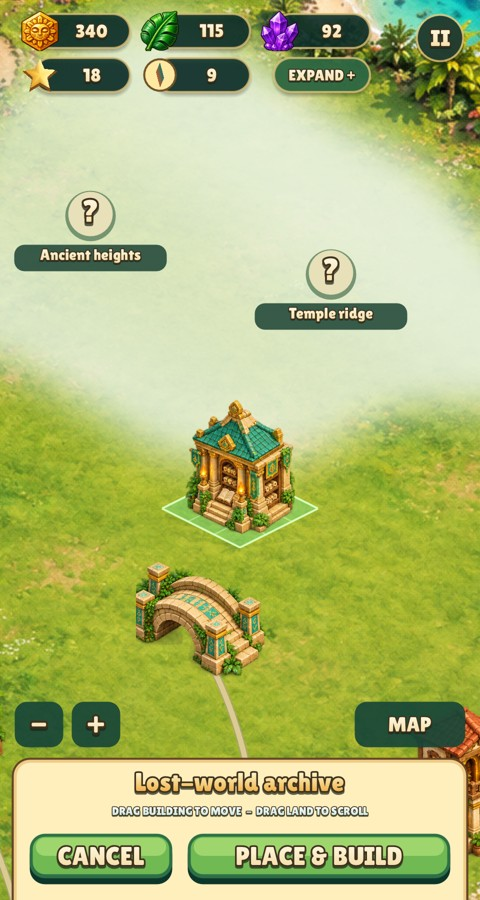 | 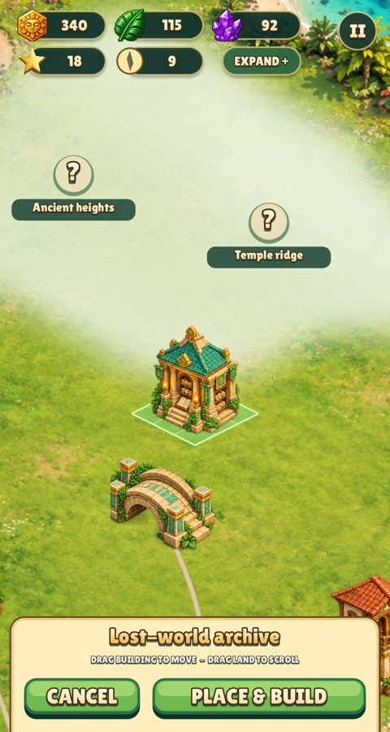 |
| phone-island | 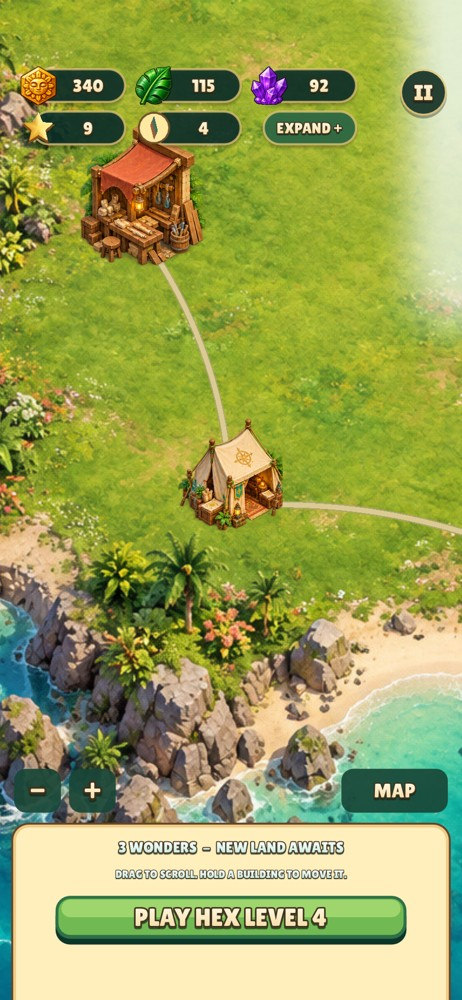 | 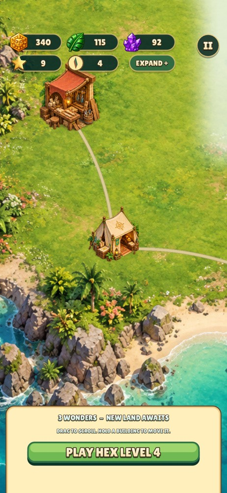 |
| phone-overview | 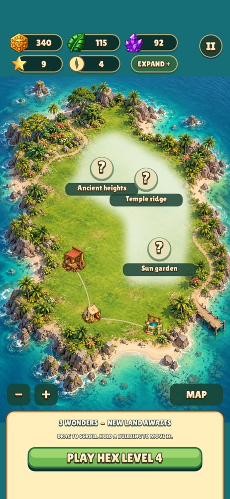 | 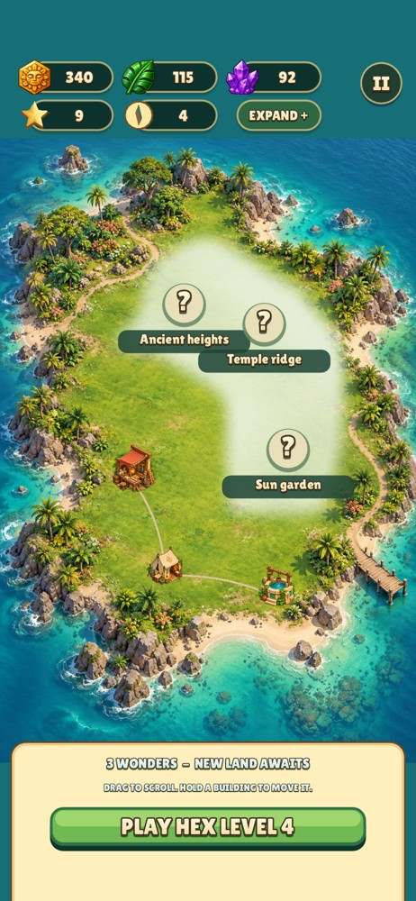 |
| phone-placement | 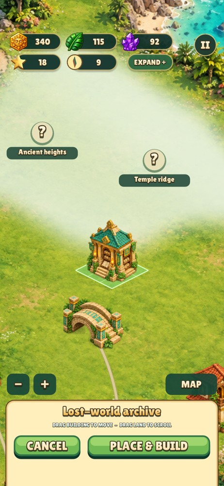 | 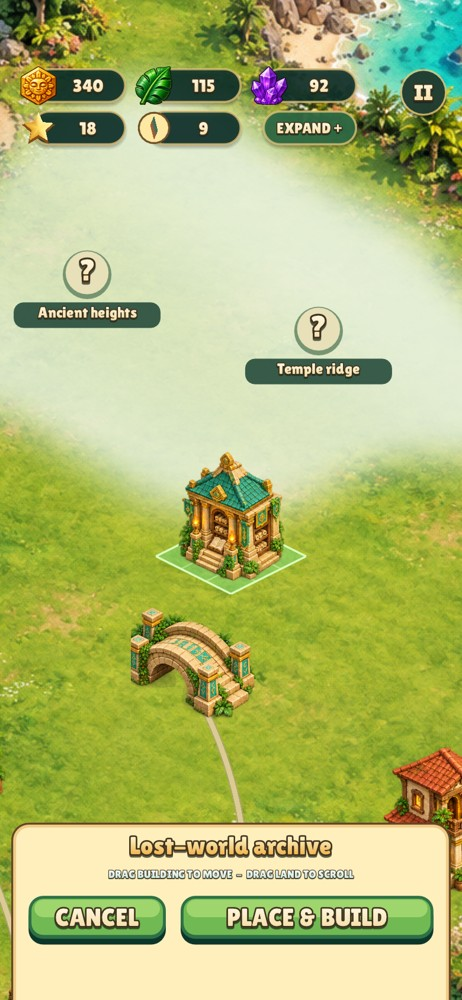 |
