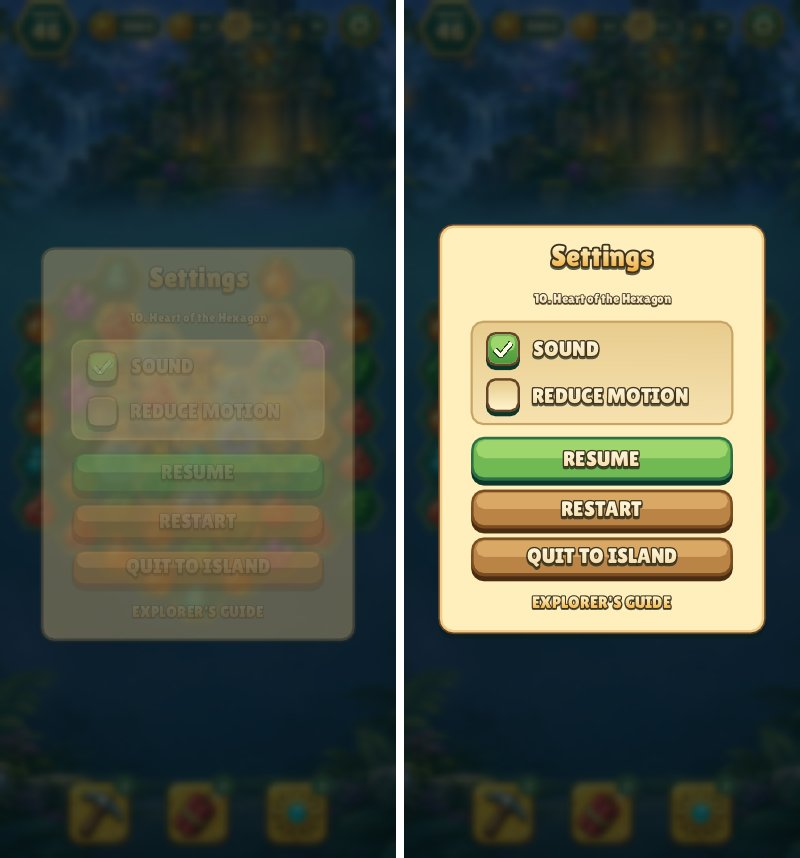

# Instant popups

Pause, results, guide and the other overlay dialogs now open and close at once.
Their 0.28 s entrance and 0.2 s exit depended on the frame clock; on a TestFlight
build Pause showed its dim with an invisible panel, which is what a stalled
entrance tween looks like. The blur already costs the opening frame, so the
motion added lag on top.

Capture: Pause tapped on level 10 at 396×858, frame 122 (tap at frame 120).
`--reel` captures still play the results parts for review.
