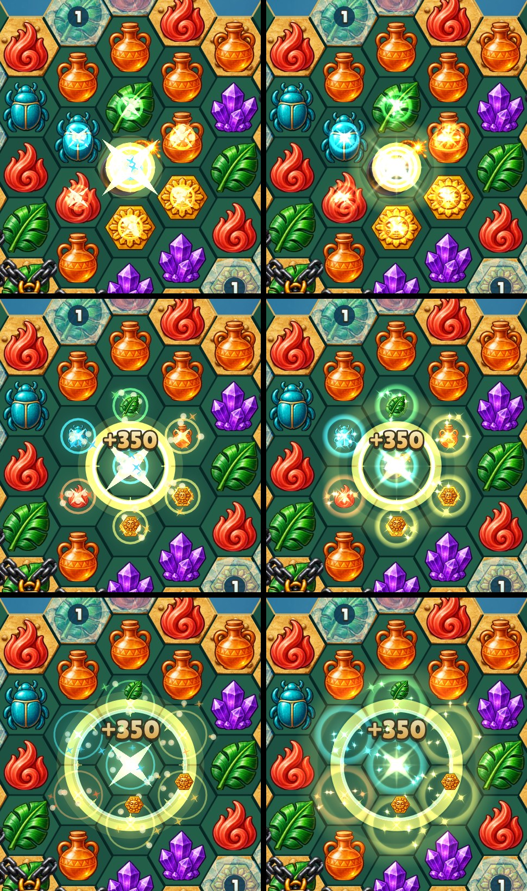
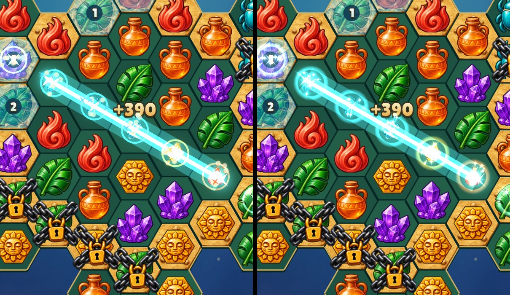

# Kenney particle sprites

Before (left) and after (right), captured from the game at 480×900 (2× pixels)
with `--fx bomb --frames 3|6|10` and `--fx ray --frames 6`.

Impacts become soft tinted rings instead of thin outlines, sparks are
four-point twinkles and streaks, and the bomb gains a bloom and a soft outer
shockwave band. The bomb's leading ring, ray beams and prism links are unchanged.
