# Larger expedition board

The maximum radius-four hex grid has nine columns and a flat-top width of
14 cell radii. Increasing the radius from 26.5 to 32 raises its width from
371 to 448 logical units on the 480-unit screen: 77% to 93%, about 21% larger.
The 16-unit side margins retain room for the rim and screen shake. The tallest
nine-cell column remains between the objective bar and the tool instruction.
Tall phones keep the existing vertical centring within the safe screen.

Cells, gems, authored state layers and selection/hints scale together. The
original mask registration remains intact. Input uses the same cell geometry;
the board/refill clips grow to encompass its bounds. Guide icon sizes remain
unchanged. No new bitmap or interaction state is introduced.

Before: `2bc1aebc2b7753f0d5e5dd06ce760a999ac6e8d5`. After: this change.
Both sides are real headless game captures at frame 4 (effect captures frame 10).
Review covers both backgrounds, all three packs, all special/blocker states,
and ray/bomb/prism effects at 480×900, plus 390×844 with phone safe areas.

Reproduce with `make CFLAGS="-O2 -g -Werror"`, then:

```sh
./build/relic-rush --headless --mute --fresh --size 480x900 --frames 4 --shot first.png
./build/relic-rush --headless --mute --fresh --size 480x900 --level 9 --frames 4 --shot late.png
./build/relic-rush --headless --mute --fresh --size 480x900 --art-board --frames 4 --shot specials.png
```

For the alternate packs append `--tiles jewels` or `--tiles resources` to the
special board. For each effect replace `--art-board` with `--fx ray`, `--fx bomb`
or `--fx prism` and use `--frames 10`. Phone captures use `--size 390x844
--safe-area 0,47,0,34`. JPEG previews are resized to at most 480×1000.

Validation: Werror build, `make test` (including catalogue/asset checks), and
real native-input `--smoke` runs at both phone sizes. No dependencies downloaded.

| Screen | Before | After |
| --- | --- | --- |
| first | 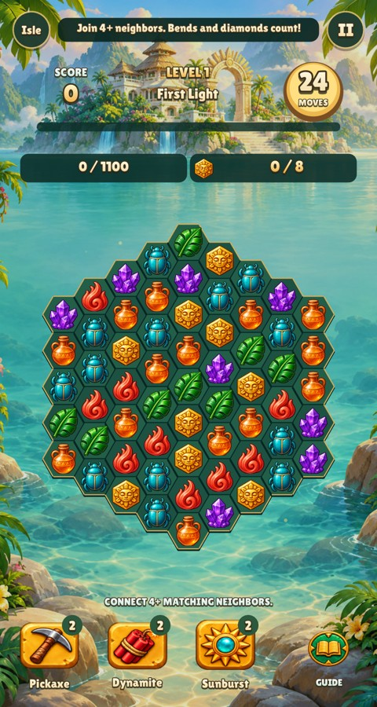 | 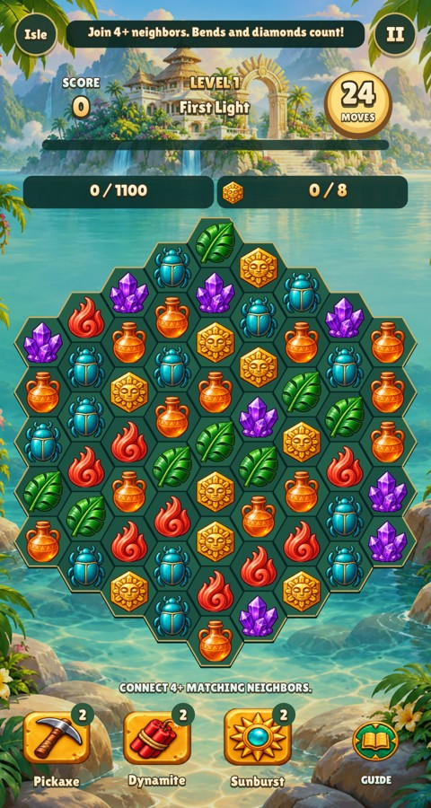 |
| late | 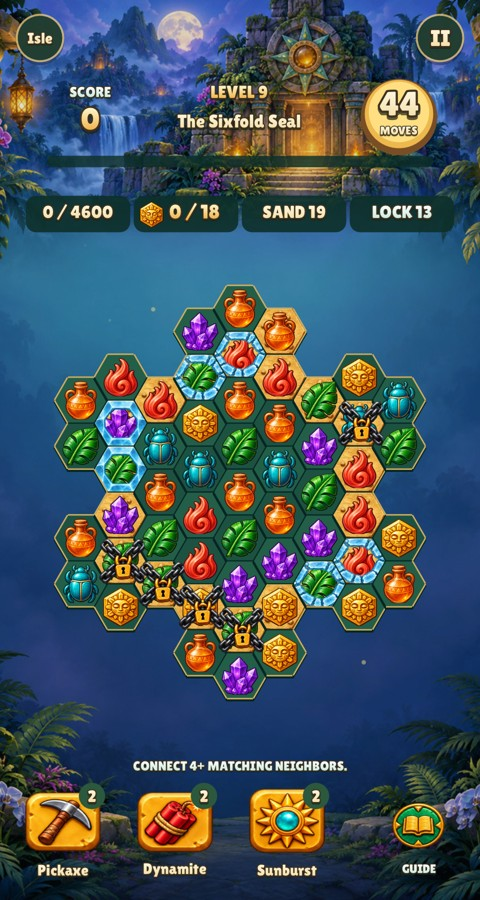 | 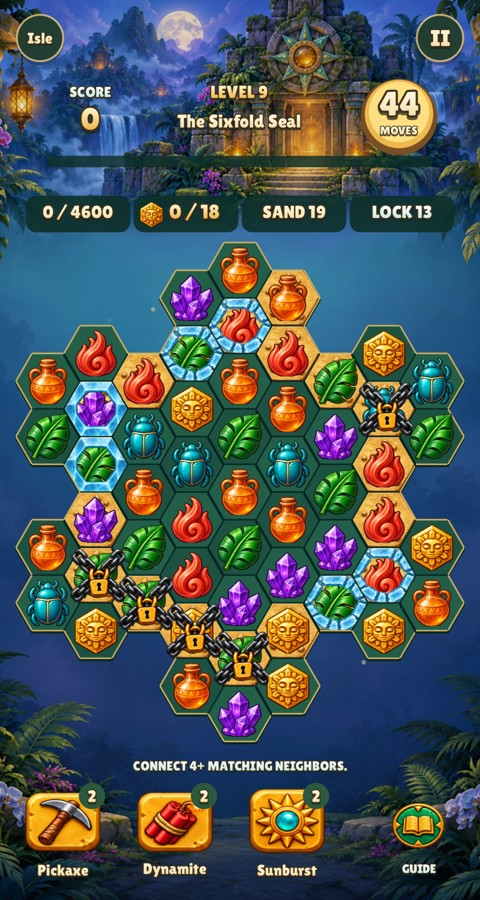 |
| specials | 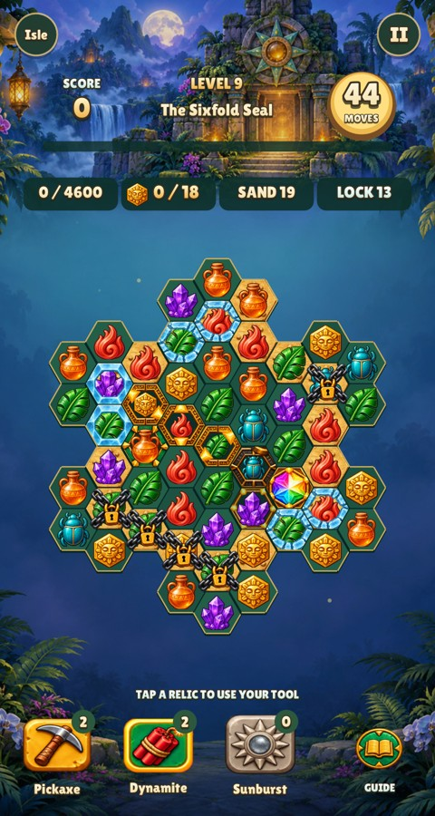 | 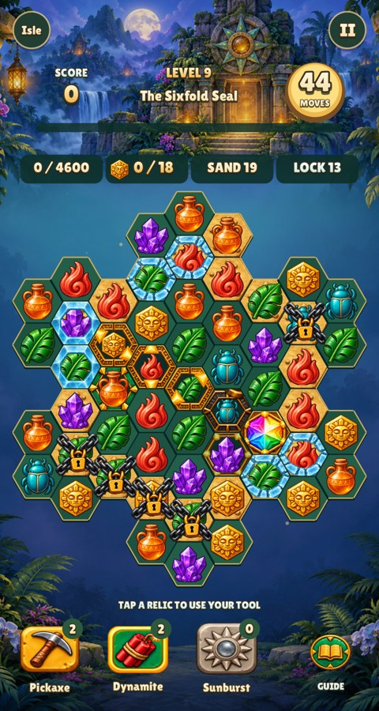 |
| jewels | 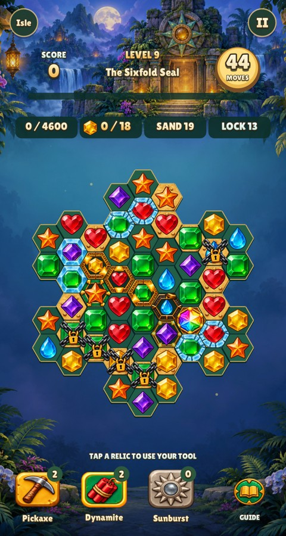 | 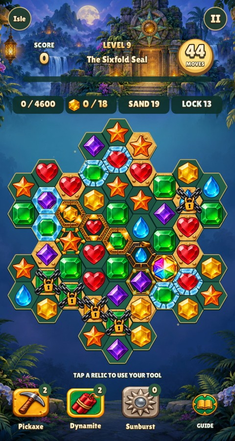 |
| resources | 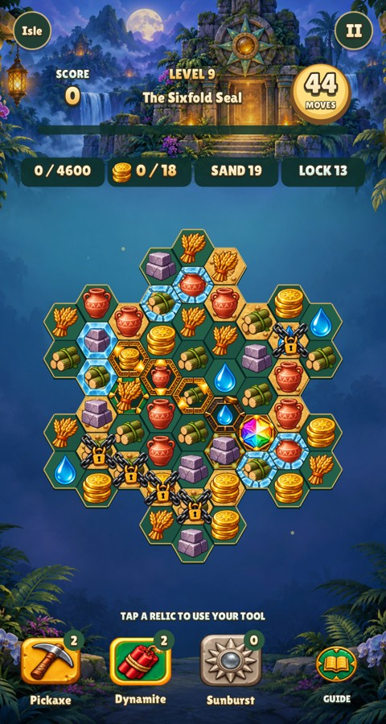 |  |
| ray | 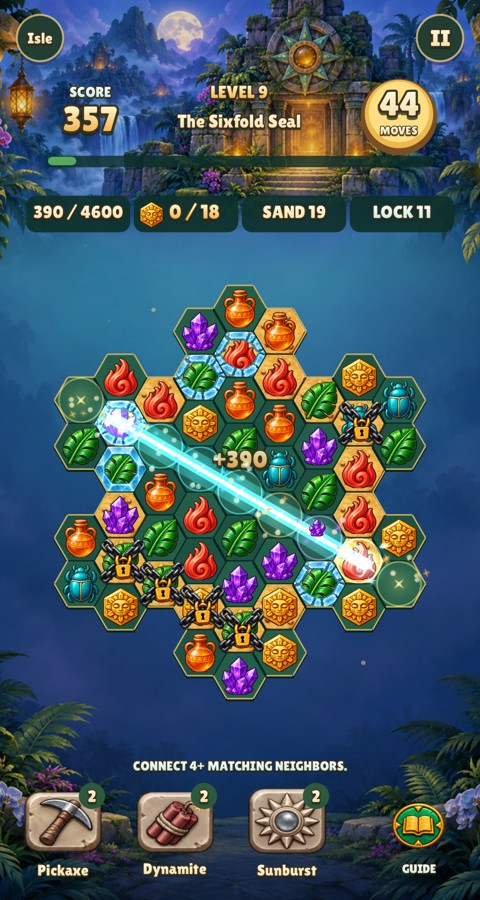 | 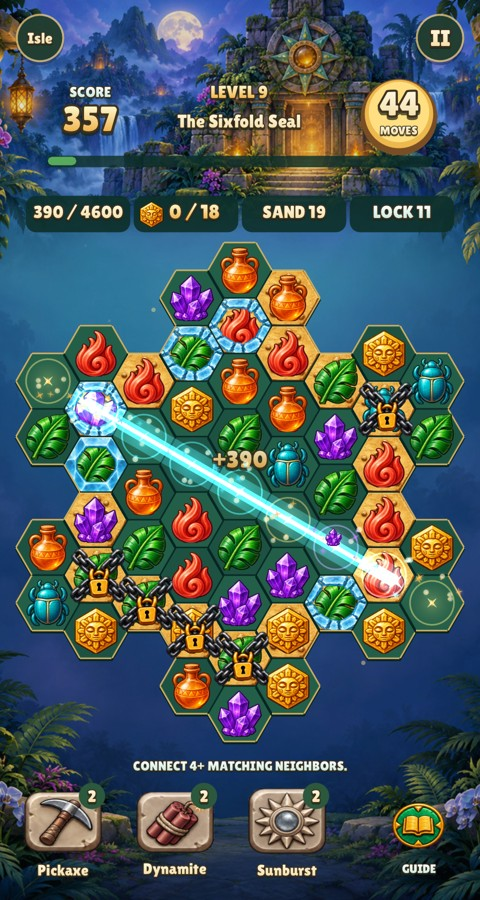 |
| bomb | 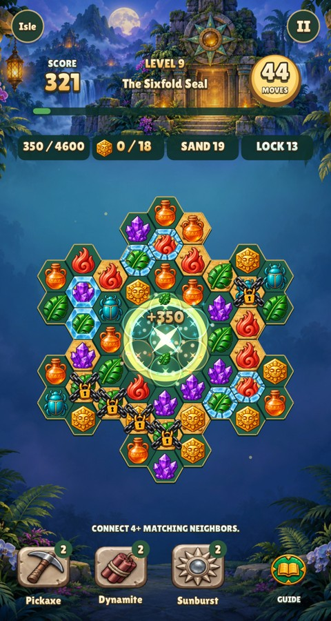 |  |
| prism | 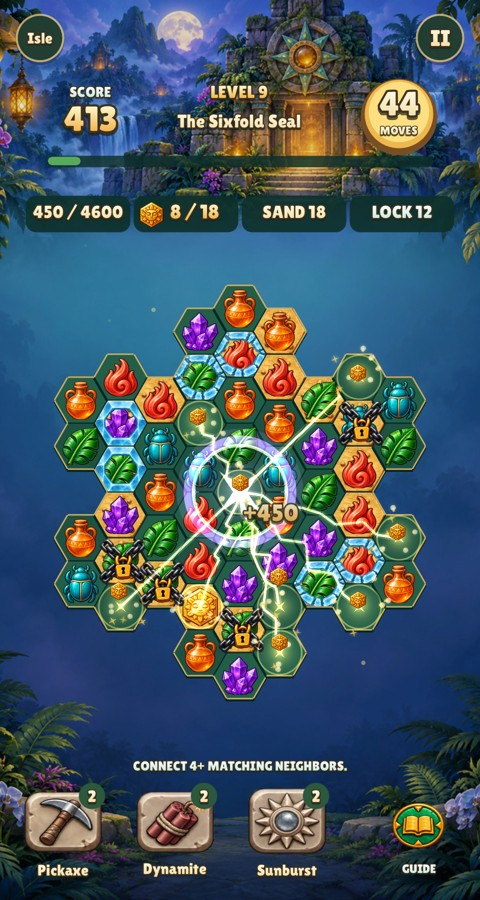 |  |
| phone-first | 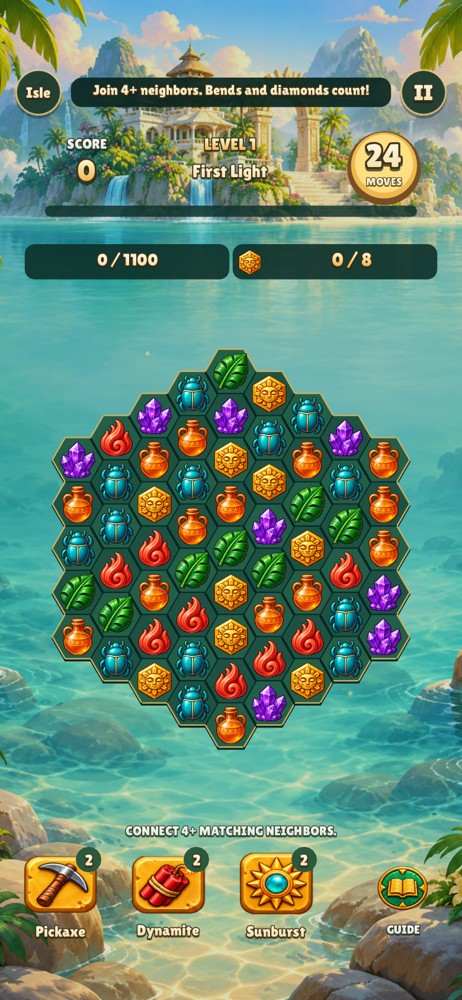 |  |
| phone-late | 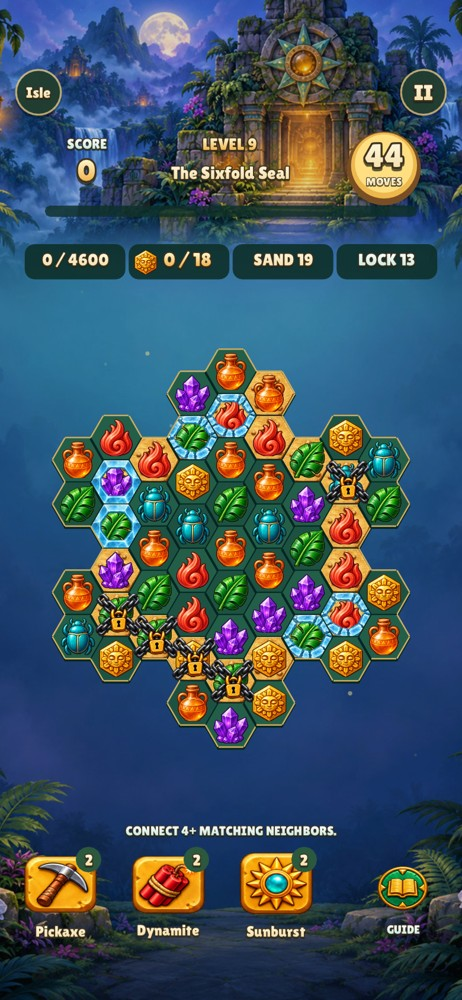 |  |
| phone-specials | 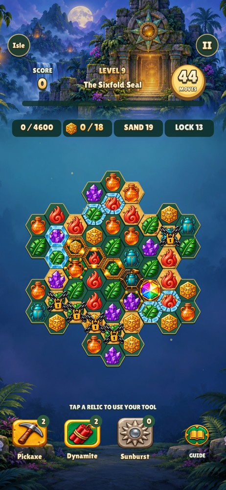 | 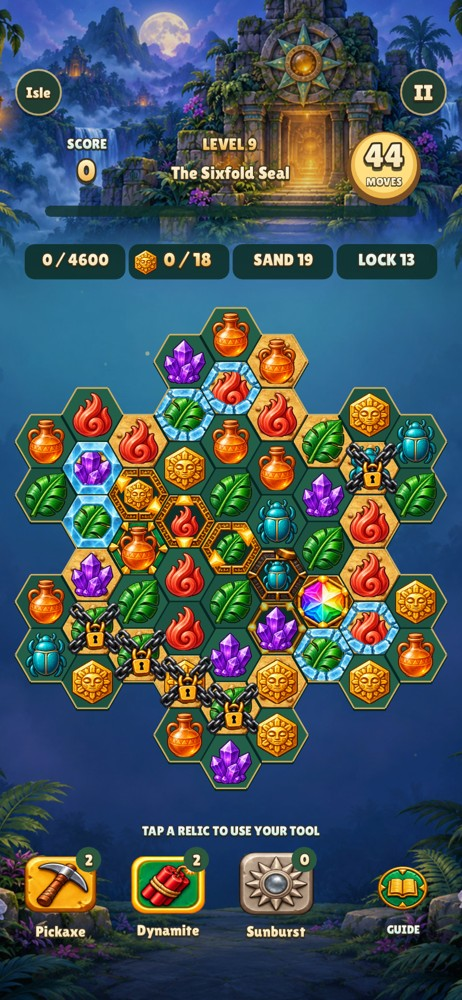 |
