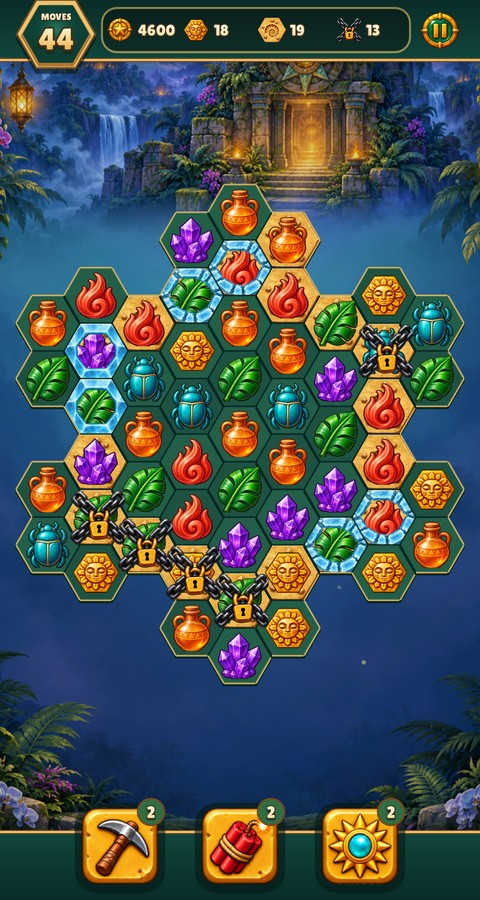
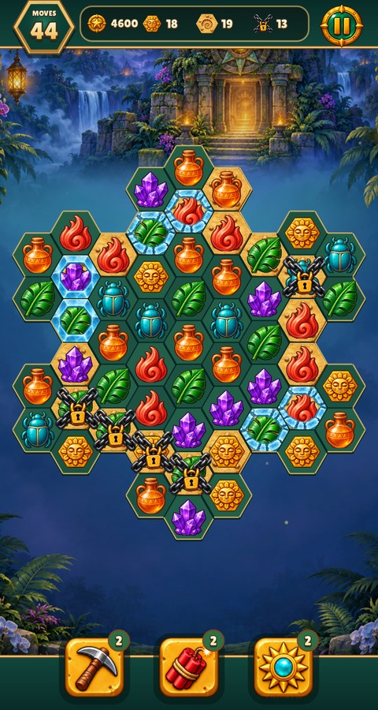
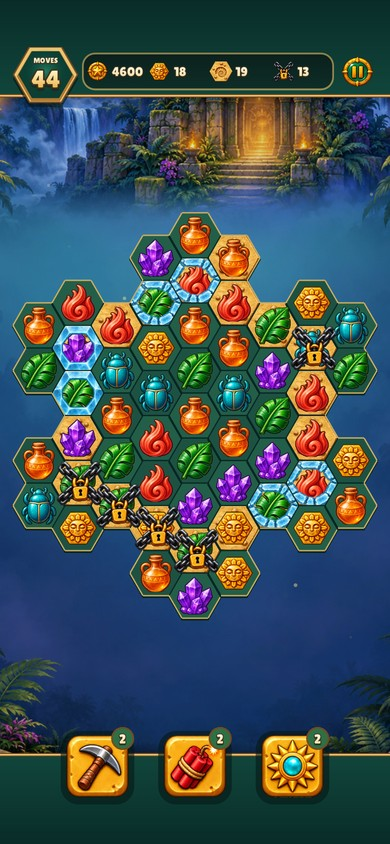
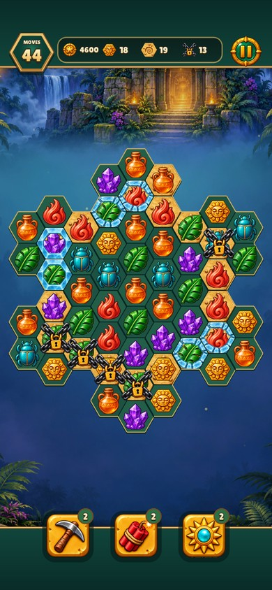
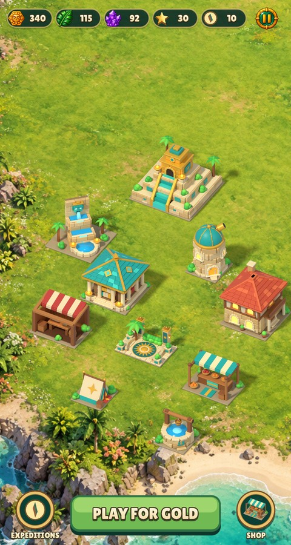
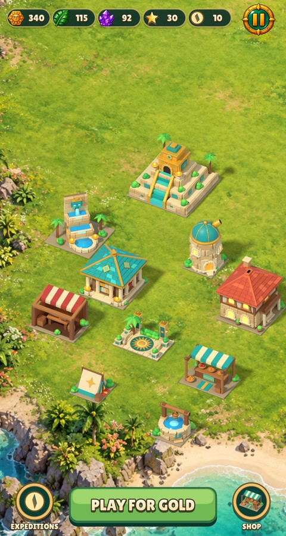
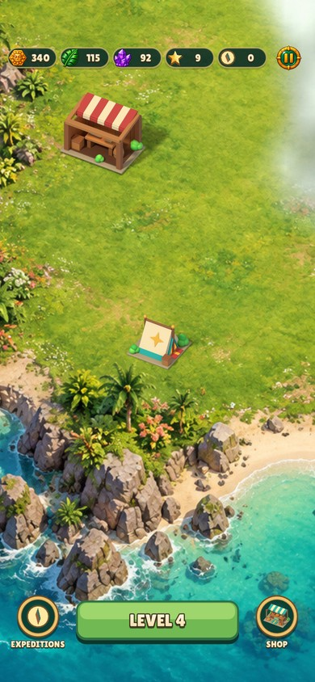
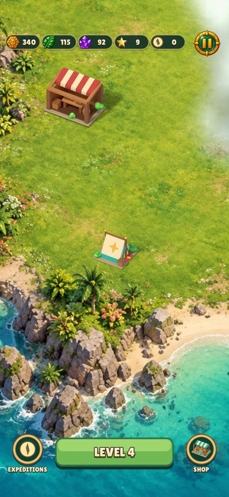

# Larger Pause button on the board and city

Enlarge the shared Pause medallion and its touch area from 44×44 to 64×64 logical
units. The board's goal plate reserves more space on its right; measured goal
rows retain their icon and count, with narrower count allocations. City currency
pills leave room beside the enlarged button. Existing authored normal, hover and
pressed artwork scales directly; no assets, alpha or visual states are changed.

Baseline: `1640f4c`. Four pairs cover the dense four-goal board and city at
480×900 and 390×844 with safe areas. Each pair uses the same existing screen job.
The smoke run opens board Pause at its new left edge and city Pause at its new
lower edge, both outside the old touch area, then resumes through real input.

```sh
make CFLAGS="-O2 -g -Werror" relic-rush build/test/relic-rush
build/test/relic-rush "rules relic_board" "smoke game" "shot floating-hud" "shot phone-floating-hud" "shot island-village" "shot phone-island"
make lint
```

Captures come from `build/shots/relic-rush/<name>.png`; JPEGs are reduced to
their logical viewport sizes. No new capture jobs or artwork runs are needed.
All eight images were visually reviewed. Scoped build: 1.55 s initially,
0.06 s up to date after the Lua change. Six selected test/capture jobs passed
with 1,117 checks in 13.91 s; lint passed in 1.18 s with no warnings or errors.

| View | Before | After |
| --- | --- | --- |
| Board, 480×900 |  |  |
| Board, 390×844 |  |  |
| City, 480×900 |  |  |
| City, 390×844 |  |  |
