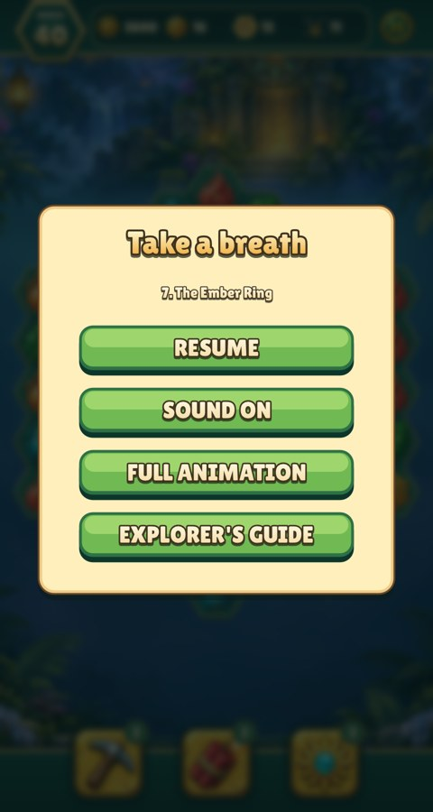
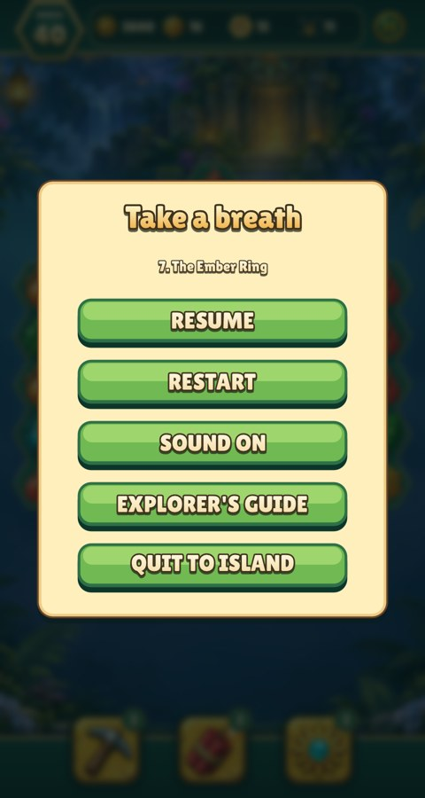
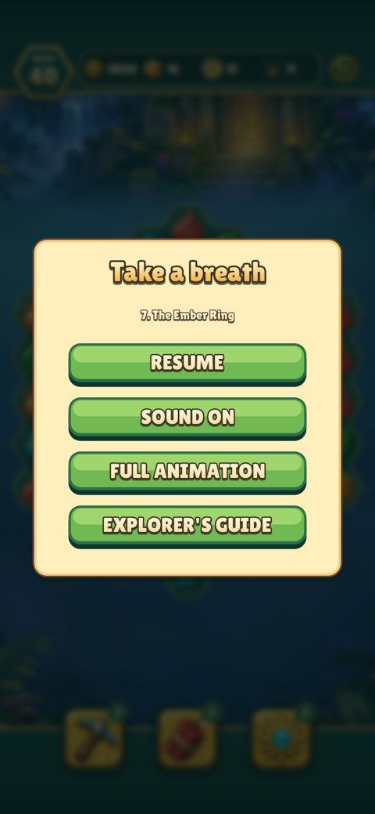
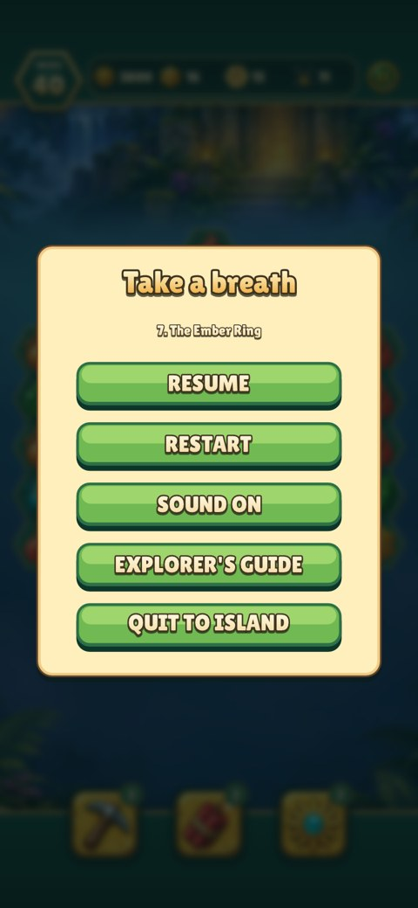
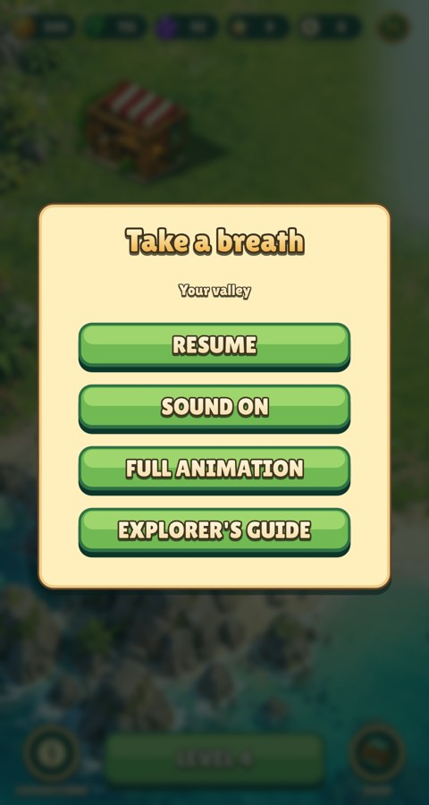
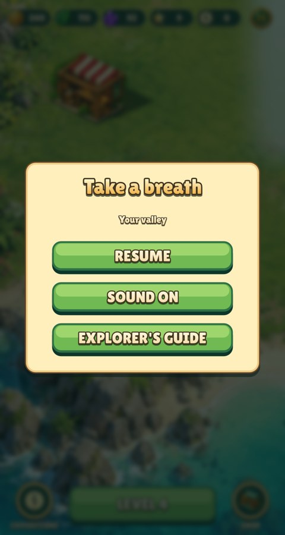
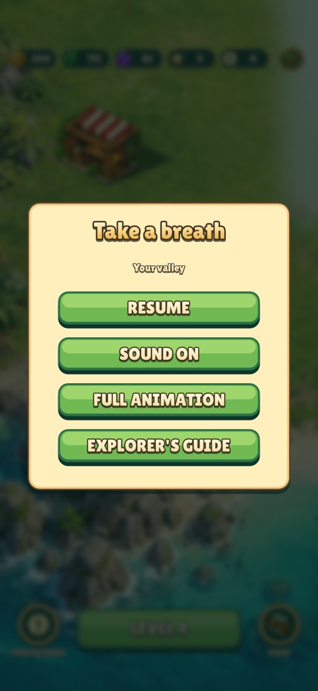
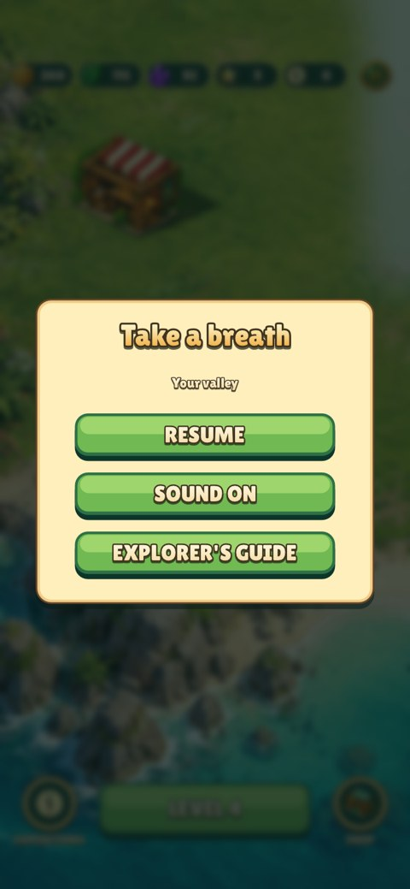

# Pause menu actions

Expedition Pause adds **Restart** and **Quit to Island** and removes the
Full Animation / Motion Reduced toggle. Restart creates a fresh attempt of the
same level, resetting the board, moves, tools, selection and effects. Quit to
Island suspends the attempt without paying rewards; the expedition browser can
resume it during the same session. Banked progress and island buildings remain.

Island Pause contains Resume, Sound and Explorer's Guide. The form measures its
visible content so both menus stay centred without excess blank space.
All buttons use the existing form skin; no bitmap assets or states were added.

Every image is an actual game capture. The 390×844 captures include 47px top and
34px bottom safe-area insets. Before uses `screens.lua` from base commit `c6099b0`; all other code and art
match the rebased game.

| Context / size | Before | After |
| --- | --- | --- |
| Expedition / 480×900 |  |  |
| Expedition / 390×844 |  |  |
| Island / 480×900 |  |  |
| Island / 390×844 |  |  |

Reproduce from the repository root:

```sh
make CFLAGS="-O2 -g -Werror"
make test
python3 tests/fixtures/pause-actions/capture.py --before-ref c6099b0
./build/relic-rush --headless --mute --fresh --smoke --size 480x900
./build/relic-rush --headless --mute --fresh --smoke --size 390x844 --safe-area 0,47,0,34
```

On Linux, prefix rendering and smoke commands with `xvfb-run -a` and set
`LIBGL_ALWAYS_SOFTWARE=1`. macOS runs the native headless renderer directly.
The smoke test uses real queued clicks for Restart, Quit to Island, island Pause
and the expedition browser. It checks a fresh attempt, unchanged banked rewards,
hidden puzzle-only island controls and resumption of the suspended board.

Validation: strict build and full `make test` passed. Native game smoke runs
passed at both phone sizes. All eight before/after captures were visually
inspected for complete labels, centred panels and safe-area placement.
