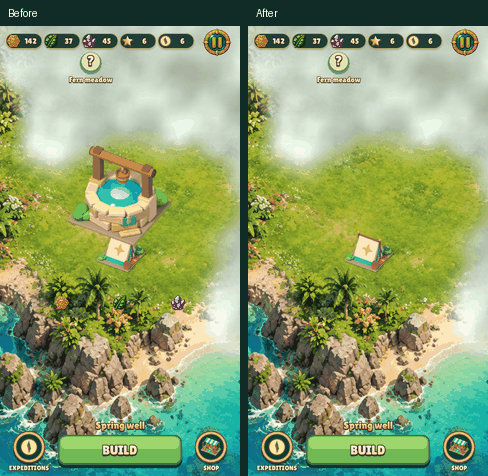
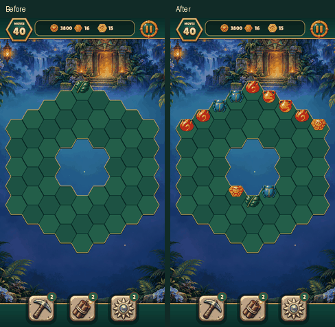
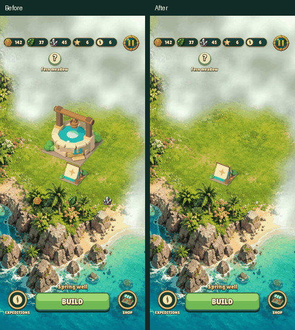
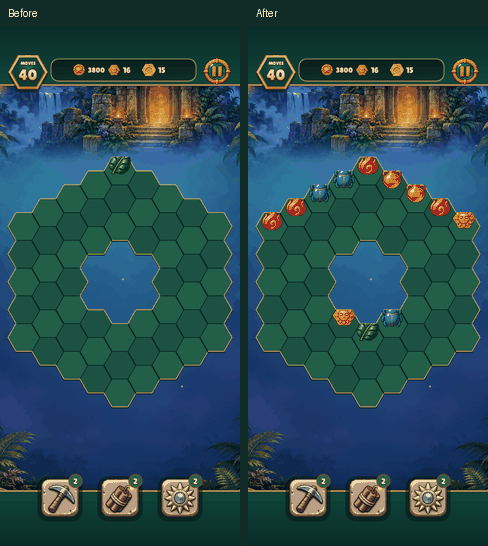

# Popup attachment and top-edge refill

The building and resource icons now share their popup's position, scale and
opacity. Form images use the skin's `image` paint callback; unskinned forms
retain their native drawing path. Every active puzzle cell with no active cell
directly above it spawns vertically, including stepped edges and cells below
holes. Interior gems fall straight down first; diagonal slides require the donor’s
cell below to be occupied, locked or missing.

These short game-rendered clips compare the previous and corrected animations.
The refill fixture clears the ring-shaped seventh board so every inlet is
visible. The artwork and animation timing are unchanged.

| Size | Building popup | Refill |
| --- | --- | --- |
| 480×900 |  |  |
| 390×844 with safe areas |  |  |

Reproduce the raw game captures with the existing one-start test runner:

```sh
make CFLAGS="-O2 -g -Werror" relic-rush christmas-market build/test/relic-rush build/test/christmas-market
build/test/relic-rush "reel relic-rush-building-entrance" "reel relic-rush-top-edge-refill"
build/test/christmas-market "reel christmas-market-building-entrance" "reel christmas-market-top-edge-refill"
```

Each reel captures sixteen frames three game frames apart into
`build/shots/frames/`. The checked-in comparisons show 240-pixel-wide previews
with Before/After headings. The 390×844 captures include top/bottom safe areas.
Both games use the corrected shared engine paths.

Regression coverage lives in `tests/lua/ui_skin.lua`,
`tests/lua/engine_match3.lua` (all 64 behavior-flag combinations) and
`tests/lua/trickling.lua` (all ten silhouettes in each game, plus identity,
conservation, determinism and lock routing).

Validation: final incremental `make -j4 CFLAGS="-O2 -g -Werror" all`
plus the engine/portrait test binaries passed (6.76 seconds). The full
`make -j4 CFLAGS="-O2 -g -Werror" test` passed in 215.16 seconds, including
generated-code checks, asset checks, every engine/game suite, audio and
Clayfight checks. `make lint` passed in 1.23 seconds with no warnings or
errors. These are measured wall times; the full test target includes its
remaining test-binary builds and asset preflight.
