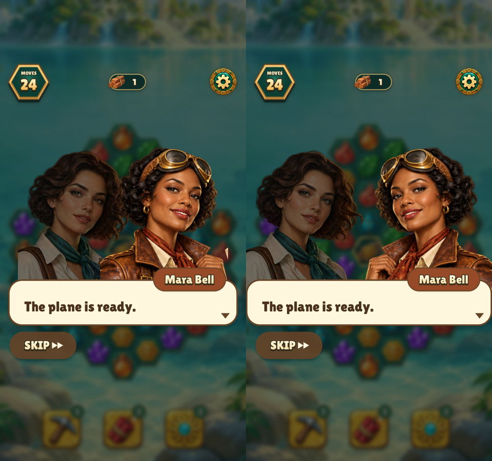
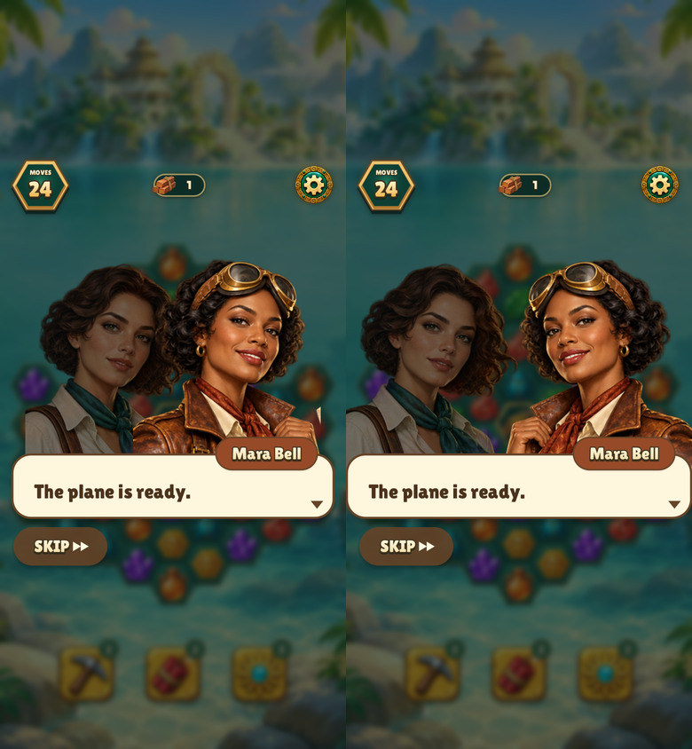
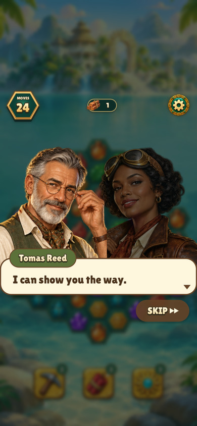
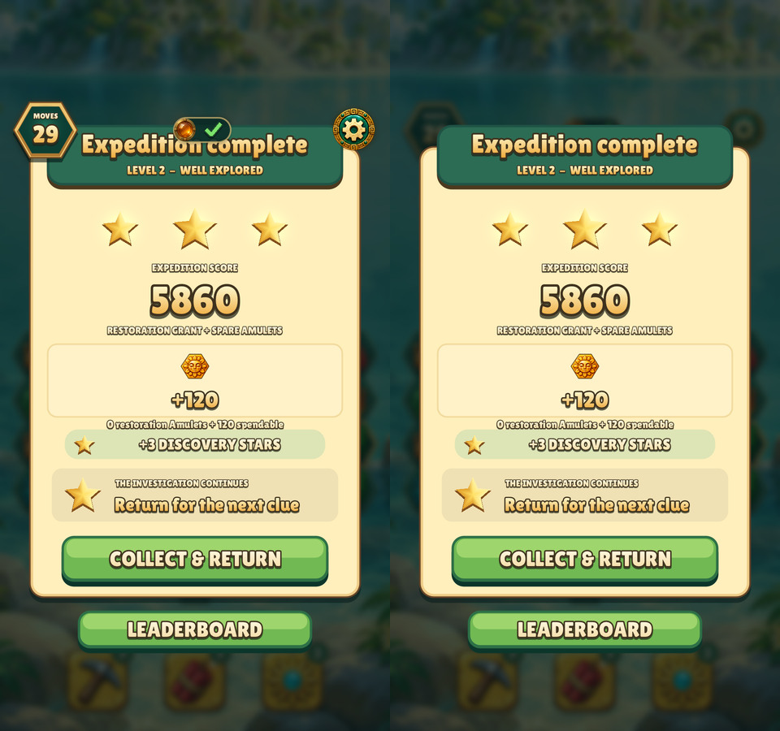
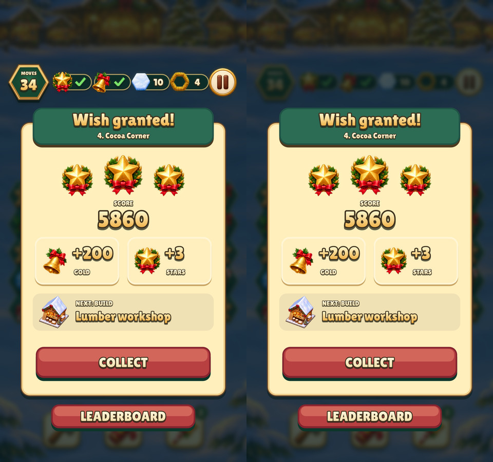
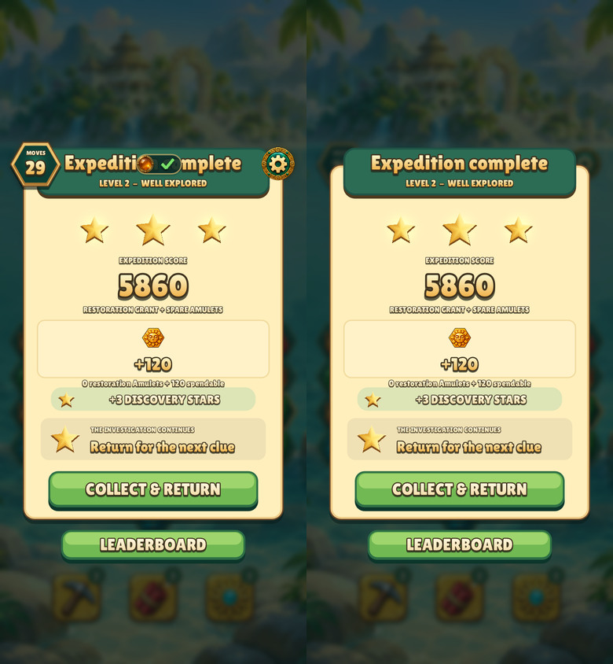
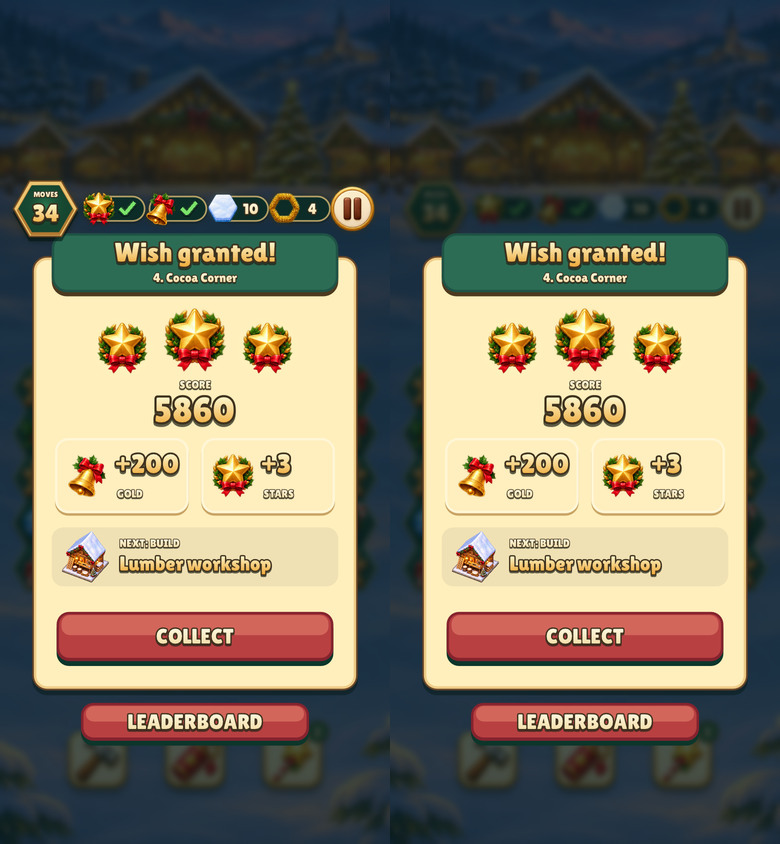

# Dialogue staging and results layering

Relic Rush exports the four runtime portraits facing right. The engine mirrors
the right slot and keeps a returning speaker on their established side. The
portraits stand at the edges of the usable screen, and the speech outline spans
the same width. Text, name tags and Skip keep their own insets.

Each comparison shows the previous layout on the left and the revised layout on
the right.

| Size | Dialogue |
| --- | --- |
| 480×900 |  |
| 390×844 with safe areas |  |



The results modal keeps the move counter, completed goals and pause button in
the blurred background. The title and buttons stay clear.

| Size | Relic Rush | Christmas Market |
| --- | --- | --- |
| 480×900 |  |  |
| 390×844 with safe areas |  |  |

From the repository root:

```sh
build/test/relic-rush 'frame portrait-listener-' 'frame portrait-same-side-' 'shot result-layer-'
build/test/christmas-market 'shot result-layer-'
```
