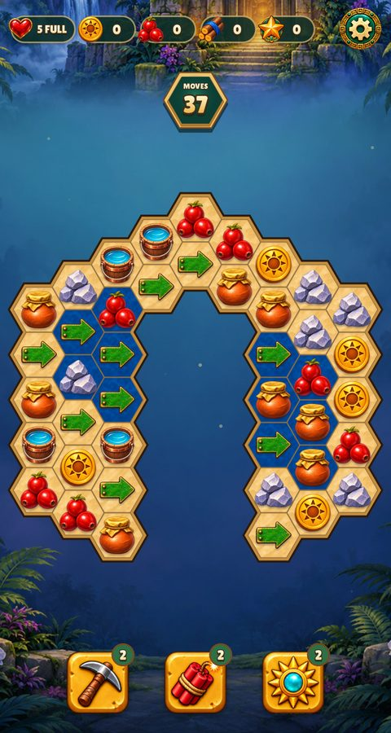
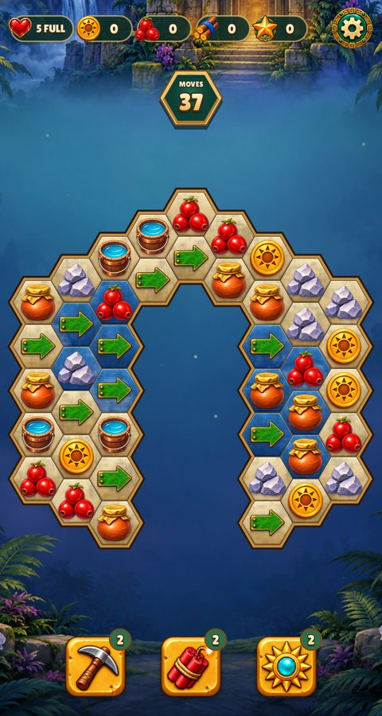
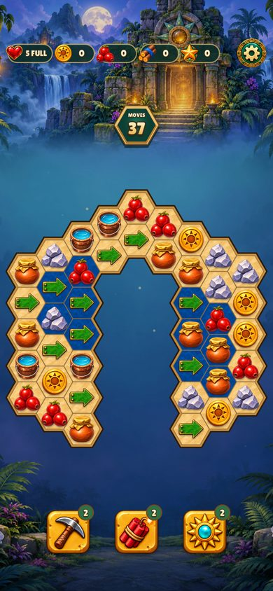
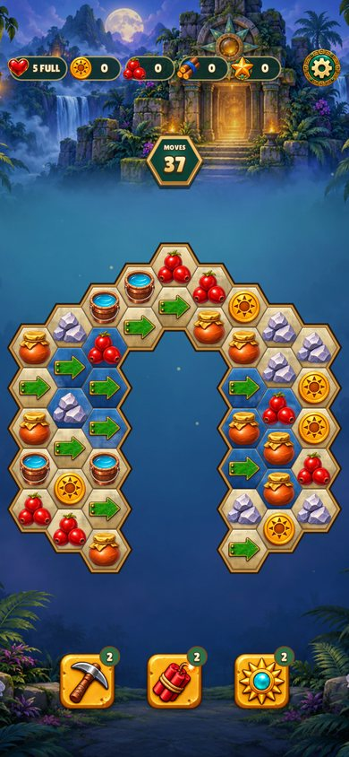
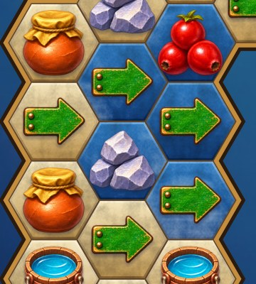
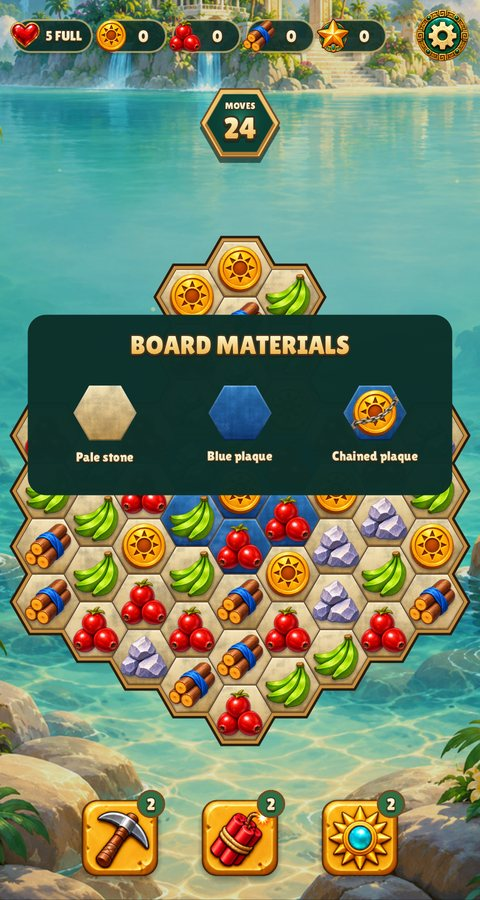

# Procedural plaques

Cells are drawn the way Cradle of Rome's plaque boards look: each face is lit
from above, with a light upper bevel and a shaded lower one, and stained by a
neutral paper grain. Cream limestone for ordinary cells, cobalt for targets.
Colours are skin values, so the board can be recoloured without new art.
"Before" is the painted bitmap with the restored frame.

| Screen | Before | After |
| --- | --- | --- |
| Level 6, 480×900 |  |  |
| Level 6, 390×844 |  |  |

| Cell detail, 2× | Explorer's Guide | Materials catalogue |
| --- | --- | --- |
|  |  |  |

```sh
python3 tools/board_grain.py games/relic-rush/data/board-grain.png
./build/relic-rush --headless --mute --fresh --size 480x900 --level 6 --shot board.png
./build/relic-rush --headless --mute --fresh --size 480x900 --dialog guide --shot guide.png
./build/relic-rush --headless --mute --fresh --size 480x900 --art-states dressing --shot materials.png
```
