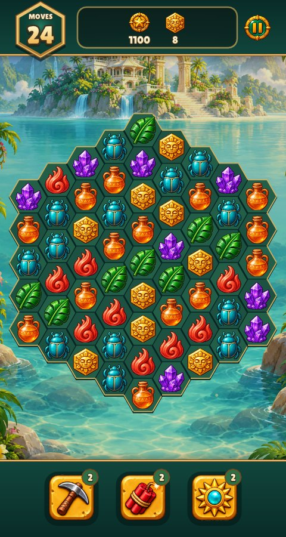
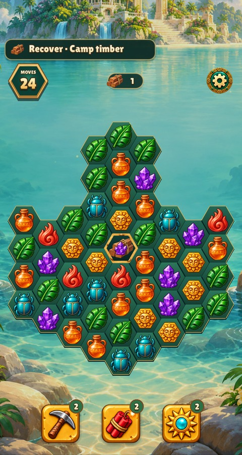
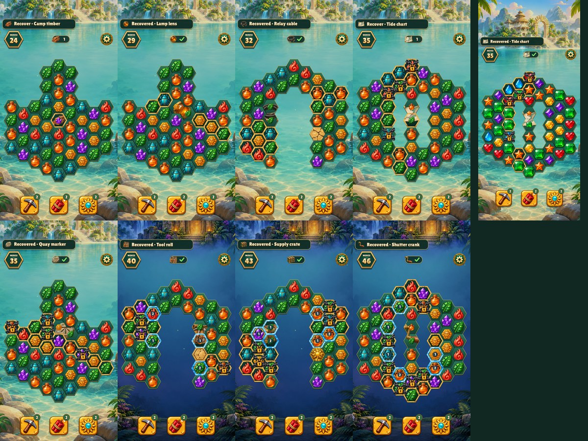
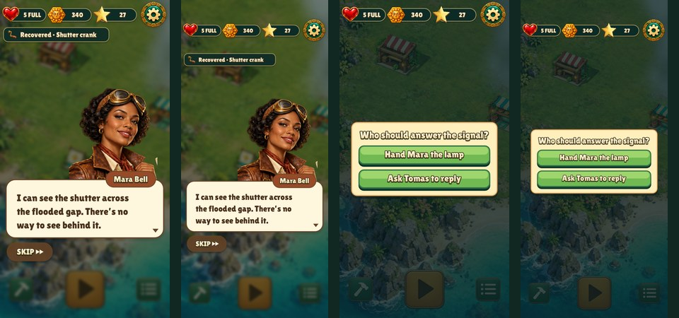
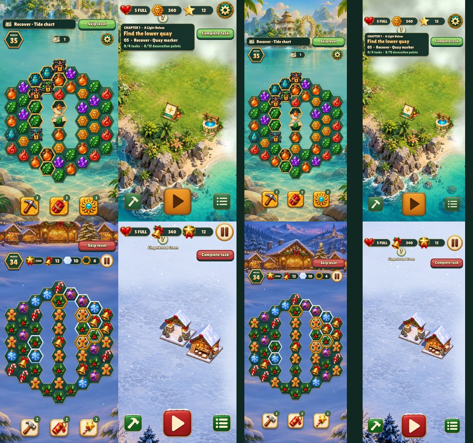

# A Light Below — historical review

These captures document the retired hidden-object board mechanic. Current boards use
normal match-3 goals; the quest objects appear in the first-clear story.

Chapter 1 boards win when the quest object is fully recovered. The goal and
first-clear dialogue use the same object art. The island tracks confirmed
placements, remaining quest tasks and decoration points. At the tide-room
reveal, Mara or Tomas can answer the signal.

| Opening board before | Opening board with camp timber |
| --- | --- |
|  |  |



The captures cover covered timber, the partially uncovered chart, and
recovered items. The narrow chart capture uses the jewel pack.





The town capture shows the well placed and the next quest ready at eight
decoration points. Each confirmed wonder earns four points, and a confirmed
optional purchase earns one. The supported phone sizes are 480×900 and
390×844 with safe-area insets.

From the repository root, use the existing test binary to reproduce the review:

```sh
build/test/relic-rush 'shot quest-handoff' 'shot debug-' 'smoke campaign' 'smoke walkthrough-pointer'
build/test/christmas-market 'shot debug-' 'smoke campaign' 'smoke walkthrough-pointer'
```
