# Grouped expedition HUD cards

Removing the large backing panel left score and level text unreadable over the
bright lagoon and detailed temple. The replacement uses three compact jade
cards with gold rims: score, level/name, and moves. Labels and values stay in
one card; the progress track aligns with the row and the objective capsules
share its backing/border style. Gaps between the cards reveal the painting.

The read-only `hud_form` in `lua/board.lua` uses engine row/column layout and
computed values. Its skin paints panels and outlined/shadowed labels only.
The engine owns grouping and padding. Score pulses and progress updates remain
live; no input target or bitmap state is added. Board scale is unchanged.

Before: `b4182d42c04f46cbc0f72e846d4d840ddd8886e4`. After: this change.
All pairs are actual headless game captures at frame 4, effects at frame 10,
and guide/pause at frame 40. Phone captures include safe areas.

Reproduce after `make CFLAGS="-O2 -g -Werror"`:

```sh
./build/relic-rush --headless --mute --fresh --size 480x900 --frames 4 --shot first.png
./build/relic-rush --headless --mute --fresh --size 480x900 --level 9 --frames 4 --shot late.png
```

Use `--art-board` for specials; `--dialog pause` / `guide` at frame 40 for modal
underlays; `--fx ray` / `bomb` / `prism` at frame 10 for score/progress effects.
Phone captures use `--size 390x844 --safe-area 0,47,0,34`. Review JPEGs are resized
to at most 480×1000. `make shots` updates canonical captures.

Validation passed: Werror build, `make test` with catalogue/asset checks, and
real native-input Relic Rush smoke tests at both phone sizes. Both backgrounds,
all top readouts, state-heavy boards, effects and modal underlays were inspected.
No dependencies downloaded.

| Screen | Before | After |
| --- | --- | --- |
| first |  | 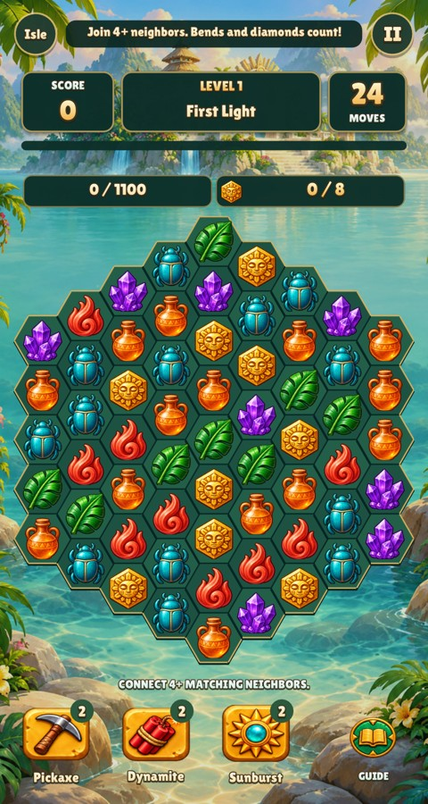 |
| late |  | 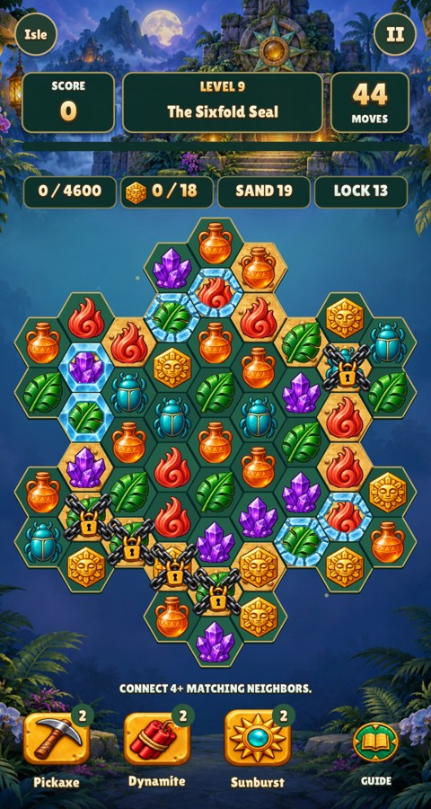 |
| specials |  | 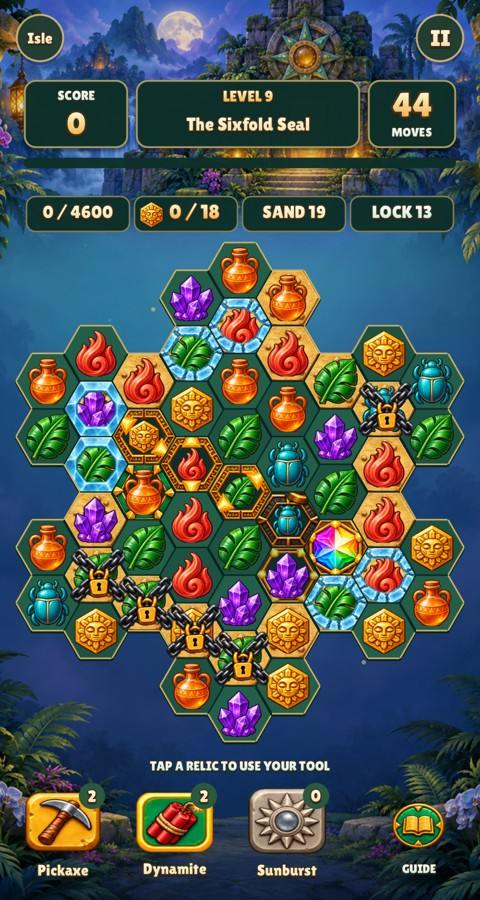 |
| pause | 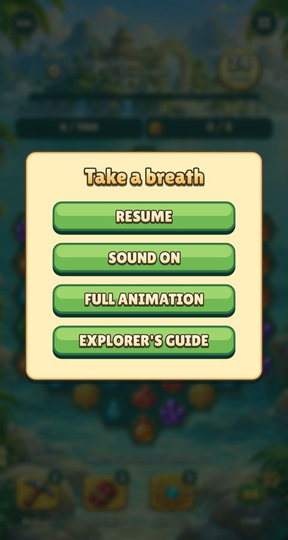 | 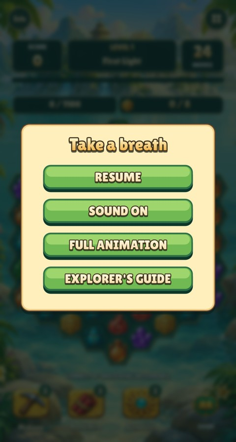 |
| guide | 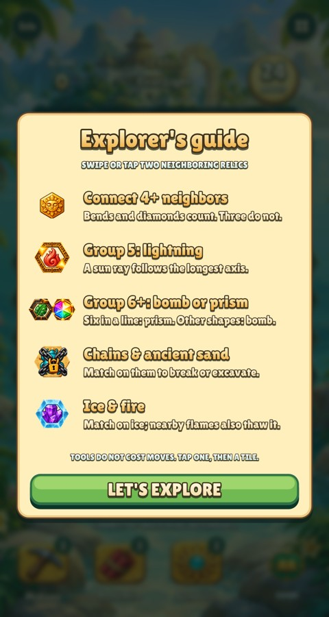 | 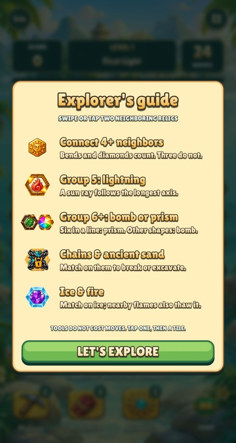 |
| ray |  | 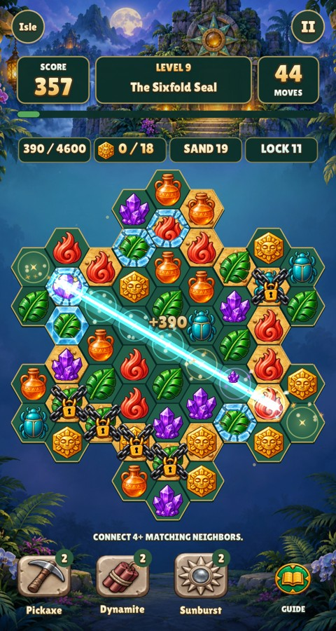 |
| bomb | 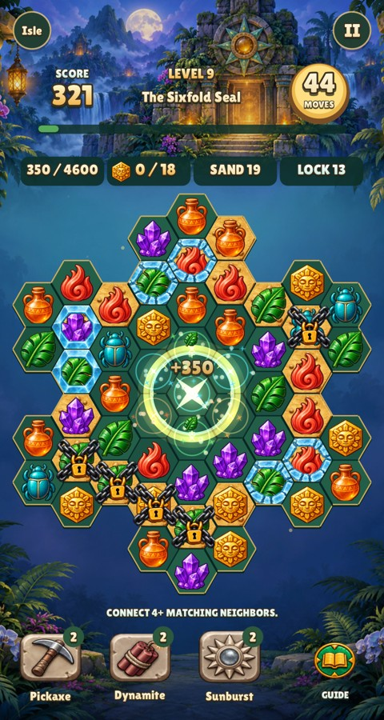 | 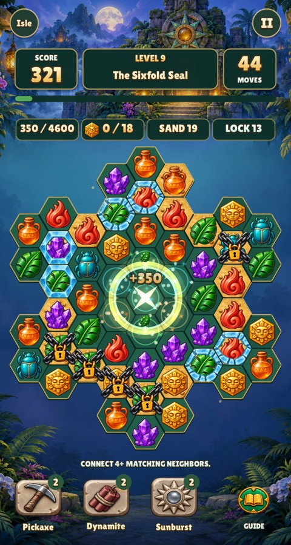 |
| prism | 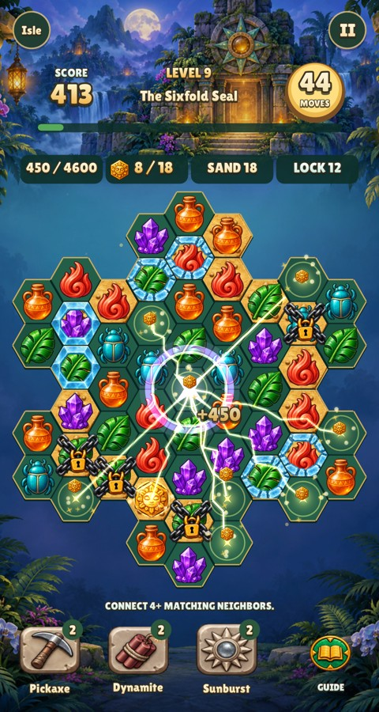 | 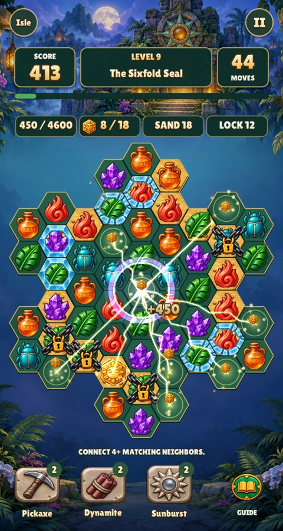 |
| phone-first | 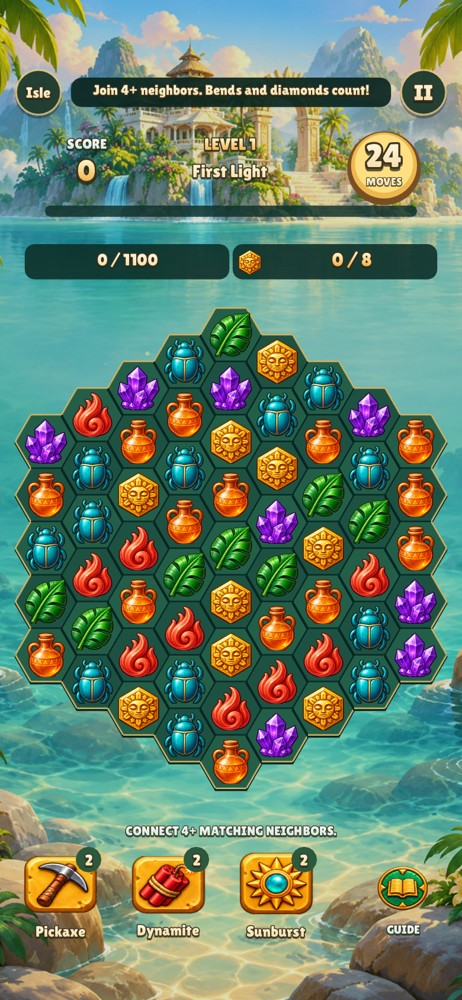 | 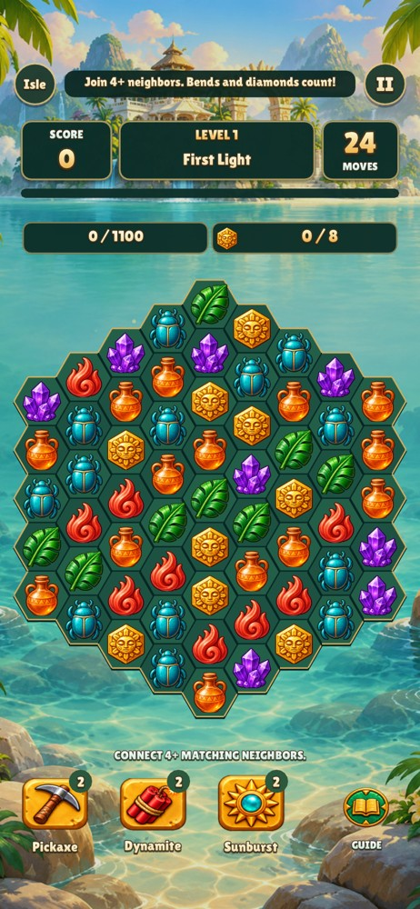 |
| phone-late | 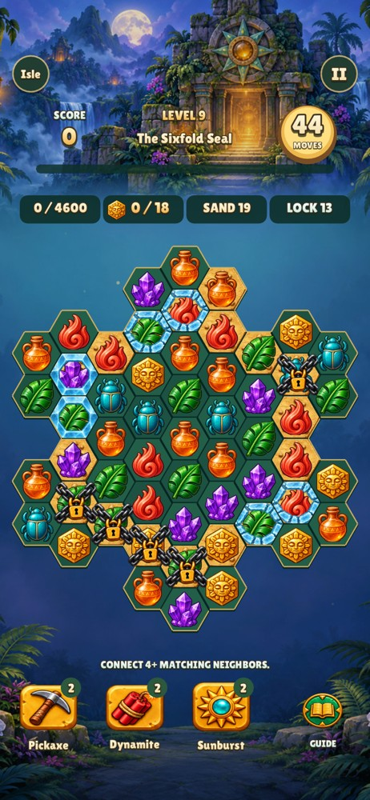 | 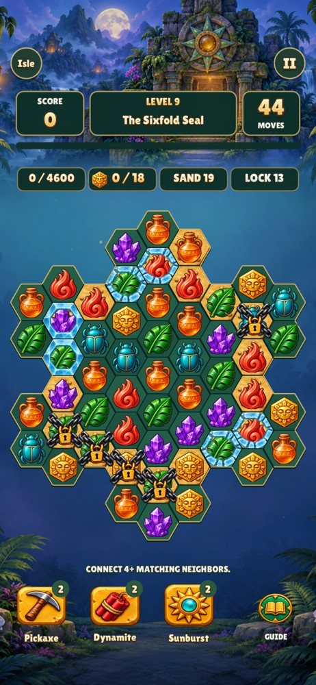 |
| phone-specials |  | 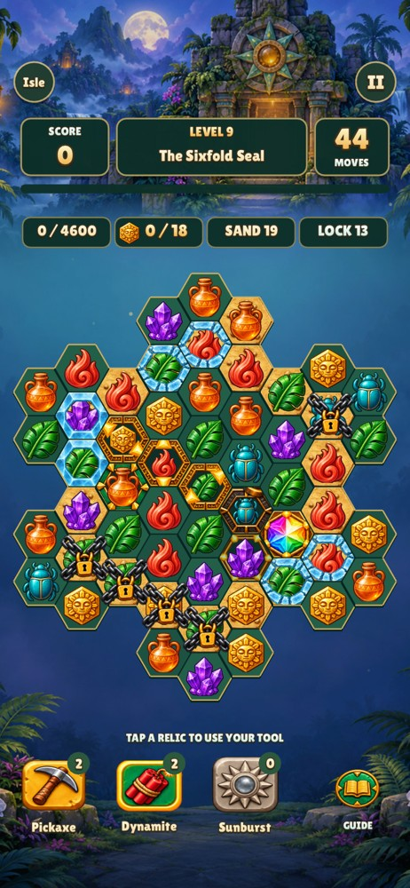 |
