# Square power-up controls

The power-up textures were drawn into 76×65 rectangles, and the original pickaxe
and dynamite sprites had wider-than-tall bodies. All three tools now use new
square artwork with their normal, selected, pressed, hover and disabled states
authored together in one transparent ImageGen atlas. Measured registration and
the exact prompt are in [the source-art directory](../../../art/tool-buttons/README.md).

Touch targets are 76×76, and drawing adds the same five-unit padding on every
side. The row moves up six units to y=784, with labels below at y=872; tall phones
add their existing height offset. The guide keeps its previous position. The
new artwork, its registration and runtime paths are catalogued in
[asset-catalogue.md](../../asset-catalogue.md).

Actual-game captures, before commit `3120b70` versus this change:

| Size/state | Before | After |
| --- | --- | --- |
| 480×900 / ready | 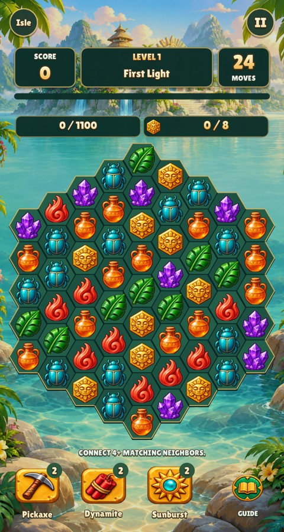 | 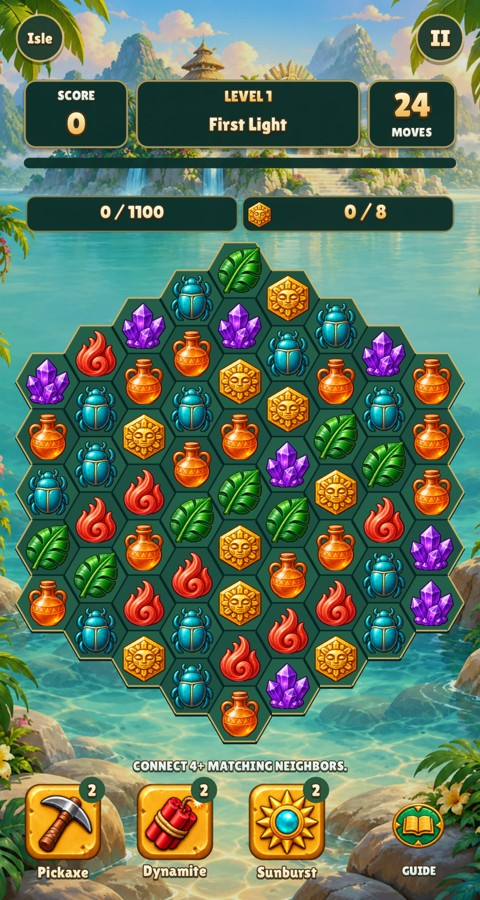 |
| 480×900 / exhausted | 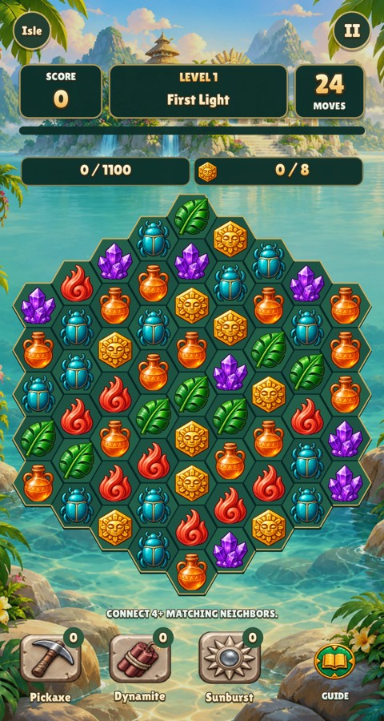 | 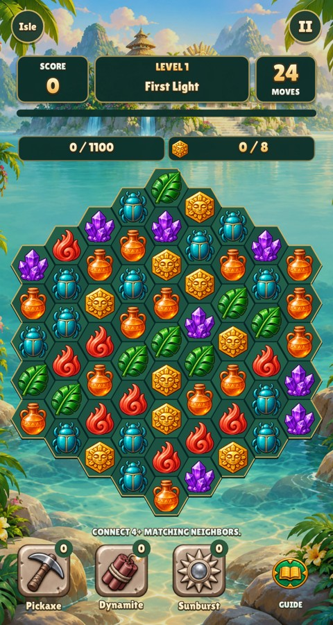 |
| 390×844 / ready |  | 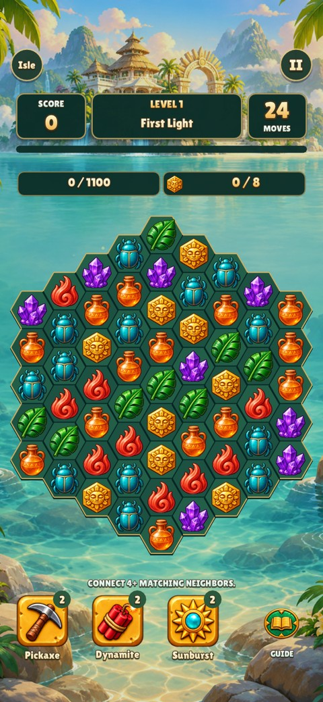 |
| 390×844 / exhausted | 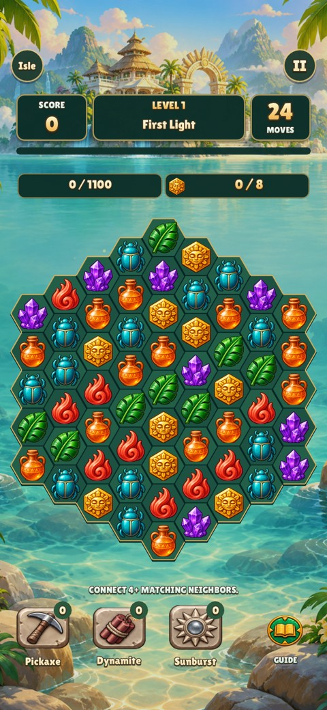 |  |

| State | 480×900 | 390×844 with 47/34 safe-area insets |
| --- | --- | --- |
| Selected dynamite | 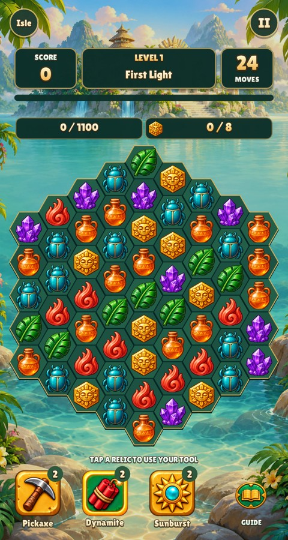 | 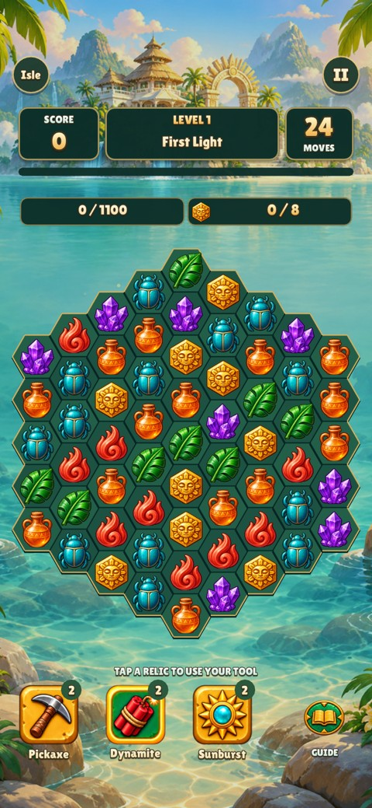 |
| Held pickaxe | 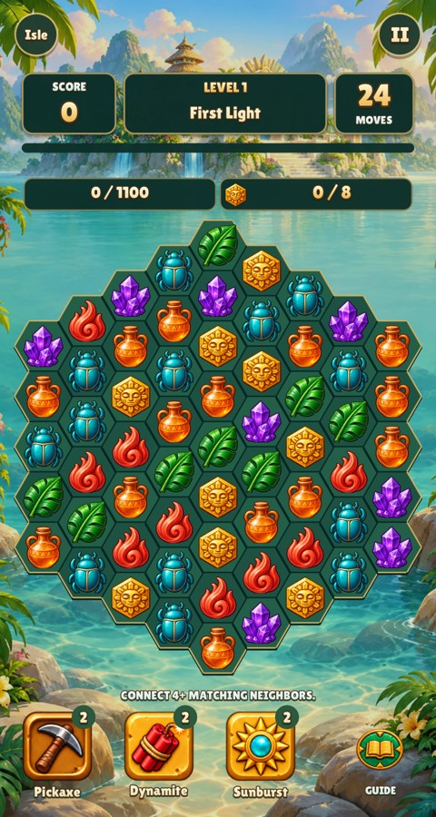 | 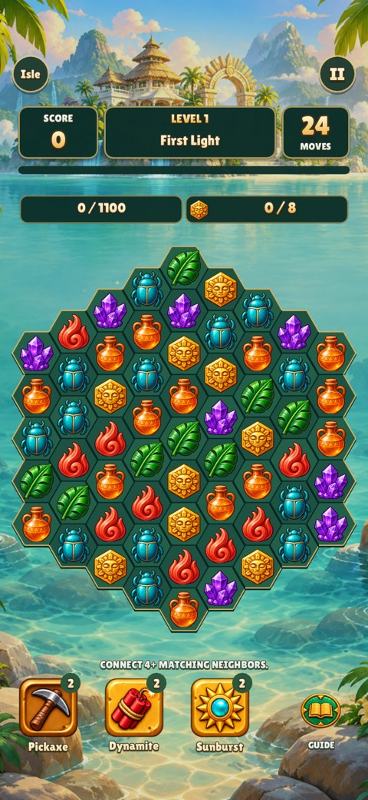 |
| Hovered sunburst | 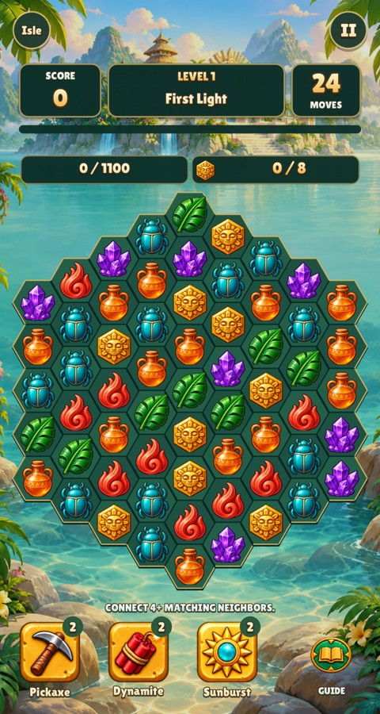 | 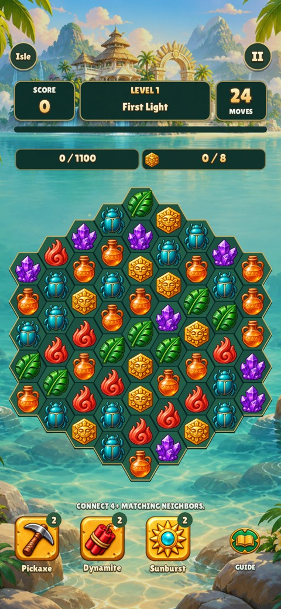 |
| Every authored state in the game's catalogue | 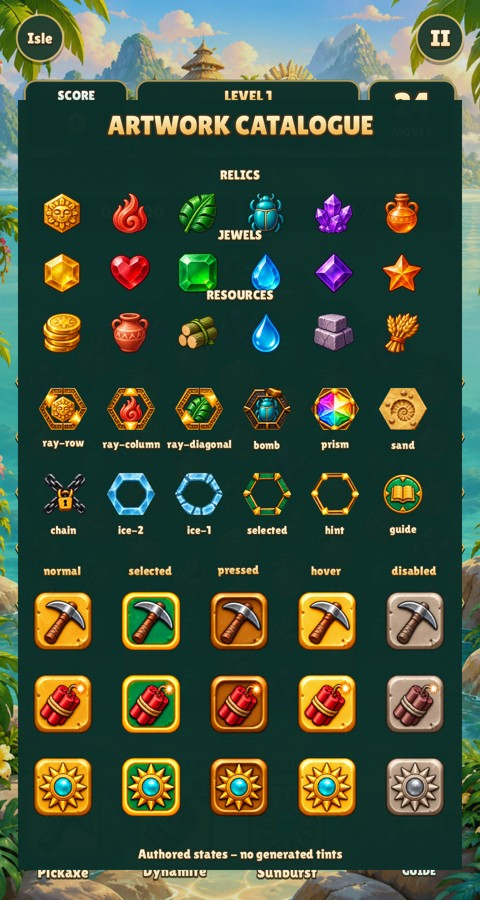 | 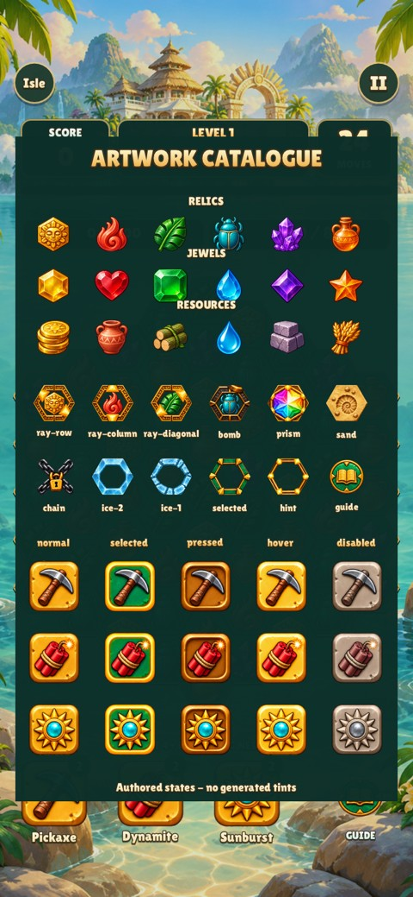 |

Reproduce all captures and native queued-input edge checks:

```sh
make CFLAGS="-O2 -g -Werror"
python3 games/relic-rush/tools/board_assets.py --check
python3 tests/fixtures/relic-tools/capture.py --before-ref 3120b70
make test
./build/relic-rush --headless --mute --fresh --smoke
./build/relic-rush --headless --mute --fresh --smoke --size 390x844 --safe-area 0,47,0,34
```

On Linux run capture and smoke commands under Xvfb. The fixture renders the
real game with its normal assets; temporary links avoid copying asset folders.
Its input checks select/toggle every tool at the newly covered top/bottom edges,
reject clicks just below the targets, and apply a pickaxe with correct charge use.

Validation passed: strict `-Werror` build, full `make test`, deterministic asset
reproduction/square-body checks, native tool edge/use checks, and complete game
smoke runs at both sizes. All sixteen review captures were inspected.
