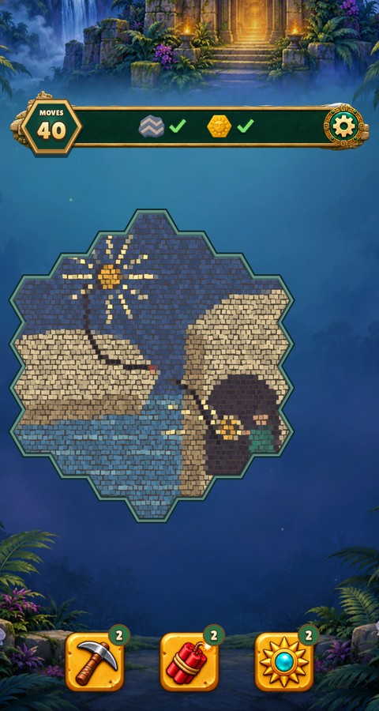
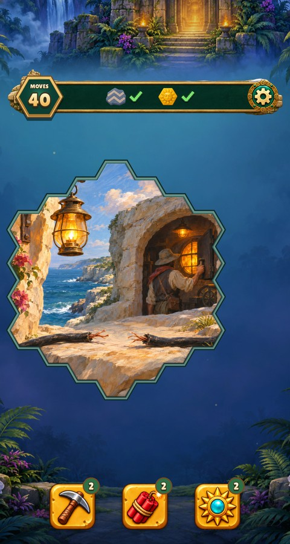
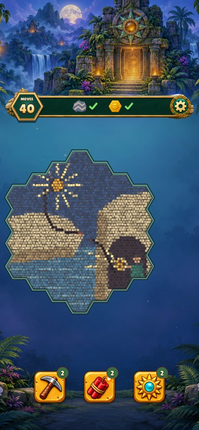
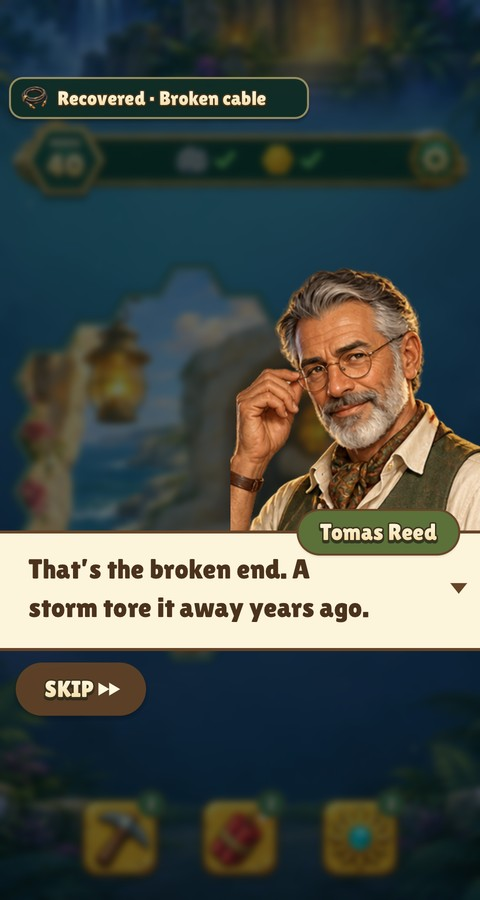

# The Broken Cable · board 8

Restoring the floor reveals the keepers' picture of the relay. The broken
copper ends point from the camp lamp and its bracket to the tide room. An
anonymous keeper works the shutter by hand. See the [asset catalogue](../../asset-catalogue.md#story-pictures)
for the source painting, prompt and runtime crop.

| Phone size | Prototype at half restored | Painting at half restored | Prototype on first clear | Painting on first clear |
| --- | --- | --- | --- | --- |
| 480×900 |  |  |  |  |
| 390×844 with safe areas |  |  |  |  |

| Ordinary mosaic floor | The first-clear exchange over the painting |
| --- | --- |
|  |  |

Render the authored picture at each stage with the existing debug entry.

```sh
build/test/relic-rush "shot reveal-"
```
