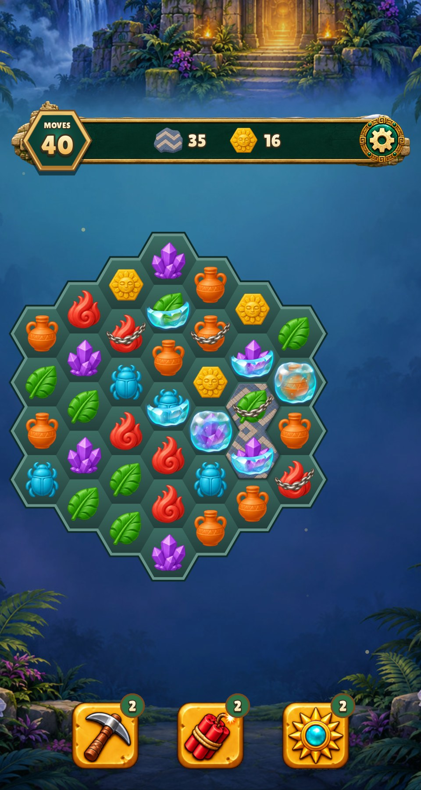

# Story mosaic prototype (board 8)

On a first clear of board 8 the restored mosaic uncovers a picture of the relay
in place of the plain tesserae. The picture is **placeholder art** drawn by
`python3 tools/relic_reveal_art.py`; see the [asset catalogue](../../asset-catalogue.md#story-mosaics-prototype).

| Before (plain mosaic) | Half restored, with Elena's line | Won: pieces cleared, picture holds |
| --- | --- | --- |
|  |  |  |

| Won at 390×844 | The first-clear exchange over the picture |
| --- | --- |
|  |  |

Reproduce:

```sh
./build/relic-rush --headless --mute --fresh --size 480x900 --level 8 --reveal .5 --frames 180 --shot half.png
./build/relic-rush --headless --mute --fresh --size 480x900 --level 8 --reveal 1 --frames 95 --shot won.png
./build/relic-rush --headless --mute --fresh --size 480x900 --level 8 --reveal 1 --frames 260 --shot beat.png
build/test/all --suite=relic-rush "shot reveal-"
```
