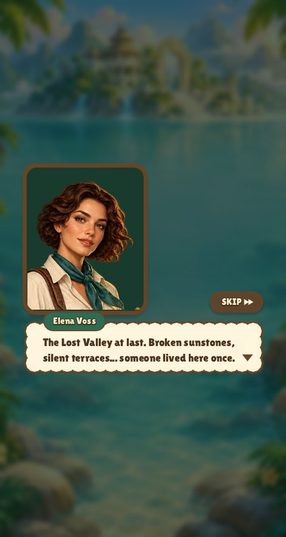
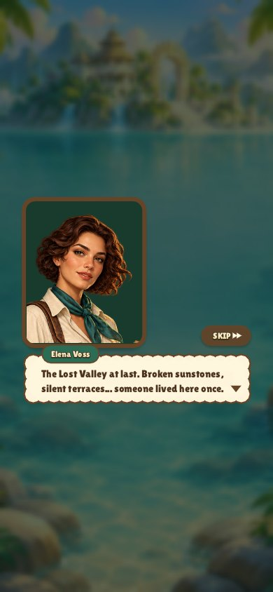
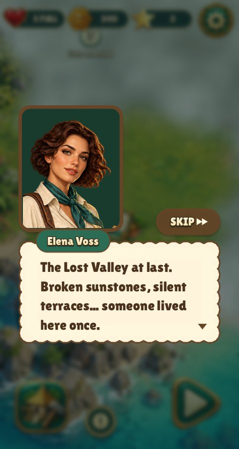
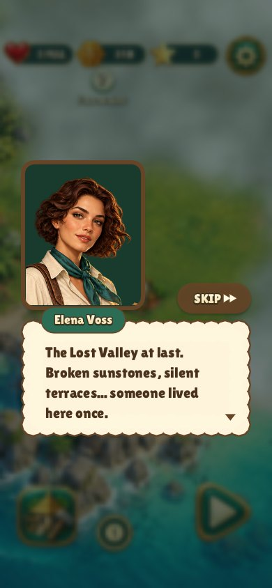
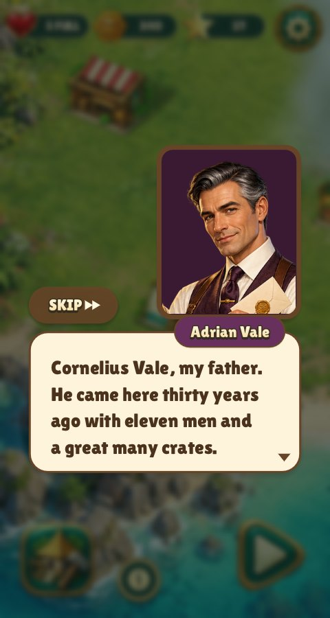
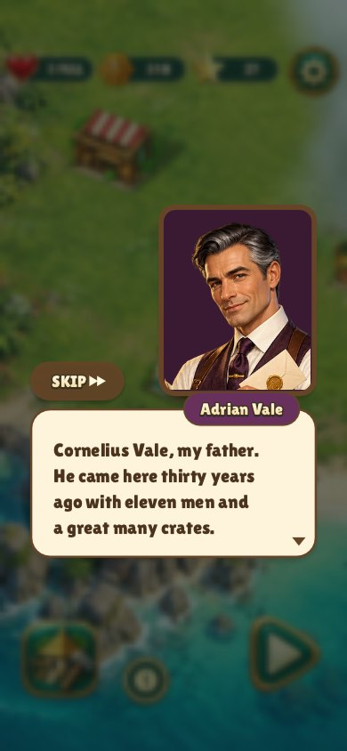
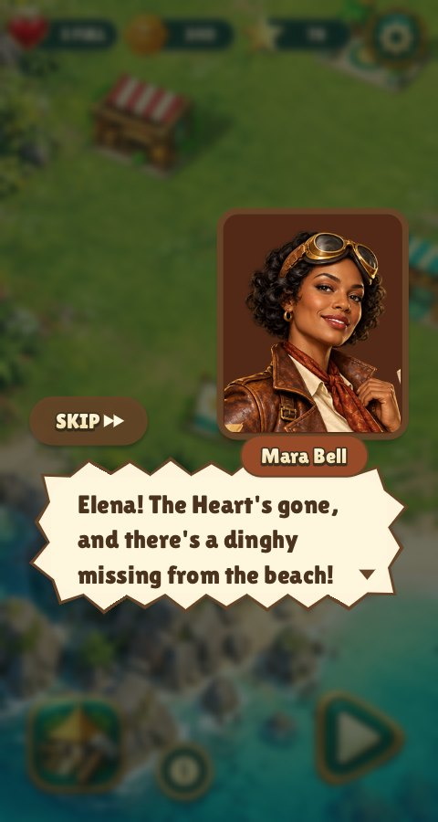
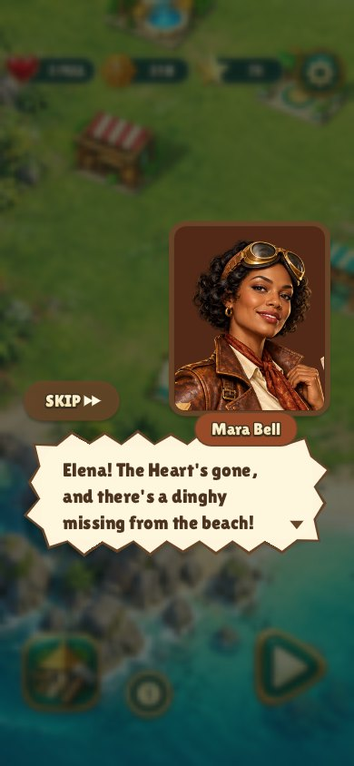
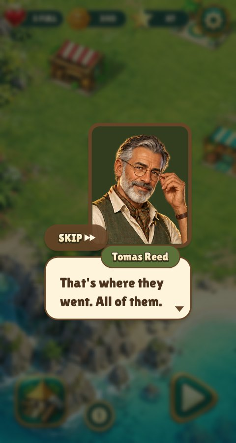
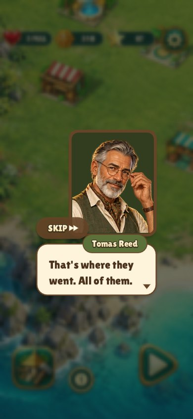

# Three-episode story review

The existing four authored portraits, island painting and ten registered wonder
sprites are reused. No sprite dimensions, camera, footprint or pivot changed.
The 183-line script is compiled by `tools/prepare_story.py`; a separate blind
reader checked the clues and reveals before implementation.

Dialogue body text increases from 21 to 31.5 points; name badges and building
bubbles increase from 15 to 22.5. The review covers both 480×900 and 390×844
with phone safe-area insets, including the longest line, a thought, a shout
and the final hook. The before images use the previous real game captures.

Use the existing single-process capture manifest:

```sh
make CFLAGS="-O2 -g -Werror" relic-rush build/test/relic-rush
xvfb-run -a ./build/test/relic-rush "shot story-" "shot phone-story-"
```

Raw frames are under `build/shots/relic-rush/`; CI's usual
`tools/screenshots.py` exports the documentation JPGs. Direct scene previews
use `--story-beat before-11`, `--story-beat after-28`, or
`--story-beat after-30 --story-line 9`, with `--frames 240` for fully typed text.

The `rules relic_story` regression follows all thirty first clears and ten
confirmed restorations, then checks interruption, save/read, replay silence,
legacy recaps, retained purchases and already-owned wonder prerequisites.

All twelve preserved images were inspected. The before captures come from CI
run 41597879292 (`f6e223f49ee7d20b9d48ad185e6e31f4fe2b14bf`); the after
captures come from run 41602186572
(`de1c6585797cf2bb7342518eef374e57ffdc6823`). The latter passed all 141 Relic
Rush rule, renderer, capture and real-input smoke cases, with 874,166 checks.

| Scene | 480×900 | 390×844 |
| --- | --- | --- |
| Before |  |  |
| Opening, larger thought text |  |  |
| Longest line |  |  |
| Shout |  |  |
| Final hook |  |  |

Later-board samples: [level 20](story-level-20.jpg) and
[level 30 on the phone](phone-story-level-30.jpg).
