# Sunstone courtyard replacement

Reviewed 30 October 2026 in the native macOS game renderer. The former
bridge-shaped gateway is replaced by a dry sun-mosaic courtyard with seating,
carved stelae and tropical planters. ID 4 and the internal `gateway` key remain
stable, preserving story order and ownership; costs remain 140 gold, 30 wood and
30 stone. Existing save restoration re-snaps changed footprints through the
shared city placement code.

The complete [three-option atlas and exact prompt](../../../art/building-catalogue/landmark-alternatives/README.md)
include a ceremonial gate and orchid terrace as saved concept alternatives.
Only the courtyard enters the runtime catalogue. This review supersedes ID 4
in the original [96-building review](../building-catalogue/README.md).

## Before and after: 480 x 900

| Screen | Before | After |
| --- | --- | --- |
| Island |  | 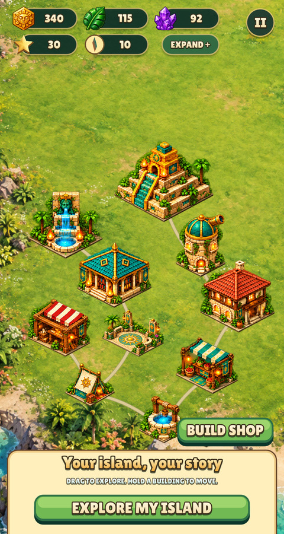 |
| Footprint registration | 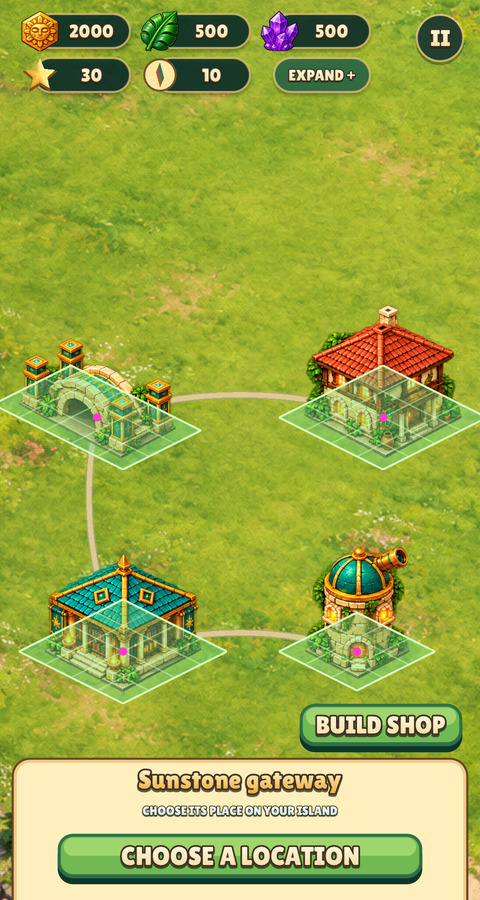 | 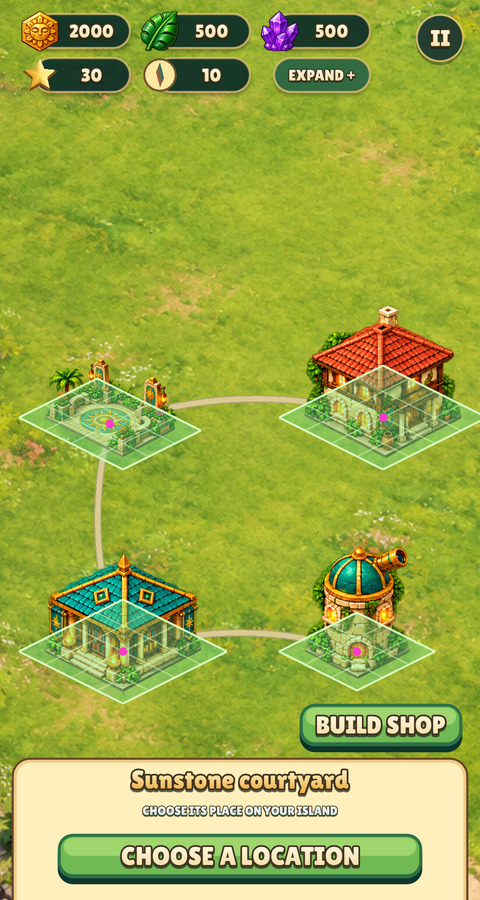 |
| Restoration details | 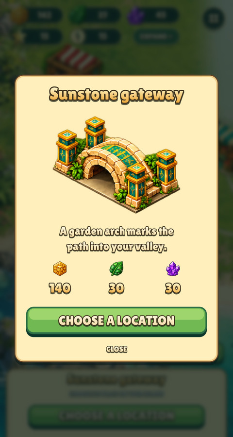 | 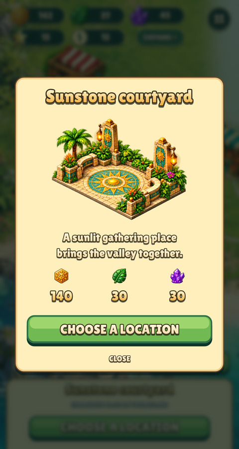 |
| Placement | 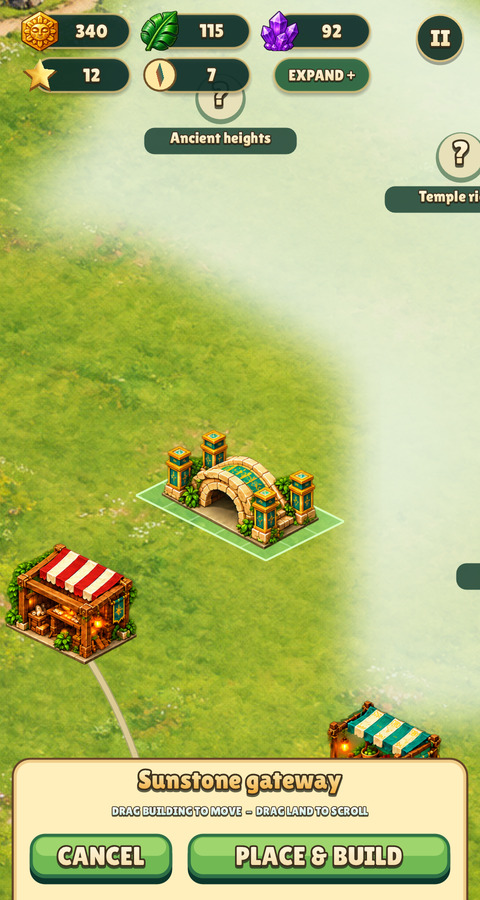 | 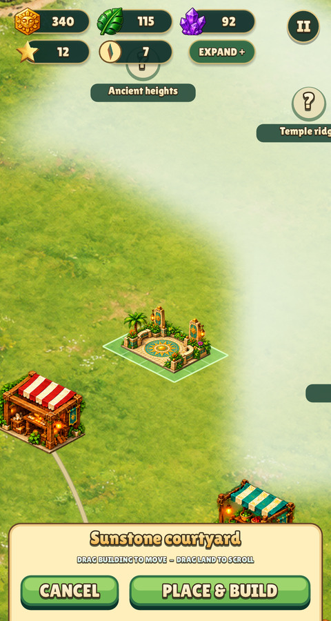 |
| Catalogue | 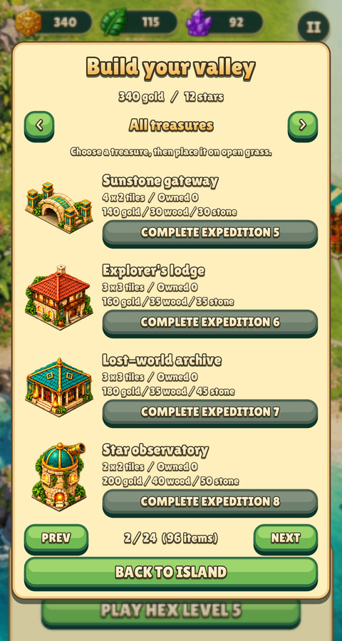 |  |

The measured 3 x 2 base uses pivot `(362,363)` and base width `716` in a
732 x 548 sprite. The footprint overlay includes the unchanged city clearance;
its pivot dot sits at the ground centre. All ten story buildings were also
checked together:

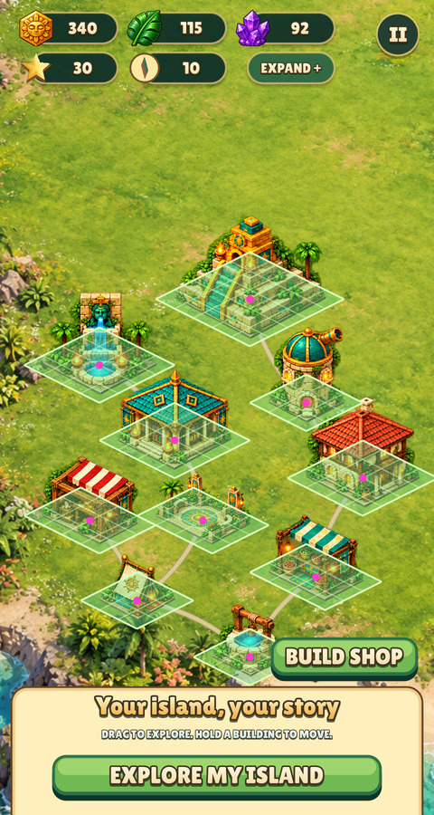

## Catalogue and smaller phone

The smaller phone runs at 390 x 844 with 47 top / 34 bottom safe-area insets.
Review JPGs are proportionally downscaled from native captures, without art edits.

| Before 390 x 844 | After 390 x 844 |
| --- | --- |
|  | 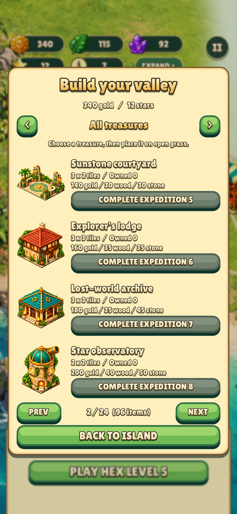 |
| 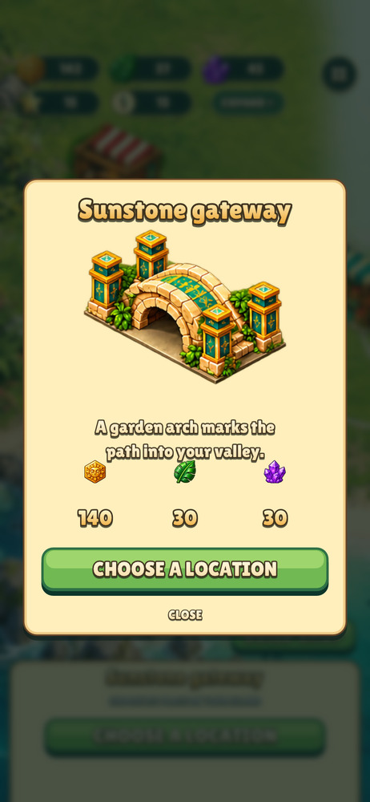 | 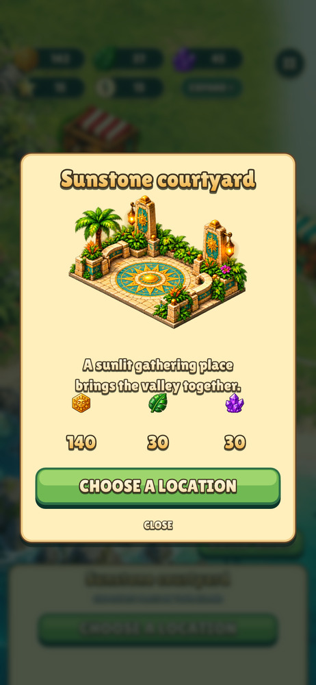 |
| 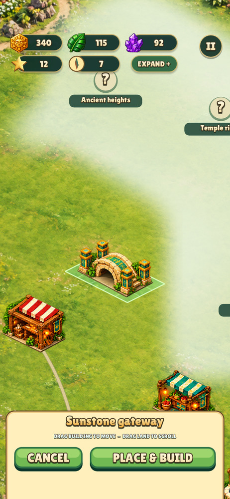 | 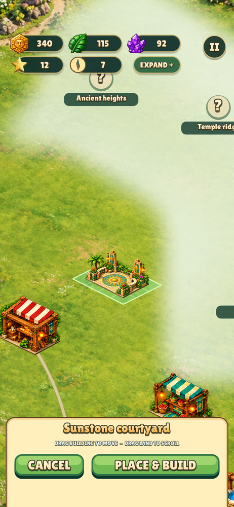 |

## Reproduce and validate

```sh
python3 games/relic-rush/tools/prepare_buildings.py
python3 tools/footprint.py games/relic-rush/data/buildings/4.png --bottom 425,542 --left 4 --right 720 --overlay /tmp/courtyard.png
make CFLAGS="-O2 -g -Werror"
make test
./build/relic-rush --headless --mute --fresh --size 480x900 --showcase --shot island.png
./build/relic-rush --headless --mute --fresh --size 480x900 --building-review 2 --footprints --shot footprints.png
./build/relic-rush --headless --mute --fresh --size 480x900 --card 4 --shot card.png
./build/relic-rush --headless --mute --fresh --size 480x900 --city 4 --placing --shot placement.png
./build/relic-rush --headless --mute --fresh --size 480x900 --catalogue all --catalogue-page 2 --shot catalogue.png
./build/relic-rush --headless --mute --fresh --size 390x844 --safe-area 0,47,0,34 --card 4 --shot phone.png
./build/relic-rush --headless --mute --fresh --size 480x900 --smoke
```

For phone catalogue/placement, use the same phone size/insets with the relevant
screen arguments. On Linux, run captures and smoke under Xvfb with
`LIBGL_ALWAYS_SOFTWARE=1`. Native PNG intermediates are reproducible and omitted.

Validation: warning-as-error build, `make test` (5,514 Relic Rush checks, 53 UI
form checks and 161 engine checks), asset inventory and native smoke at both
480 x 900 and 390 x 844 with safe areas passed. Before captures use the base
commit's Lua/data exported to a temporary folder with the same native renderer.
