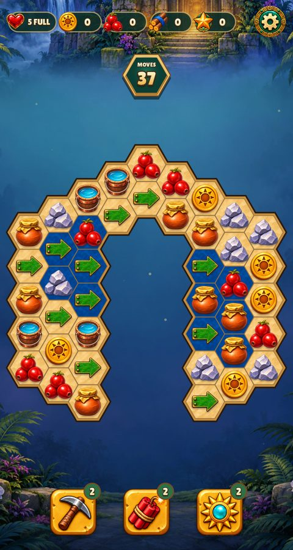
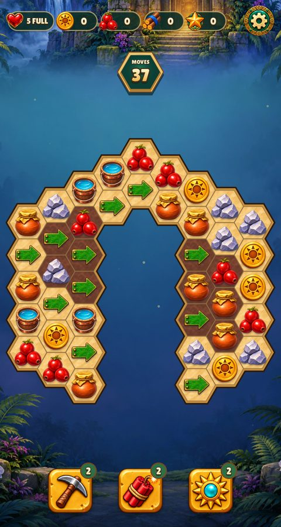
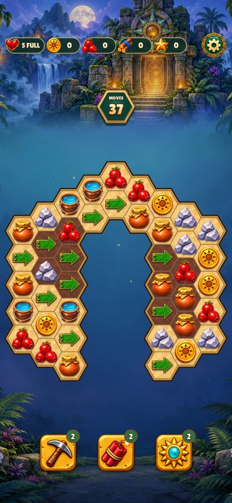
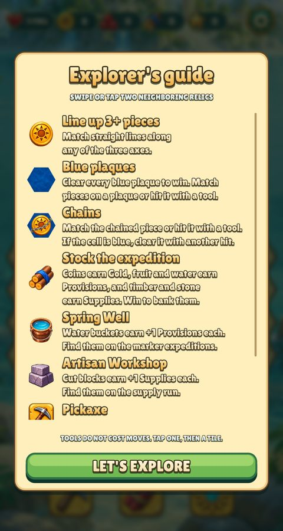
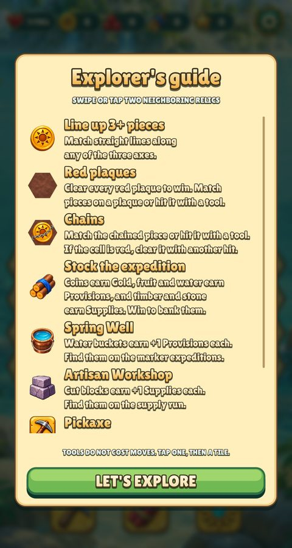

# Target plaque colour grade

The cobalt target cells merged into the blue jungle mist behind the board.
The dressing packer now colour-grades that face to red umber stone, keeping
its painted grain. The limestone, the source atlas and the frame are unchanged.
The lesson and the Explorer's Guide call them red plaques.

| Screen | Before | After |
| --- | --- | --- |
| Level 6, 480×900 |  |  |
| Level 6, 390×844 |  |  |
| Explorer's Guide, 480×900 |  |  |

```sh
python3 games/relic-rush/tools/prepare_board_dressing.py
./build/relic-rush --headless --mute --fresh --size 480x900 --level 6 --shot board.png
./build/relic-rush --headless --mute --fresh --size 480x900 --dialog guide --shot guide.png
```
