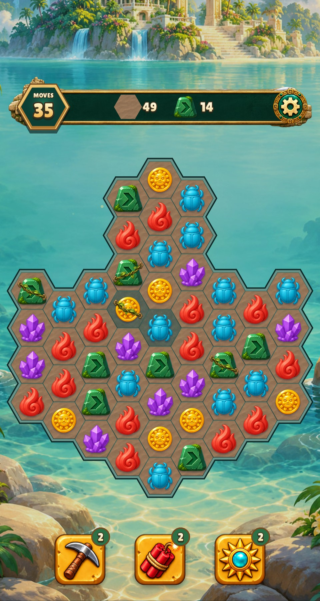
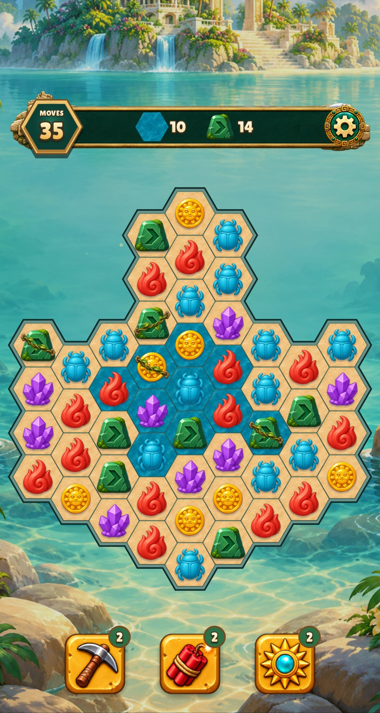
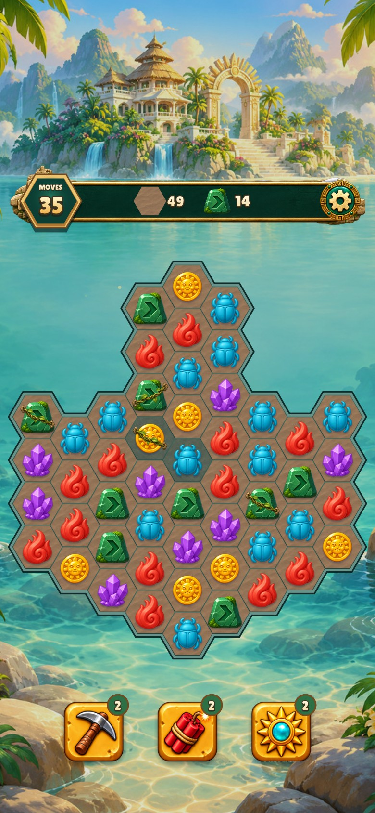
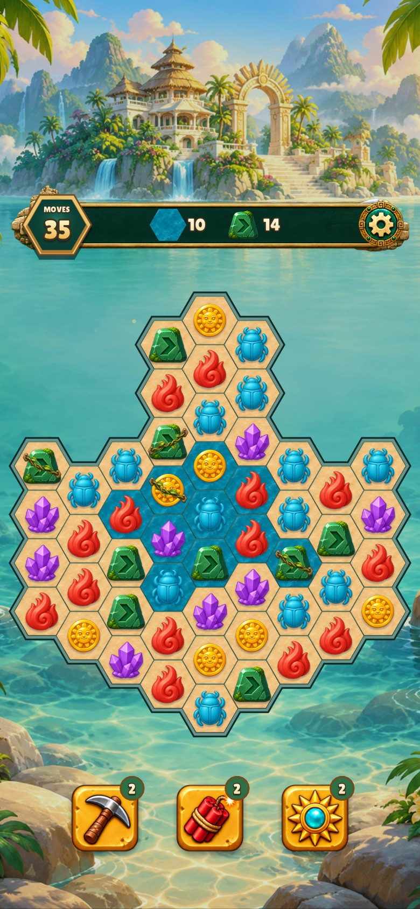
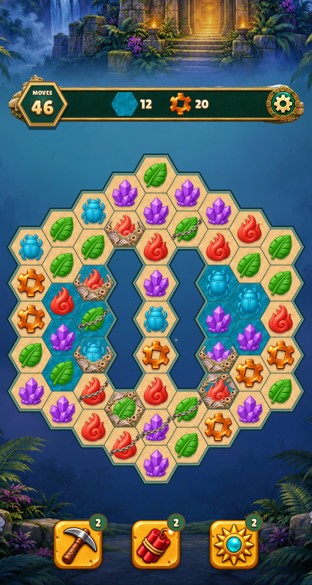
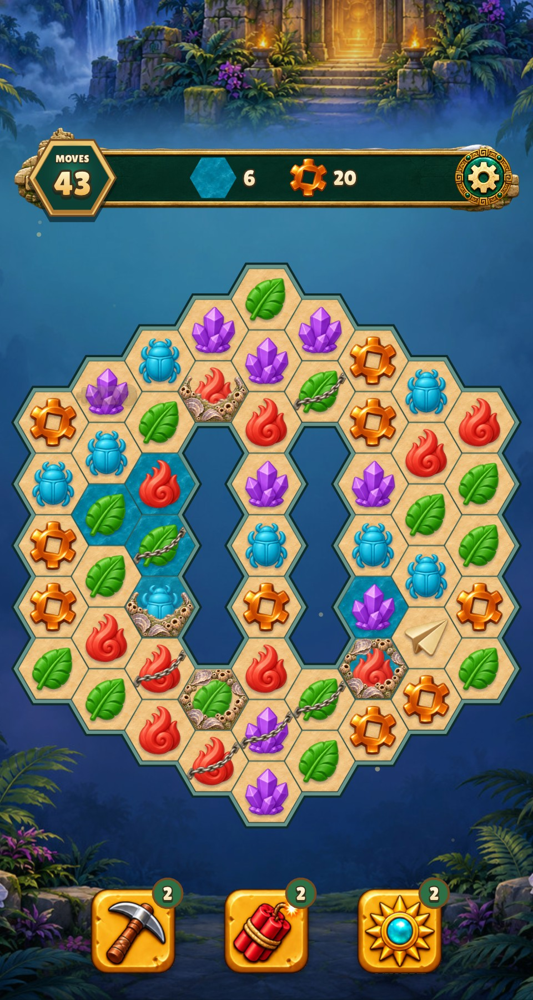
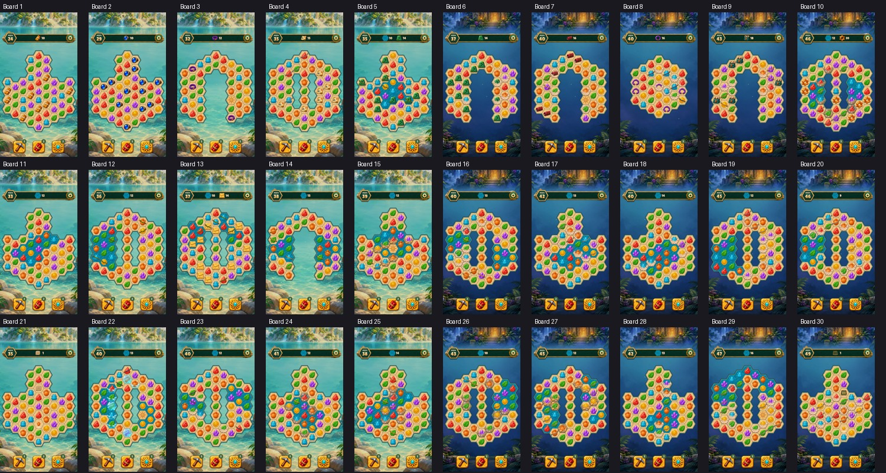

# Sandstone and blue plaques

Board 5 introduces a 10-cell target patch under the pieces. Its gold, green
and cyan pieces appear against both floor states. The old sand objective
marked the whole board.

| Format | Before | After |
| --- | --- | --- |
| 480 × 900 |  |  |
| 390 × 844 |  |  |

Board 10 shows how the floor coexists with barnacles, locks and the gear
collection. A direct clear exposes sandstone and reduces the plaque counter.

| Opening | After three moves |
| --- | --- |
|  |  |

The test runner captures the boards with `shot plaques-phone`,
`frame scenario-relic-rush-board-05`, `frame scenario-relic-rush-board-10`
and `reel relic-rush-plaques`. Set `SPRITE_SCENARIO=1` and pass `--extended`
to run the scenario frames.

The full campaign review shows how plaques, story collections and deliveries
alternate across the thirty expeditions.

