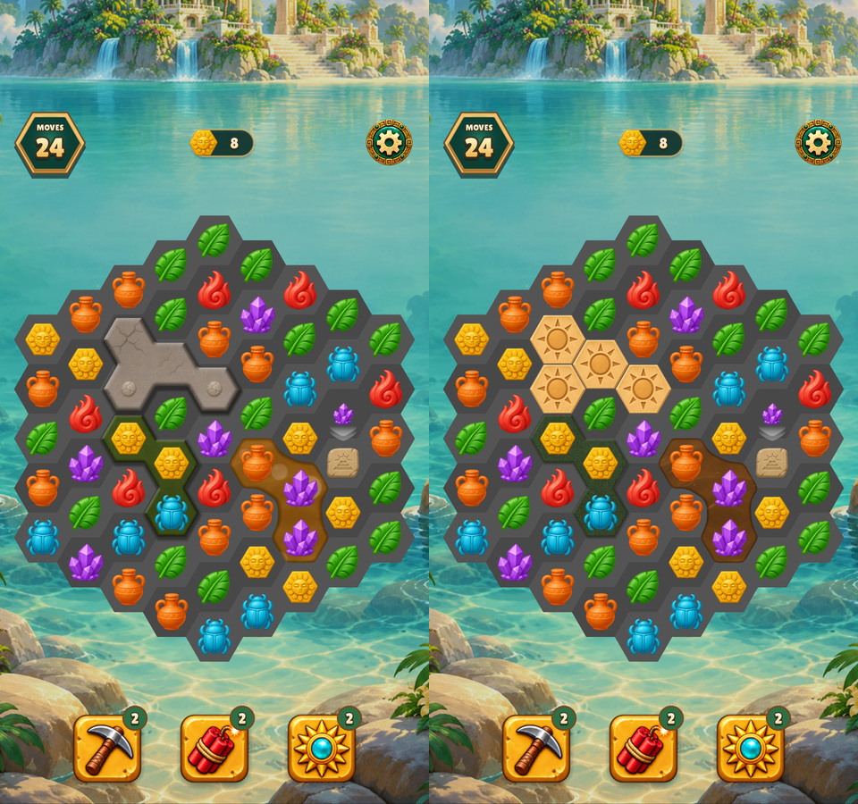
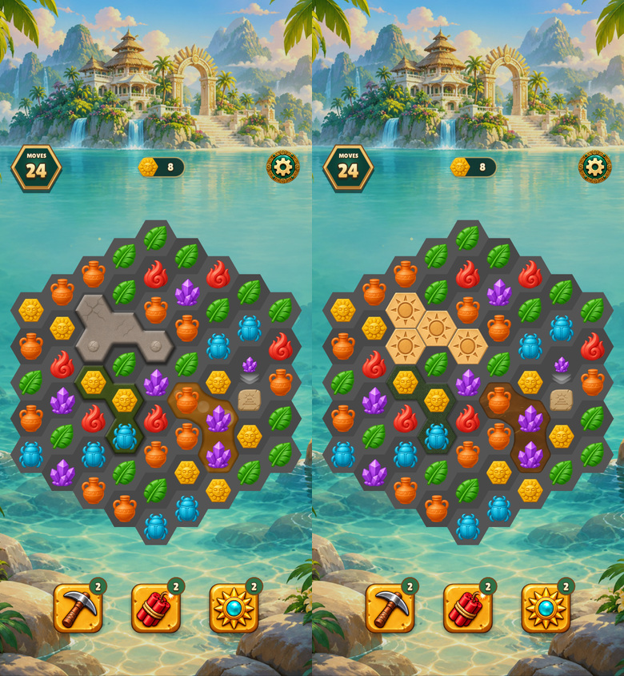

# Woven carpet, oil and carved stones

The earlier board is on the left. The right side shows the woven carpet,
amber oil with small drifting glints, and individual face-on carved stones.
One adjacent match or direct power-up hit breaks a stone.

| Phone size | Before and after |
| --- | --- |
| 480×900 |  |
| 390×844 |  |

```sh
python3 tools/match3_atlas.py
./build/test/all --suite=relic-rush 'shot element-states' 'shot phone-element-states'
```
