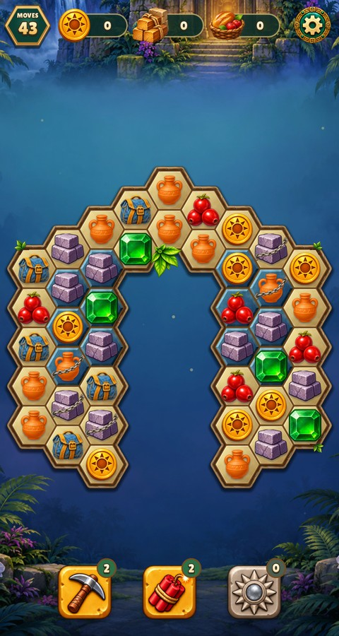
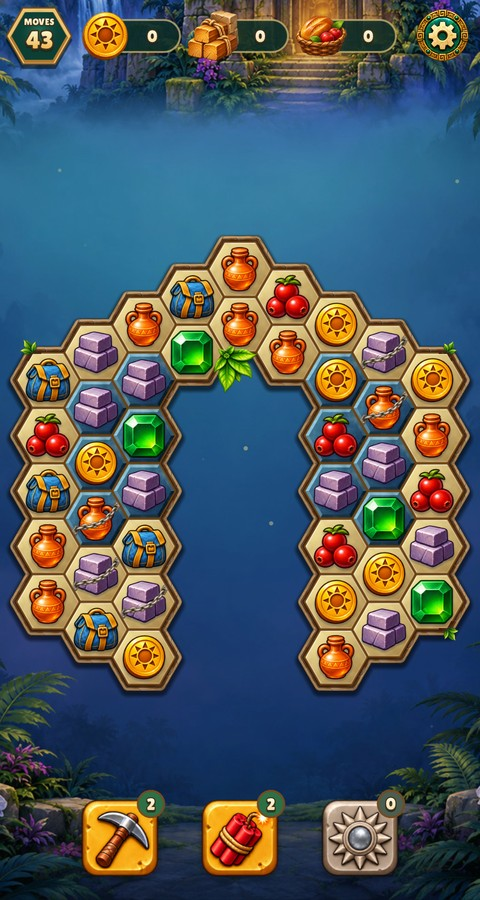
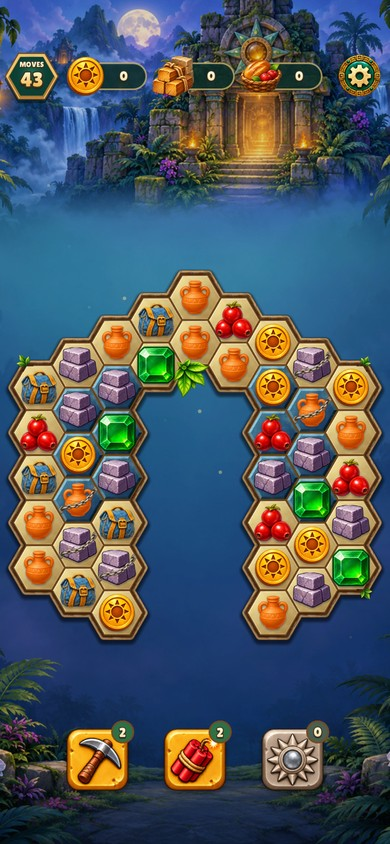
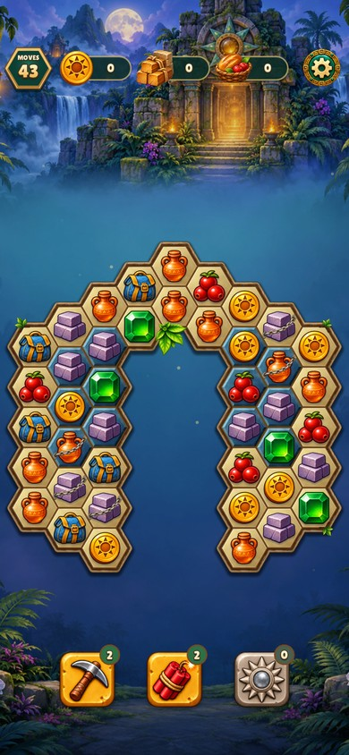

# Relic Rush campaign pieces

One 5 × 5 atlas contains the 23 matchable resources, upgrades and quest objects.
The two unused cells are transparent. The artifact review includes the opening
palette, chained tiles, two resource unlock sections, and the Explorer’s Guide.

| Level 9 | Before | After |
| --- | --- | --- |
| 480 × 900 |  |  |
| 390 × 844 |  |  |

| Other views | After |
| --- | --- |
| Opening resource palette | [Level 1](opening.jpg) |
| Broken cable, water buckets and cut blocks | [Level 8](cable-phone.jpg) |
| Gear and rations | [Level 10](gear.jpg) |
| Late-game resource upgrades | [Level 30](late-phone.jpg) |
| Guide | [Resource and chain icons](guide-phone.jpg) |

The 23 registered objects passed strict canonical hex checks at the board
sprite's draw scale. Reproduce the captures with
`build/test/relic-rush "shot floating-hud" "shot phone-floating-hud" "shot hex-first" "shot broken-cable-phone" "shot dressing-tide-room" "shot phone-story-level-30" "shot phone-guide"`.
