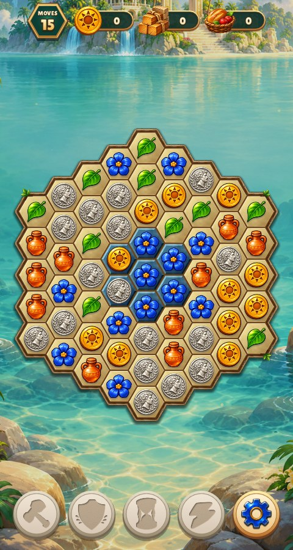
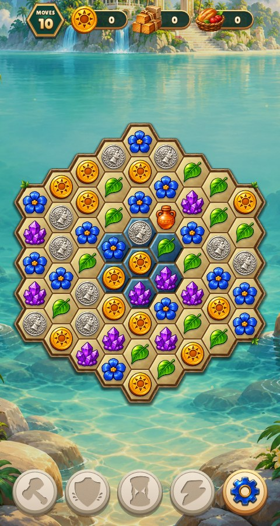
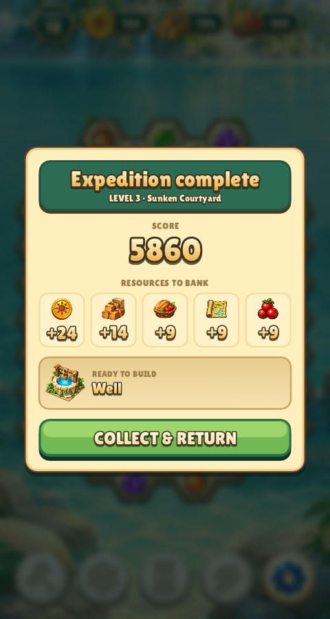
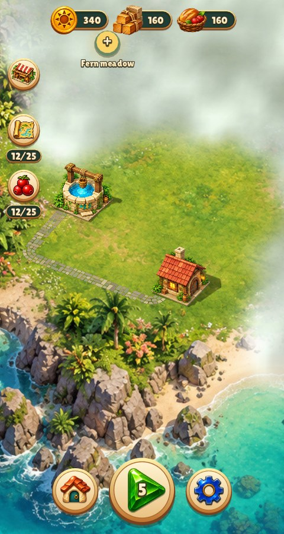
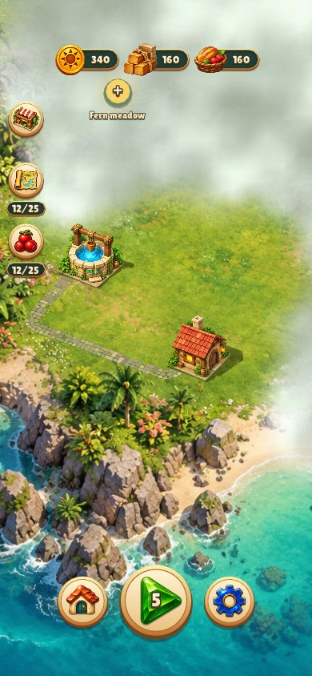
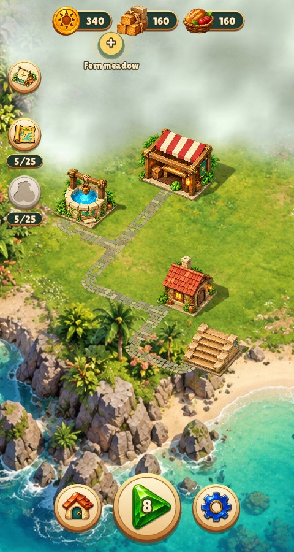

# Lines of three, six kinds and the crew's requests

Relic Rush now matches straight lines of three among six kinds. The sixth slot
shows quartz, or the piece of an open crew request. Open requests stand as
round markers down the island's left edge, under the next building.
[Rules](../../../match4-rules.md#crew-requests) · [Story](../../../story.md#crew-requests)

## Board

| View | Before: lines of four, five kinds | After: lines of three, six kinds |
| --- | --- | --- |
| Expedition 1 · 480×900 |  |  |
| Expedition 3 · 480×900 |  |  |
| Expedition 3 · 390×844 |  |  |

| Expedition 6: arrows and tool rolls | Expedition 9: relay cable | Results with request pieces |
| --- | --- | --- |
|  |  |  |

## Island

| View | Before | After |
| --- | --- | --- |
| Island · 480×900 |  |  |
| Island · 390×844 |  |  |

| Ready to hand in | One board slot: the second request waits |
| --- | --- |
|  |  |

## Request card

| Short · 480×900 | Short · 390×844 | Filled · 480×900 |
| --- | --- | --- |
|  |  |  |

`build/test/relic-rush "shot quest-"` renders the after views. The before views
come from the previous commit with `--level 1`, `--level 3` and `--city 2`.
