# Lines of three, six kinds and the crew's requests

Relic Rush now matches straight lines of three among six kinds. The sixth slot
shows quartz, or the piece of an open crew request. Open requests stand as
round markers down the island's left edge, under the next building.
[Rules](../../../match4-rules.md#crew-requests) · [Story](../../../story.md#crew-requests)

## The first-epoch investigation

| Phone | Elena introduces the chart | Tomas offers the shutter test | Mara sights the reef |
| --- | --- | --- | --- |
| 480×900 | 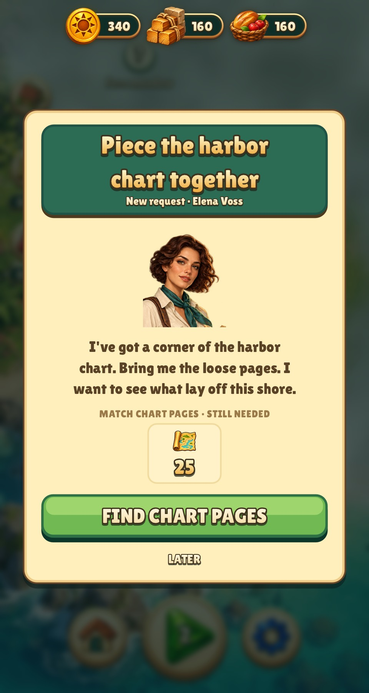 | 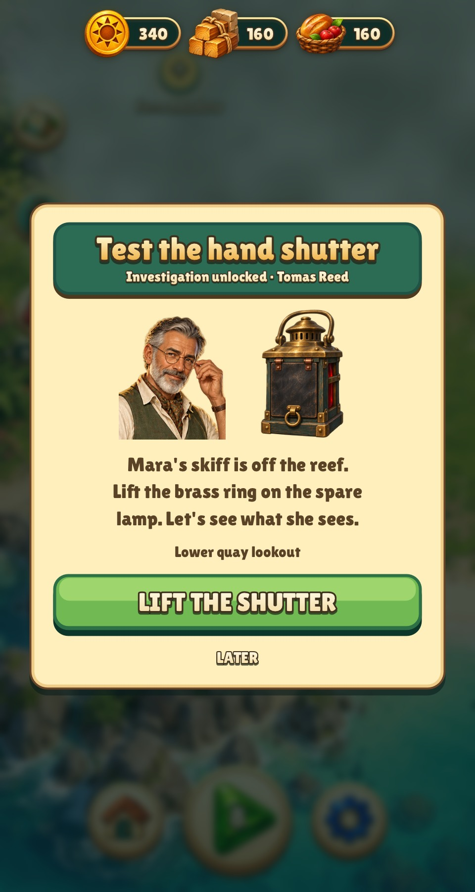 | 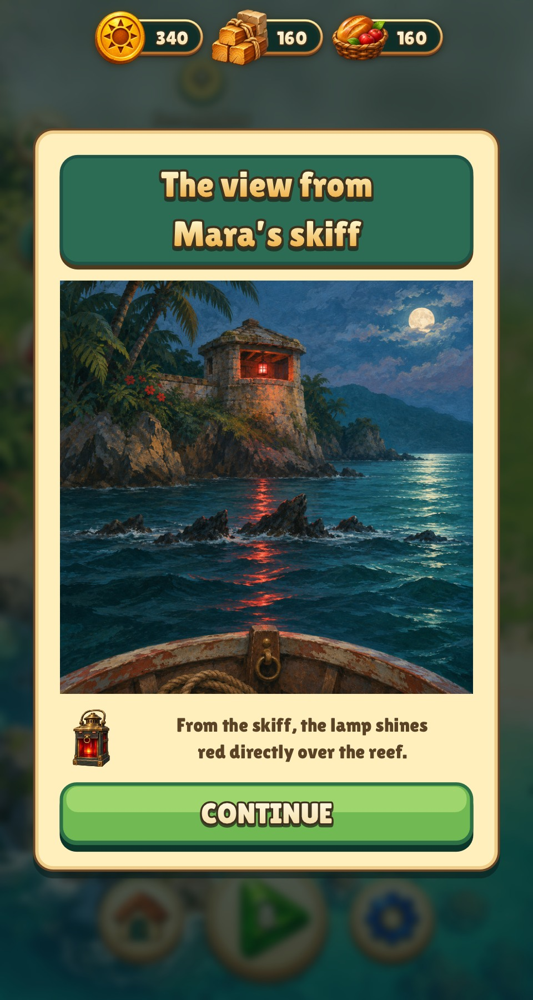 |
| 390×844 | 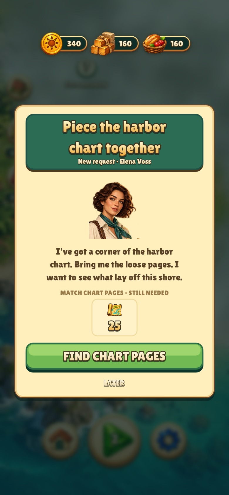 | 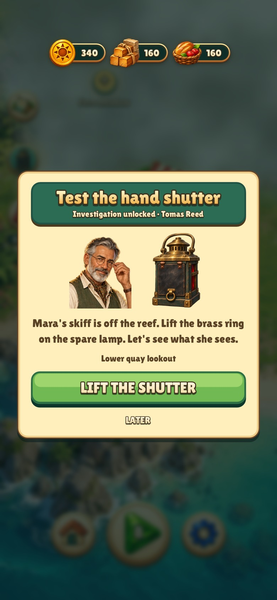 | 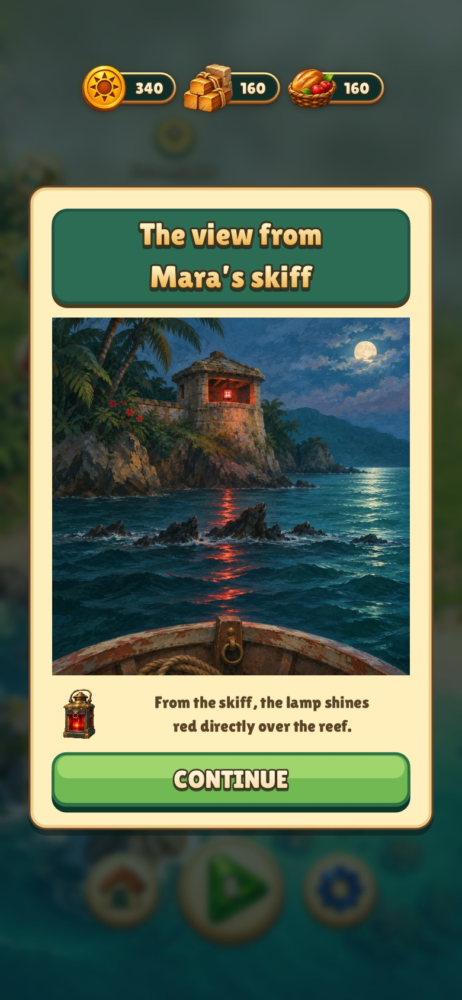 |

[Updated ready-to-hand-in card](quest-card-ready.jpg) · [Playable review entries and design plan](../../../epoch-one-quests.md)

## Quest counters above the board

| View | Before the counters | With the counters |
| --- | --- | --- |
| Expedition 3 · 480×900 | 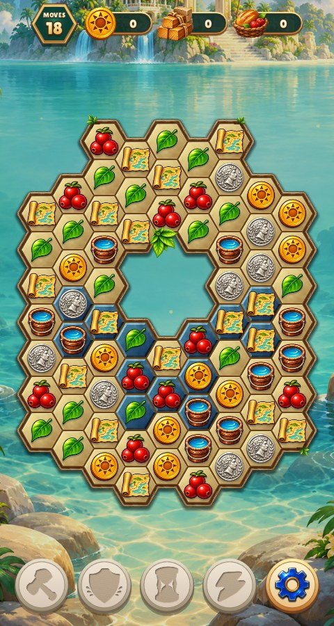 | 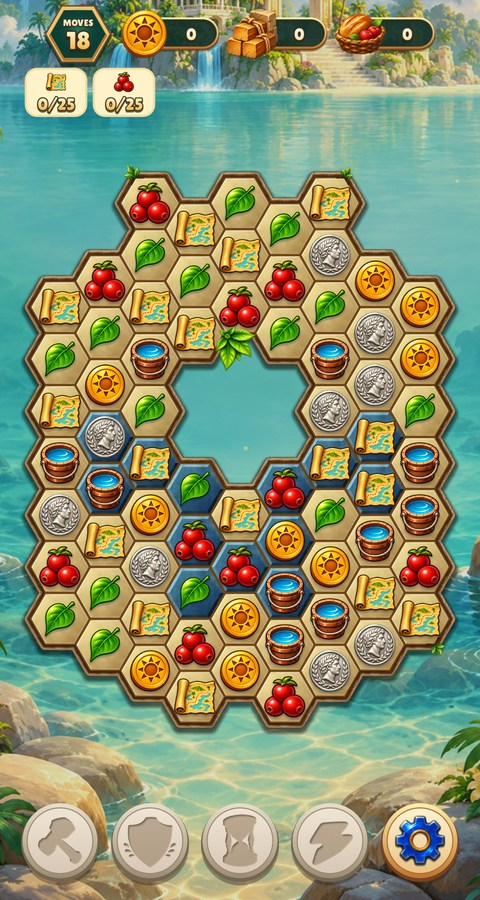 |
| Expedition 3 · 390×844 | 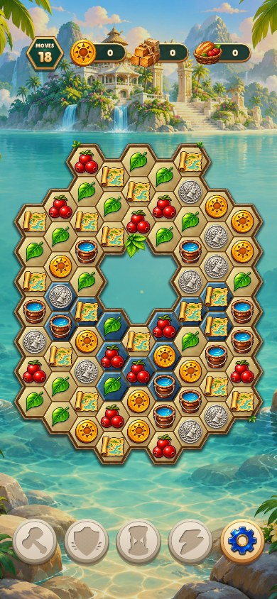 | 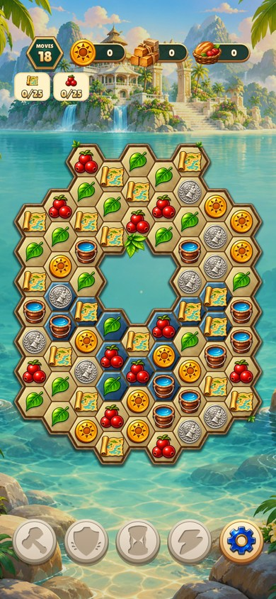 |

## Original board comparison

| View | Before: lines of four, five kinds | After: lines of three, six kinds |
| --- | --- | --- |
| Expedition 1 · 480×900 |  |  |
| Expedition 3 · 480×900 | 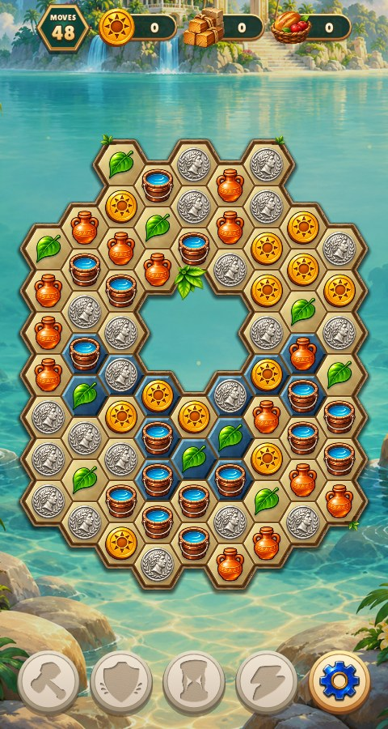 |  |
| Expedition 3 · 390×844 | 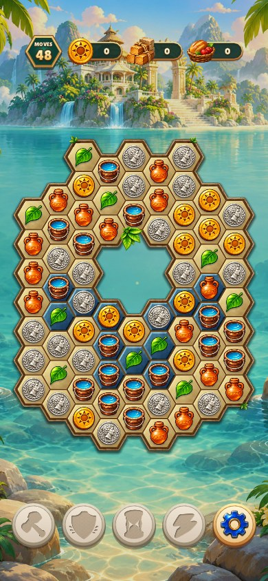 |  |

| Expedition 6: arrows and tool rolls | Expedition 9: relay cable | Results with request pieces |
| --- | --- | --- |
| 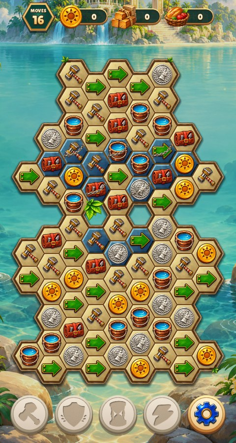 | 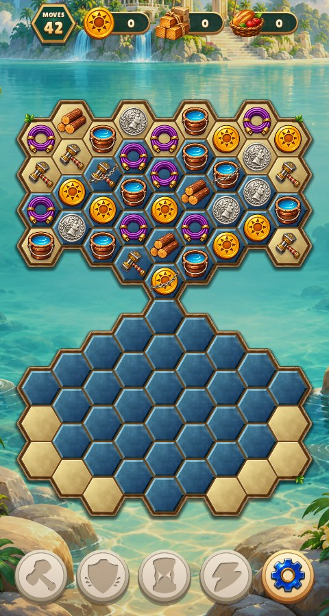 |  |

## Island

| View | Before | After |
| --- | --- | --- |
| Island · 480×900 | 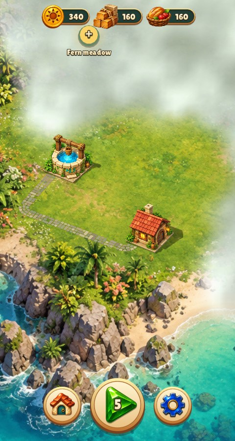 |  |
| Island · 390×844 | 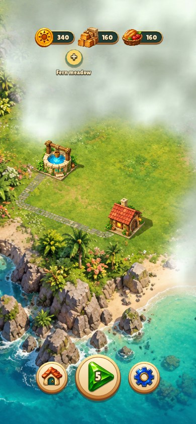 |  |

| Ready to hand in | One board slot: the second request waits |
| --- | --- |
|  |  |

## Request card

| Short · 480×900 | Short · 390×844 | Filled · 480×900 |
| --- | --- | --- |
| 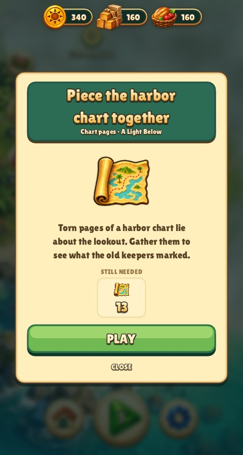 | 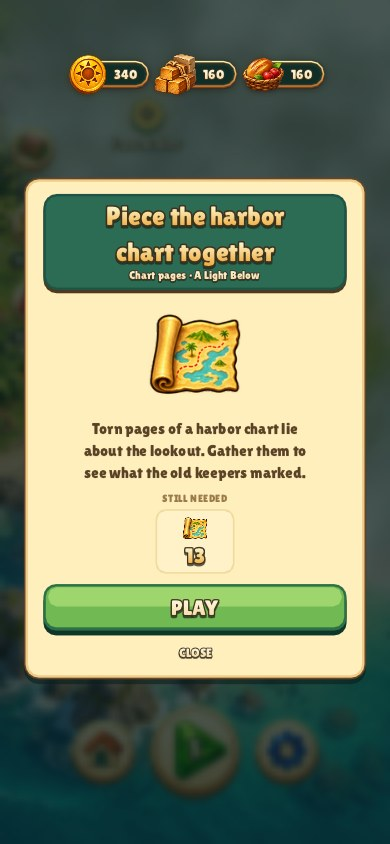 | 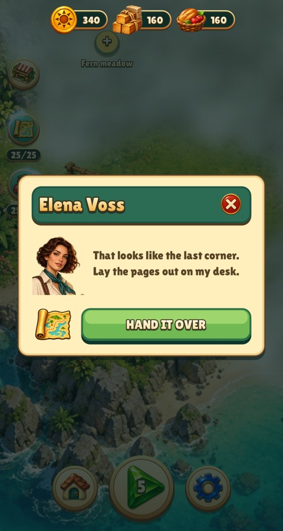 |

## Illustrated hand-ins

| Harbor chart · 480×900 | Broken cable · 390×844 |
| --- | --- |
| 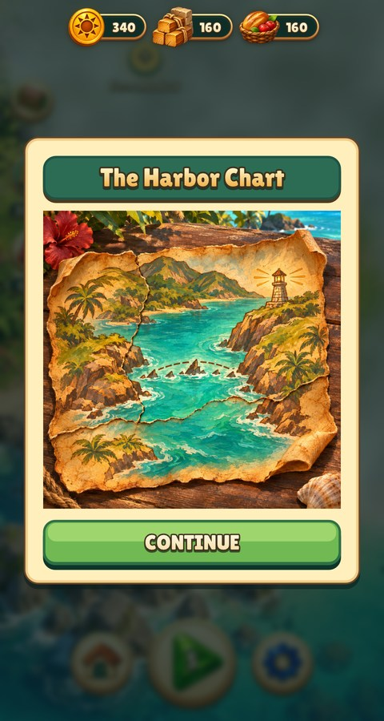 | 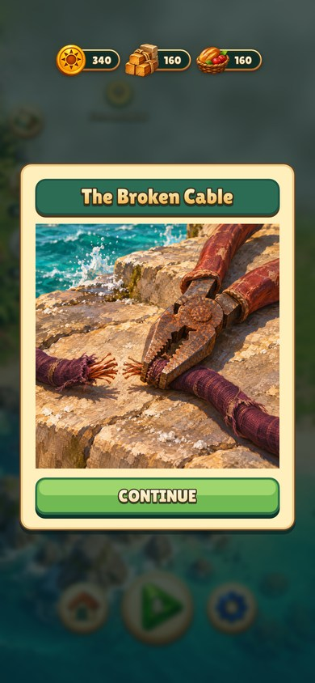 |

`build/test/relic-rush "shot quest-board" "shot quest-handoff" "smoke quest-flow"`
renders the expedition and illustrated cards, and checks the request flow
from a paused board through a post-campaign replay and hand-in.
