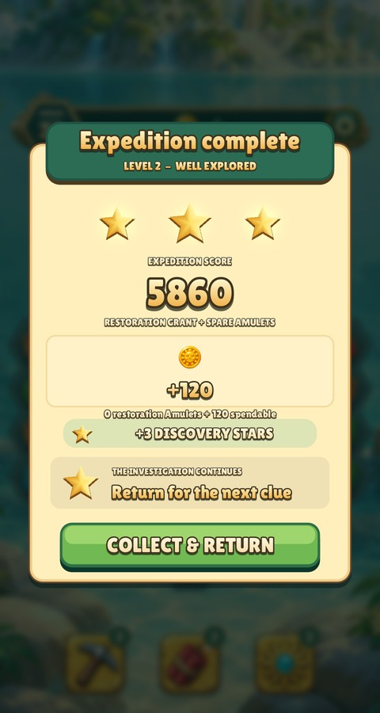
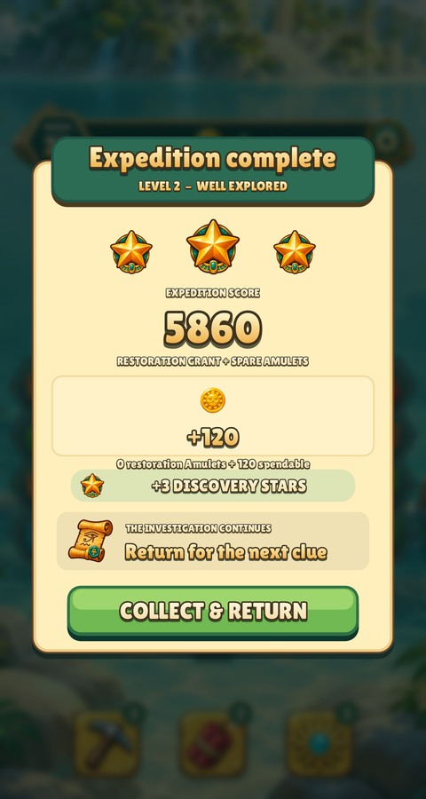
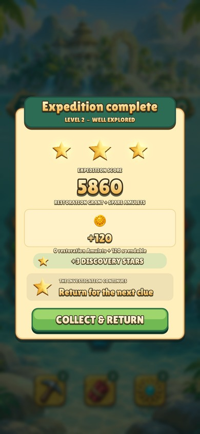
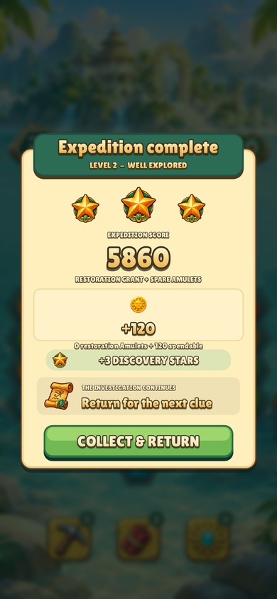
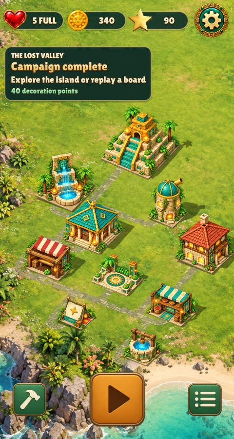
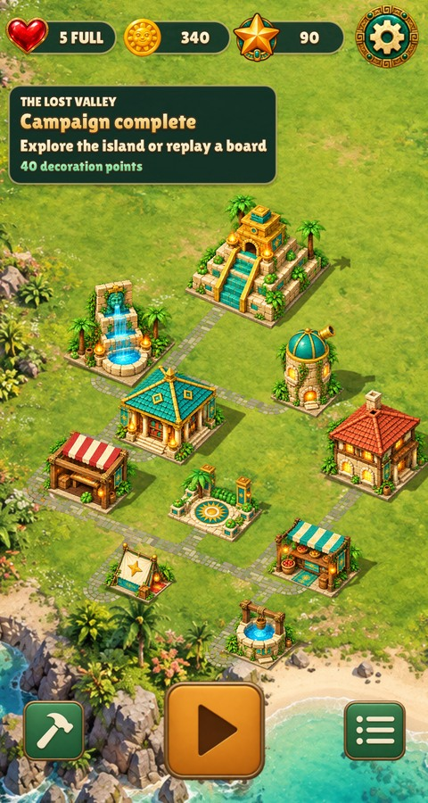
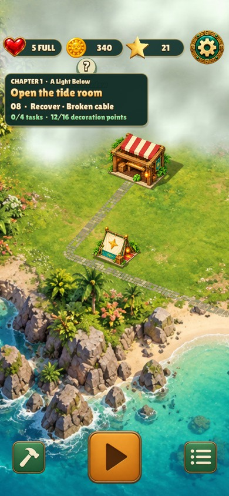
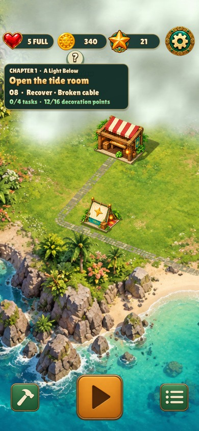
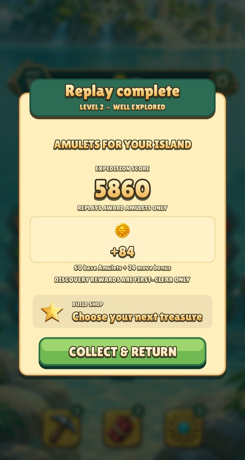
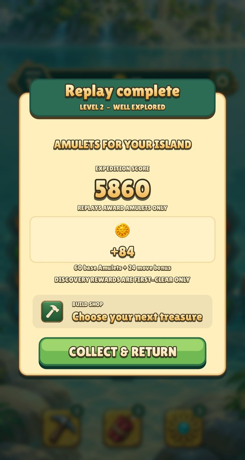

# Discovery Stars

| In-game view | Before | After |
| --- | --- | --- |
| First clear, 480×900 |  |  |
| First clear, 390×844 |  |  |
| Island wallet, 480×900 |  |  |
| Island wallet, 390×844 |  |  |
| Replay, 480×900 |  |  |

Capture the results and wallet with the Relic Rush test binary from the repository root.

```sh
build/test/relic-rush "shot victory" "shot phone-victory" "shot replay-victory" \
  "shot island-village" "shot phone-island"
```
