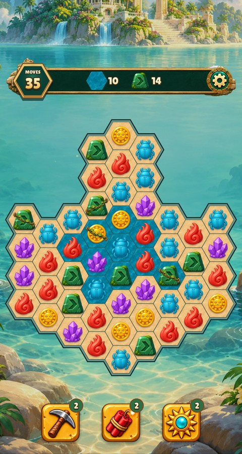
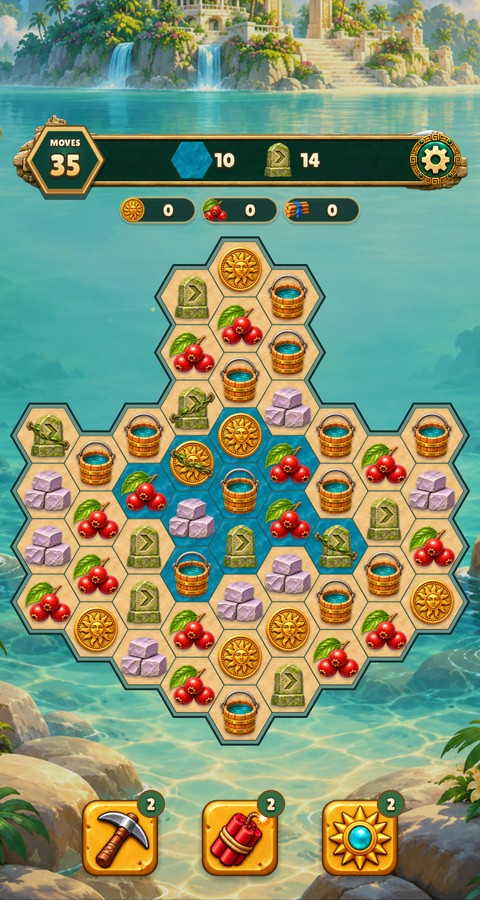
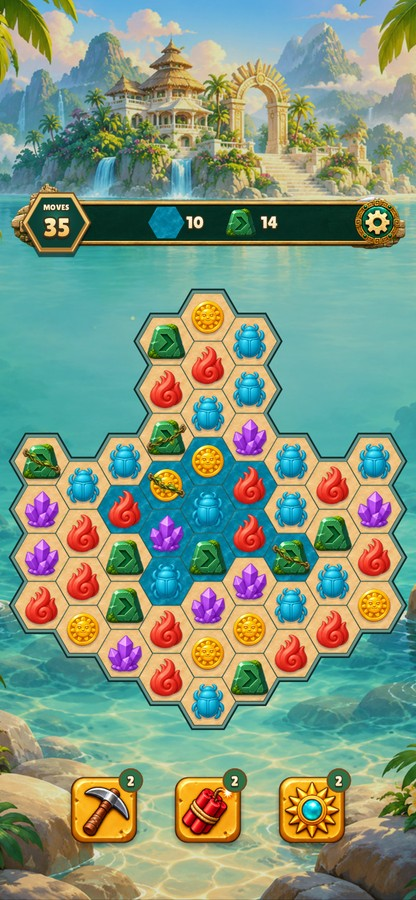
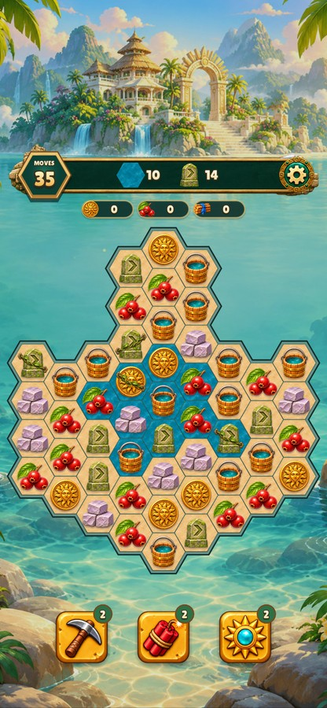
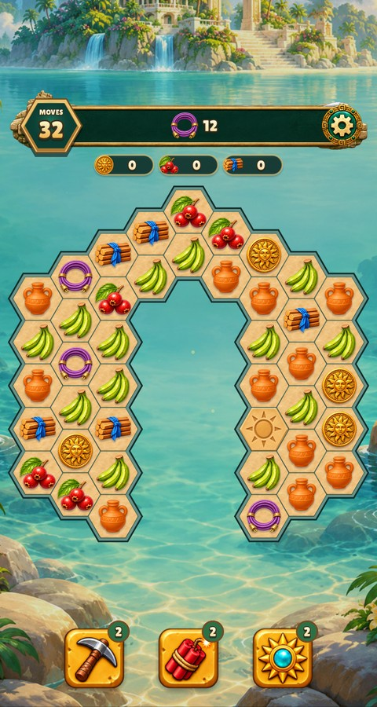
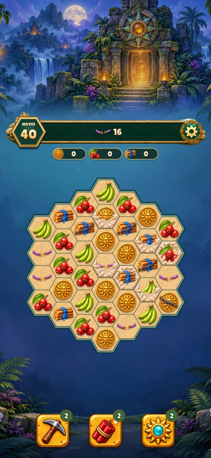
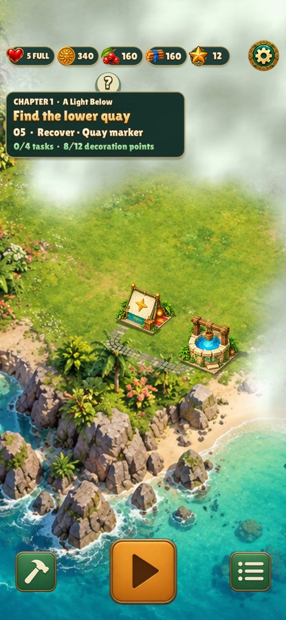
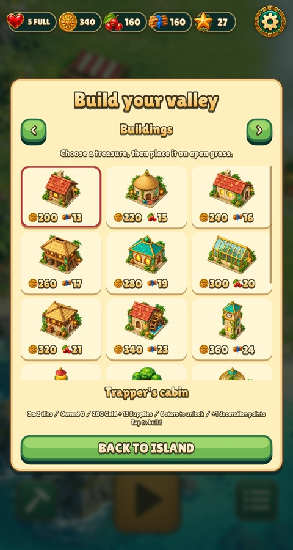
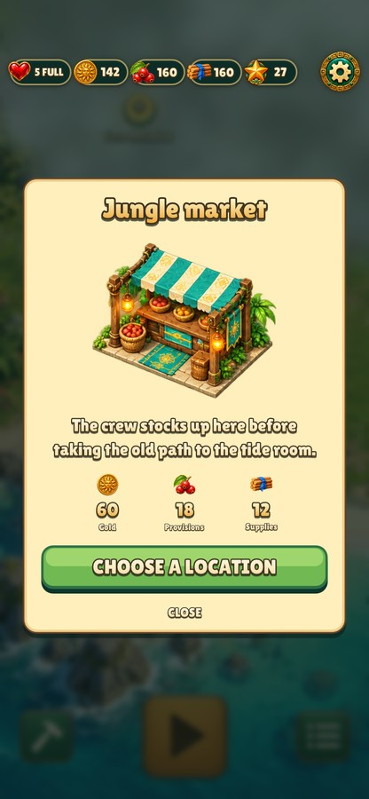
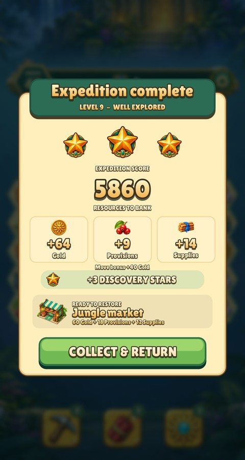

# Expedition economy and story pieces

The [expedition atlas](../../../../art/resource-pieces/scenario-atlas.png)
contains six resource sprites and ten story items. The campaign captures
below show the ordinary pieces and the water variant, the two cables, the
three wallet amounts, and prices in the shop and building card.

| Safe area | Previous board 5 | Board 5 after restoring the well |
| --- | --- | --- |
| 480 × 900 |  |  |
| 390 × 844 |  |  |

[Board 5 before restoring the well](timber-before-well.jpg) shows the same
blue slots occupied by timber. Confirming the well changes those slots to
water on boards 5 and 6.

| Story board | Capture |
| --- | --- |
| 3, intact relay cable |  |
| 8, broken cable |  |

| Wallet on the island | Optional building prices | Market restoration | Result and next restoration |
| --- | --- | --- | --- |
|  |  |  |  |

The renderer captures use `shot water-`, `shot plaques-phone`,
`shot broken-cable-phone`, and `shot economy-`. Scenario frames use
`SPRITE_SCENARIO=1 build/test/relic-rush --extended 'frame scenario-relic-rush-'`.
Both use the live game textures and forms.
