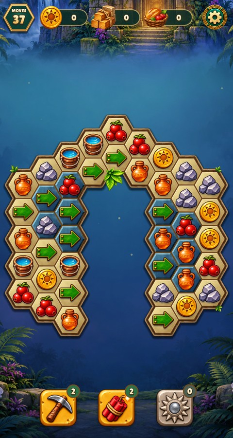
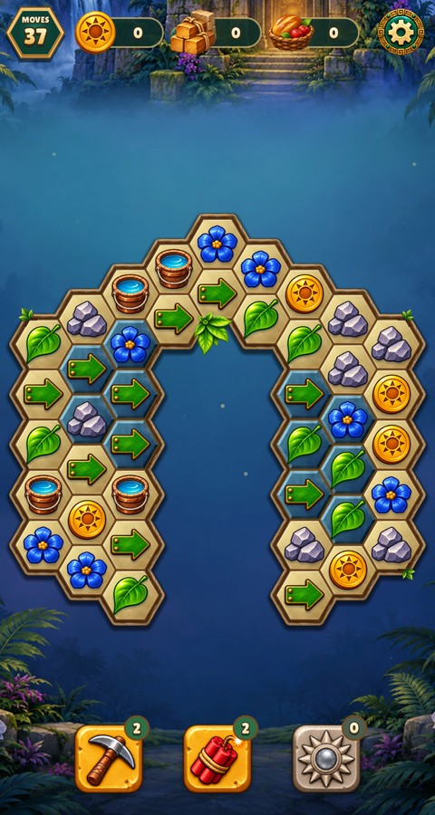
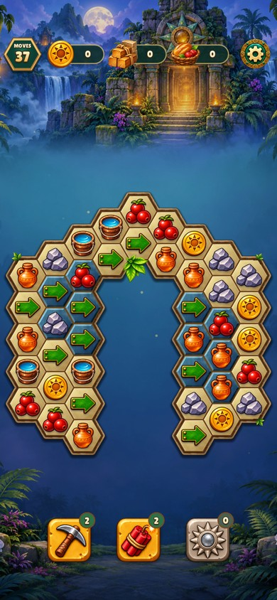
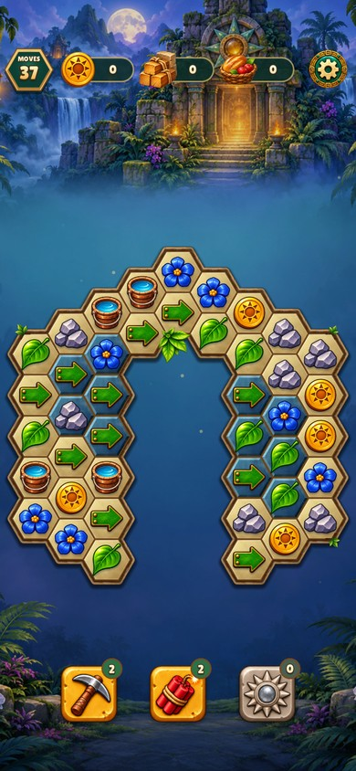
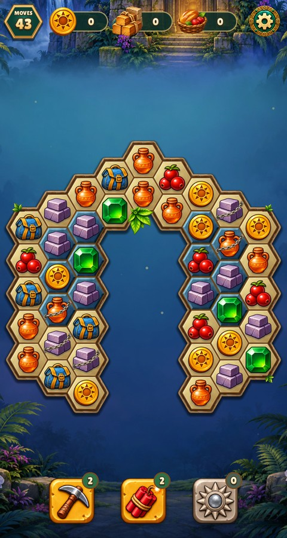
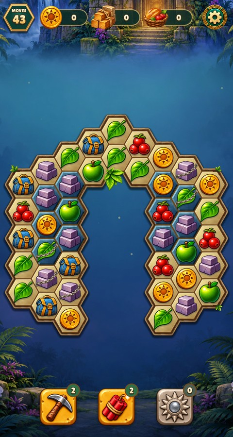
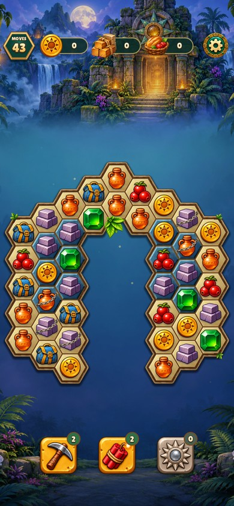
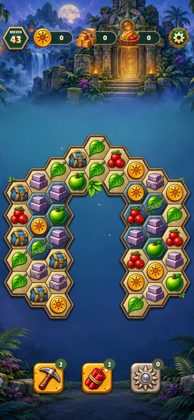
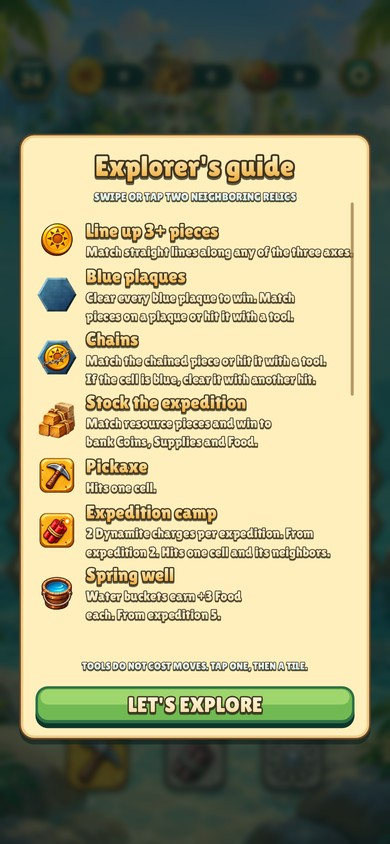
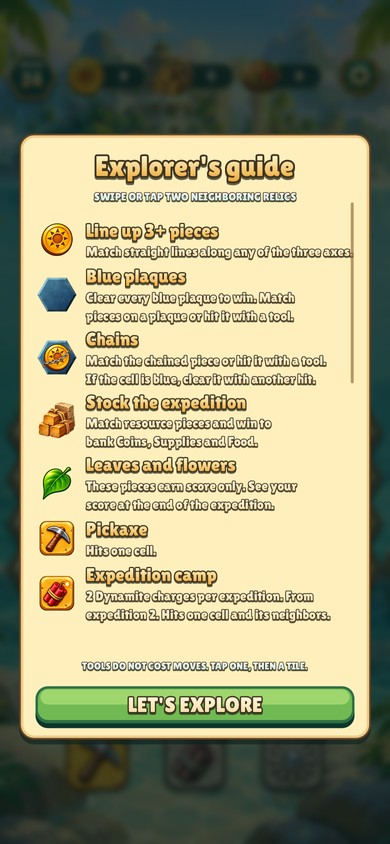

# Green apple and score pieces

The apple occupies the green Food slot. The leaf and the blue flower earn
expedition score only. Level 6 shows both score pieces alongside the Well's
water buckets and the shore marker.

| Screen | Before | After |
| --- | --- | --- |
| Level 6, 480 × 900 |  |  |
| Level 6, 390 × 844 |  |  |
| Level 9, 480 × 900 |  |  |
| Level 9, 390 × 844 |  |  |
| Guide, 390 × 844 |  |  |

Reproduce with `build/test/relic-rush "shot dressing-shore" "shot floating-hud" "shot phone-floating-hud" "shot phone-guide"`.
